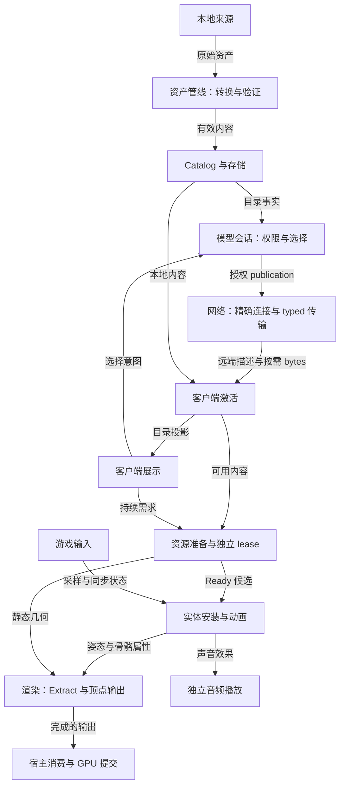

# 系统架构

YSM 用基岩版模型替换 Minecraft 中玩家、投射物和载具的视觉呈现。Java 领域层拥有来源、权限、发布、实体状态与资源生命周期；native 提供计算能力；Minecraft / Forge 提供游戏事实、连接与 GPU 提交环境。

产品义务以[产品决策](../product-decisions/README.md)为准，格式和协议以[标准](../standards/README.md)为准。格式、协议与运行行为仍为 unstable；支持范围与差异见[当前状态](../status/support-and-verification.md)。

## 主数据流

边表示交付数据或意图，不代表共享写入权。远端路径只在对应会话权威生效时使用；local 模式使用本地目录与选择。

目录发布、内容激活、target Ready、实体安装和宿主消费有独立完成条件。前一阶段成功不证明后一阶段可用；选择消息也不隐式取得模型 body。音频接纳播放后保有独立寿命，不由触发它的 installation 退休追溯终止。

## 系统边界

| 职责 | 输入与结果 | 设计入口 |
|---|---|---|
| 运行组合 | 宿主窗口 → 进程、服务及连接作用域 | [Runtime](runtime/overview.md) |
| 资产管线 | 来源 → 已验证容器与模型视图 | [转换与兼容](asset-pipeline/overview.md) |
| 模型管理 | 来源、权限与需求 → 目录、内容与资源 lease | [核心模型及下级职责](model-management/overview.md) |
| 网络 | 精确连接与权威事实 → publication、按需传输与状态投影 | [连接与传输](network/overview.md) |
| 动画 | 资产与实体输入 → 私有求值、姿态与受控效果 | [实体与 Molang](animation/overview.md) |
| 渲染 | 静态几何与姿态 → 宿主可消费的顶点 | [渲染管线](rendering/overview.md) |
| Native 能力 | 显式输入与 buffer → 有界计算结果 | [能力与 JNI](native-runtime/overview.md) |
| 客户端展示 | 目录与交互 → 页面展示、需求和选择意图 | [页面设计](client-presentation/overview.md) |
| 游戏与扩展接入 | 宿主事件与上下文 → 领域 owner 的调用窗口 | [接入设计](integration/overview.md) |

相邻模块不共同修改同一份权威状态。跨域组合先提交所属事实，再通知消费者；通知失败不回滚已提交事实。Provider 拥有接口契约，组合层只拥有必要组合规则。子系统目录可递归展开，目录父子关系不等于运行时 ownership。

## 作用域与终结

[Runtime](runtime/overview.md#运行作用域与所有权)定义进程、客户端服务、游戏服务端、exact connection 与实体的寿命。Shared worker、Catalog 和合法资源保留不随单次连接结束；同一 JVM 内的客户端和 integrated server 仍独立修改状态。

发布资格、活动使用与物理回收是不同事实。Owner 撤销资格后拒收迟到结果，仍负责原工作终态；消费者只撤自身 interest 或 lease。资源最终关闭取决于剩余保留和宿主交接，不能以 GC、超时或另一侧关闭证明本侧完成。

## 按问题定位

跨子系统关系有三个阅读入口，精确规则仍归各设计正文：

- [资源所有权与配额](views/resource-ownership.md)：按 owner 比较生命周期根、共享保留、关闭责任与内存预算。
- [资源生命周期场景](views/resource-lifecycle.md)：reload、连接撤销、实体退休及服务关闭的影响。
- [实体表现状态组合](views/entity-presentation-state.md)：指派、Ready、安装、通道许可与当次消费的关系，以及世界、GUI 和第一人称的差异。

| 问题 | 权威入口 |
|---|---|
| 连接替换后哪些结果失去提交资格？ | [网络撤销交接](network/overview.md#连接撤销交接)、[模型会话](model-management/sessions/overview.md) |
| Reload 后为何仍能保留旧安装？ | [Catalog](model-management/catalog/overview.md)、[客户端资源](model-management/client-resources/overview.md)、[实体生命周期](animation/entity-lifecycle.md) |
| 动画触发结束后，播放与 PCM 为何还在？ | [音频设计](model-management/audio/overview.md) |
| 实体 retire 与物理释放有何区别？ | [实体生命周期](animation/entity-lifecycle.md)、[资源保留](model-management/client-resources/overview.md)、[内存边界](native-runtime/overview.md) |
| 线程容量、发布顺序和关闭由谁约束？ | [有限工作](runtime/overview.md#有限工作与发布)、[结束与替换](runtime/overview.md#结束与替换) |
| 当前责任映射在哪里？ | 各设计入口的“实现与验证入口”；[运行接入映射](runtime/implementation/lifecycle-and-publication.md) |
| 如何修改层次、裁剪实现细节并修复依赖？ | [架构文档维护](../governance/architecture-docs.md) |

机制成本与归约机会见[复杂度地图](../complexity-map/README.md)。本页导航不拥有下级资源清单或状态定义。
