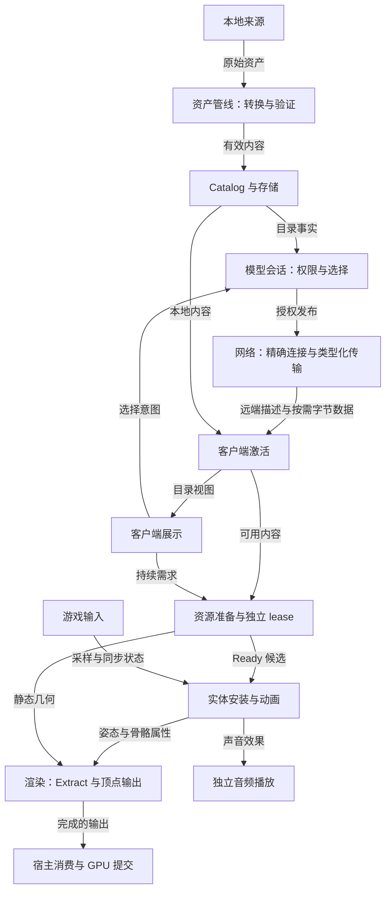

# 系统架构

YSM 用基岩版模型替换 Minecraft 中玩家、投射物和载具的视觉呈现。Java 领域层负责来源、权限、发布、实体状态与资源生命周期，native 提供计算能力，Minecraft 与 Forge 提供游戏事实、网络连接与 GPU 提交环境。

产品义务以[产品决策](../product-decisions/README.md)为准，格式和协议以[标准](../standards/README.md)为准。当前格式、协议与运行行为仍处于不稳定阶段，支持范围与已知差异见[当前状态](../status/support-and-verification.md)。

## 主数据流

下图展示各模块间的数据和意图流向：箭头代表交付数据或请求意图，不代表共享写入权。远端路径仅在对应会话权威生效时启用，本地模式则直接使用本地目录与选择。

目录发布、内容激活、target Ready、实体安装和宿主消费各自有独立的完成条件：前一阶段成功并不保证后一阶段可用，选择消息也不会隐式拉取模型主体数据。音频一旦被接纳播放，就拥有独立生命周期，不会随着触发它的实体安装退休而被追溯终止。

## 系统边界

| 职责 | 输入与结果 | 契约入口 |
|---|---|---|
| 运行组合 | 宿主窗口 → 进程、服务及连接作用域 | [Runtime](runtime/overview.md#seam-contract) |
| 资产管线 | 来源 → 已验证容器与模型视图 | [转换与兼容](asset-pipeline/overview.md#seam-contract) |
| 模型管理 | 来源、权限与需求 → 目录、内容与资源 lease | [核心模型及下级职责](model-management/overview.md#seam-contract) |
| 网络 | 精确连接与权威事实 → 目录发布、按需传输与状态同步 | [连接与传输](network/overview.md#seam-contract) |
| 动画 | 资产与实体输入 → 私有求值、姿态与受控效果 | [实体与 Molang](animation/overview.md#seam-contract) |
| 渲染 | 静态几何与姿态 → 宿主可消费的顶点 | [渲染管线](rendering/overview.md#seam-contract) |
| Native 能力 | 显式输入与 buffer → 有界计算结果 | [能力与 JNI](native-runtime/overview.md#seam-contract) |
| 客户端展示 | 目录与交互 → 页面展示、需求和选择意图 | [页面设计](client-presentation/overview.md#seam-contract) |
| 游戏与扩展接入 | 宿主事件与上下文 → 领域 owner 的调用窗口 | [接入设计](integration/overview.md#seam-contract) |

相邻模块不会共同修改同一份权威状态。跨模块协作时，先提交本模块的权威状态，再通知下游消费者；即使通知失败，也不会回滚已提交的状态。各提供方负责自己的接口契约，组合层只保留必要的跨模块规则。子系统目录可按职责继续递归拆分，目录上的父子关系不代表运行时的所有权归属。

各入口的职责章节继续导航到下级子系统，包括没有独立目录的单页子系统。Seam 的适用范围、划分方式及格式见[设计指南](../development/design.md#契约与责任)，消费者核对与使用保证见[实现指南](../development/implementation.md#使用保证与保护责任)。

## 作用域与终结

[Runtime](runtime/overview.md#运行作用域与所有权)定义了进程、客户端服务、游戏服务端、精确连接与实体的生命周期。共享 worker、Catalog 和仍有效的资源保留不会随单次连接结束而释放；即使客户端和集成服务端运行在同一 JVM 内，双方也各自维护状态，互不直接写入。

发布资格、活动使用与物理回收是三件独立的事。Owner 撤销发布资格后会拒收迟到结果，但仍负责把已启动的原工作收尾；消费者只撤销自己的需求登记或 lease。资源最终何时物理关闭，取决于剩余的保留者和宿主交接，不能以 GC、超时或另一侧关闭来证明本侧已经完成。

## 按问题定位

跨子系统关系可以通过以下横向视图阅读，精确规则仍以各设计正文为准：

- [资源所有权与配额](views/resource-ownership.md)：按 owner 比较生命周期根、共享保留、关闭责任与内存预算。
- [资源生命周期场景](views/resource-lifecycle.md)：比较 reload、连接撤销、实体退休及服务关闭的影响。
- [实体表现状态组合](views/entity-presentation-state.md)：理清指派、Ready、安装、通道许可与当次消费的关系，以及世界、GUI 和第一人称的差异。
- [客户端帧流程与 Seam](views/client-frame-seams.md)：梳理 tick、主线程任务、世界实体、Iris shadow、手部与 GUI 的调用窗口。

| 问题 | 权威入口 |
|---|---|
| 连接替换后哪些结果失去提交资格？ | [网络撤销交接](network/overview.md#连接撤销交接)、[模型会话](model-management/sessions/overview.md) |
| Reload 后为何仍能保留旧安装？ | [Catalog](model-management/catalog/overview.md)、[客户端资源](model-management/client-resources/overview.md)、[实体生命周期](animation/entity-lifecycle.md) |
| 动画触发结束后，播放与 PCM 为何还在？ | [音频设计](model-management/audio/overview.md) |
| 实体 retire 与物理释放有何区别？ | [实体生命周期](animation/entity-lifecycle.md)、[资源保留](model-management/client-resources/overview.md)、[内存边界](native-runtime/overview.md) |
| 线程容量、发布顺序和关闭由谁约束？ | [有限工作](runtime/overview.md#有限工作调度与领域交接)、[结束与替换](runtime/overview.md#结束与替换) |
| 当前责任映射在哪里？ | 各设计入口的“实现与验证入口”；[运行接入映射](runtime/implementation/lifecycle-and-publication.md) |
| 如何修改层次、裁剪实现细节并修复依赖？ | [架构文档维护](documentation-rules.md) |

机制成本与归约机会见[复杂度地图](../complexity-map/README.md)。
