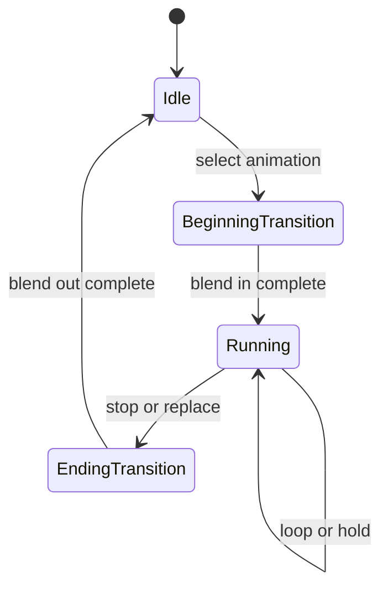

# Controller、播放与声音触发

上级契约：[动画](overview.md#seam-contract)。

## 职责与边界

本页展开[动画时间推进](overview.md#时间推进与观察)与[声音边界](overview.md#声音与宿主)。Controller 的来源不改变实体私有时间线、效果门禁或最终骨骼契约。

## Seam Contract

| 消费者问题 | 契约 |
|---|---|
| Processor 如何取得本次动作、状态和播放时间线？ | [动作选择与播放](#动作选择与播放) |
| 作者声音事件如何交给宿主播放，如何控制同 ID？ | [声音触发与宿主播放](#声音触发与宿主播放) |

### 共同规则

适用范围：[动作选择与播放](#动作选择与播放)和[声音触发与宿主播放](#声音触发与宿主播放)均继承本节的输入定义、副作用阶段、实体执行权及证据限制。解析缓存属于播放内部，不建立独立播放或资源生命周期。

Animation 和 controller 的名称、引用、时间单位与 wire 约束见 [Model Schema](../../standards/model-schema/assets-and-validation.md)，本页不复制字段结构。

#### 副作用阶段

主时间线触发 instruction keyframe，真实 state transition 触发 on-entry/on-exit；其他 `RenderContext` 重算走 observation。连续骨骼采样与 controller animation 选择的入口上限为 CONTEXT；instruction、on-entry/on-exit、coded predicate 和显式动作入口为 ACTION。共享函数继承实际入口，callee 自身 effect 不升权；入口授权不取代原 allowEmitting、batch 和宿主提交资格。它们使用[Molang runtime 的门禁与失败规则](molang-runtime.md#求值失败)。

本页依赖[动画时间推进](overview.md#时间推进与观察)、[实体执行权](entity-lifecycle.md#执行权与任务交接)与[Molang 许可及失败](molang-runtime.md#seam-contract)。实际联动、声音和多 pass 的证据范围由[动画问题](../../status/known-issues/animation.md)限定。

### 动作选择与播放

**边界与权威**

Controller 拥有当前实体使用中的动作选择、播放推进与声音触发。动画名称的存在、来源身份与可缓存性由[资源解析方](../model-management/client-resources/implementation/resource-ownership.md#动画解析与保留)裁决；本层缓存复用解析结果，不接管资源事实权威。

本契约向 Processor 提供当前动作和播放输出；资源缓存与播放保留属于同一实体使用。继承[共同规则](#共同规则)。

**前置条件与输入**

动画和 controller 输入遵守[共同规则](#共同规则)中的 Schema 与执行资格。

**结果与保证**

#### 播放状态

Player 支持循环、单次播放和保持末帧。选择与当前相同的 animation 不会隐式重启；显式 reload 或状态重置才重建时间线。Coded controller 还可返回继续、暂停或停止，用于区分推进时间、保持当前值和结束播放。

手部 hold/use/swing 的 coded 播放由 `ModelOriginVersion` 选择兼容规则：内部 `originVer < 19` 时，hold/use 强制循环，swing 强制单次；较新模型使用动画文件的播放类型。经默认动画补全取得的动画始终使用文件类型，资源解析结果保留本次 fallback 来源，不修改共享 Animation。该映射只恢复 Java 播放语义，不改变 native UV 版本选择。

#### Bedrock 状态机

- 从声明的 default state 开始；每次按声明顺序检查 transition，第一个成立者获胜。
- 一个 state 可以按条件激活多个 animation，结果进入同一 controller 的混合流程。
- 空 state 可以继续跳转，但应检测环路，避免单次更新无限迁移。
- State 可以引用子 controller；嵌套仍服从同一实体时间线、Molang 上下文与副作用门禁。
- On-entry、on-exit 与 instruction keyframe 是动作阶段，不属于连续骨骼采样；重复求值不能无条件重复触发。

#### Coded controller override

模型可以为 coded controller 声明 override handler：controller 名中的 `.` 换成 `_ctrl_` 后作为事件名，取该事件下首个 handler。无参数 F32 调用成功返回精确 2/3/4 时分别选择继续/停止/暂停；缺失、其他值或普通执行失败均委托 Java predicate。成功状态由当前 typed 调用的正常返回/异常区分，不由旧 sticky failure 或数值 0 伪造。整次 evaluation 先前失败仍阻止 batch 提交；严重返回违约继续交给 owner，见[Molang runtime](molang-runtime.md#求值失败)。

**所有权与时序**

#### 解析缓存与播放寿命

每个运行时 Coded／Bedrock controller 缓存当前来源的稳定成功和证实缺失；同一 Bedrock controller 的 player 共用解析结果，子 controller 自有缓存。缓存不共享播放、随机或状态机历史。缓存命中不查询共享 store，也不建立 read batch；predicate 等直接资源查询仍由资源层服务。来源身份与可缓存性由[动画资源解析](../model-management/client-resources/implementation/resource-ownership.md#动画解析与保留)裁决。

兼容纹理重绑定在新查询前清除缓存和旧缺失的同名跳过资格，同时保留已取得动画的播放历史。暂态失败和失败 fallback 不取得同名跳过资格；player 在后续求值重试，Bedrock 无需等待状态跳转。重试取得相同替代动画时继续原时间线，取得新动画时切换。显式重播重建时间线，但可复用已缓存的解析结果。使用结束清除缓存与播放引用。

#### 指令区间推进

离散指令沿经过的主时间线区间保持因果，不能只处理最终采样点；额外观察不重复提交。时间门禁由[动画核心模型](overview.md#时间推进与观察)定义。

**失败与拒收**

目标 animation 不存在时回到 idle，不以随机 fallback 掩盖资源错误；render target 不可用时的系统级回退另见[默认模型](../model-management/client-resources/default-model.md)。

暂态失败、失败 fallback 与兼容重绑定沿[解析缓存与播放寿命](#解析缓存与播放寿命)恢复；coded override 的委托与严重失败沿[覆盖结果](#coded-controller-override)裁决。

资源不可用的系统回退见[实体失败与恢复](entity-lifecycle.md#失败记忆与恢复)。

**证据与依赖**

播放、离散推进及资源来源依赖[动画时间推进](overview.md#时间推进与观察)、[资源解析](../model-management/client-resources/implementation/resource-ownership.md#动画解析与保留)与[Molang 许可及失败](molang-runtime.md#seam-contract)。当前实机范围见[动画问题](../../status/known-issues/animation.md)。

### 声音触发与宿主播放

**边界与权威**

本契约在作者事件的声音作用域与宿主音频接纳之间交接触发和控制。继承[共同规则](#共同规则)。

Instruction sound、controller-state sound 与 `ysm.play_sound` 进入同一 entity/controller 声音作用域。

**前置条件与输入**

#### 声音选择输入

带 `:` 的 selector 使用 Minecraft namespaced sound id；其他 selector 精确匹配当前 target 的 immutable sound map。

音量、pitch、位置、relative/UI、loop 与暂停来自同一作者控制对象。

**结果与保证**

同 tick 的不同作者事件依声明顺序触发。非零 numeric ID 与 string ID 分属不同命名空间；数字 `0` 是匿名播放，字符串 `"0"` 仍是普通 ID。非 force 重复拒绝，force 先 seal 旧 handle；stop 只命中同 ID，作用域 reset/retire 结束自身全部 handle。额外 observation 不重复发声。

**所有权与时序**

后端接纳后的读取、控制与唯一终态由[音频子系统](../model-management/audio/overview.md)拥有。

**失败与拒收**

当前 target 的 sound map 无对应条目时，只拒绝该次触发。

Minecraft 决定 channel/device 调度；拒绝、断粮或设备终止不补播。

**证据与依赖**

接纳后的读取、控制与唯一终态由[音频子系统](../model-management/audio/overview.md)定义；实际声音、联动和多 pass 的证据范围见[动画问题](../../status/known-issues/animation.md)。

## 设计取舍

解析缓存复用资源层已建立的成功与证实缺失，避免每次播放重新裁决来源事实。缓存按 controller 保留解析结果，同时隔离播放、随机与状态机历史；来源替换和暂态失败仍需要原有失效与重试路径。

声音触发只承担作者事件及本作用域控制，独立接纳后的播放交给音频子系统。该分工允许播放按自己的唯一终态结束，代价是触发成功不代表设备已经播放或保证补播。

## 实现与验证入口

`CodedAnimationController`、`BedrockAnimationController` 与 `HybridAnimationController` 分别提供内建、声明与覆盖来源。`AnimationPlayer` 保存播放与转换状态，`AnimationProcessor` 合成输出，`SoundInstanceManager` 保存作用域内 ID 到 pending/已提交 handle 的关联。它们均属于当前实体使用。
