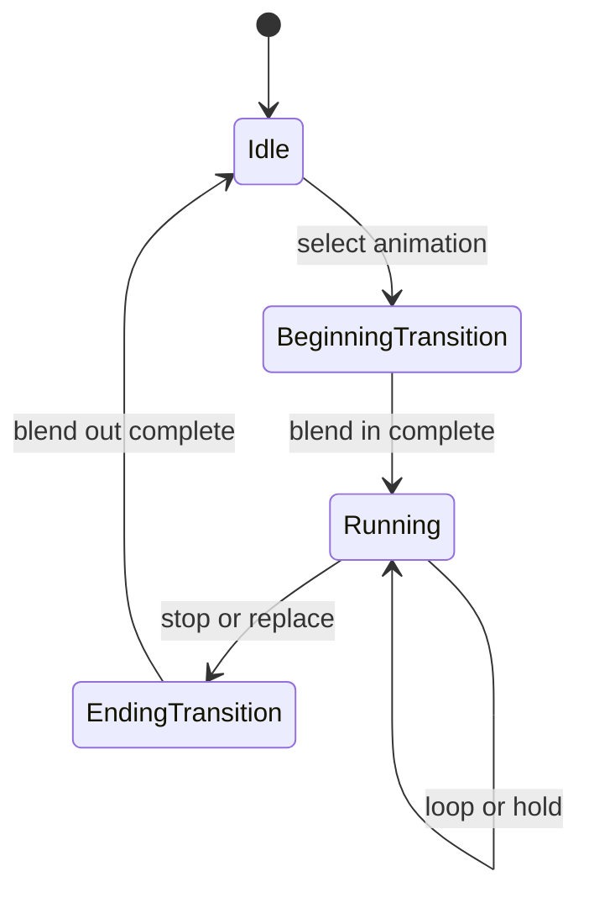

# Controller、播放与声音触发

上级契约：[动画](overview.md#seam-contract)。

## 职责与边界

本页展开[动画时间推进](overview.md#时间推进与观察)与[声音边界](overview.md#声音与宿主)，说明动作选择、播放推进与作者声音事件如何交接。无论 controller 来自内建代码、Bedrock 声明还是混合覆盖，都不会改变实体私有时间线、效果门禁或最终骨骼契约。

## Seam Contract

| 消费者问题 | 契约 |
|---|---|
| Processor 如何取得本次动作、状态和播放时间线？ | [动作选择与播放](#动作选择与播放) |
| 作者声音事件如何交给宿主播放，如何控制同 ID？ | [声音触发与宿主播放](#声音触发与宿主播放) |

### 共同规则

适用范围：[动作选择与播放](#动作选择与播放)和[声音触发与宿主播放](#声音触发与宿主播放)均继承本节的输入定义、副作用阶段、实体执行权及证据限制。解析缓存属于播放层的内部优化，不建立独立的播放或资源生命周期。

Animation 和 controller 的名称、引用、时间单位与线缆格式约束见 [Model Schema](../../standards/model-schema/assets-and-validation.md)，本页不重复字段结构。

#### 副作用阶段

主时间线推进会触发 instruction keyframe，真实的状态切换会触发 on-entry 与 on-exit；同帧内的其他 `RenderContext` 重算只走 observation 路径。连续骨骼采样与 controller 动画选择的入口权限上限为 CONTEXT；instruction、on-entry 与 on-exit、coded predicate 以及显式动作入口的上限为 ACTION。共享函数继承实际调用入口的权限，被调函数自身声明的 effect 不会提升权限；入口权限还须与当次宿主 `allowEmitting` 窗口取交集。这些门禁与失败处理均遵守[Molang runtime 的门禁与失败规则](molang-runtime.md#求值失败)。

本页依赖[动画时间推进](overview.md#时间推进与观察)、[实体执行权](entity-lifecycle.md#执行权与任务交接)与[Molang 许可及失败](molang-runtime.md#seam-contract)。实际模组联动、声音和多 pass 场景的验证范围由[动画问题](../../status/known-issues/animation.md)限定。

### 动作选择与播放

**边界与权威**

Controller 负责当前实体使用中的动作选择、播放推进与声音触发，向 `AnimationProcessor` 提供当前动作与播放输出。动画名称是否存在、来源身份以及是否允许缓存，由[资源解析方](../model-management/client-resources/implementation/resource-ownership.md#动画解析与保留)决定；本层缓存只复用解析结果，不接管资源事实的权威。资源缓存与播放状态的寿命都归属于当前实体使用。本契约继承[共同规则](#共同规则)。

**前置条件与输入**

动画和 controller 输入须遵守[共同规则](#共同规则)中的 Schema 定义与实体执行资格。

**结果与保证**

#### 播放状态

Player 支持循环、单次播放和保持末帧三种播放模式。再次选择与当前相同的动画不会隐式重启，只有显式 reload 或状态重置才会重建时间线。Coded controller 还可以返回继续、暂停或停止，分别对应推进时间、保持当前姿态和结束播放。

手部 hold、use 与 swing 动作的 coded 播放按 `ModelOriginVersion` 选用兼容规则：当内部 `originVer < 19` 时，hold 与 use 强制循环，swing 强制单次；较新模型则遵循动画文件自身的播放类型。经默认动画补全取得的动画始终使用文件自身的播放类型，资源解析结果会记录本次 fallback 来源，不修改共享的 `Animation` 对象。这项映射只恢复 Java 侧的播放语义，不影响 native UV 版本选择。

#### Bedrock 状态机

- 从声明的 default state 开始；每次求值按声明顺序检查 transition，第一个条件成立的转换生效。
- 单个 state 可以按条件同时激活多个 animation，这些动画进入同一个 controller 的混合流程。
- 空 state 可以继续跳转，但必须检测环路，防止单次更新陷入无限迁移。
- State 可以引用子 controller，嵌套的子 controller 仍服从同一条实体时间线、同一个 Molang 上下文和相同的副作用门禁。
- On-entry、on-exit 与 instruction keyframe 属于动作阶段，不属于连续骨骼采样，因此重复观察不能无条件重复触发。

#### Coded controller override

模型可以为 coded controller 声明覆盖处理器（override handler）：将 controller 名称中的 `.` 替换为 `_ctrl_` 作为事件名，并取该事件下的首个 handler。该 handler 以无参数 F32 形式调用，精确返回 2、3 或 4 时分别表示继续、停止或暂停；如果 handler 缺失、返回其他数值或发生普通执行失败，则退回委托给 Java predicate。调用是否成功由当前类型化调用的正常返回或抛出异常区分，不依靠旧的粘性失败标志（sticky failure）或数值 0 来判断。覆盖过程中产生的普通动作立即生效；若发生严重返回违约，仍交由 owner 按[Molang runtime](molang-runtime.md#求值失败)处理。

**所有权与时序**

#### 解析缓存与播放寿命

每个运行时的 Coded 或 Bedrock controller 都会缓存当前来源下已证实的成功结果和缺失结果。同一 Bedrock controller 下的各个 player 共用这份解析结果，子 controller 拥有自己的独立缓存。缓存只复用解析结果，不共享播放进度、随机状态或状态机历史。命中缓存时不查询共享 store，也不建立 read batch；predicate 等直接资源查询仍由资源层直接服务。来源身份与可缓存性由[动画资源解析](../model-management/client-resources/implementation/resource-ownership.md#动画解析与保留)决定。

发生兼容纹理重绑定时，会在新查询前刷新 view，清除与绑定相关的缓存以及旧缺失项的同名跳过资格，同时原位保留 controller、播放时间线、current 与 next 动画及事件游标。重绑定不会触发重置时间线的模型更新，也不会重放初始化或事件。暂态失败和失败 fallback 不会获得同名跳过资格：player 会在后续求值中重试，Bedrock 也不必等待状态跳转。如果重试拿到了相同的替代动画，就延续原时间线；拿到新动画则切换播放。显式重播会重建时间线，但仍可复用已缓存的解析结果。

模型使用结束时，先清除缓存、current、next、lastResolved、骨骼队列和来源引用，再归还实体执行借用。共享定义、动画与程序的保留统一遵循[store 所有权](../model-management/client-resources/overview.md#动画资源所有权与退休)，私有播放状态不会因为 target 仍在 Ready 缓存中而延长寿命。

#### 指令区间推进

离散指令沿主时间线实际经过的时间区间保持因果顺序，不能只处理最终采样点；同帧的额外观察不重复提交。时间门禁由[动画核心模型](overview.md#时间推进与观察)定义。

**失败与拒收**

目标动画不存在时，player 回到 idle，不会用随机 fallback 掩盖资源错误；render target 不可用时的系统级回退另见[默认模型](../model-management/client-resources/default-model.md)。

暂态失败、失败 fallback 与兼容重绑定的恢复路径见[解析缓存与播放寿命](#解析缓存与播放寿命)；coded override 的回退委托与严重失败处理见[覆盖结果](#coded-controller-override)。

资源不可用时的系统级回退见[实体失败与恢复](entity-lifecycle.md#失败记忆与恢复)。

**证据与依赖**

播放推进、离散区间及资源解析依赖[动画时间推进](overview.md#时间推进与观察)、[资源解析](../model-management/client-resources/implementation/resource-ownership.md#动画解析与保留)与[Molang 许可及失败](molang-runtime.md#seam-contract)。当前实机验证范围见[动画问题](../../status/known-issues/animation.md)。

### 声音触发与宿主播放

**边界与权威**

本契约在作者事件的声音作用域与宿主音频接纳层之间交接声音触发与控制，继承[共同规则](#共同规则)。Instruction 声音、controller 状态声音与 `ysm.play_sound` 进入同一个实体与 controller 声音作用域。

**前置条件与输入**

#### 声音选择输入

带 `:` 的 selector 按 Minecraft 带命名空间的声音 ID 解析；其余 selector 精确匹配当前 target 的不可变 sound map。音量、音高（pitch）、位置、relative 或 UI 标记、循环与暂停选项来自同一个作者控制对象。

**结果与保证**

同一个 tick 内的不同作者声音事件按声明顺序触发。非零数字 ID 与字符串 ID 分属不同的命名空间：数字 `0` 表示匿名播放，而字符串 `"0"` 仍是普通命名 ID。未开启 `force` 时，重复触发同一 ID 会被拒绝；开启 `force` 时，会先封口旧句柄再启动新播放。`stop` 只作用于同 ID 的播放，作用域 reset 或 retire 会结束本作用域内的全部句柄。额外观察不会重复发声。

**所有权与时序**

声音一旦被后端接纳，后续的音频读取、控制与唯一终态均由[音频子系统](../model-management/audio/overview.md)负责。

**失败与拒收**

当前 target 的 sound map 中找不到对应条目时，只拒绝这一次触发。音频通道与设备调度由 Minecraft 决定，遇到拒绝、断粮或设备终止时不补播。

**证据与依赖**

音频接纳后的读取、控制与唯一终态由[音频子系统](../model-management/audio/overview.md)定义；实际声音表现、模组联动和多 pass 的证据范围见[动画问题](../../status/known-issues/animation.md)。

## 设计取舍

- **在 controller 层缓存资源解析结果**：复用资源层已经确定的成功和证实缺失结论，避免每次播放都重新核验来源。缓存按 controller 存放，既隔离了播放进度、随机状态和状态机历史，也保留了来源替换和暂态失败后的失效与重试路径。
- **将声音触发控制与后端播放解耦**：本层只管理作者事件和作用域内控制，接纳后的播放生命周期全部交给音频子系统。这样播放可以按自己的终态独立收尾，代价是触发返回成功并不保证设备已实际发声或失败后会补播。

## 实现与验证入口

`CodedAnimationController`、`BedrockAnimationController` 与 `HybridAnimationController` 分别提供内建、声明和覆盖三种动作来源。`AnimationPlayer` 保存播放与过渡状态，`AnimationProcessor` 合成最终输出，`SoundInstanceManager` 维护作用域内 ID 到待提交或已提交句柄的映射。这些组件均归属于当前实体使用。
