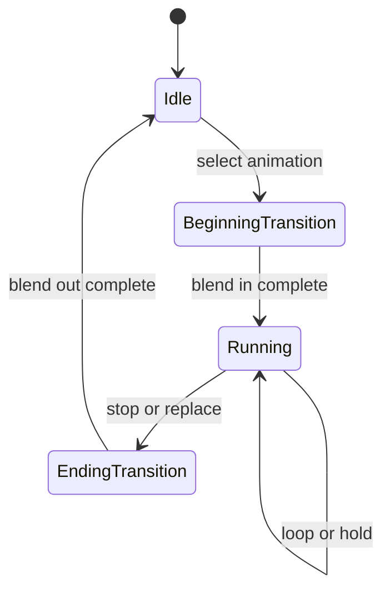

# Controller、播放与声音触发

本页展开[动画时间推进](overview.md#时间推进与观察)与[声音边界](overview.md#声音与宿主)。Controller 的来源不改变实体私有时间线、效果门禁或最终骨骼契约。

## 播放状态

Player 支持循环、单次播放和保持末帧。选择与当前相同的 animation 不会隐式重启；显式 reload 或状态重置才重建时间线。目标 animation 不存在时回到 idle，不以随机 fallback 掩盖资源错误；render target 不可用时的系统级回退另见[默认模型](../model-management/client-resources/default-model.md)。Coded controller 还可返回继续、暂停或停止，用于区分推进时间、保持当前值和结束播放。

手部 hold/use/swing 的 coded 播放由 `ModelOriginVersion` 选择兼容规则：内部 `originVer < 19` 时，hold/use 强制循环，swing 强制单次；较新模型使用动画文件的播放类型。经默认动画补全取得的动画始终使用文件类型，资源 owner 保留来源标记。该映射只恢复 Java 播放语义，不改变 native UV 版本选择。

## Bedrock 状态机

- 从声明的 default state 开始；每次按声明顺序检查 transition，第一个成立者获胜。
- 一个 state 可以按条件激活多个 animation，结果进入同一 controller 的混合流程。
- 空 state 可以继续跳转，但应检测环路，避免单次更新无限迁移。
- State 可以引用子 controller；嵌套仍服从同一实体时间线、Molang 上下文与副作用门禁。
- On-entry、on-exit 与 instruction keyframe 是动作阶段，不属于连续骨骼采样；重复求值不能无条件重复触发。

Animation 和 controller 的名称、引用、时间单位与 wire 约束见 [Model Schema](../../standards/model-schema/assets-and-validation.md)，本页不复制字段结构。

## Coded controller override

模型可以为 coded controller 声明 override handler：controller 名中的 `.` 换成 `_ctrl_` 后作为事件名，取该事件下首个 handler。无参数 F32 调用成功返回精确 2/3/4 时分别选择继续/停止/暂停；缺失、其他值或普通执行失败均委托 Java predicate。成功状态由当前 typed 调用的正常返回/异常区分，不由旧 sticky failure 或数值 0 伪造，不经过 OptionalInt/Outcome。整次 evaluation 先前失败仍阻止 batch 提交；严重返回违约继续交给 owner，见[Molang runtime](molang-runtime.md#失败与信任边界)。

## 副作用阶段

主时间线触发 instruction keyframe，真实 state transition 触发 on-entry/on-exit；其他 `RenderContext` 重算走 observation。连续骨骼采样与 controller animation 选择的入口上限为 CONTEXT；instruction、on-entry/on-exit、coded predicate 和显式动作入口为 ACTION。共享函数继承实际入口，callee 自身 effect 不升权；入口授权不取代原 allowEmitting、batch 和宿主提交资格。它们使用[Molang runtime 的门禁与失败规则](molang-runtime.md#失败与信任边界)，实机覆盖见[动画已知问题](../../status/known-issues/animation.md)。

## 声音触发与宿主播放

Instruction sound、controller-state sound 与 `ysm.play_sound` 进入同一 entity/controller 声音作用域。带 `:` 的 selector 使用 Minecraft namespaced sound id；其他 selector 精确匹配当前 target 的 immutable sound map，缺失只拒绝该次触发。

同 tick 的不同作者事件依声明顺序触发。非零 numeric ID 与 string ID 分属不同命名空间；数字 `0` 是匿名播放，字符串 `"0"` 仍是普通 ID。非 force 重复拒绝，force 先 seal 旧 handle；stop 只命中同 ID，作用域 reset/retire 结束自身全部 handle。额外 observation 不重复发声。

后端接纳后的读取、控制与唯一终态由[音频子系统](../model-management/audio/overview.md)拥有。Minecraft 决定 channel/device 调度；拒绝、断粮或设备终止不补播。音量、pitch、位置、relative/UI、loop 与暂停来自同一作者控制对象。

## 指令区间推进

离散指令沿经过的主时间线区间保持因果，不能只处理最终采样点；额外观察不重复提交。时间门禁由[动画核心模型](overview.md#时间推进与观察)定义。

## 实现与验证入口

`CodedAnimationController`、`BedrockAnimationController` 与 `HybridAnimationController` 分别提供内建、声明与覆盖来源。`AnimationPlayer` 保存播放与转换状态，`AnimationProcessor` 合成输出，`SoundInstanceManager` 保存作用域内 ID 到 pending/已提交 handle 的关联。它们均属于当前实体使用。

资源不可用的系统回退见[实体失败与恢复](entity-lifecycle.md#失败记忆与恢复)。实机与联动证据见[动画问题](../../status/known-issues/animation.md)。
