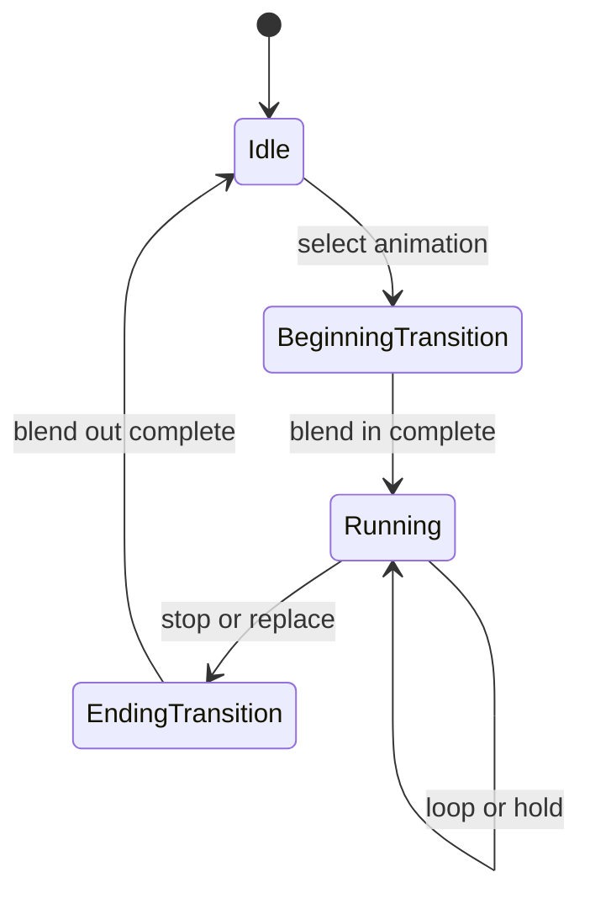

# Controller、播放与声音触发

上级契约：[动画](overview.md#seam-contract)。

## 职责与边界

本页展开[动画时间推进](overview.md#时间推进与观察)与[声音边界](overview.md#声音与宿主)，说明动作选择、播放推进与作者声音事件交接。内建代码、Bedrock 声明与混合覆盖 controller 共用同一套实体私有时间线、效果门禁和骨骼输出边界。

## Seam Contract

| 消费者问题 | 契约 |
|---|---|
| Processor 如何取得本次动作、状态和播放时间线？ | [动作选择与播放](#动作选择与播放) |
| 作者声音事件如何交给宿主播放，如何控制同 ID？ | [声音触发与宿主播放](#声音触发与宿主播放) |

### 共同规则

适用范围：[动作选择与播放](#动作选择与播放)和[声音触发与宿主播放](#声音触发与宿主播放)。

Animation 与 controller 的名称、引用、时间单位与格式规范见 [Model Schema](../../standards/model-schema/assets-and-validation.md)。解析缓存是播放层内部优化，不建立独立生命周期。

#### 副作用阶段

主时间线推进触发 instruction keyframe，真实状态切换触发 on-entry 与 on-exit；同帧内其他 `RenderContext` 重算走 observation 路径。连续骨骼采样与 controller 动画选择的入口权限上限为 CONTEXT；instruction、on-entry/on-exit、coded predicate 与显式动作入口上限为 ACTION。共享函数继承实际调用入口权限，与当次宿主 `allowEmitting` 窗口取交集；门禁与失败处理见[Molang runtime](molang-runtime.md#求值失败)。

依赖[动画时间推进](overview.md#时间推进与观察)、[实体执行权](entity-lifecycle.md#执行权与任务交接)与[Molang 许可及失败](molang-runtime.md#seam-contract)；实际模组联动、声音和多 pass 验证范围见[动画问题](../../status/known-issues/animation.md)。

### 动作选择与播放

**边界与权威**

Controller 负责当前实体使用中的动作选择、播放推进与声音触发，向 `AnimationProcessor` 输出播放结果。动画存在性、来源身份与可缓存性由[资源解析方](../model-management/client-resources/implementation/resource-ownership.md#动画解析与保留)决定；解析缓存与播放状态寿命归属于当前实体使用。

**结果与保证**

#### 播放状态

Player 支持循环、单次播放与保持末帧三种模式；重选当前动画不隐式重启，仅显式 reload 或状态重置重建时间线。Coded controller 还可返回继续、暂停或停止。

手部 hold、use、swing 的 coded 播放按 `ModelOriginVersion` 选用兼容规则：内部 `originVer < 19` 时 hold/use 强制循环、swing 强制单次，较新模型遵循动画文件自身播放类型；经默认动画补全取得的动画始终用文件自身类型（资源解析记录 fallback 来源而不改共享 `Animation` 对象）。该映射仅作用于 Java 播放语义，不影响 native UV 版本。

#### Bedrock 状态机

- 从声明的 default state 开始；每次求值按声明顺序检查 transition，首个成立条件生效。
- 单 state 可按条件同时激活多个 animation 并进入同一 controller 混合流程。
- 空 state 可连续跳转，但需检测环路防止单次更新死循环。
- State 可引用子 controller，子 controller 仍共用同一实体时间线、Molang 上下文与副作用门禁。
- On-entry、on-exit 与 instruction keyframe 属动作阶段，重复观察不重复触发。

#### Coded controller override

模型可为 coded controller 声明覆盖处理器：将 controller 名称中的 `.` 替换为 `_ctrl_` 作为事件名并取首个 handler，以无参 F32 调用，精确返回 2/3/4 分别表示继续/停止/暂停；handler 缺失、返回其他值或发生普通执行失败时回退 Java predicate。调用成败由类型化返回或抛异常区分，不依赖粘性失败标志或数值 0。覆盖中已产生的普通动作立即生效，严重违约交 owner 按[Molang runtime](molang-runtime.md#求值失败)处理。

**所有权与时序**

#### 解析缓存与播放寿命

每个运行时的 Coded 或 Bedrock controller 缓存当前来源下已证实的成功与缺失结果（同一 Bedrock controller 下各 player 共用，子 controller 独立），只复用解析结果，不共享播放进度、随机状态或状态机历史；命中时不查共享 store 也不建 read batch（predicate 直接查询仍走资源层）。

兼容纹理重绑定时，在新查询前刷新 view，清除绑定相关缓存及旧缺失项的同名跳过资格，原位保留 controller、时间线、current/next 动画及事件游标，不重放初始化或事件。暂态失败和失败 fallback 不获得同名跳过资格，后续求值重试：拿到相同替代动画延续原时间线，拿到新动画则切换。显式重播重建时间线但仍复用解析缓存。

模型使用结束时，先清缓存、current、next、lastResolved、骨骼队列与来源引用，再归还实体执行借用；共享定义、动画与程序保留见[store 所有权](../model-management/client-resources/overview.md#动画资源所有权与退休)。

#### 指令区间推进

离散指令沿主时间线实际经过的时间区间保持因果顺序，不只处理最终采样点；同帧额外观察不重复提交（见[动画核心模型](overview.md#时间推进与观察)）。

**失败与拒收**

目标动画不存在时 player 回到 idle，不用随机 fallback 掩盖资源错误；render target 不可用时的系统级回退见[默认模型](../model-management/client-resources/default-model.md)与[实体失败与恢复](entity-lifecycle.md#失败记忆与恢复)。

### 声音触发与宿主播放

**前置条件与输入**

#### 声音选择输入

Instruction 声音、controller 状态声音与 `ysm.play_sound` 共用同一实体/controller 声音作用域。带 `:` 的 selector 按 Minecraft 命名空间声音 ID 解析，其余精确匹配当前 target 不可变 sound map；音量、音高、位置、relative/UI 标记、循环与暂停选项来自同一作者控制对象。

**结果与保证**

同一 tick 内的作者声音事件按声明顺序触发。非零数字 ID 与字符串 ID 分属不同命名空间：数字 `0` 表示匿名播放，字符串 `"0"` 为普通命名 ID。未开启 `force` 时重复触发同 ID 被拒绝；开启 `force` 时先封口旧句柄再启动新播放。`stop` 只作用于同 ID，作用域 reset/retire 结束本作用域内全部句柄。额外观察不重复发声。

**所有权与时序**

声音经后端接纳后，读取、控制与唯一终态交由[音频子系统](../model-management/audio/overview.md)负责。

**失败与拒收**

当前 target sound map 缺失条目时仅拒绝本次触发；音频通道与设备调度由 Minecraft 决定，拒绝、断粮或设备终止时不补播。

## 设计取舍

- **在 controller 层缓存资源解析结果**：复用资源层已经确定的成功和证实缺失结论，避免每次播放都重新核验来源。缓存按 controller 存放，既隔离了播放进度、随机状态和状态机历史，也保留了来源替换和暂态失败后的失效与重试路径。
- **将声音触发控制与后端播放解耦**：本层只管理作者事件和作用域内控制，接纳后的播放生命周期全部交给音频子系统。这样播放可以按自己的终态独立收尾，代价是触发返回成功并不保证设备已实际发声或失败后会补播。

## 实现与验证入口

`CodedAnimationController`、`BedrockAnimationController` 与 `HybridAnimationController` 分别提供内建、声明和覆盖三种动作来源。`AnimationPlayer` 保存播放与过渡状态，`AnimationProcessor` 合成最终输出，`SoundInstanceManager` 维护作用域内 ID 到待提交或已提交句柄的映射。这些组件均归属于当前实体使用。
