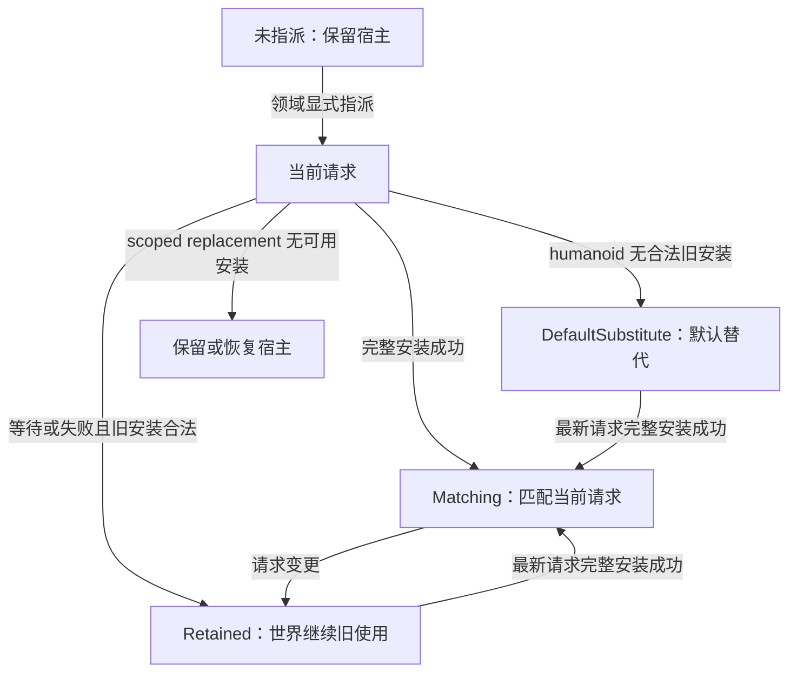
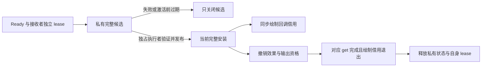

# 实体模型使用与生命周期

上级契约：[动画](overview.md#seam-contract)。

## 职责与边界

本页细化[动画的结束与复用](overview.md#实体使用的结束与复用)。实体生命周期根负责协调模型指派、完整安装、求值调度与同步借用；[客户端资源](../model-management/client-resources/overview.md)只负责交付 Ready 状态和独立 lease，不替实体发布私有状态。

## Seam Contract

| 消费者问题 | 契约 |
|---|---|
| 当前指派、Ready 候选、完整安装及其使用何时成立或结束？ | [模型使用与完整安装](#模型使用与完整安装) |
| 调度方何时交出或收回私有更新态，GUI 许可允许什么？ | [执行权与任务交接](#执行权与任务交接) |

### 共同规则

适用范围：[模型使用与完整安装](#模型使用与完整安装)和[执行权与任务交接](#执行权与任务交接)均继承本节的共享资源边界、实时输入限制、OOM 处理边界及严重错误优先级。两项契约分别负责模型使用周期与任务执行权交接，任务完成本身不替代安装或消费资格。

模型的只读资产与 `AnimationStore` 可通过 lease 或执行借用在多个实体间共享，唯一关闭规则见[客户端资源](../model-management/client-resources/overview.md#动画资源所有权与退休)。多个输出槽只用于隔离 Extract 结果，不会建立独立的播放时间线。通用展示实体缓存与模型卡预览池是两套独立机制，辅助资源保留见[页面资源 owner](../client-presentation/implementation/page-runtime.md#页面与资源-owner)。

独占执行权仅覆盖当前 owner 的私有状态，不会冻结实时（live）的 `Entity`、`level`、`Minecraft` 或可选模组 provider 的外部状态。即便主线程为 GUI 任务固定了 `GuiFrameInput`，也不能证明所有外部读取都满足线程约束，调用方仍须承担外部输入边界的责任。当前缺口见[Context、线程与生命周期](../../status/known-issues/animation.md#context线程与生命周期)。

关于 OOM 与严重错误的边界如下：

- **求值期 OOM**：实体的同步求值或异步任务发生 OOM 时，本次执行不交付准备结果；owner 消费该次任务失败，后续独立执行仍可正常进入。
- **安装期 OOM**：候选安装遇到 OOM 时，只拒绝本次安装，不把该精确内容写入永久失败记忆。私有准备阶段失败会保留旧安装；如果共享 holder 激活已经修改了状态，则结束旧使用。已发布安装和独立 lease 保持有效；必需默认模型（required default）的安装失败仍向上传播。
- **严重错误优先级**：GUI 任务交接和最终投影收尾采用帧层的严重错误优先级，原本的普通失败作为 suppressed 异常保留。在候选准备、激活与结束使用的清理中，非 OOM 的 `VirtualMachineError` 和 `ThreadDeath` 优先于原 OOM 或普通失败传播；其余清理异常不覆盖既有主失败。用于构造诊断信息的内存分配若失败，不得跳过后续清理。CPU 求值的局部 OOM 隔离边界不扩展到图片准备或 required default 安装。

### 模型使用与完整安装

**边界与权威**

本契约在资源交付方与实体根之间定义单次模型使用的完整生命周期，覆盖完整采用、保留、兼容替换与结束。本契约继承[共同规则](#共同规则)。

#### 对象寿命与模型使用

每次显式选择、重选或清空都会建立独立的操作身份（operation identity）。一次完整安装只对应它发布时关联的那次操作：即便新操作选中的是相同模型，也不能借旧安装直接宣告完成等待或上报。兼容纹理更新则保留原操作身份与私有 runtime。这种关联不新增 revision 计数，也不维护跨线程镜像。

Animatable 只保存两项核心事实：当前选中的 target 与操作身份，以及实际生效的 usage、独立 lease 与私有 runtime。请求关系、候选与匹配状态都从这两项事实派生，不另外保存一份可独立演进的指派副本。页面退出或 wrapper 替换不会撤销真实玩家的模型选择；需求协调器也不维护第二份“安装已完成”的状态。

对象可达、宿主活跃、已有选择、资源 Ready、完整安装与允许求值是彼此独立的事实。同一个 `AnimatableEntity` 在其寿命内可以先后拥有多次模型使用；同一个 subject 若被多个 owner（如世界本体与预览页）同时引用，彼此的可变状态完全隔离。

| Owner 用途 | 上级生命周期 | 私有状态与结束 |
|---|---|---|
| 世界玩家、投射物、载具 | Entity 的 capability 或 provider；宿主属于当前 level | 持有 controller、组件、表达式实例、Roaming、输出和自身 lease；宿主失活或卸载时结束使用 |
| GUI 卡片、中央预览、生成预览 | 所属页面或单次 preview 操作 | 拥有独立的动画 owner 与创建时的 FakePlayer；页面、操作或世界结束时退休 |
| 第一人称手臂和背景 | 客户端共享 renderer，绑定当前 LocalPlayer | 持有独立动画状态与三个输出槽；玩家替换、退出世界或 renderer 替换时释放 |

**前置条件与输入**

#### 候选与兼容条件

实体的当前使用由两部分构成，并在同一个独占窗口内同时发布：

- **私有动画执行态**：持有 store、执行借用、表达式实例、组件、controller、时间线与私有骨骼状态。实体根始终独占执行态的关闭权。
- **可替换 target 绑定**：持有自身 lease、查询 view、failure gate、几何与声音 resolver。更换绑定只撤销旧绑定的自身引用和 lease，不转移执行态关闭权。

构造完整候选时，会先校验当前 request、bake profile 和真实 subject，并私有构造全套执行态与绑定。普通安装由主线程发布；GUI 帧任务则凭单实体许可完整绑定已 Ready 的 target 并在同次任务内求值，主线程在对应 `join` 完成前不能访问该安装或私有状态。只有候选全部构造并校验成功后，才会撤销旧资格并提交新安装；候选若中途退出，只释放自己新建的资源。

当仅纹理发生变化时，可以走兼容替换路径，原位保留执行态。兼容条件必须同时满足：精确内容、发布角色、逻辑 target、bake profile、binding、purpose、同一准备结果，以及 main 与 arm store 的对象身份全部一致；同时旧安装必须健康、属于同一次选择操作和同一个 owner，且当前没有活动的绘制借用。兼容候选只私有验证新绑定并引用待保留执行态的身份；激活时先撤销旧输出，再向组件通知实际 target，一次性刷新几何与声音 resolver、查询 view 及 failure gate，最后提交新绑定并撤销旧绑定。执行态始终留在原地，关闭权不在新旧 holder 之间转交。

**结果与保证**

#### 指派、请求与安装关系

上图描述请求与实际安装之间的对应关系变化，并非统一资源状态机。LocalPlayer 在本地模式构造时会建立普通的 builtin default 意图，待 required 源可用后解析为真实 ModelId；如果普通目录尚未发布，就保留该 ID 等待，期间可先采用 intrinsic default 替代。远端实体只有收到 model section 才会建立指派；动画 DELTA 不建立指派，资源 Ready 后也不会补发此前错过的播放。

实体分别保存请求模型、请求纹理与实际安装，`ResourceRequest` 和安装失败记忆也保留发布角色。例如请求连续经历 A → B → C 时，合法的 A 可以继续以 Retained 方式显示，迟到的 B 只会结束自己的候选而不会覆盖 C。当显式请求就是 intrinsic default 且安装匹配时，关系为 Matching；而请求普通默认模型、暂时用 required default 替代时，关系仍为 DefaultSubstitute，即使两者内容哈希相同也不改变这一区分。

完整安装一旦发布，即确立 target、profile 与真实 subject 的兼容保证。实体 owner 在本次使用期间持续维持这一保证；后续求值与世界渲染直接消费它，不再重新对照当前 Catalog 检查 target 或实体 tag。请求解析只用于需求协调和新安装接纳。

Catalog 移除条目、target 或 matches 规则变化，或未来的磁盘读取失败，都不会撤销已经合法建立的旧安装。只有领域撤销指派、宿主失活或运行许可变化，才会按原 owner 规则结束使用。GUI 只在关系为 Matching 时用 3D 模型表示当前选择，世界实体则可以继续展示 Retained 的旧模型。图片、占位与点击资格由[客户端展示](../client-presentation/overview.md#选择与资源需求)决定。

Binding 会缓存“请求与当前安装”的派生关系。当角色、模型、target、纹理、用途、subject 或 binding，或者实际安装发生变化时，binding 在下次消费前重建关系；当前请求所依赖的 Catalog 内容变更或移除也会使其失效，而无关目录发布不触发重算。该关系本身不持有独立 lease，也不延长安装寿命。

#### 安装发布结果

候选构造期间，外部查询只能看到完整的旧安装或 Unbound 状态；同一 owner 上的切模、reset、retire 和递归求值都会被明确拒绝。新安装发布后，外部绘制回调可以发起新的请求变更或封口，但不能递归触发安装；即使回调通知抛出异常，也不会回滚已经发布的新安装。

兼容纹理替换成功后，私有执行态与实例身份、变量、组件初始化、采样历史、播放进度、controller、Roaming、物理状态及事件游标全部原位保留；与绑定相关的查询缓存会被刷新，resource resolver 不再指向旧 target，且不重放初始化或事件。真正更换 store 时则重建模型域，只承接同一主体仍适用的位置历史，不复制任意组件。仅仅 store 相同，不能绕过其余兼容条件。

#### 查询与借用

查询接口分为两类：事实查询只报告当前指派、请求、安装、关系、许可和在途工作；能力查询则分别判断当前是否具备播放、求值、准备或精确结果消费的资格。这些查询都是纯只读操作，不会触发资源拉取、推进动画、汇合任务、执行 hook，也不预留未来的消费资格。

在依赖未变的情况下，GUI 查询会复用已算出的请求关系，避免反复重建请求或重新解析有效纹理。外部 hook 返回后的消费仍须重新查询当前关系与许可；旧的 Prepared 结果不能跨越选择、安装或生命周期变化继续消费。

更新态与 subject 的访问窗口见[前置条件](#访问窗口)，任务交接见[执行权与任务交接](#执行权与任务交接)，关闭顺序见[暂停、reset 与 retire](#暂停reset-与-retire)。

**所有权与时序**

#### 安装接纳与 Busy

资源到达 Ready 只说明准备产物可用，并不代表当前 owner 仍接纳它。候选在构造时捕获原选择操作、主体、用途、binding 和精确内容；安装执行者在激活时逐项复核这些条件、当前请求与执行许可，防止旧请求的迟到结果覆盖新选择。接管后的独立 lease 转入当前 target 绑定；如果在激活前被拒收或私有构造失败，只关闭候选及其 lease，不会触及共享 target 或既有执行态的关闭权。

普通安装入口是非阻塞的，不会等待动画 worker：只要任务尚未经过对应 `get`（即便后台已算完），或者当前处于绘制借用、候选窗口占用中，都直接返回 Busy，且不记为内容失败。非 GUI 协调方保留 Ready anchor，留待下一 tick 重试；GUI 帧调度方则在拿到独立接收 lease 和执行许可后，走内部安装入口。纹理导航遇到 Busy 时直接拒绝本次进入，不保留自动跳转意图。

#### 暂停、reset 与 retire

所有生命周期入口和 GUI 清理交接都遵循[执行权与任务交接](#执行权与任务交接)，严重错误优先级遵循[共同规则](#共同规则)。

| 事件 | 当前使用 | 后续资格 |
|---|---|---|
| 本机 body 屏蔽绘制 | 保持 producer 逻辑推进 | 绘制许可独立变化 |
| 纯消费者暂停 | 结束 demand、任务、安装与私有输出 | 保留指派和网络投影，解除全部限制后按最新请求重建；旧播放不排队 |
| reset | 结束当前使用 | 保留指派、请求及安装失败记忆 |
| 显式 reload | 结束当前使用 | 保留指派和请求，清除本 owner 的安装失败记忆 |
| retire | 撤销指派，结束当前使用 | 永久终结 owner；重复调用不重复释放，重新指派不能复活 |
| 异步宿主失活 | 移除预调度登记并 retire | 后续使用须创建新 owner |

同步 owner 由上级在页面或操作结束时显式退休，执行权限与 GUI 归还规则见[任务交接](#执行权与任务交接)。上述清理义务适用于 JVM 持续运行期间的领域结束；[JVM 进程退出](../runtime/overview.md#jvm-进程退出)时会直接放弃运行资源，服务不另行登记全部实体来做退出清理。

普通结束流程会先等待对应异步任务的 `get`（覆盖 worker 的完整 `finally`；若等待期间线程被中断，先继续等完再恢复中断标志），趁原安装仍有效时完成最终投影接纳，再撤销资格并执行清理。LocalPlayer 的偏好保留责任见 [Roaming](implementation/state-inputs-and-sync.md#roaming)。同步绘制回调是局部例外：在回调内触发 reset 或 retire 时，会立即撤销消费资格，但私有状态与 lease 的物理释放延后到最外层绘制借用退出后执行。普通求值路径不使用这种延后释放机制。

显式结束路径会在安全边界调用 `onModelEnded()`；组件没有独立的 reset 或 retire hook，真正更换 store 时直接新建私有执行态。清理按固定顺序进行：先解除输出、controller 查询、播放队列、handler 与 program、reader 与 context 以及 deferred 与 transient 关联；再关闭私有实例并归还执行借用；最后清空 store 引用和 target lease。旧安装凭据只保留拒收迟到结果所需的身份，清空所有可能反向保活执行态或共享资源的引用。某一步清理失败不得跳过后续步骤，主失败与其余 suppressed 失败按[共同规则](#共同规则)合并。

这里的“未终结工作”包含本 owner 的任务以及尚未移交的 attempt 与 lease，不包括已经结束的失败或未命中。取消自身需求时无需等待共享 Flight 物理终结；自身工作结束也不代表 target、GPU 资源或 allocator 已经回收。

#### 完成样本的发布与结束

每个实体的完成样本（completed sample）有且只有一个发布者——它的 canonical world body（即玩家 body、投射物 body，或其余实体的世界 vehicle body）。投射物的 Vehicle wrapper、GUI 预览和第一人称手臂均无权发布或清空样本槽。样本只保存不可变的纯值查询结果，不持有 `Entity`、event、component、controller、provider 或资源 lease。

主更新在推进原历史之后冻结本轮私有输入。只有当表达式求值、组件 `endEval` 和逻辑清理全部正常完成，且原安装仍有效并允许发布时，才原子替换完成槽，确保外部只能看到完整的旧值或完整的新值。取消、实例或组件失败以及安装过期都不会发布样本。循环的正常截断与单表达式函数深度终止不撤销主轮发布资格；逻辑成功后的普通 Extract 失败也不会撤回已经发布的逻辑样本。

发生真正的 `endUse`、reset、retire 或 disconnect 时，在原任务交接完成后清空样本槽，并拒收迟到发布。连续换模或私有候选失败期间，保留上一个完成样本直到新主轮将其替换；旧样本不授予任何旧模型的资源资格。箭头表达式只读取入口捕获的快照样本，不会触发目标实体求值或等待。来源槽中若保存了 `Entity` 引用，不会延长目标的资源资格；槽位被覆盖或源实例结束时撤销该引用根。

#### 显式释放与 GC 回收

各资源 owner 通过 `Cleaner` 兜底物理释放，但 `Cleaner` 不会触发实体或组件回调，也不保证及时取消网络需求。清理状态不得反向持有生成 Root、component 或实体，以免造成保活泄漏。Compiled instance 负责释放 generation lease，短期 session 负责释放 program lease 与配额，模型 lease 和 native 输出沿用各自的一次性释放机制。

显式卸载、替换和退休应尽早释放占用。共享 target 的关闭与宿主纹理回收仍由[客户端资源](../model-management/client-resources/overview.md)定义，独立接纳的音频播放按[音频终态](../model-management/audio/overview.md)结束。

**失败与拒收**

#### 失败记忆与恢复

OOM 边界与严重错误优先级见[共同规则](#共同规则)。按失败发生的阶段不同，隔离策略如下：

- **私有准备失败**：新 holder 构造或首次 target hook 失败时，仅拒绝该候选，完整保留健康的旧安装与历史。
- **兼容激活失败**：兼容替换一旦开始修改共享 holder 后发生失败或取消，无法安全回滚半修改状态，必须结束旧使用。拒绝事实仍记在候选的精确请求与内容上。
- **普通 Extract 异常**：只撤销本次几何输出，不走结束整个使用的路径（因为结束使用会丢弃尚无接纳资格的投影）。主线程在同步调用或对应 `get` 之后，记录精确安装、采样上下文与原异常，已提交的逻辑轮与投影保持有效。Required default 的原异常仍向上传播，宿主顶点消费和其他 `Error` 维持原有边界。
- **普通表达式异常或组件失败**：结束该精确安装。Worker 先逆序完成已成功 `beginEval` 的全部配对 `endEval`，主线程在取得对应 `get` 或 GUI `join` 后记录拒绝事实并结束使用；同步路径也在借用退出后交回原 owner 处理。函数深度终止只截断当前表达式，不撤销安装。普通安装结束后的恢复留待下一次协调机会（采用 intrinsic default 或回退宿主），不修改请求选择，也不在 hook 或清理栈内递归触发安装。Intrinsic default 自身失败直接传播，不降级到普通默认模型。

安装失败按精确请求与内容记忆，且只约束当前 owner，不影响全局声明接纳，也不会把该内容标为全局损坏。切走再切回、普通 reset 或时间推移都不会解除记忆；只有内容身份发生变化后才会重新评估，显式 reload 也只清空本 owner 的记忆而不清共享资源失败状态。Default 候选失败同样先记录拒绝再传播原异常，不递归降级或自动重建。

当模型会话进入 `intrinsic-default-only` 模式后，普通安装立即失去求值与消费资格，并在下一次同步边界结束旧使用：humanoid 改用 intrinsic default，scoped replacement 恢复宿主模型。该模式不等于目录缺项，也不会撤销指派、断开 Minecraft 连接或阻止仍然合法的新需求，具体会话决策见[模型会话](../model-management/sessions/overview.md)。

**证据与依赖**

主线程任务交接与绘制借用的具体落实见[实体实现](implementation/entity-and-frame-state.md)。真实退出重进、联动宿主和失败组合的验证范围见[动画问题](../../status/known-issues/animation.md)与[模型问题](../../status/known-issues/model-management.md)，本页不承诺 GC 回收时限。

### 执行权与任务交接

**边界与权威**

本契约规范调度方如何交出和收回单个 owner 私有更新态的独占访问权。本契约继承[共同规则](#共同规则)；模型使用及其 lease 的结束仍由[模型使用与完整安装](#模型使用与完整安装)决定。

单个 owner 的私有更新态在同一时刻只向唯一的独占执行者开放，`EntityExecutionLifecycle` 在执行入口维护这项约束，并将门禁绑定到表达式 runtime：没有待交接任务时，主线程可以进入合法的同步窗口；普通异步任务存续期间，只有该任务的实际执行者能访问更新态。同一 owner 在不同 render context 下的求值也严格串行，仅仅身处工作线程池并不授予访问权。

主线程独占指派、reset、reload 和 retire 等公共生命周期入口。任务执行者与同步求值回调不得重入这些入口，违约调用在修改任何状态前就会被拒绝；即使主线程接管了排队任务，在任务主体及完整 `finally` 结束前同样受此限制。页面失效时先停止消费，等所有已接纳的 GUI 任务全部交接完毕再结束使用。如果兼容激活失败需要结束旧使用，任务只标记待结束，由主线程在 `join` 时执行原 owner 的清理。

**前置条件与输入**

#### 访问窗口

在对应异步任务完成 `get` 或 GUI 任务完成 `join` 之前，外部只能查询主线程维护的调度事实，不能读取实体的私有更新态。表达式实例与 runtime 的读取门禁直接依赖[独占执行权](#执行权与任务交接)，不会隐式阻塞等待。GUI 的准备与消费额外要求关系为 Matching；若外部 hook 改变了选择或许可，旧结果立即失效。宿主取消绘制与实际消费共享本次准备结果，规则见[渲染交接](../rendering/overview.md#顶点输出与宿主接管)。

世界主线程允许在动画任务交接前读取构造时固定的 subject 引用，供 renderer 检查兼容资格；这种读取不访问动画更新态，也不归还执行权。GUI 任务则不同：由于它会在执行期间临时改写私有 subject 的输入，从任务预留开始直到主线程显式 `join`，subject 仍只允许该任务独占访问。

**结果与保证**

任务交接只归还执行权并建立结果的内存可见性，不会延长安装、动作或输出的资格。动作与投影仍由[Molang 求值领域](molang-runtime.md#invocation-与效果)按当前安装和提交窗口接纳，派生绘制结果依赖[本次准备与消费](../rendering/overview.md#顶点输出与宿主接管)。独立编译任务可以跨实体任务存活，但它只交付编译好的程序，最终仍由原 owner 按[短期执行](molang-runtime.md#短期执行)复核安装后接纳；迟到或无人接纳的产物沿原交付协议关闭。

**所有权与时序**

主线程必须通过原任务的对应 `get` 收回普通异步任务的更新态，覆盖任务主体和完整 `finally`；仅观察任务完成标志、发起取消或工作线程退出，都不能替代交接。

每个普通异步任务只有一个结果与交接载体。如果渲染线程按需等待时，原任务仍在调度队列中尚未被 worker 领取，渲染线程可以直接领取并在主线程上执行它（调度方与渲染方至多只有一个领取者）；一旦 worker 已经领取（哪怕尚未进入主体）、正在执行或已完成但未交接，就不能再被接管。执行线程切换不改变原采样参数、context、动作许可和失败归属，执行完毕后仍须走完原任务的 `get`。

帧末交接、reset、retire、后续提交、命令以及 GUI 交接都不会去领取排队任务。单实体的渲染按需交接也不会提前开放其他任务仍在读取的共享状态写窗口。

在单次世界渲染调用范围内，每个 owner 至多登记一次、调度方至多提交一次。登记持续到全部任务和最终投影交接完成；提交失败、reset 或 retire 都不会提前撤销登记。同步 owner 也必须登记本次最终投影责任，建立与结束点见[帧执行](../rendering/implementation/frame-execution.md#任务发布与并发边界)。

GUI 执行权在主线程预留任务时封口，若提交被拒则立即归还。该许可仅开放指定单实体任务的内部完整安装与 CPU 求值，不开放公共生命周期入口、绘制或其他实体。指定任务只能进入一次；任务返回后仍须由主线程显式 `join`，任务结束、线程结束或完成标志均不自动归还执行权。

**失败与拒收**

提交被拒时不会留下待交接任务。等待交接期间遇到线程中断不得跳过交接，须等交接彻底完成后再恢复中断标志。如果渲染线程在接管排队任务前本身已带中断标志，该标志不作为被接管任务的取消信号，任务完整执行后再恢复原标志；反之，任务执行中新产生的中断标志不会因为角色切换而被清除。

任务中发生的组件、求值及 Extract 失败交给[模型使用的失败与恢复](#失败记忆与恢复)处理；共享的 OOM 边界与严重错误优先级见[共同规则](#共同规则)。

**证据与依赖**

主线程任务交接、GUI 许可与绘制借用的具体落实见[实体实现](implementation/entity-and-frame-state.md)。真实宿主与失败组合的验证范围见[动画问题](../../status/known-issues/animation.md)。

## 设计取舍

- **按 owner 与对应任务交接执行权，不靠线程池身份推断访问权**：这样可以彻底防止并发竞态。普通安装遇到窗口占用时直接返回 Busy，而 GUI 帧则显式借出单次执行权，代价是后续接纳和主线程读取都必须严格等待原任务交接。
- **兼容纹理替换原位保留私有执行态**：避免了不必要的状态重建和关闭权转交。但由于激活 hook 仍可能改写共享执行态，候选构造失败与激活开始后的失败必须采用不同边界——前者只丢弃候选，后者必须结束当前使用。

## 实现与验证入口

`AnimatableEntity` 协调 `EntityModelBinding` 的指派与安装、`EntityExecutionLifecycle` 的执行权以及表达式 runtime 的私有状态。具体责任映射与验证入口见[实体状态的落实关系](implementation/entity-and-frame-state.md)。
