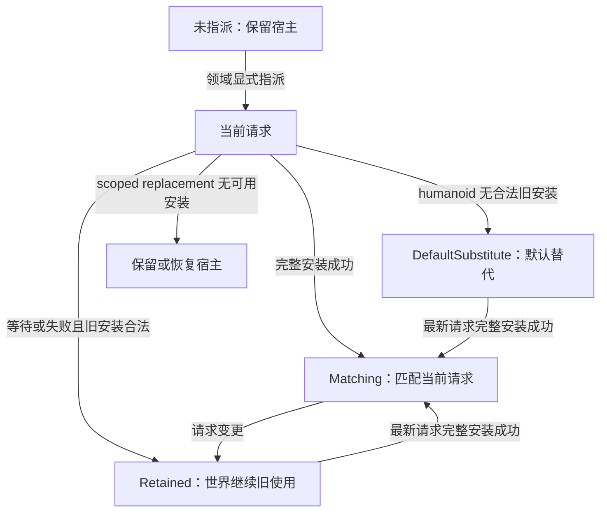
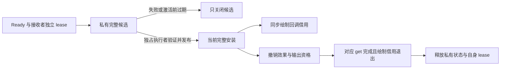

# 实体模型使用与生命周期

上级契约：[动画](overview.md#seam-contract)。

## 职责与边界

本页细化[动画的结束与复用](overview.md#实体使用的结束与复用)。实体生命周期根协调模型指派、完整安装、求值调度与同步借用；[客户端资源](../model-management/client-resources/overview.md)只交付 Ready 状态与独立 lease，不替实体发布私有状态。

## Seam Contract

| 消费者问题 | 契约 |
|---|---|
| 当前指派、Ready 候选、完整安装及其使用何时成立或结束？ | [模型使用与完整安装](#模型使用与完整安装) |
| 调度方何时交出或收回私有更新态，GUI 许可允许什么？ | [执行权与任务交接](#执行权与任务交接) |

### 共同规则

适用范围：[模型使用与完整安装](#模型使用与完整安装)和[执行权与任务交接](#执行权与任务交接)。

模型的只读资产与 `AnimationStore` 通过 lease 或执行借用跨实体共享，唯一关闭规则见[客户端资源](../model-management/client-resources/overview.md#动画资源所有权与退休)。多个输出槽只隔离 Extract 结果，不建立独立播放时间线。通用展示实体缓存与模型卡预览池为两套独立机制，见[页面资源 owner](../client-presentation/implementation/page-runtime.md#页面与资源-owner)。

单实体独占执行权只覆盖当前 owner 的私有状态，不冻结实时（live）的 `Entity`、`level`、`Minecraft` 或可选模组 provider（即便主线程为 GUI 任务固定了 `GuiFrameInput`）。外部输入的当前并发缺口见[Context、线程与生命周期](../../status/known-issues/animation.md#context线程与生命周期)。

当前 OOM 与严重错误边界：
- **求值期 OOM**：同步求值或异步任务发生 OOM 时，本次不交付准备结果；owner 消费该失败，后续独立执行仍可进入。
- **安装期 OOM**：只拒绝本次安装，不记入永久失败记忆。私有准备阶段失败保留旧安装；共享 holder 激活已修改状态时结束旧使用；required default 安装失败仍向上传播。
- **严重错误优先级**：GUI 任务交接与最终投影收尾及清理中，非 OOM 的 `VirtualMachineError` 和 `ThreadDeath` 优先于原 OOM 或普通失败传播，原失败作为 suppressed 保留；其余清理异常不覆盖主失败；诊断信息分配失败不跳过后续清理。该局部 OOM 边界不扩展到图片准备或 required default 安装。

### 模型使用与完整安装

**边界与权威**

#### 对象寿命与模型使用

每次显式选择、重选或清空建立独立的操作身份（operation identity）。一次完整安装只对应其发布时关联的操作：新操作即使选中相同模型，也不能复用旧安装宣告完成等待；兼容纹理更新则保留原操作身份与私有 runtime。

Animatable 只保存两项事实：当前选中 target 与操作身份，以及实际生效的 usage、独立 lease 与私有 runtime；请求关系、候选与匹配状态均由此派生。页面退出或 wrapper 替换不撤销真实玩家的模型选择。

对象可达、宿主活跃、已有选择、资源 Ready、完整安装与允许求值彼此独立。同一 `AnimatableEntity` 在寿命内可先后拥有多次模型使用；同一 subject 被多个 owner（如世界本体与预览页）引用时，彼此可变状态隔离。

| Owner 用途 | 上级生命周期 | 私有状态与结束 |
|---|---|---|
| 世界玩家、投射物、载具 | Entity 的 capability 或 provider；宿主属于当前 level | 持有 controller、组件、表达式实例、Roaming、输出和自身 lease；宿主失活或卸载时结束使用 |
| GUI 卡片、中央预览、生成预览 | 所属页面或单次 preview 操作 | 拥有独立动画 owner 与创建时的 FakePlayer；页面、操作或世界结束时退休 |
| 第一人称手臂和背景 | 客户端共享 renderer，绑定当前 LocalPlayer | 持有独立动画状态与三个输出槽；玩家替换、退出世界或 renderer 替换时释放 |

**前置条件与输入**

#### 候选与兼容条件

实体的当前使用由两部分构成，在同一独占窗口内同时发布：
- **私有动画执行态**：持有 store、执行借用、表达式实例、组件、controller、时间线与私有骨骼状态；实体根独占其关闭权。
- **可替换 target 绑定**：持有自身 lease、查询 view、failure gate、几何与声音 resolver；更换绑定只撤销旧绑定的引用与 lease，不转移执行态关闭权。

世界玩家的完整安装具备物理资产时，由 `AnimationSession` 持有一个 `PlayerPhysicsSession`，统一管理该玩家的原生世界、物理样本历史和降级状态。候选放弃或安装结束时，由该动画会话关闭原生世界。

构造完整候选前先校验当前 request、bake profile 和真实 subject，再私有构造全套执行态与绑定。普通安装由主线程发布；GUI 帧任务凭单实体许可完整绑定已 Ready 的 target 并在同次任务内求值，主线程在对应 `join` 前不访问该安装或私有状态。候选全部通过后才撤销旧资格并提交新安装；中途退出只释放新建资源。

仅纹理变化时可走兼容替换路径，原位保留执行态。兼容条件：精确内容、发布角色、逻辑 target、bake profile、binding、purpose、同一准备结果及 main/arm store 对象身份全部一致，且旧安装健康、属于同一次选择操作与同一 owner、当前无活动绘制借用。兼容候选私有验证新绑定；激活时先撤销旧输出，再向组件通知实际 target，一次性刷新 resolver、查询 view 与 failure gate，最后提交新绑定并撤销旧绑定。

**结果与保证**

#### 指派、请求与安装关系

上图描述请求与实际安装间的对应关系变化，非统一资源状态机。LocalPlayer 在本地模式构造时建立普通 builtin default 意图，待 required 源可用后解析为真实 ModelId；普通目录尚未发布时保留该 ID 等待，期间可采用 intrinsic default 替代。远端实体仅收到 model section 时建立指派；动画 DELTA 不建立指派，资源 Ready 后也不补发此前错过的播放。

实体分别保存请求模型、请求纹理与实际安装，`ResourceRequest` 与安装失败记忆保留发布角色。请求连续经历 A → B → C 时，合法 A 可继续以 Retained 显示，迟到的 B 仅结束自身候选而不覆盖 C。显式请求 intrinsic default 且安装匹配时为 Matching；请求普通默认模型暂用 required default 替代时为 DefaultSubstitute（即便内容哈希相同）。

完整安装发布后确立 target、profile 与真实 subject 的兼容保证，后续求值与世界渲染直接消费，不再对照当前 Catalog 重检 target 或实体 tag。Catalog 移除条目、target/matches 变化或后续磁盘读取失败，均不撤销已合法建立的旧安装。GUI 仅在 Matching 时用 3D 模型表示当前选择，世界实体可继续展示 Retained 旧模型（GUI 展示规则见[客户端展示](../client-presentation/overview.md#选择与资源需求)）。

Binding 缓存“请求与当前安装”的派生关系：当角色、模型、target、纹理、用途、subject、binding 或实际安装变化，或当前请求依赖的 Catalog 内容变更/移除时，在下次消费前重建；无关目录发布不触发重算。

#### 安装发布结果

候选构造期间外部查询只能看到完整旧安装或 Unbound；同一 owner 上的切模、reset、retire 和递归求值均拒绝。新安装发布后，外部绘制回调可发起新请求或封口，但不能递归安装；回调抛异常不回滚已发布的新安装。

兼容纹理替换成功后，私有执行态、变量、组件初始化、采样历史、播放进度、controller、Roaming 与事件游标原位保留；绑定相关查询缓存刷新且不重放初始化或事件。玩家沿用原物理会话及其原生世界、运动历史和降级状态。真正更换 store 时重建模型域，仅承接同一主体仍适用的位置历史，不复制任意组件。

#### 查询与借用

事实查询报告当前指派、请求、安装、关系、许可与在途工作；能力查询判断播放、求值、准备或结果消费资格。两类查询均为纯只读，不触发拉取、推进动画、汇合任务或执行 hook。外部 hook 返回后需重新查询当前关系与许可。更新态访问窗口见[前置条件](#访问窗口)，任务交接见[执行权与任务交接](#执行权与任务交接)，关闭顺序见[暂停、reset 与 retire](#暂停reset-与-retire)。

**所有权与时序**

#### 安装接纳与 Busy

候选构造时捕获原选择操作、主体、用途、binding 与精确内容；激活时逐项复核这些条件、当前请求与执行许可，防止迟到结果覆盖新选择。接管后的独立 lease 转入当前 target 绑定；激活前拒收或构造失败只关闭候选及其 lease。

普通安装入口非阻塞，不等待动画 worker：任务尚未经过对应 `get`、处于绘制借用或候选窗口占用中时直接返回 Busy，不记为内容失败。非 GUI 协调方保留 Ready anchor 待下一 tick 重试；GUI 帧调度方凭独立接收 lease 和执行许可走内部安装入口；纹理导航遇 Busy 直接拒绝，不保留自动跳转意图。

#### 暂停、reset 与 retire

所有生命周期入口和 GUI 清理交接遵循[执行权与任务交接](#执行权与任务交接)。

| 事件 | 当前使用 | 后续资格 |
|---|---|---|
| 本机 body 屏蔽绘制 | 保持 producer 逻辑推进 | 绘制许可独立变化 |
| 纯消费者暂停 | 结束 demand、任务、安装与私有输出 | 保留指派和网络投影，解除全部限制后按最新请求重建；旧播放不排队 |
| reset | 结束当前使用 | 保留指派、请求及安装失败记忆 |
| 显式 reload | 结束当前使用 | 保留指派和请求，清除本 owner 的安装失败记忆 |
| retire | 撤销指派，结束当前使用 | 永久终结 owner；重复调用幂等，重新指派不复活 |
| 异步宿主失活 | 移除预调度登记并 retire | 后续使用须创建新 owner |

上述清理义务适用于 JVM 持续运行期间；[JVM 进程退出](../runtime/overview.md#jvm-进程退出)直接放弃运行资源。

普通结束流程先等待对应异步任务 `get`（覆盖 worker 完整 `finally`；等待遇中断时先等完再恢复中断标志），趁原安装仍有效完成最终投影接纳，再撤销资格并清理（LocalPlayer 偏好保留见 [Roaming](implementation/state-inputs-and-sync.md#roaming)）。同步绘制回调为局部例外：回调内触发 reset/retire 立即撤销消费资格，物理释放延后至最外层绘制借用退出后执行。

显式结束在安全边界调用 `onModelEnded()`（组件无独立 reset/retire hook）。清理按顺序进行：解除输出、controller 查询、播放队列、handler/program、reader/context 及 deferred/transient 关联 → 关闭私有实例并归还执行借用 → 清空 store 引用和 target lease。旧安装凭据只留身份，清空一切反向保活引用；单步清理失败不跳过后续步骤，主失败与 suppressed 按[共同规则](#共同规则)合并。

取消自身需求无需等待共享 Flight 物理终结；自身工作结束不代表 target、GPU 资源或 allocator 已回收。

#### 完成样本的发布与结束

每个实体的完成样本（completed sample）唯一发布者是其 canonical world body（玩家 body、投射物 body 或其余实体的世界 vehicle body）；投射物 Vehicle wrapper、GUI 预览和第一人称手臂不发布也不清空样本槽。样本只存不可变纯值，不持有 `Entity`、event、component、controller、provider 或资源 lease。

主更新推进历史后冻结本轮私有输入；仅当表达式求值、组件 `endEval` 与逻辑清理全部正常完成，且原安装仍有效允许发布时，才原子替换完成槽。循环正常截断、单表达式函数深度终止以及逻辑成功后的普通 Extract 失败均不撤回已发布逻辑样本。

真正 `endUse`、reset、retire 或 disconnect 时，在原任务交接完成后清空样本槽并拒收迟到发布。连续换模或私有候选失败期间保留上一完成样本直至新主轮替换。箭头表达式只读入口捕获的快照样本，不触发目标求值或等待。

#### 玩家物理历史与传送

客户端线程在原版接纳传送的入口按玩家实体发布传送代际。物理会话看到新的代际即撤销旧物理样本的消费资格，并在下一次合格的主更新执行零速复位。

- 本地玩家每次完成 `ClientPacketListener.handleMovePlayer` 都推进代际，零位移同样触发复位。
- 远端玩家在 `ClientPacketListener.handleTeleportEntity` 的实际 `lerpTo` 调用前比较包目标与实体当前根位置。距离达到 16 方块才推进代际并开始抑制，期间再次收到符合条件的长跳会更新窗口。普通相对移动、旋转和小于 16 方块的绝对纠偏沿用原截止 tick。

以接包时的 `entity.tickCount` 为 `t`。从接包后本 tick 的剩余渲染帧到 `t+3` 的末帧，每次合格主更新都执行零速复位。从 `t+4` 起的首个合格主更新建立落位基线。即使渲染跳过整个窗口，新的传送代际也会触发这次复位。

例如，Minecraft 1.20.1 的远端玩家从 `x=0` 传到 `x=24` 时，第三次实体更新已经把坐标设为 24，但同一 tick 里 `partialTick` 为 0.25 和 0.75 的渲染根位置分别为 18 和 22。整个 `t+3` 继续复位，避免把这段渲染插值当成实际运动。`PlayerTeleportStateTest.lastInterpolationTickStillMovesBetweenRenderFrames` 回放了这一边界。

#### 显式释放与 GC 回收

各资源 owner 用 `Cleaner` 兜底物理释放；`Cleaner` 不触发实体/组件回调，也不保证及时取消网络需求，清理状态不反向持有生成 Root、component 或实体。Compiled instance 释放 generation lease，短期 session 释放 program lease 与配额；共享 target 关闭见[客户端资源](../model-management/client-resources/overview.md)，音频播放见[音频终态](../model-management/audio/overview.md)。

**失败与拒收**

#### 失败记忆与恢复

按失败阶段隔离：
- **私有准备失败**：新 holder 构造或首次 target hook 失败时仅拒绝候选，保留健康旧安装与历史。
- **兼容激活失败**：已开始修改共享 holder 后失败或取消，无法安全回滚半修改状态，直接结束旧使用，拒绝事实记在候选的精确请求与内容上。
- **普通 Extract 异常**：仅撤销本次几何输出，保留已提交逻辑轮与投影；主线程在同步调用或对应 `get` 后记录精确安装、采样上下文与原异常。Required default 异常仍向上传播。
- **普通表达式异常或组件失败**：结束该精确安装。Worker 逆序完成已成功 `beginEval` 的配对 `endEval`，主线程在 `get` 或 GUI `join` 后记录拒绝并结束使用。函数深度终止仅截断当前表达式。恢复留待下一次协调机会（采用 intrinsic default 或回退宿主），不在 hook 或清理栈内递归安装。Intrinsic default 失败直接传播。

安装失败按精确请求与内容记忆，仅约束当前 owner；切走再切回、普通 reset 或时间推移不解除记忆，内容身份变化时重新评估，显式 reload 仅清本 owner 记忆。

玩家物理在建世界或求解失败后撤销物理样本，当前模型继续以纯动画运行，建世界失败记为 `WORLD_CREATE_FAILED`。当前安装的原位恢复由显式 `retryPhysics()` 在执行权交还后发起。若原生世界尚未建成，该次重试会尝试创建世界。显式 `reloadGeoModel()` 结束当前安装，换模、物理资产变化及重进世界通过新的完整安装建立会话。

显示限制可以结束安装并释放世界。同一世界、相同准备输入重新安装时，实体仅保留失败原因与恢复门禁。缓存重新准备产生的新标识不会开启重试。

会话进入 `intrinsic-default-only` 模式后，普通安装立即失去求值与消费资格，在下一次同步边界结束旧使用：humanoid 改用 intrinsic default，scoped replacement 恢复宿主模型（见[模型会话](../model-management/sessions/overview.md)）。

**证据与依赖**

主线程交接与绘制借用落实见[实体实现](implementation/entity-and-frame-state.md)；验证范围见[动画问题](../../status/known-issues/animation.md)与[模型问题](../../status/known-issues/model-management.md)。

### 执行权与任务交接

**边界与权威**

当前实现通过 `EntityExecutionLifecycle` 保证单个 owner 私有更新态在同一时刻只向唯一独占执行者开放（并将门禁绑定到表达式 runtime）：无待交接任务时主线程进入同步窗口；普通异步任务存续期间只有该任务实际执行者可访问更新态；同一 owner 在不同 render context 下的求值也串行。

主线程独占指派、reset、reload、retire 等公共生命周期入口；任务执行者与同步求值回调重入这些入口会在修改状态前被拒绝（主线程接管排队任务期间在主体及 `finally` 结束前同理）。页面失效时先停止消费，待全部已接纳 GUI 任务交接后再结束使用；兼容激活失败需结束旧使用时，任务仅标记待结束，由主线程在 `join` 时清理。

**前置条件与输入**

#### 访问窗口

在对应异步任务 `get` 或 GUI 任务 `join` 完成前，外部只查询主线程维护的调度事实，不读私有更新态；表达式实例与 runtime 读取门禁直接依赖本独占执行权，不隐式阻塞等待。GUI 准备与消费额外要求关系为 Matching，外部 hook 改变选择或许可后旧结果失效。宿主取消与实际消费一致性见[渲染交接](../rendering/overview.md#顶点输出与宿主接管)。

世界主线程可在动画任务交接前读取构造时固定的 subject 引用供 renderer 检查兼容资格（不访问更新态、不归还执行权）。GUI 任务期间会临时改写私有 subject 输入，从任务预留到主线程 `join` 期间 subject 由该任务独占。

**结果与保证**

任务交接归还执行权并建立内存可见性，不延长安装、动作或输出资格。动作与投影由[Molang 求值领域](molang-runtime.md#invocation-与效果)按当前安装接纳；独立编译任务可跨实体任务存活，最终由原 owner 按[短期执行](molang-runtime.md#短期执行)复核安装后接纳，迟到产物由原交付协议关闭。

**所有权与时序**

主线程通过原任务对应 `get` 收回普通异步任务更新态（覆盖主体与完整 `finally`）；完成标志、取消或线程退出均不替代交接。

每个普通异步任务有唯一交接载体：渲染线程按需等待时，若任务仍在队列未被 worker 领取，渲染线程可直接领取并在主线程执行（调度方与渲染方至多一方领取）；一旦 worker 已领取、正在执行或已完成未交接，不再接管。线程切换不改变采样参数、context、动作许可与失败归属，完毕后仍走原 `get`。帧末交接、reset、retire、后续提交、命令与 GUI 交接不领取排队任务；单实体按需交接不提前开放其他任务仍在读的共享状态写窗口。

单次世界渲染调用内，每个 owner 至多登记一次、调度方至多提交一次；登记持续到全部任务和最终投影交接完成（提交失败、reset 或 retire 不提前撤销登记）。同步 owner 同样登记最终投影责任，见[帧执行](../rendering/implementation/frame-execution.md#任务发布与并发边界)。

GUI 执行权在主线程预留任务时封口（提交被拒立即归还），仅开放指定单实体任务的内部完整安装与 CPU 求值，执行一次后仍需主线程显式 `join` 归还。

**失败与拒收**

提交被拒不留待交接任务。等待交接期间遇线程中断不跳过交接，等交接彻底完成后再恢复中断标志。渲染线程接管排队任务前自带的中断标志不作为任务取消信号，任务跑完后恢复；任务中新产生的中断标志不因角色切换清除。组件、求值与 Extract 失败见[失败记忆与恢复](#失败记忆与恢复)。

**证据与依赖**

主线程交接、GUI 许可与绘制借用落实见[实体实现](implementation/entity-and-frame-state.md)；验证范围见[动画问题](../../status/known-issues/animation.md)。

## 设计取舍

- **按 owner 与对应任务交接执行权，不靠线程池身份推断访问权**：防止单实体更新态并发竞态。普通安装遇到窗口占用直接返回 Busy，GUI 帧显式借出单次执行权；代价是后续接纳与主线程读取需等待原任务交接。
- **兼容纹理替换原位保留私有执行态**：避免不必要的状态重建与关闭权转交。由于激活 hook 可能改写共享执行态，候选构造失败与激活开始后的失败采用不同边界——前者仅丢弃候选，后者结束当前使用。

## 实现与验证入口

`AnimatableEntity` 协调 `EntityModelBinding` 的指派与安装、`EntityExecutionLifecycle` 的执行权以及表达式 runtime 的私有状态。具体责任映射与验证入口见[实体状态的落实关系](implementation/entity-and-frame-state.md)。
