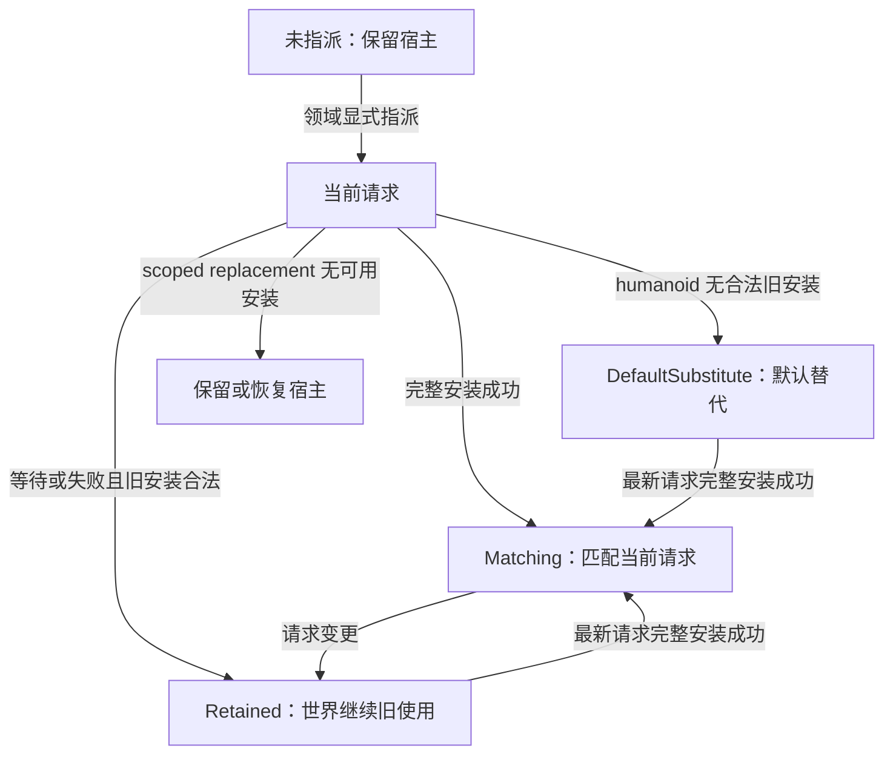
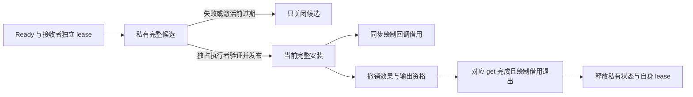

# 实体模型使用与生命周期

本页细化[动画的结束与复用](overview.md#实体使用的结束与复用)。实体根协调指派、安装、求值与同步借用；[客户端资源](../model-management/client-resources/overview.md)只交付 Ready 和独立 lease，不替实体发布私有状态。

## 对象寿命与模型使用

对象可达、宿主活跃、已有指派、资源 Ready、完整安装与允许求值是不同事实。一个 `AnimatableEntity` 可以先后拥有多次模型使用；同一 subject 的多个 owner 不共享可变状态。

| Owner 用途 | 上级生命周期 | 私有状态与结束 |
|---|---|---|
| 世界玩家、投射物、载具 | Entity 的 capability/provider；宿主属于当前 level | Controller、组件、表达式实例、Roaming、输出和自身 lease；宿主失活或卸载结束使用 |
| GUI 卡片、中央预览、生成预览 | 页面或单次 preview 操作 | 自己的动画 owner 与创建时的 FakePlayer；页面、操作或世界结束时退休 |
| 第一人称手臂和背景 | 客户端共享 renderer，绑定当前 LocalPlayer | 独立动画状态与三个输出；玩家替换、退出或 renderer 替换时释放 |

模型只读资产和 module 可以经 lease 共享。多个输出槽只隔离 Extract 结果，不建立独立播放时间线。通用展示实体缓存不等于模型卡预览池，辅助保留见[页面资源 owner](../client-presentation/implementation/page-runtime.md#页面与资源-owner)。

## 指派、请求与安装关系

图中的边表示安装关系变化，不是统一资源状态机。LocalPlayer 构造时显式建立 default 指派；远端只有 model section 建立指派。动画 DELTA 不建立指派，Ready 不补发错过的播放。

请求模型、请求纹理与实际安装分别保存。A → B → C 时，合法 A 可继续 Retained；迟到 B 只结束自己的候选，不能覆盖 C。当前请求就是 default 且安装匹配时为 Matching；DefaultSubstitute 仅表示 default 替代另一个请求。

目录移除或未来读取失败不撤销合法旧安装。GUI 只用 Matching 3D 表示当前选择；世界可以继续 Retained。[客户端展示](../client-presentation/overview.md#选择与资源需求)决定图片、占位与点击资格。

## 完整安装与替换

候选应验证当前 request/profile、真实 subject，并完整构造组件、表达式 root、controller、processor、资源 holder 与实际变体。普通安装由主线程发布。GUI 帧任务可凭单实体许可完整绑定已 Ready target，并在同一次任务内求值；主线程在对应 `join` 前不能访问安装或私有状态。全部候选步骤成功后，安装执行者先撤销旧安装报告资格，再结束旧状态和自身 lease。

私有准备失败保留健康旧安装与历史。候选期查询只见完整旧安装或 Unbound；同 owner 切模、reset、retire 和递归求值明确拒绝。发布后的外部绘制回调可改变请求或封口，不能递归安装；通知异常不回滚已发布安装。

普通安装入口不等待动画 worker。只要任务尚未经过对应 `get`，即使已完成也返回 Busy；绘制借用或候选窗口占用同样返回 Busy，不记录内容失败。非 GUI 协调方保留 Ready anchor，下次 tick 再尝试；GUI 帧调度方在取得独立接收 lease 和执行许可后使用内部安装入口。纹理导航直接拒绝本次进入，不保留导航意图。

仅纹理变化时，兼容性应同时满足精确内容、逻辑 target、bake profile、binding、purpose、同一准备结果与 main/arm module 对象身份。旧安装还应健康、属于同一 owner 且无活动借用。兼容候选先私有验证几何与资源关联；激活先撤旧输出，再通知实际 target、刷新资源视图并转移状态关闭权。

兼容激活已修改共享状态，失败或取消应结束旧使用，不能回滚半修改 holder。成功替换保留组件初始化、采样历史、播放、controller、Roaming、物理与主体时间线；resource resolver 不保留旧 target。新模型则重建模型域，只承接同主体仍适用的位置历史，不复制任意组件。

## 暂停、reset 与 retire

| 事件 | 当前使用 | 后续资格 |
|---|---|---|
| 本机 body 屏蔽绘制 | 保持 producer 逻辑推进 | 绘制许可独立变化 |
| 纯消费者暂停 | 结束 demand、任务、安装与私有输出 | 保留指派和网络投影，解除全部限制后按最新请求重建；旧播放不排队 |
| reset | 结束当前使用 | 保留指派、请求及安装失败记忆 |
| 显式 reload | 结束当前使用 | 保留指派和请求，清除本 owner 的安装失败记忆 |
| retire | 撤销指派，结束当前使用 | 永久终结 owner；重复调用不重复释放，重新指派不能复活 |
| 异步宿主失活 | 移除预调度登记并 retire | 后续使用应创建新 owner |

主线程拥有指派、reset、reload 和 retire。GUI 许可只开放指定任务的内部完整安装与 CPU 求值，不开放公共生命周期入口、绘制或其他实体。Worker 与同步求值回调不能重入公共生命周期入口；拒绝发生在状态变化之前。同步 owner 的上级在页面或操作结束时显式退休。

GUI 执行权在主线程预留时封口，提交拒绝时归还。指定任务只能进入一次；任务返回后仍须主线程显式 `join`。任务结束、线程结束或完成标志均不归还执行权。页面失效先停止消费，在所有已接纳任务交接后结束使用。兼容激活失败需要结束旧使用时，任务先标记待结束，由 `join` 完成原 owner 的清理。

GUI 任务交接和最终投影收敛采用帧层的严重错误优先级，原普通失败保留为 suppressed。结束使用清理中的非 OOM `VirtualMachineError` 和 `ThreadDeath` 同样优先传播，原 OOM 聚合规则不变。CPU 求值的局部 OOM 边界不扩展到图片准备或 required-default 安装。

普通结束先取得任务的对应 `get`，在原安装仍有效时完成最终投影接纳，再撤销资格并清理。LocalPlayer 的保留责任见 [Roaming](implementation/state-inputs-and-sync.md#roaming)。`get` 覆盖 worker 的完整 finally；等待中断后继续等待，再恢复中断标志。同步绘制回调是局部例外：回调内 reset/retire 立即撤销消费资格，私有状态和 lease 延后到绘制借用退出才释放。普通求值不使用这条延后释放路径。

显式路径在安全边界执行 `onModelEnded()`；组件没有 reset/retire hook，真实换模创建新 holder。单项清理失败不跳过后续清理，既有主失败保留，清理失败作为 suppressed。

## 失败记忆与恢复

普通 Extract 异常只撤销本次几何输出。主线程在同步调用或对应 `get` 后记录 exact installation、采样上下文和原异常；已成功提交的逻辑轮与投影保留。结束整个使用不等待目标汇合，仍会丢弃尚无接纳资格的投影，因此 Extract 失败不沿用组件失败的结束使用路径。Required default 的原异常仍传播；宿主顶点消费和其他 `Error` 保持原边界。

实体的同步求值或异步任务发生 OOM 时，本次执行不交付准备结果；owner 消费任务失败，后续独立执行仍可进入。私有候选安装的 OOM 只拒绝本次安装，不写入 exact content 的永久失败记忆。已发布安装和独立 lease 保留；required default 失败仍传播。共享 holder 激活已改变状态时，仍按原规则结束旧使用。

严重 non-null 返回违约或组件生命周期失败结束 exact installation。Worker 先完成已成功 begin 的全部配对 end，主线程取得对应 `get` 后才保存拒绝事实并结束使用；资格丢失按取消归约，不伪造组件故障。普通安装在后续协调机会采用 default 或宿主，不在 hook 或清理栈内递归安装。

新 holder 构造或首次 target hook 失败只拒绝候选。兼容替换开始修改共享 holder 后失败，结束旧使用；拒绝事实仍属于候选 exact request/content。失败只约束该 owner，不改变全局声明接纳或将内容标为全局损坏。

安装失败按 exact request/content 记忆。切走切回、普通 reset 或时间经过不解除记忆。内容身份变化后重新评估；显式 reload 只清本 owner 的记忆，不清共享资源失败资格。Default 候选失败也先记录拒绝再传播原异常，不递归降级或自动重建。

模型会话进入 intrinsic-default-only 后，普通安装失去求值与消费资格；下一次同步边界结束旧使用。Humanoid 采用 default，scoped replacement 恢复宿主。该输入不等于目录缺项，不撤销指派、Minecraft 连接或仍合法的新需求；会话裁决见[模型会话](../model-management/sessions/overview.md)。

## 查询与借用

事实查询只描述当前指派、请求、安装、关系、许可与工作。能力查询分别判断播放、求值、准备或精确结果消费的当前资格；不取得资源、不推进动画、不汇合任务、不执行 hook，也不预留未来资格。

未经过对应 `get` 或 GUI `join` 时，外部只能查询主线程维护的调度事实，不能读取实体更新态。Worker 独占自己的执行态；主线程在业务入口显式交接，再调用普通查询。实例与 runtime 的读取门禁识别 exact 执行者，不隐式等待，也不按线程池身份放行。GUI 的准备和消费另要求 Matching；hook 改变选择或许可后旧结果立即失效。宿主取消与实际消费共享本次准备结果，规则见[渲染交接](../rendering/overview.md#三阶段契约)。

世界主线程可在动画任务交接前取得构造时固定的 subject 引用，供 renderer 检查兼容资格。此读取不取得动画状态，也不归还执行权。GUI 任务会临时改写私有 subject 输入，因此从预留到显式 `join`，subject 仍只供对应任务访问。

未终结工作包括本 owner 的任务和尚未移交的 attempt/lease，不包括已结束的失败或 miss。取消自己的需求不等待共享 Flight 物理终结；自己的工作结束也不证明 target、GPU 或 allocator 已回收。

## 显式释放与 GC 回收

资源 owner 的 Cleaner 兜底物理释放，不执行实体或组件回调，也不保证及时取消网络需求。清理状态不保留生成 Root、component 或实体，防止反向保活。Compiled instance 释放 generation lease，短期 session 释放 program lease 与配额；模型 lease 和 native 输出沿用各自的一次性释放能力。

显式卸载、替换和退休尽早结束当前占用。共享 target 的关闭与宿主纹理回收仍由[客户端资源](../model-management/client-resources/overview.md)定义；独立接纳的播放按[音频终态](../model-management/audio/overview.md)结束。

主线程任务交接与绘制借用见[实体实现](implementation/entity-and-frame-state.md)。真实退出重进、联动宿主和失败组合的证据见[动画问题](../../status/known-issues/animation.md)与[模型问题](../../status/known-issues/model-management.md)，本页不提供 GC 时限。
