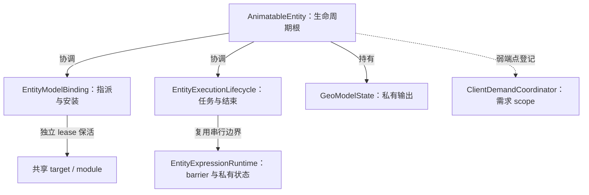

# 实体状态的落实关系

本页落实[完整安装与替换](../entity-lifecycle.md#完整安装与替换)、[结束边界](../entity-lifecycle.md#暂停reset-与-retire)及[时间推进](../overview.md#时间推进与观察)。

## 实体级所有权

`AnimatableEntity` 是生命周期根。`EntityModelBinding` 保存指派、request 与唯一完整安装；`EntityExecutionLifecycle` 保存执行阶段和单个动画任务。`EntityExpressionRuntime` 拥有组件 holder、实例及其 barrier。`AnimatedGeoModel` 拥有 entity 级 `BoneAttribute`；`GeoModelState` 拥有各输出槽。共享 target/module 通过自身 lease 保留。

图中实线标明责任或保留，虚线表示弱登记；目录层级不表达这些持有关系。需求 scope 的取得与接管由[需求协调](../../model-management/demand/overview.md)拥有。

## 绑定与切换

`tryInstallation()` 对表达式 barrier 使用非阻塞进入。任务、借用或候选窗口占用即返回 Busy；它不等待 Future。已完成任务通过终态事实归约，协调方持有 Ready anchor 并在后续 tick 重试。

候选按显式 target 构造，不通过 current getter 取得候选。`EntityModelBinding` 与 expression runtime 在同一 barrier 发布；候选期旧查询仍见完整旧安装。`ModelRenderTarget.isStateCompatible()` 提供精确资源与 module 身份判断，根补充 owner、健康与串行窗口条件。

`prepareModelBinding/prepareResourceBinding` 私有验证兼容候选。激活按显式 target 通知 holder 并移交状态关闭权；清理不从可变 current getter 反查旧资源。失败记忆由 binding 按 exact request/content 保存；`reloadGeoModel()` 清除此 owner 的记忆。

根的 reset、reload、retire 为 final，完整清理不依赖角色 hook 调用 `super`。Lifecycle 先封口，在调用退出且任务真实终态后执行根提供的清理；等待任务时不持 barrier，避免阻止 worker 退出。

`DeclarationComponentScope` 对成功 begin 的前缀逆序执行 end，保留主失败并汇总清理失败。失败 begin 自行释放未移交的借用；每个正常 hook 返回后复核 exact installation。组件失效先撤查询资格，活动借用退出后才解除清理引用。

`canAcceptPlayback`、`canEvaluate`、`canPrepare` 和 `canConsume` 分别映射[查询契约](../entity-lifecycle.md#查询与借用)。`BlockReason` 从同源事实派生，不另存资格。Ready 不等于安装、查询也不触发取得。

## 时间与更新频率

`AnimatableEntity` 独占主采样 tick 与实际主更新时间基线。新 holder 的首次样本独立建立，tracker 延续主体历史。全部 begin 成功后先接纳跨度，再分发 tick/update；失败不回滚或重放该跨度。Observation、限频或姿态复用不移动基线。

`AnimationParallelTicker` 弱引用登记异步 owner，强引用仅覆盖当次任务。宿主离开当前 level 或 removed 时移除登记并 retire；活跃 owner 显式 retire 不移除登记。任务完成通过 Future 发布，等待中断后仍确认真实终态，再恢复中断标志。

## Canonical 与 mutable 输出

各槽隔离提取结果，仍共享实体时间线。第一人称 owner 的 LeftArm、RightArm 与 Background 独占输出；body/arm 只投影命名 Roaming 值，不共享可变对象。局部根、context 复用与同步借用见[帧执行](../../rendering/implementation/frame-execution.md#java-预调度与-context)。

## 输入与副作用边界

`EntityExpressionRuntime` 在组件求值外拥有完整效果轮；表达式清理不关闭 component、module 或安装 lease。效果提交与输入门禁见[Molang 落实关系](molang-runtime.md#binding-与-invocation)。Live Minecraft/optional-mod 读取仍有[线程与验证缺口](../../../status/known-issues/animation.md)。
