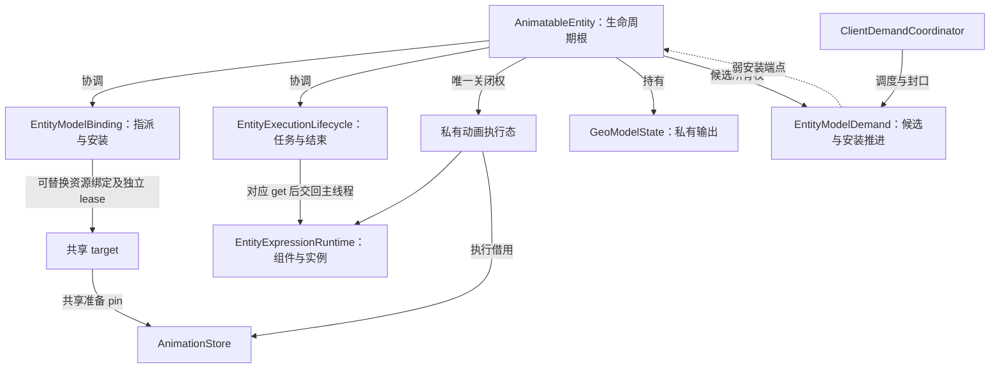

# 实体状态的落实关系

本页对应[完整安装与替换](../entity-lifecycle.md#模型使用与完整安装)、[结束边界](../entity-lifecycle.md#暂停reset-与-retire)及[时间推进](../overview.md#时间推进与观察)，列出实体侧状态对象的类级分工、交接窗口与清理顺序。

## 实体级所有权

`AnimatableEntity` 是实体生命周期根，独占 `AnimationSession` 关闭权，内部拆分为五个协作成员：

- `EntityModelBinding`：持有当前模型指派、操作身份、请求与生效安装，并缓存请求与安装关系的派生结果。
- `EntityModelDemand`：负责候选接收、准入检查与 Busy 重试。
- `EntityExecutionLifecycle`：维护执行阶段、退休标志与单个待交接任务，并将单实体串行门禁绑定到 `EntityExpressionRuntime`，使安装、求值与实例读取共用同一执行权。
- `AnimationSession` 与 `EntityExpressionRuntime`：前者持有 `AnimationStore`、组件、`AnimationProcessor`、`AnimationData` 与 `AnimatedGeoModel`；后者持有当前 State 的 Execution 与表达式实例。两者在同一独占窗口内同步发布和结束。
- `ResourceHolder` 与 `GeoModelState`：`ResourceHolder` 保存可替换 target、独立 lease 与激活回调（查询 view 与 resolver 均从显式 target 取得）；`GeoModelState` 拥有各渲染输出槽。

图中实线为责任或强保留，虚线为弱端点。[需求协调](../../model-management/demand/overview.md)决定用途准入，实体 owner 决定候选采用与安装。

## 绑定与切换

### 安装入口与 Busy 判定

- **普通路径 `tryInstallation()`**：非阻塞，只检查主线程调度事实。存在待交接任务（含后台已算完但尚未 `Future.get`）、处于绘制借用期或候选窗口占用时，直接返回 Busy。
- **GUI 帧路径**：主线程先取得独立 Ready lease 并预留 `GuiTask`，后台任务通过 `GuiExecution.install` 消费该 lease 并完成绑定，全程绕开公共指派与资源拉取入口。未转交的候选由帧逻辑关闭，已转交的 lease 归 `EntityModelBinding`；GUI 候选不向协调器回报完成。来源 anchor 在安装可观察后退出。

### 候选构造、兼容替换与清理顺序

- **显式输入与窗口发布**：构造候选使用显式传入的 target 与原操作身份，避免从可变 current getter 反查。同值的新选择操作重建私有状态，兼容纹理更新保留原操作身份。`EntityModelBinding` 与 `EntityExpressionRuntime` 在同一独占窗口内发布；候选构造期间合法查询看到完整旧安装，GUI 任务执行期间主线程不访问表达式实例。
- **完整安装（`FullInstallationCandidate`）**：由 `prepareModelBinding` 校验。发布前独占新建的 `AnimationSession`，发布成功时将关闭权转交实体根。
- **兼容替换（`ResourceHolder`）**：先由 `ModelRenderTarget.isStateCompatible()` 比对资源与执行绑定身份，再由实体根复核 owner 一致、旧安装健康与串行窗口空闲，并经 `prepareResourceBinding` 校验。兼容候选不转移 session 关闭权；激活时以显式 target 通知组件，刷新几何/声音 resolver、查询 view 与 failure gate，原位保留 session、实例、controller、播放进度与事件游标，旧绑定仅撤回自身引用与 lease。
- **固定清理顺序（`clearInstalledRuntime`）**：
  1. 从所属安装对象清除 session 中的模型、controller 与组件引用。
  2. 由 `EntityExpressionRuntime` 关闭表达式实例并归还执行保护。
  3. 清理当前绑定的资源与 lease。
  失败记忆由 `EntityModelBinding` 按精确请求与内容保存，`reloadGeoModel()` 仅清空本 owner 记忆。
- **请求关系缓存**：`EntityModelBinding` 缓存当前请求与已安装状态的派生关系，不持有额外 lease。命中条件为 target、纹理、用途、subject、资源服务身份（固定 bake profile 与 subject binding）及当前请求 content 身份（固定 manifest；内容或纹理列表变化会产生新 content）全部一致。选择、操作变更、发布或释放时清空该缓存；GUI worker 在私有窗口内维护，主线程 `join` 后消费。

### 生命周期终结、GUI 许可与失败归属

- **终结入口**：实体根的 `reset`、`reload`、`retire` 均为 `final`，保证完整清理不依赖子类 hook。普通异步任务结束前等待对应 `Future.get`，GUI 任务经原 `GuiTask.join` 收回；等待遇中断时先完成交接再恢复中断标志。绘制回调内触发结束立即撤销消费资格，物理释放延后至最外层借用退出。`retire` 永久终结 owner，`reset` 与 `reload` 允许重建使用。
- **清理归属**：服务层不维护全域安装关闭清单；异步 ticker 的弱引用仅用于任务调度与宿主失活退休。进程正常运行时持续履行上述清理义务，[JVM 进程退出](../../runtime/overview.md#jvm-进程退出)时直接放弃运行资源。
- **GUI 任务许可**：`reserveGuiTask` 仅接受 GUI 用途并在预留瞬间封住实例访问权，`run` 将许可交给唯一执行者，提交被拒时调用 `reject` 立即归还。任务结束后仍需主线程 `join` 归还许可；许可不依赖全局 `ThreadLocal`，也仅开放该单实体的绑定与 CPU 求值。
- **组件与表达式失败**：
  - `DeclarationComponentScope` 对已成功 `beginEval` 的前缀逆序调用 `endEval`，保留主失败并将清理异常记为 suppressed；`beginEval` 自身失败由该组件自行释放未移交借用。组件执行期拒绝重入生命周期入口。
  - 普通表达式异常包装为 `INSTANCE_EXECUTION`（含顶层 provenance 与原 `Throwable`），经同步返回或 worker 交接回到主线程后，由对应精确安装的 binding owner 接纳并清理；兼容激活失败时 worker 仅标记待结束，由主线程交接后收尾。函数深度终止不走此终结通道，runtime 也不维护表达式黑名单。
- **状态查询**：`canAcceptPlayback`、`canEvaluate`、`canPrepare`、`canConsume` 对应[查询契约](../entity-lifecycle.md#查询与借用)，`BlockReason` 从同一组事实即时派生。查询为纯只读，资源 Ready 独立于完成安装。

## 主体查询输入

- **样本草稿**：`AnimatableEntity` 持有类型化样本草稿，producer 在 `beginEval` 与 `update` 窗口填入查询值；主更新轮和独立入口在首条表达式前冻结本轮样本。组件 `finally` 清空草稿，runtime 轮级 `finally` 解除 context、binding、样本、网络投影、host view、位置与延后借用。
- **完成样本发布**：`SubjectSampleAccess` 挂在 `Entity` 上，仅存最近一次完成的不可变纯值。发布者角色在 owner 构造时固定，成功主更新轮直接复用私有样本发布。发布与结束沿用 `EntityExecutionLifecycle` 原有任务交接偏序，无需额外 generation 或锁。换模调用的 `clearInstalledRuntime` 保留完成槽，真正结束调用的 `clearEndedUse` 清空完成槽。
- **箭头派生**：`MolangContext.derive` 在有效箭头入口捕获目标完成样本与网络投影，并为目标构造属于源 generation 的 binding。生成代码沿用源执行帧，子环境（child）仅在同步 RHS 期间借用源输入。来源细节见[主体完成样本与玩家投影](state-inputs-and-sync.md#主体完成样本与玩家投影)。

## 时间与更新频率

- **时间基线**：`AnimatableEntity` 独占最近主采样 tick 与最近实际主更新时间两条基线。新 holder 独立建立首次样本，tracker 延续主体历史。仅当全部组件 `beginEval` 成功后，才先接纳本次时间跨度并依次分发 `tick` 与 `update`（后续失败不回滚或重放跨度）。Observation、限频跳过和姿态复用均不移动基线。
- **异步调度与失活退休**：`AnimationParallelTicker` 以弱引用登记异步 owner，调度时用强引用覆盖当次任务及最终投影交接。宿主离开当前 level 或被标记 removed 时，ticker 移除弱登记并触发 `retire`，当次强引用保持至交接结束。任务载体覆盖完整 `finally`，经对应 `get` 后才清除待交接句柄（遇中断时先等完再恢复中断标志）。

## Canonical 与 mutable 输出

各输出槽隔离 Extract 结果，但共享同一播放时间线。第一人称 owner 的 `LeftArm`、`RightArm`、`Background` 各自独占输出槽；body 与 arm 间仅同步命名 Roaming 数值。局部根、context 复用与同步借用见[帧执行](../../rendering/implementation/frame-execution.md#java-预调度与-context)。

## 输入与副作用边界

- `EntityExpressionRuntime` 在组件求值外围管理完整效果轮，单条表达式清理不影响组件、module 或安装 lease。效果提交与门禁见[Molang 落实关系](molang-runtime.md#binding-与-invocation)，实时 Minecraft 与可选模组读取缺口见[动画问题](../../../status/known-issues/animation.md)。
- GUI 帧任务先应用主线程固定的 `GuiFrameInput`，再依次执行完整绑定与 `GuiExecution.update`，退出时恢复私有主体的临时输入；后续绘制仅消费本次准备结果。共享 renderer、dispatcher 与 OpenGL 状态归主线程，GUI 任务许可仅覆盖显式采用的模型列表预览实例。
