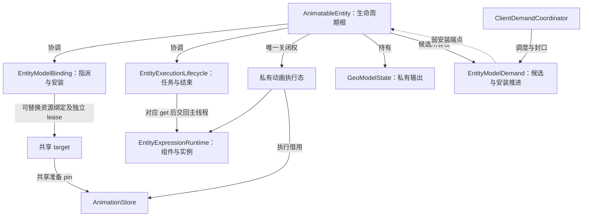

# 实体状态的落实关系

本页落实[完整安装与替换](../entity-lifecycle.md#模型使用与完整安装)、[结束边界](../entity-lifecycle.md#暂停reset-与-retire)及[时间推进](../overview.md#时间推进与观察)，说明实体侧各状态对象之间的所有权、交接窗口与清理顺序。

## 实体级所有权

`AnimatableEntity` 是实体的生命周期根，独占 `AnimationSession` 的关闭权，并通过以下组件分工协作：

- `EntityModelBinding`：保存模型指派、操作身份、请求与当前唯一的完整安装。
- `EntityModelDemand`：管理候选接收、准入检查与 Busy 重试。
- `EntityExecutionLifecycle`：维护执行阶段、永久退休标志和单个待交接任务，并将同一实体的执行门禁绑定到 `EntityExpressionRuntime`，确保完整安装、表达式求值与实例读取共享同一把串行执行权。
- `AnimationSession` 与 `EntityExpressionRuntime`：`AnimationSession` 持有 store、组件、`AnimationProcessor`、`AnimationData` 与 `AnimatedGeoModel`；runtime 的当前 State 持有对应的 Execution 与表达式实例，两者在同一独占安装窗口内同时发布与结束。
- `ResourceHolder` 与 `GeoModelState`：`ResourceHolder` 只保存可替换的 target 与 lease 及激活回调，查询 view 与 resolver 均从显式传入的 target 获取；`GeoModelState` 拥有各渲染输出槽。

图中实线表示责任或强保留，虚线表示弱端点，代码目录层级不代表这些持有关系。[需求协调](../../model-management/demand/overview.md)负责用途准入，实体 owner 负责候选采用与安装。

## 绑定与切换

### 安装入口与 Busy 判定

`tryInstallation()` 只检查主线程上的调度事实且从不阻塞等待：只要存在待交接任务（即便后台已算完但尚未经过对应 `Future.get`）、处于绘制借用期或候选窗口被占用，就直接返回 Busy。GUI 帧路径则不同：主线程先取得独立的 Ready lease 并预留 `GuiTask`，任务在后台通过 `GuiExecution.install` 消费该 lease 并完成绑定，全程不调用公共指派或资源获取入口。GUI 帧候选不向协调器回报完成；未转交的候选由帧逻辑关闭，已转交的 lease 归 `EntityModelBinding` 持有。来源 anchor 在实际安装可观察后退出。

### 候选构造、兼容替换与清理顺序

`EntityModelBinding` 只保存当前选中的 target 与操作身份，以及实际生效的 usage；请求与安装的对应关系是派生缓存。构造候选时必须使用显式传入的 target 和原操作身份，不能从可变的 current getter 反查。同值的新选择操作会重建私有状态，兼容纹理更新则保留原操作身份。`EntityModelBinding` 与 `EntityExpressionRuntime` 在同一个独占安装窗口内一起发布，候选期间的合法查询仍看到完整的旧安装；GUI 任务执行期间，主线程不能查询表达式实例。兼容判断由 `ModelRenderTarget.isStateCompatible()` 提供精确的资源与执行绑定身份比对，再由实体根补充 owner 一致、旧安装健康和串行窗口空闲等条件。

完整安装与兼容替换在对象转移上严格区分：

- `FullInstallationCandidate` 在发布前独占新建的 `AnimationSession`，发布成功时将关闭权转交实体根；`prepareModelBinding` 负责校验该路径。
- 兼容候选只构造新的 `ResourceHolder`，不转交 session 关闭权；`prepareResourceBinding` 负责校验该路径。兼容激活时，以显式 target 通知组件，刷新几何与声音 resolver、查询 view 和 failure gate，原位保留 session、实例、controller、播放进度和事件游标，旧绑定只撤回自己的引用与 lease。
- `clearInstalledRuntime` 按固定顺序清理：先清除 session 中的模型、controller 与组件引用，再由 runtime 关闭表达式实例并归还执行保护，最后清理绑定的资源；整个清理过程都从所属安装对象读取资源，不从可变的 current getter 反查。失败记忆由 `EntityModelBinding` 按精确请求与内容保存，`reloadGeoModel()` 仅清空本 owner 的记忆。

### 生命周期终结、GUI 许可与失败归属

实体根的 reset、reload 与 retire 方法均声明为 `final`，确保完整清理不依赖子类 hook 调用 `super`。普通异步执行在结束前必须等待对应 `Future.get`；GUI 执行则必须经过原 `GuiTask.join`，不能被公共入口隐式接回。Worker 异常原样保留；兼容激活失败时只标记待结束，由主线程在交接完成后收尾清理。绘制回调内触发结束会立即撤销消费资格，物理释放延后到最外层局部借用退出。Retire 永久终结 owner，只有 reset 与 reload 允许后续重新建立使用。

候选与已安装的执行态始终由实体根及其上级生命周期负责结束，服务层不维护全域的安装关闭清单；异步 ticker 中的弱引用登记只用于任务调度和宿主失活时的退休触发。[JVM 进程退出](../../runtime/overview.md#jvm-进程退出)时会直接放弃运行资源，但在进程正常运行期间，任务与绘制交接以及实体清理义务始终有效。

`reserveGuiTask` 只接受 GUI 用途，在预留瞬间即封住实例访问权；`run` 将许可交给该任务的唯一执行者。任务跑完后许可不会自动归还，必须由主线程调用 `join` 完成对应 `get` 后才归还，等待中断不得跳过交接。若提交被拒则调用 `reject`，不构造已接纳任务。该许可不依赖全局 `ThreadLocal`，也不开放公共生命周期入口、绘制或对其他实体的访问。

`DeclarationComponentScope` 会对已经成功 `beginEval` 的组件前缀按逆序调用 `endEval`，保留主失败并把清理异常记为 suppressed。如果某个组件的 `beginEval` 自身失败，由该组件自行释放尚未移交的借用；组件执行期间禁止重入生命周期入口。所有失败都回到主线程后，才撤销安装资格并执行清理。

普通表达式执行异常统一包装为 `INSTANCE_EXECUTION`，携带顶层 provenance 与原 `Throwable`，沿同步调用或 worker 的交接出口返回；主线程在借用退出并完成对应 `get` 或 `join` 后，把失败交给对应精确安装的 binding owner。函数深度终止不会走这条终结通道，runtime 也不另存表达式黑名单或 dispatch 终止状态。

`canAcceptPlayback`、`canEvaluate`、`canPrepare` 和 `canConsume` 四个查询直接对应[查询契约](../entity-lifecycle.md#查询与借用)，`BlockReason` 从同一组事实派生而不另存资格。资源 Ready 不等于已完成安装，调用查询也不会触发资源拉取。

`EntityModelBinding` 会缓存请求与安装关系的判定结果：选择 target 或操作变更、安装发布及释放都会清空该缓存；命中判定比较 target、纹理、用途、subject、资源服务身份以及当前请求的 content 身份（资源服务固定 bake profile 与 subject binding，content 固定 manifest；内容、默认纹理或纹理列表变化都会通过新 content 发布）。缓存只引用派生输入，不持有额外 lease。GUI worker 在私有执行窗口内维护该关系，主线程在 `join` 后消费。

## 主体查询输入

`AnimatableEntity` 持有类型化的样本草稿（sample draft），由 producer 在 `beginEval` 与 `update` 窗口内填入查询值。主更新轮和独立入口在执行首条表达式前冻结本轮样本；组件 `finally` 清空草稿，runtime 轮级 `finally` 解除 context、binding、样本、网络投影、host view、位置与延后借用。

`SubjectSampleAccess` 挂在 `Entity` 上的槽位只保存最近一次完成的不可变纯值。发布者角色在 owner 构造时即固定，成功的主更新轮直接复用同一份私有样本发布。`EntityExecutionLifecycle` 与精确安装复用原有的任务交接偏序来协调发布与真正结束，无需额外增加样本 generation 或锁。换模时的 `clearInstalledRuntime` 不清空完成槽，只有真正的结束路径 `clearEndedUse` 才清空。

`MolangContext.derive` 在有效箭头入口处捕获目标的完成样本与网络投影，并为目标构造属于源 generation 的 binding。生成代码始终沿用源执行帧，子环境（child）仅在同步 RHS 期间借用源输入，不创建目标执行帧。采样与投影的具体来源见[状态输入](state-inputs-and-sync.md#主体完成样本与玩家投影)。

## 时间与更新频率

`AnimatableEntity` 独占主采样 tick 与实际主更新时间两条基线。新 holder 的首次样本独立建立，tracker 延续主体历史。只有全部组件 `beginEval` 成功后，才先接纳本次时间跨度再依次分发 `tick` 与 `update`；后续失败不会回滚或重放该跨度。Observation、限频跳过或姿态复用都不移动基线。

`AnimationParallelTicker` 用弱引用登记异步 owner，并在每次调度时用强引用覆盖当次任务和最终投影交接。当宿主离开当前 level 或被标记为 removed 时，ticker 移除弱登记并执行 retire，但当次强引用仍保持到完整交接结束；显式 retire 同样永久终结 owner。任务载体覆盖完整 `finally`，只有经过对应 `get` 后才清除待交接句柄；等待中断时必须继续完成交接，再恢复中断标志。

## Canonical 与 mutable 输出

各个输出槽彼此隔离 Extract 结果，但共享同一条实体播放时间线。第一人称 owner 的 `LeftArm`、`RightArm` 与 `Background` 各自独占输出槽；body 与 arm 之间只同步命名 Roaming 数值，不共享可变对象。局部根、context 复用与同步借用见[帧执行](../../rendering/implementation/frame-execution.md#java-预调度与-context)。

## 输入与副作用边界

`EntityExpressionRuntime` 在组件求值外围管理完整的效果轮，单次表达式清理不会关闭组件、module 或安装 lease。效果提交与输入门禁见[Molang 落实关系](molang-runtime.md#binding-与-invocation)，实时 Minecraft 与可选模组读取的现状见[线程与验证缺口](../../../status/known-issues/animation.md)。

GUI 帧任务先应用主线程固定的 `GuiFrameInput`，再执行完整绑定与 `GuiExecution.update`，退出时恢复私有主体的临时输入。后续绘制只消费本帧准备结果，不重复求值。共享 renderer、dispatcher 与 OpenGL 状态仍归主线程独占，GUI 任务许可绝不扩展到世界实体或 FULL 中央预览。
