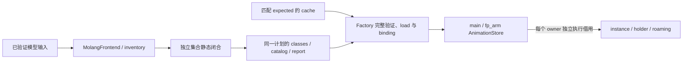

# Molang 运行时的落实关系

本页对应[共享产物准备与准入](../molang-runtime.md#共享产物准备与准入)、[完整准备](../molang-runtime.md#完整准备与准入)和[即时动作](../molang-runtime.md#invocation-与效果)，列出编译身份、缓存加载、执行绑定与短期入口的类级映射。语言与扩展契约分别归[静态语言](../molang-static-language.md)、[解释语义](../molang-interpreter.md)和[共同声明](../molang-declarations.md)。

## 源码、解析与缓存

本节覆盖 AOT 路径的程序清点、预期身份（expected）、generation 与编译加载；GUI 独立准备见[GUI 独立解释](#gui-独立解释)。

- **清点与编译输入**：`MolangFrontend` 将源码解析为 Portable Program，`ModelProgramInventory` 分别按 `main` 与 `fp_arm` 清点程序、入口与业务位置。引擎在单次编译单元内合并契约等价入口，同时逐来源保留 inventory 与业务位置，且隔离本地函数与默认补全函数身份。AOT 持久热路径不再读源码或旧 AST。
- **预期身份（expected）**：`RenderTargetExpressionModuleFactory` 基于已验证输入、冻结 registry/计划与编译环境计算 expected。`HostAbi` 汇总冻结声明、完整动画 ABI、宿主兼容内容与 `EngineAbi.current()` 的实际包名和派生版本；编译身份同时纳入语言语义以及 generator、runtime、linkage、verifier 的兼容摘要。生成类名由引擎决定。
- **结构身份与位置分离**：源码内容、配置、来源与用途进入确定性身份，显示位置不进入。`ProgramKey` 标识当前组合下的结构身份，完整 origin 与位置信息独立用于绑定和诊断。磁盘存储与复用校验见[模型存储](../../model-management/storage/overview.md)。
- **语义选项传递**：`ModelInfoView` 直接从原始 `origin_ver` 构造不可变 `CompilerOptions`。准备 `main`/`arm`、GUI/FULL 输入，以及合入默认源和公共函数后均沿用接收模型选项；Factory 的缓存查询、失败 key、冷编译和 expected 计算共用该值。加载完成的 generation 将选项交给 transient 布局，旧安装请求不会读到新安装状态。
- **除零回退实现**：开启除零回退时，引擎生成对共享 helper 的精确静态调用并记录实际除法来源。Helper 随引擎 JAR 重定位，其类与成员信息同时供给代码生成器与字节码校验器；该选项计入 expected，暖路径命中时仅执行验证、加载和绑定。

## 模块与发布流程

- **集合隔离与绑定**：`main` 与 `fp_arm` 各自维护 inventory、generation 与绑定；`player_init`、`player_update`、`sync`、`config` 由 body 分发，其余回调留在原来源集合；默认补全按来源命名空间与本地同名函数隔离。Factory 按 catalog 来源编号建立烘焙索引，经 resource 将每个位置绑定为 `sourceId`、`entryId` 与 `shape`（冷编译、内存复用与磁盘加载共用此步）；因安装已保证引用与当前 resource 配对，`ProgramRef` 不重复携带 generation。Factory 核查完整个 target 的 Roaming 声明并集后才交付结果，实体安装阶段再按真实 subject 构造适用组件。
- **用途计划**：中央预览接收完整 FULL Ready 资源并采用 `AbstractClientPlayer` 绑定；第一人称手部维持自身 AOT 集合；intrinsic default 采用固定 `LivingEntity` 计划。各实体 owner 持有独立私有状态，不同 `ClassLoader` 加载的同名类互不通用。

## GUI 独立解释

- **按需输入与无增量编译**：普通模型卡片、纹理候选和预览图生成的 `FakePlayer` 从区域动画输入存储取得未绑定来源，仅在消费时准备当前表达式，不构建完整 inventory、编译闭包或 AOT module，也不探测 FULL 缓存。来源环境固定接收模型选项以及本地与默认回退名称范围，用户函数体首次调用时才读取准备。现有 transient API 仅用于 AOT 安装态，解释路径新增表达式直接走同一准备入口。
- **源输入复用**：输入存储基于当前源程序生成描述符，在内存或磁盘命中时核对位置、角色、程序键、长度与摘要。首次准备时直接解码、转换并绑定已配对源输入，动画数据块仍按局部批次延迟读取；准备成功的程序随 `AnimationStore` 保留。
- **统一运行设施**：`EntityExpressionRuntime` 按已安装种类直接分发 AOT 或解释出口，两者共用同一套 `MolangContext`、组件 holder、轮级借用、ACTION 门禁、`defer`、Roaming 和实体失败出口。解释路径基于冻结声明与环境缓存的 `MethodHandle` 调用，AOT 直接调用生成实例类。
- **借用与驻留**：`AnimationStore` 统一管理定义、函数、事件程序与解释环境，`InterpretedExpressionPrograms` 负责内部按需程序读取。实体从 store 持有私有执行借用，统一退休规则见[动画资源所有权与退休](../../model-management/client-resources/overview.md#动画资源所有权与退休)。

## 内容准入与动画调试

- **Builtin 准入**：artifact 记录的 replacement 集合是内建模型接纳的唯一依据（局部 `UNSET`、动态门禁 missing 与合法 presence 不计入）。普通模型允许含 replacement 发布；内建模型只要出现 replacement 即拒绝该 target，并继续处理其余 target。
- **报告与诊断**：被合并复用的生成位置在静态报告中保留全部输入来源集合，局部恢复与 replacement 逐来源回填。AOT 执行诊断仅记录顶层 provenance 与原 `Throwable`，解释路径在函数消费失败时额外附带实际函数来源与调用位置。调试视图直接读取已发布 module 的不可变 report（冷暖路径一致），展示游标不保活 resource。

## Binding 与 invocation

### 实例创建与执行串行

- `AnimationStore` 封装后端选择、程序读取与实例创建；`RenderTargetExpressionModule` 仅作为内部后端提供组件 provider、诊断信息与可选 Roaming 状态。Resource 自行获取实例 lease 并消费同代常量与类型目录；实例创建失败时引擎释放候选 lease，组件 holder 仍由实体关闭。
- `EntityExecutionLifecycle` 通过主线程待交接句柄与对应 `Future.get` 串行协调安装、求值、迁移和关闭，runtime 普通访问不加锁也不阻塞等待。`MolangContext` 在每轮求值中充当共用业务 view 与执行帧，provider 同步借用并在轮末解除宿主引用。当前生产 context 依赖单实体串行执行权且不提供跨实例重入保护，引擎自身的活跃检查仅作辅助防御。

### 绑定冻结、箭头派生与声明接纳

- **绑定配对**：`ExpressionHost` 冻结 `ExpressionBinding`，并将声明环境、`BindingPlan` 与静态入口上限计入编译身份。实体安装时按真实 subject 创建同代 `SubjectBinding`，保证 program、context、binding、shape、参数与 receiver 严格配对。
- **箭头链接**：`ExpressionHost` 注册精确 `Entity` 引用及 `MolangContext.derive`、`origin`、`originBinding` 的链接，将 `SUBJECT` 映射为 `CURRENT`、`ORIGIN` 映射为 `ROOT`。`ROOT` 访问器与 `derive` 均直接复用源帧。子环境只检查目标是否为 `null`、已移除或跨世界，不访问目标载体、provider 或 runtime；轮级 `finally` 统一撤销借用。
- **声明冻结与投影**：Collector 依次完成来源检查、冲突检测、all-of 依赖核验与类级资格检查后绑定实现并冻结 registry，随后开放烘焙与缓存查询。普通 host 与 builtin-only host 均从同一次冻结派生，下游直接消费其 effect、补全与链接信息。Intrinsic default 仅挑选可信内建且无外部模组依赖的声明，供 registry、artifact、binding 与 transient 共用。注册权威见[扩展接入](../../integration/overview.md)。

### 许可、异常、动作与数学 intrinsic

- **入口许可与深度**：每条顶层表达式绑定“宿主窗口 ∩ entry/layout 上限”的固定 ACTION 许可。`MolangContext` 仅维护函数深度计数；入口失败交付顶层来源与原 `Throwable`（普通异常抛 `INSTANCE_EXECUTION`，函数深度终止仅截断当前表达式，且首次深度诊断不遮蔽后续普通异常）。独立求值轮经 `ComponentScope.evaluate` 借用 event，动画 pass 复用外层 hook。
- **OOM 归属**：求值期 OOM 绕过单程序零值/`UNSET` 回退，直接终结整轮执行并交由实体操作 owner 接纳；context、待交付载荷与组件借用按常规退出，不因此停用单程序或触发默认模型恢复。Transient 与 watch 任务先交付已有结果通知，再将执行失败交回同一 owner。
- **领域动作与 coded 窗口**：声明类直接调用对应领域 owner（声音走 animation/controller/global manager，骨骼修改当前 bone，controller 动作读取借用 event 上的 coded 窗口）。`CodedAnimationController.process` 在动作选择前开启窗口、player 消费前关闭并在 `finally` 清除。
- **`ysm.defer`**：经公共 view 专用入口登记，复制已求值有限 F32 参数并记录来源、安装与采样上下文。`AnimationPlayer` 与 coded controller 退出上下文时逆序排空，正常组件在 `endEval` 前排空剩余项。每条 handler 重置函数深度与许可（深度超限仅跳过当前项，普通异常清空余项并终止实例）；排空期间关闭 coded 窗口，整轮累计上限 64 次。
- **数学 intrinsic**：`MathDeclarations` 将语言数学名映射到引擎闭集 intrinsic，不经 Java provider 转发。兼容摘要同时覆盖声明、领域实现和 controller 调度源码。

## Event 与 handler 分发

- `@eventType` 登记 target handler，未知后缀不自动获得入口。`player_init` 与 `player_update` 由实体前置任务触发，`sync` 由已验证网络消息或本地调用触发，`defer` 在当前动画上下文结束时逆序排空。Coded override 见[Controller](../controllers-and-playback.md#coded-controller-override)。
- 本地 `ysm.sync` 登记拷贝后的参数、来源与安装身份（不捕获 context 或 event）。源组件与 context 借用全部退出后，runtime 以迭代 FIFO 排空队列，processor 为每项开启新 ACTION 轮；`draining` 标志让排空期新产生的 sync 在同一轮迭代消费，避免同步递归重入。函数深度终止保留已登记载荷；源或 handler 普通异常、安装拒收或严重退出清空余项。远端 sync 直接交给网络 owner。

## Privileged ingress

短期源码执行入口仅来自客户端本地命令，网络 sync 与 form 均调用本地已编译 handler。

| 入口 / 组件 | 执行边界与交付机制 |
|---|---|
| `/ysmclient` 与调试目标 | 经 `RegisterClientCommandsEvent` 注册于客户端 dispatcher，执行与补全都在客户端主线程访问实体 owner。`debug` 默认选玩家自身，支持 `@s`、玩家名、实体 ID 或 UUID（仅限客户端已加载实体）。动画 worker 读取调试目标不改状态，HUD 在主线程解除失效目标；execute 反馈回到主线程时若实例已替换则丢弃。 |
| 缓存清理命令 | `/ysmclient cache prune-next [all]` 沿用本机玩家边界，`/ysm cache prune-next [all]` 需服务端管理等级 2，均只操作当前进程启用的缓存根并预约下次启动清理（带 `all` 额外预约清理全局 converted/bake 的其他 schema 版本）。命令逐根汇报已提交的日期重置，不触发 reload 或即时删除；下次启动时若遇排他锁、扫描不完整或活动保护仍可能跳过。 |
| `TransientExpressionSession` 交付 | 绑定精确安装、generation、`SubjectBinding` 与冻结布局，分三段：主线程 **Prepare** 借用 store 冻结源码、授权、用途、位置与安装 key 并取得独立编译保护 → 后台 **Compile** 仅读冻结输入 → 主线程下次准备窗口 **Attach** 复核安装与 generation 匹配后创建 access（过期候选直接关闭）。`AnimationProcessor` 短临界区 inbox 原子移交关闭权（关闭前 publish 归接收方，关闭后失败归编译方）。Watch 的发现、revision 替换与 attach 均在主线程准备窗口完成，worker 仅执行本轮已接纳 pre/post 任务。 |
| 关闭与语义约束 | Session 显式关闭 access 与 program lease，`Cleaner` 仅持剥离后的 lease 与配额信息，不反向引用 context/provider/session。内容哈希相同的新 generation 不复活旧 access。短期程序不能扩展槽位、提升静态表示或重编模型，违约在调用 provider、写状态或提交动作前拒绝。`EXECUTE`（上限 `ACTION`）与 `WATCH`（上限 `CONTEXT`）均沿用正常持久写语义与当前 Root；仅宿主 `Object` 观察出口对标量装箱，失败按异常返回。 |

## Bounds 与热路径

编译链不设人工数量上限，对完整输入与 artifact 校验编码、类型、实际表示与精确链接；取消或失败时拒绝整个候选。大容量输入由生成器按物理方法、类、初始化块和 dispatch 自动拆分。网络与 Roaming 上限见[协议](../../../standards/protocol-v1/README.md)。AOT 持久热路径不再解析源码、使用反射、动态生成代码或读 artifact 文件，实际分配与帧耗时通过[集成验证](../../../verification/molang-declarations.md)实测。

## 静态表示与对象写

- 跨 module 受管对象值按[静态语言](../molang-static-language.md)做写隔离，外部只读数组按声明共享。运行时不根据动态值改写持久槽位静态表示，布局变化体现在编译身份中。
- `ExpressionHost` 冻结语言选项与深度策略。每条顶层表达式开始时重置源帧活跃函数深度，内部函数、箭头子环境与容量拆分 helper 共用源帧；`LOOP` 每次独立四舍五入并截断至 1024 次，`FOR_EACH` 不截断。单条表达式结束保留整轮诊断，普通异常单独记为终止失败（terminal failure）。
