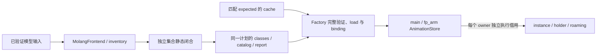

# Molang 运行时的落实关系

本页落实[Molang 编译与执行分离](../molang-runtime.md#共享产物准备与准入)、[完整准备](../molang-runtime.md#完整准备与准入)和[即时动作](../molang-runtime.md#invocation-与效果)，定位编译身份、缓存加载、执行绑定与短期入口的具体责任。AOT 语言规则归[静态语言](../molang-static-language.md)，GUI 动态规则归[解释语义](../molang-interpreter.md)，扩展作者接口归[共同声明](../molang-declarations.md)。

## 源码、解析与缓存

本节描述的完整程序清点（inventory）、预期身份（expected）、generation、编译与加载均针对 AOT 路径；GUI 路径直接消费独立的未绑定输入，见[GUI 独立解释](#gui-独立解释)。

`MolangFrontend` 将源码解析为 Portable Program，`ModelProgramInventory` 分别按 `main` 与 `fp_arm` 完整清点所选 target 或动画集的程序、入口和业务位置；AOT 持久执行阶段不再读取源码或旧 AST。`RenderTargetExpressionModuleFactory` 根据已验证输入、冻结的 registry 与计划以及编译环境，重新计算预期身份（expected）。引擎会在完整编译单元内合并契约等价的入口，但 inventory 与业务位置仍逐来源保留；共享编译结果不会混淆本地函数与默认补全函数的独立身份。

`HostAbi` 汇总冻结声明与执行契约、完整动画 ABI、宿主兼容内容，以及 `EngineAbi.current()` 的实际包名与派生版本；编译身份还包含语言语义以及 generator、runtime、linkage 与 verifier 的兼容摘要。仅凭源码、Java 签名和版本号相同不足以复用旧缓存；生成类名由引擎决定，宿主不从包名反推。

源码内容、配置、来源及用途均计入确定性身份，而显示位置不进入逻辑身份。`ProgramKey` 标识当前组合下的结构身份，完整 origin 与位置信息则独立用于绑定和诊断，旧缓存标签不能替代当前映射。磁盘存储验证与复用规则见[模型存储](../../model-management/storage/overview.md)。

`ModelInfoView` 直接从原始 `origin_ver` 构造不可变的 `CompilerOptions`，不复用历史档位舍入。准备 `main` 与 `arm` 以及 GUI 与 FULL 输入时传递同一份选项，合入默认源和公共函数后也继续沿用接收模型的选项。Factory 的缓存查询、失败 key、冷编译和预期身份计算共用该值。加载完成的 generation 会把选项交给 transient 布局，旧安装的临时编译请求不会读到新安装的状态。

当除零回退选项开启时，引擎会生成对共享 helper 的精确静态调用，并记录实际除法来源。Helper 随引擎 JAR 一起重定位，对应的类与成员信息同时服务于代码生成器与字节码校验器。该选项与兼容内容一并计入预期身份，身份命中时暖路径只执行验证、加载和绑定。

## 模块与发布流程

`main` 与 `fp_arm` 各自维护独立的 inventory、generation 与绑定：body 负责分发 `player_init`、`player_update`、`sync` 和 `config` 事件，其余回调留在各自的来源集合。默认补全通过来源命名空间与本地同名函数隔离。Factory 根据 catalog 中的来源编号建立烘焙索引，再通过 resource 把每个位置绑定为 `sourceId`、`entryId` 与 `shape`；冷编译、内存复用与磁盘加载共用这一步骤。由于安装已经保证引用与当前 resource 配对，`ProgramRef` 不再重复携带 generation。Factory 核查完整个 target 的 Roaming 声明并集后才会交付结果，实体安装阶段再针对真实 subject 构造适用组件。

动画页的中央预览接收完整的 FULL Ready 资源，使用 `AbstractClientPlayer` 绑定；第一人称手部维持自身的 AOT 集合；intrinsic default 使用固定的 `LivingEntity` 计划。每个实体 owner 均创建独立的私有状态，由不同 `ClassLoader` 加载的同名类互不通用。

## GUI 独立解释

解释路径对每条表达式独立准备，用户函数体在实际调用时按来源读取，解释环境只复用基于冻结声明生成的只读调用计划。现有的 transient API 属于 AOT 的增量编译入口，仍要求实体处于 AOT 安装态；解释路径不存在整集与增量编译之分，新增表达式直接走同一准备入口，不另建 transient 机制。

普通模型卡片、纹理候选和预览图生成的 `FakePlayer` 从区域动画输入存储中获取未绑定来源，按实际消费准备程序，初始化、controller 与展示动画仍由既有实体 owner 驱动。GUI 不构建完整 inventory、编译闭包或 AOT module，也不探测 FULL 缓存文件。来源环境固定了接收模型的选项以及本地与默认回退的完整名称范围，函数体直到首次调用才读取，局部程序索引不构成缺失证明。

准备输入中保留了当前源程序；输入存储基于同一来源生成描述符，在内存或磁盘命中时核对位置、角色、程序键、长度与摘要。解释程序首次准备时直接消费这批已配对的源输入，只解码、转换和绑定当前程序，无需逐条程序重开派生文件。准备成功的程序随 store 保留，动画数据块仍按局部批次延迟读取。

`EntityExpressionRuntime` 在安装态明确区分 AOT 实例与解释实例，求值出口直接按已安装种类分发，不做失败后切换路径或后台静默升级。两条路径直接复用同一套 `MolangContext`、组件 holder、轮级借用、ACTION 门禁、`defer`、Roaming 和实体失败出口。解释绑定基于同一份冻结声明及各自环境缓存的 `MethodHandle`，调用时传入当前实例的接收者；AOT 则直接调用编译生成的实例类。

`AnimationStore` 统一接管定义、函数与事件程序以及解释环境，`InterpretedExpressionPrograms` 是其内部的按需程序读取机制。实体从 store 获取私有执行借用，实例内的求值、函数调用和同步读取共用这份保护；固定输入预览与独立后台工作按各自工作寿命归还保护。统一关闭与驻留规则见[动画资源所有权与退休](../../model-management/client-resources/overview.md#动画资源所有权与退休)。

## 内容准入与动画调试

Artifact 中显式记录的 replacement 集合是内建模型（builtin）接纳的唯一依据，诊断文案或错误码前缀不承担判定权威。普通模型允许发布带 replacement 的完整 module；内建模型只要出现任意 replacement，就拒绝该 target，并继续汇总其余可完成的 target。局部 `UNSET`、动态门禁 missing 与合法 presence 不计入 replacement。

对于被合并复用的生成位置，静态报告仍保留全部输入来源集合，局部恢复与 replacement 会逐来源回填。AOT 执行诊断只保留实际的顶层 provenance 与原 `Throwable`，解释路径在函数消费失败时会额外附带实际函数来源与调用位置。调试视图直接读取已发布 module 的不可变 report，冷路径与暖路径共享同一份报告。调试展示游标不保活 resource，也不触发编译。

## Binding 与 invocation

### 实例创建与执行串行

`AnimationStore` 封装后端选择、程序读取和实例创建；`RenderTargetExpressionModule` 仅作为内部后端向引擎提供组件 provider、诊断信息和可选的 Roaming 状态。Resource 自行获取实例 lease 并消费同代常量与类型目录，宿主不再维护一份用于回传的常量表。实例创建失败时由引擎释放候选 lease，组件 holder 的关闭责任仍归实体。

`EntityExecutionLifecycle` 通过主线程待交接句柄和对应 `Future.get` 串行协调安装、求值、迁移和关闭，runtime 的普通访问不加通用锁也不隐式等待。`MolangContext` 在每轮求值中充当共用的业务 view 与执行帧，provider 只同步借用并在轮末解除宿主引用。引擎自身的活跃检查不能替代宿主串行调度和跨实例禁止重入约束。

### 绑定冻结、箭头派生与声明接纳

`ExpressionHost` 冻结 `ExpressionBinding`，声明环境、`BindingPlan` 与静态入口上限一并进入编译身份。实体安装时针对真实 subject 创建同代 `SubjectBinding`，保证 program、context、binding、shape、参数与精确 receiver 严格配对，执行入口和生成代码直接消费这些保证。

`ExpressionHost` 注册精确类型 `Entity` 引用以及 `MolangContext.derive`、`origin` 和 `originBinding` 的链接关系，将 `SUBJECT` 映射到 `CURRENT`，将 `ORIGIN` 映射到 `ROOT`。`ROOT` 访问器直接从既有源帧获取源 context 与 binding，`derive` 也接收同一帧，根 context 不额外保存指向自身的引用。安装阶段绑定源 subject，轮级 `finally` 统一撤销借用。箭头派生的子环境只检查目标是否为 `null`、已移除或跨世界，不去探测载体、provider 或目标 runtime。

Collector 先完成来源检查、冲突检测、全部 all-of 依赖核验与类级资格检查，再绑定实现并冻结 registry，之后才开放烘焙与缓存查询。下游消费者直接从这批已接纳声明派生 effect、符号补全、host 链接和 builtin-only 投影，不维护第二份发布目录；普通 host 与 builtin-only host 来自同一次冻结。Intrinsic default 只从可信内建来源中挑选依赖不含外部模组的声明，registry、artifact、binding 和 transient 共用这份投影（它不隔离函数实现内部的传递调用）。默认源保持未绑定，普通模型在自身 host 中编译补全内容。注册权威见[扩展接入](../../integration/overview.md)。

### 许可、异常、动作与数学 intrinsic

每条顶层表达式绑定“宿主窗口与 entry 或 layout 上限取交集”后的固定 ACTION 许可。`MolangContext` 只保存函数深度计数，生成代码不维护执行游标、callee 来源或影子栈。入口失败交付顶层来源与原 `Throwable`：普通异常抛出 `INSTANCE_EXECUTION`，函数深度终止只截断当前表达式，且首次深度诊断不会遮蔽随后发生的普通异常。独立求值轮通过 `ComponentScope.evaluate` 借用 event，动画 pass 则复用外层 hook。

发生 OOM 时保留其资源失败归属，绕过单程序的零值或 `UNSET` 回退分支，直接终结包含该求值的整轮执行。实体操作 owner 接纳该失败，context、待交付载荷与组件借用按正常流程退出；不会因 OOM 停用某个 program 或转入默认模型恢复。Transient 与 watch 任务先交付已有的结果通知，再把执行失败交回同一 owner。

声明类同步定位精确领域 owner 并直接调用：声音走当前的 animation、controller 或 global manager，骨骼直接修改当前 bone，controller 动作只读取借用 event 上的 coded 窗口。`CodedAnimationController.process` 在动作选择前打开该窗口、player 消费前关闭，并在 `finally` 中清除。只读访问 `ControllerExecutionState` 不授予修改权限。

`ysm.defer` 通过公共 view 的专用登记方法工作：runtime 复制已求值的有限 F32 参数并保存独立来源、安装与采样上下文。`AnimationPlayer` 与 coded controller 退出上下文时按逆序排空，正常组件在 `endEval` 前排空剩余 capture。每个延迟 handler 重置函数深度与许可：深度超限只跳过当前项，普通异常则清空余项并终止实例。排空期间关闭 coded 窗口，整轮累计 64 次捕获限制递归登记。

`MathDeclarations` 将语言数学名映射到引擎闭集 intrinsic。普通声明接纳、数学声明以及实际 registry 与 binding 共同封闭编译身份，数学运算不经过 Java provider 转发。兼容摘要同时覆盖声明、领域实现和 controller 调度源码。

## Event 与 handler 分发

`@eventType` 用于登记 target handler，未知事件后缀不会自动获得调用入口。`player_init` 与 `player_update` 由实体前置任务触发，`sync` 由已验证的网络消息或本地调用触发，`defer` 在当前动画上下文结束时逆序排空。Coded override 的匹配与回退规则见[Controller](../controllers-and-playback.md#coded-controller-override)。

本地 `ysm.sync` 登记独立的拷贝参数、来源和安装身份，不捕获 context 或 event。Runtime 在源组件与 context 借用全部退出后，以迭代方式按 FIFO 顺序排空队列，由 processor 为每项开启新的 ACTION 轮；`draining` 标志保证排空期间新产生的 sync 由同一轮迭代继续消费，杜绝同步递归重入。函数深度终止会保留已登记的正常载荷，而源或 handler 的普通异常、安装拒收及严重退出会清空剩余队列。远端 sync 则立即交给网络 owner。

## Privileged ingress

短期源码执行入口仅来自客户端本地命令：服务端不提供任意源码执行命令或专用源码载荷，网络的 sync 与 form 请求继续调用本地已编译 module 的既有 handler。

- **客户端命令与调试目标**：`/ysmclient` 通过 `RegisterClientCommandsEvent` 注册在客户端 dispatcher，命令执行与补全都在客户端主线程访问实体 owner，不依赖服务端命令树或服务端权限。`debug` 默认选中玩家自身，也支持 `@s`、玩家名、实体 ID 或 UUID，目标仅限于客户端当前已加载实体，不解析服务端选择器。动画 worker 读取调试目标时不修改或清理状态，HUD 在主线程解除失效目标。Execute 的结果反馈回客户端主线程，若玩家实例已经替换则直接丢弃。
- **缓存清理命令**：`/ysmclient cache prune-next [all]` 沿用本机玩家边界，预约本进程下次启动时清理缓存；`/ysm cache prune-next [all]` 要求服务端管理等级 2，集成服与专用服均可使用，且命令只访问当前执行进程启用的缓存根。命令逐根报告已提交的日期重置，未启用全局根时不保存全局请求；带 `all` 时还会持久预约清理全局 converted 与 bake 缓存中的其他 schema 版本。这些命令不触发 reload 或即时清理，下次启动时仍可能因进程排他锁、扫描不完整或活动对象保护而跳过清理。
- **短期编译与原子交付**：`TransientExpressionSession` 绑定精确安装与 generation、`SubjectBinding` 以及冻结布局。主线程在 Prepare 阶段通过当前 store 的执行借用冻结源码、授权、用途、位置和精确安装 key，并取得独立编译保护；后台 Compile 线程只读取冻结输入，不捕获可变 runtime、实例或实体。主线程在下一次执行准备窗口进入 Attach，复核当前安装与 generation 仍匹配后才创建 access，过期候选直接关闭；成功的 access 归 session 持有。`AnimationProcessor` 的短临界区 inbox 只负责原子转移独立编译产物：关闭前 publish 成功则由接收方负责关闭，关闭后 publish 失败则由编译方负责关闭，不依赖“先查 epoch 再入队”。Watch 的发现、revision 替换与 attach 全部在主线程准备窗口完成，worker 只跑本轮已接纳的 pre 与 post 任务。
- **关闭与语义边界**：Session 显式关闭 access 和 program lease，各自的 `Cleaner` 只保存剥离后的 lease 与必要配额信息，不反向引用 context、provider 或 session。即使新 generation 的内容哈希相同，也不会复活旧 access。短期程序不得扩展槽位、提升静态表示或重编模型，违约在调用 provider、写状态或提交动作前即被拒绝。`EXECUTE` 与 `WATCH` 都使用正常持久写语义和当前 Root：`EXECUTE` 可申请 `ACTION`，`WATCH` 上限为 `CONTEXT`，不用 snapshot 绕开状态语义。只有宿主 `Object` 观察出口会对标量装箱，执行失败绝不伪装成成功 `UNSET`。

## Bounds 与热路径

编译链不施加人工数量上限，但对完整输入与 artifact 仍严格检查编码、类型、实际表示和精确链接；遇到取消或真实失败时拒绝整个候选，不截断 replacement 集合来凑发布。面对大容量输入，生成器按物理方法、类、初始化块和 dispatch 自动拆分，实际开销由产物和基准测试反映。网络与 Roaming 数量上限由[协议](../../../standards/protocol-v1/README.md)定义。AOT 持久热路径不再解析源码、使用反射、动态生成代码或读 artifact 文件，但结构本身不证明零分配或帧预算达标，测量方法见[集成验证](../../../verification/molang-declarations.md)。

## 静态表示与对象写

跨 module 的受管（managed）对象值按[静态写入规则](../molang-static-language.md)做写隔离，外部只读数组则按声明共享。运行时不会根据值反推形状，也不会临时改变持久槽位的静态表示；任何布局变更都体现为编译身份变化。

`ExpressionHost` 冻结语言选项与深度策略。执行帧在每条顶层表达式开始时重置活跃函数深度，内部函数、箭头子环境和容量拆分 helper 共用源帧；`LOOP` 每次独立四舍五入并截断到 1024 次，`FOR_EACH` 不截断。单条表达式结束不会清空整轮诊断，普通异常单独记为终止失败（terminal failure）。
