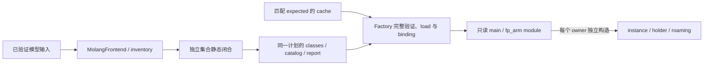

# Molang 运行时的落实关系

本页落实[Molang 编译与执行分离](../molang-runtime.md#编译与执行分离)、[完整准备](../molang-runtime.md#完整准备与准入)和[效果事务](../molang-runtime.md#invocation-与效果)。语言规则由[静态语言](../molang-static-language.md)拥有，扩展作者接口由[共同声明](../molang-declarations.md)拥有。

## 源码、解析与缓存

`MolangFrontend` 形成 Portable Program；`ModelProgramInventory` 按 main/fp_arm 完整清点所选 target/set 的程序、入口与业务位置。持久执行不再读取 source 或旧 AST。`RenderTargetExpressionModuleFactory` 从已验证输入、冻结 registry/plan 与编译环境重建 expected。引擎在完整单元内合并等价契约，inventory 和业务位置仍逐来源保留；共享不改变本地与默认函数的独立 callable 身份。

HostAbi 包含冻结声明和执行契约、完整动画 ABI、宿主兼容内容，以及 `EngineAbi.current()` 的实际包名与派生版本。编译身份另含语义、generator/runtime/linkage/verifier 兼容摘要。同 source、Java 签名与版本号不足以复用；生成类名由引擎提供，宿主不从包名推导。

源码内容、配置、来源及用途进入确定性身份，显示位置不进入 logical identity。ProgramKey 保持当前组合的结构身份，完整 origin 与位置独立用于绑定和诊断；旧 cache 标签不能替代当前映射。存储验证与复用见[模型存储](../../model-management/storage/overview.md)。

## 模块与发布流程

Main/fp_arm 各有独立 inventory、generation 与绑定；body 分发 player_init/update、sync/config，其他回调保持来源集合。默认补全用来源命名空间隔离本地同名函数。Factory 从 catalog 的来源编号构造 baked 索引，并通过 resource 绑定每个位置的 sourceId/entryId/shape/generation；冷、内存与磁盘路径共用该步骤。Factory 检查整个 target 的 Roaming 并集后才交付；实体安装另行构造适用组件与真实 subject。

普通卡片与纹理候选使用 GUI 展示闭包和 `FakePlayer` binding。GUI 不探测或借用 FULL module；动画页中央预览接收完整 FULL Ready，使用 `AbstractClientPlayer` binding。Default 使用固定 `LivingEntity` 计划。每个 owner 都创建私有 state，ClassLoader 不同的同名 Class 不互换。

## 内容准入与动画调试

Artifact 的显式 replacement 集合是 builtin 准入依据，诊断文字或 code 前缀不是裁决权威。普通模型可使用带 replacement 的完整 module；builtin 任一 replacement 拒绝该 target，并继续汇总其他可完成 target。局部 UNSET、动态 missing 与合法 presence 不算 replacement。

共享生成位置的静态报告保留输入来源集合；局部恢复与 replacement 逐来源投影。`RuntimeDiagnostics` 只解释执行异常，`MolangContext.CallFailure` 在 reset 前保存实际顶层 provenance 与独立 callee 来源/node/cause。调试从已发布 module 读取不可变 report，并用当前 ProgramKey 映射定位；冷、暖路径共用此事实。调试游标不保活 target/resource，也不触发编译；关闭、目标或 generation 变化时丢弃。发送失败不推进游标。

## Binding 与 invocation

`EntityExpressionRuntime.ownerBarrier` 串行安排安装、求值、迁移和 close。`MolangContext` 是每轮共用的业务 view 与 frame；provider 只同步借用，轮结束解除宿主引用。引擎的活跃检查不替代宿主串行与跨 instance 的禁止重入约束。

`ExpressionHost` 冻结 `ExpressionBinding`；声明环境、BindingPlan 与静态入口上限进入身份，subject 实例和当前许可不进入 key。执行前由引擎核对已绑定 source/entry 配对、shape 和 exact generation；同内容重建也不能复活旧引用。安装为真实 subject 创建同代 SubjectBinding；获准调用缺失精确 provider 时，在求参前失败。

Collector 先完成来源、冲突、依赖与类资格，再绑定实现并冻结 registry；随后才开放 bake/cache lookup。普通与 builtin-only host 来自同一次冻结。Intrinsic default 的 artifact、组件及 transient 使用可信投影，普通模型借用 default 源仍使用普通 host。注册权威见[扩展接入](../../integration/overview.md)。

每条表达式绑定固定 ACTION 许可，由宿主窗口与 entry/layout 上限求交。表达式 reset 清除本次借用，不清整轮首次失败、输入或 batch。`EffectTransaction` 在全部 program、必要 hook、效果验证与 owner 资格成功后提交一次；清理失败也阻止提交。已提交的外部效果不回滚。

OOM 保留资源失败归属，越过单 program 的零值或 UNSET 分支，终结包含该求值的整轮执行。实体操作 owner 接纳失败，context、效果 batch 和 barrier 按正常路径退出；不因 OOM 停用 program 或进入默认模型恢复。Transient/watch 先交付已有结果通知，再把执行失败交回同一 owner。

声音预验证选定精确 animation/controller/global manager，提交闭包只捕获该 manager，不从复用 context 补读。`ysm.defer` 复制有限 F32 与独立来源，不保留 argument view；排空时进入新的顶层权限与预算窗口。

## Event 与 handler 分发

`@eventType` 登记 target handler，未知后缀不自动获得调用者。Player init/update 由实体前置任务触发；sync 由已验证消息或本地调用触发；defer 在当前 animation context 结束时逆序排空。Coded override 的选择见[Controller](../controllers-and-playback.md#coded-controller-override)。

## Privileged ingress

`TransientExpressionSession` 使用 exact installation/generation、SubjectBinding 与冻结 layout。准备先在 barrier 保留资源，离开 barrier 编译，再回到 barrier 复核安装、取消与非执行状态；过期候选关闭。成功 access 由 session 持有，排队、watch 与直接执行复用它。

Session 显式关闭 access 和 program lease。各自 Cleaner 只保存 detached lease 与必要配额信息，不保留 context、provider 或 session。相同 hash 的新 generation 不复活旧 access。短期程序不得扩 slot、提升表示或重编模型；拒绝发生在 provider、状态或动作之前。

EXECUTE/WATCH 都使用正常持久写语义和当前 Root。EXECUTE 可申请 ACTION，WATCH 上限为 CONTEXT；不以 snapshot 绕开状态语义。只有宿主 Object 观察出口装箱 scalar，执行失败不伪装成成功 UNSET。

## Bounds 与热路径

编译输入、报告与 artifact 受宿主显式策略约束，超限拒绝，不能截断 replacement 集合发布。网络与 Roaming 上限由[协议](../../../standards/protocol-v1/README.md)拥有。持久执行不解析源、反射、生成代码或访问 artifact 文件；该结构不证明零分配或帧预算，计量边界见[集成验证](../../../verification/molang-declarations.md)。

## 静态表示与对象写

跨 module 的 managed 值按[静态写入规则](../molang-static-language.md)隔离，foreign/readonly 数组按其声明共享。运行时不从值反推形状或临时改变持久表示；布局变化属于编译身份变化。

`ExpressionHost` 把 `ExpressionPolicy` 交给 registry 与 CompilationPolicy，builtin-only host 保留相同策略。lookup 从可信来源和策略构造 expected；transient 从本代 module 派生策略并保留原预算。frame 按顶层入口重置 loop/value、provider、control 和 depth 计数，内部函数共用窗口；generic argument scratch 继续拒绝使用。被拒绝的重入不取得清理权，表达式结束不清除整轮首次失败和待裁决效果。
