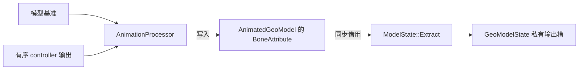

# 动画与骨骼输出的交接

本页对应[动画数据流](../overview.md#数据流与交接)与[渲染资源边界](../../rendering/overview.md#资源与状态)，说明 Java 动画求值到 native Extract 之间的骨骼通道映射与同步借用边界。

## 处理流程

每帧求值时，`AnimationProcessor` 合并有序的 controller 输出并复位未被驱动的通道，将局部结果写入实体私有属性数组。活跃骨骼（active bone）指当前仍受动画或复位驱动的骨骼，与渲染器最终可见骨骼集合相互独立。动画绑定与 `BakedModel` 共用同一份前序遍历（preorder）骨骼顺序。

## BoneAttribute

| 通道 | 动画与 Extract 共同解释的语义 |
|---|---|
| `rotation` | 已包含模型初始旋转的最终局部旋转 |
| `position` | 相对模型基准的局部动画位移 |
| `scale` | 局部缩放 |
| `cubes_hidden` | 隐藏本骨骼自身的几何与 locator，不影响后代骨骼 |
| `children_hidden` | 保留当前骨骼，跳过其全部后代骨骼 |
| `locator_sequence` | 静态 locator 标记，供提取阶段选择附着点 |
| `color` | 当前骨骼的 RGB 乘色，默认白色 |
| `transparency_glow` | Alpha 与 glow；默认 alpha 不衰减，glow 可保留上层光照 |

- **局部作用域与持久性**：`BoneAttribute` 仅存局部骨骼属性（不含最终矩阵、可见面、顶点偏移或 GPU 状态）。颜色、透明度与 glow 不向后代继承，经动态动作写入后跨帧保持，直至再次写入或重建 `AnimatedGeoModel`（兼容纹理替换保留当前值）。
- **命名 glow 初值**：`GeoBone` 保存由骨骼名称推导的不可变 glow 初值，`AnimatedGeoBone.initializeAttributes()` 统一用它初始化活跃属性与第一人称背景声明属性。运行时动态写入不改写 `GeoBone`，Extract 与 Render 也不再重复解析名称前缀，对应[命名初值契约](../../../product-decisions/decisions/geometry-regions.md#bcnamed-bone-glow-is-overridable)。

## Native 交接

- **同步只读借用**：`AnimatedGeoModel` 持有属性数组，native `ModelState::Extract` 仅在本次同步调用内临时读取，不留存地址也不反写动画状态。Java 原位更新数组后同步触发提取，无独立 staging 回滚；提取失败后的消费资格由[帧发布](../../rendering/implementation/frame-execution.md#输入输出与状态)裁决。
- **`ysm.bone_pivot_abs` 读取语义**：求值期间直接读取同一渲染上下文上一次完整 Extract 产出的骨骼槽位并结合 pivot 还原模型空间坐标，不跨调用保存底层视图。缺少匹配有效输出或目标骨骼时返回零向量；若本次 Extract 跳过了目标骨骼，仍会读出槽位中已有内容（可能是初始值、旧帧或旧模型残留）。第一人称手臂与 `firstPersonMod` 求值中固定返回向量 missing。
- **第一人称背景输入**：直接使用 `GeoModel` 的声明初始属性（不取运行期动画快照），模型引用变化时仅重建该背景输入，不另建 processor 或表达式实例。三份输出的借用与复用见[局部根提取](../../rendering/implementation/frame-execution.md#局部根提取)。
