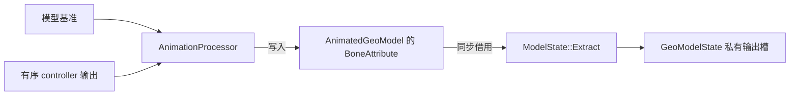

# 动画与骨骼输出的交接

本页落实[动画数据流](../overview.md#数据流与交接)与[渲染资源边界](../../rendering/overview.md#资源与状态)，定义 Java 动画求值到 native Extract 之间的骨骼通道映射与借用边界。

## 处理流程

每帧求值时，`AnimationProcessor` 合并有序的 controller 输出并复位未被驱动的通道，将结果写入实体私有的属性数组。这里的活跃骨骼（active bone）表示仍受动画或复位驱动的骨骼，不等同于渲染器最终可见的骨骼。动画绑定与 `BakedModel` 共用同一份前序遍历（preorder）顺序，但动画绑定本身不替代几何烘焙（geometry bake）。

## BoneAttribute

| 通道 | 动画与 Extract 共同解释的语义 |
|---|---|
| `rotation` | 已包含模型初始旋转的最终局部旋转 |
| `position` | 相对模型基准的局部动画位移 |
| `scale` | 局部缩放 |
| `cubes_hidden` | 隐藏本骨骼自身的几何与 locator，不自动隐藏后代骨骼 |
| `children_hidden` | 保留当前骨骼，跳过其全部后代骨骼 |
| `locator_sequence` | 静态 locator 标记，供提取阶段选择附着点 |
| `color` | 当前骨骼的 RGB 乘色，默认白色 |
| `transparency_glow` | Alpha 与 glow；默认 alpha 不衰减，glow 可保留上层光照 |

`BoneAttribute` 只携带局部骨骼属性，不包含最终变换矩阵、可见面、顶点偏移或 GPU 状态。颜色、透明度与 glow 不会向后代继承；经动态动作写入后会跨帧保持，直到再次被写入或重建 `AnimatedGeoModel`（兼容纹理替换不会重置它们）。

`GeoBone` 保存根据骨骼名称推导出的不可变 glow 初值，`AnimatedGeoBone.initializeAttributes()` 统一用它初始化活跃属性与第一人称背景的声明属性。运行时动态写入不修改 `GeoBone`，Extract 与 Render 阶段也不再重复应用名称前缀，对应[命名初值契约](../../../product-decisions/decisions/geometry-regions.md#bcnamed-bone-glow-is-overridable)。

## Native 交接

`AnimatedGeoModel` 持有属性数组，native `ModelState::Extract` 仅在调用窗口内同步临时读取，不保存内存地址，也不反写 Java 动画状态。由于 Java 是原位写入属性数组后同步调用提取，不存在独立的 staging 回滚机制；提取失败后的消费资格由[帧发布](../../rendering/implementation/frame-execution.md#输入输出与状态)判断。

`ysm.bone_pivot_abs` 在动画求值期间直接读取同一渲染上下文上一次完整 Extract 产出的骨骼槽位，并结合骨骼 pivot 还原模型空间坐标；若缺少匹配的有效输出或目标骨骼，则返回零向量。需要注意，即便本次 Extract 跳过了该骨骼，查询仍会读取槽位内容——读到的可能是初始值、旧帧数据或旧模型残留，这一边界由模型作者承担。在第一人称手臂与 `firstPersonMod` 求值中，该查询固定返回向量 missing。底层视图不跨调用保存。

第一人称背景直接使用对应 `GeoModel` 的声明初始属性，不从运行中的动画快照或复位结果获取。模型引用变化时仅重建该背景输入，不另建 processor 或表达式实例。第一人称三份输出的借用与复用规则由[局部根提取](../../rendering/implementation/frame-execution.md#局部根提取)负责。
