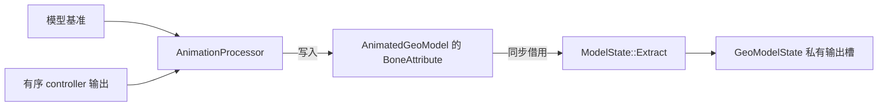

# 动画与骨骼输出的交接

本页落实[动画数据流](../overview.md#数据流与交接)与[渲染资源边界](../../rendering/overview.md#资源与状态)，定义 Java 动画到 native Extract 的必要通道映射。

## 处理流程

`AnimationProcessor` 合成 controller 并复位未驱动通道，写入 entity 私有属性数组。其 active bone 表示仍受动画或复位驱动的骨骼，不等同于 renderer 的可见骨骼。绑定与 `BakedModel` 使用同一 preorder；动画绑定不替代 geometry bake。

## BoneAttribute

| 通道 | 动画与 Extract 共同解释的语义 |
|---|---|
| rotation | 已包含模型初始旋转的最终局部旋转 |
| position | 相对模型基准的局部动画位移 |
| scale | 局部缩放 |
| cubes_hidden | 隐藏本骨骼几何与 locator，不必隐藏后代 |
| children_hidden | 保留当前骨骼，跳过全部后代 |
| locator_sequence | 静态 locator 标记，供提取选择附着点 |
| color | 当前骨骼 RGB 乘色，默认白色 |
| transparency_glow | Alpha 和 glow；默认 alpha 不衰减，glow 可保留上层 light |

属性不包含最终矩阵、可见面、顶点偏移或 GPU 状态。颜色、透明度和 glow 不向后代继承；动态动作写入后跨帧保留，直到再次写入或创建新的 AnimatedGeoModel。兼容变体替换不重置它们。

`GeoBone` 保存名称推导的不可变 glow 初值；`AnimatedGeoBone.initializeAttributes()` 统一初始化活跃属性与第一人称背景声明属性。动态写入不改 GeoBone，Extract/Render 不再次应用名称前缀。对应[命名初值契约](../../../product-decisions/decisions/geometry-regions.md#bcnamed-bone-glow-is-overridable)。

## Native 交接

`AnimatedGeoModel` 保留属性数组，Extract 只同步临时读取，不保存地址或反写动画。Java 原位写入后同步提取，不具备独立 staging 回滚；失败后的消费资格由[帧发布](../../rendering/implementation/frame-execution.md#输入输出与状态)判断。

第一人称背景使用精确 GeoModel 的声明初始属性，不从运行中动画快照或复位取得。模型引用变化时重建该输入，不另建 processor 或表达式实例。三份输出的借用与复用由[局部根提取](../../rendering/implementation/frame-execution.md#局部根提取)拥有。
