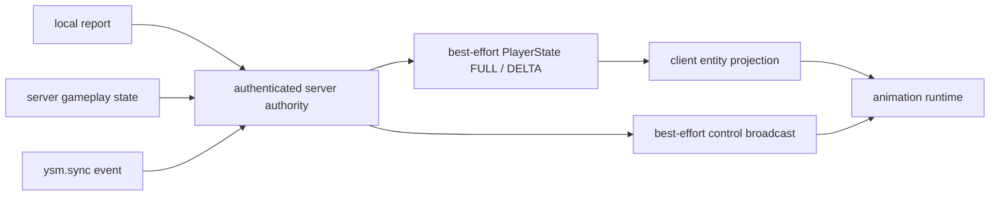

# 状态输入与同步

本页落实[动画输入交接](../overview.md#数据流与交接)，定位联网权威投影、实体私有状态与事件接纳的不同责任。

动画运行时消费的是客户端可见状态的投影。服务端为联网玩家状态的权威，但不求值 animation、controller 或骨骼；客户端把权威投影与本地 `Entity`、输入和 `RenderContext` 合并后完成动画。

## 输入分类

| 输入 | 典型内容 | 权威与用途 |
|---|---|---|
| `Entity` 观察 | tick、位置与位移、`Pose`、骑乘、生命状态、行走、身体与头部方向 | 客户端 `level` 中的当前事实，用于连续动作与姿态 |
| 服务端 PlayerState | 模型选择、gameplay / effects、额外动画、远端操作轴、Roaming | 经 exact connection 与内容验证的 best-effort 联网投影 |
| `Minecraft` | 键鼠、相机、`level` 与 `LocalPlayer` 状态 | 只用于本地动画或构造受限报告，不能自行成为服务端权威 |
| `AnimationEvent` / `RenderContext` | `partialTick` / `level`、GUI、第一人称、pass 与视角差异 | 分别提供采样时刻，以及姿态语义与输出复用条件 |
| 模型资源 | animation、controller、用户函数、config form 与骨骼绑定 | 容器只携带源与公开模型内容；加载期形成 Portable Program inventory 与已验证 module，不从模型 bytes 接纳 JVM artifact |
| 兼容适配 | 可选模组的动作、装备、载具或相机状态 | 当前直接接线未统一改造和验收，未迁入的联动见[状态](../../../status/known-issues/animation.md#联动与验证) |

`LocalPlayer` 和 `RemotePlayer` 的数据来源不同，但进入 controller 前应归一为明确的逻辑输入。当前查询仍散布在运行时并直接读取 live 对象，尚未形成统一快照，见[实体与帧状态](entity-and-frame-state.md)。

## 状态与事件

Roaming 随 PlayerState FULL/DELTA 的到达机会累积；消息没有 revision、ACK、重放或顺序保证，合法遗漏、重复与延迟可造成投影漂移。`ysm.sync` 是瞬时事件，产品边界见[script-sync](../../../product-decisions/decisions/script-sync.md)，消息限制见[当前协议](../../../standards/protocol-v1/README.md)。

`PlayerStateHandler` 只有收到 model section 才建立远端指派。播放入口自身检查运行职责和完整安装；缺安装或暂停时不读动画、不加载、不排队，但同消息其他投影继续应用。STOP 无需资源。消费者暂停保留领域投影，恢复按最新请求创建新的播放生命周期；模型更替不调用清空网络投影的万能 reset。

## Roaming

Roaming 是模型作用域内、可跨帧和 controller 使用的一组 float 变量，通过 `v.roaming` 暴露给 Molang。加载期分别为 main/arm 解析静态字段，并验证整个 target 并集，entity 侧按 producer／consumer role 持有独立的 generated state。

- `ClientRoamingSession` 按模型派生的 32-bit `modelHash` 保存会话数据；当前 generated state 由 entity expression runtime 持有。LocalPlayer 的保留快照独立于安装，区分未知与已知空；采样不建立恢复资格。首份 self FULL 接纳基线，普通回显保留本地连续性，省略 Roaming 的 FULL 明确清空。接收时校验结构、容量与有限值，安装时再校验字段布局；布局失败保留原数据。
- LocalPlayer 安装从保留快照初始化候选，再发布精确安装资格。联网基线到达前的实例只提供临时表现，不能保留默认值或提交报告；基线到达后先封口，再沿 reload 安装恢复实例。仅本地会话可在成功安装时建立空基线。隐藏、卸载和安装失败保留数据，同会话玩家实例替换通过 `moveFrom()` 转移快照；连接结束沿实体 owner 退休撤销资格。
- `LocalPlayer` body 使用 producer role，每次合法赋值（包括同值）置单一 dirty。正常动画更新结束形成完整 body delta 源结果，worker 不进入会话、载具或 arm。主线程取得源 get 后维护所属 `ClientRoamingSession`；目标也完成对应 get 后，才按精确连接与安装身份采用投影。目标仍忙时结果只保留到本次调用末尾；完整 drain 后最终采用或丢弃，不跨调用重试。Action/control/transient 的写入等下一次正常更新消费。Arm 交集不截断 body-only 字段，逻辑成功后的 Extract 失败不撤回 delta 或动作。
- 远端玩家、投射物与载具使用 consumer role：模型脚本可以推进当前 state，但写入不置 dirty、不上报，也不在 runtime 替换时额外保留。FULL/DELTA 先校验字段名与有限值再修正当前 state，失败不产生部分更新；vehicle 变更会被转发给乘客。
- 新 arm 安装在主线程取得 body 交接后，对交集作一次非消费 snapshot/full 初始化（含空交集）。投影先验证完整字段与有限值，再一次采用；连接或任一端安装换代会丢弃旧结果。报告端也非消费采样，不依赖正常 delta 是否已消费；报告业务入口先取得 body get，再以 exact installation 资格约束 snapshot/planner/编码/提交。模型上下文改变时创建独立 state；报告机会、真实 FULL baseline 与 best-effort 失败边界由[玩家状态与控制](../../network/player-state.md)定义。

Roaming 当前没有删除语义，也不能作为可靠事件队列。短键碰撞与真正 Forge 双端收敛仍有缺口，见[动画已知问题](../../../status/known-issues/animation.md)。

### Roaming owner

Roaming 是按模型命名空间同步的自定义 float 状态：

| 层 | Owner |
|---|---|
| 服务端权威 | `ModelInfoCapability` 的 `RoamingVariableStore` |
| 客户端会话投影 | `PlayerAnimatableCapability` 的 `ClientRoamingSession` |
| 模型可见结构 | 每个 entity runtime 持有 generated roaming state；本地玩家为 producer，其他对象为 consumer |

模型通过 `v.roaming.<name>` 访问当前 state；普通 entity 不共享这份 scoped storage。Producer 的命名 snapshot 用于网络采样，正常更新 delta 用于本地投影。主线程只接纳原 installation 仍有效的变化；endUse 在封口前完成最终 adoption，随后撤销安装引用并保留 LocalPlayer 快照。Consumer 写入只推进当前 runtime，不产生上行状态；服务端 full 或 delta 可以修正当前值。远端 full 建立命名空间基线，基线前到达的 delta 只在所属会话投影内排队。模型切换、远端重置和会话结束分别按其 owner 清理实例或命名空间，不能由动画 processor 推断网络 authority。

## `ysm.sync`

`ysm.sync` 是模型 `sync` handler 的即时事件通道。Client 在允许发射的 logical phase 构造 `EmitMolangSync`，参数至多 16 个有限 F32。服务端按已认证 connection 确定主体，把 `MolangSyncEvent` 广播给可见客户端及发送者。接收端同步执行该 entity 当前的 `sync` handler。

发送端从当前安装取得 shared semantics；服务端以自身已验证模型、target、有效 config 与事件契约重建期望，保持 connection、主体和模型授权后才转发。接收端复核当前 consumer 的 shared semantics，并在自己的 module 中选择 `sync` handler；双方本地 ProgramId、profile、ABI 或布局不同不影响接纳。字段定义与 schema 拒绝规则见[当前协议](../../../standards/protocol-v1/README.md#expression-action-与本地求值)。该门禁不替代本地 artifact 加载验证，也不增加重放或顺序保证。

丢失、可靠性与服务端验证义务由[script-sync](../../../product-decisions/decisions/script-sync.md)定义。

## Config form

Config form 的 read/write/label action 都是模型内已编译的类型化 program。UI 读取当前 entity generation 的 read handler；用户操作先要求同一当前 module 存在对应 bool/F32/label handler，再发送 button/form 语义路由和类型化 payload，不拼接或传输 Molang source。

服务端在转发前验证 connection、目标控制权限、当前模型、shared semantics、form 类型和 label/index；接收端复核当前 module 后执行自己的本地 handler。重新绑定产生的新 entity generation 使旧 UI action 失效，接收方 ProgramId 不来自 wire。完整字段与失败规则见[Expression action 与本地求值](../../../standards/protocol-v1/README.md#expression-action-与本地求值)。
