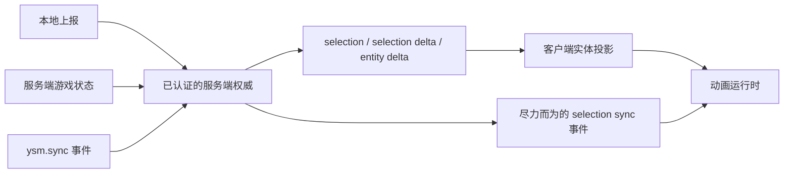

# 状态输入与同步

本页落实[动画输入交接](../overview.md#数据流与交接)，界定联网权威投影、实体私有状态与事件接纳的各自责任。

动画运行时在客户端消费的是可见状态的投影：服务端作为联网玩家状态的权威，但不计算动画、controller 或骨骼姿态；客户端把服务端投影与本地 `Entity`、输入设备和 `RenderContext` 合并，完成最终求值。

## 输入分类

| 输入 | 典型内容 | 权威与用途 |
|---|---|---|
| `Entity` 观察 | tick、位置与位移、`Pose`、骑乘、生命状态、行走、身体与头部方向 | 客户端 `level` 中的实时事实，用于连续动作与姿态 |
| 服务端 PlayerState | 模型选择、gameplay 与 effects、额外动画、远端操作轴、Roaming | 经精确连接与内容验证的尽力而为联网投影 |
| `Minecraft` | 键鼠、相机、`level` 与 `LocalPlayer` 状态 | 仅用于本地动画或构造受限上报，不能自行成为服务端权威 |
| `AnimationEvent` 与 `RenderContext` | `partialTick`、`level`、GUI、第一人称、pass 与视角差异 | 分别提供采样时刻，以及姿态语义与输出复用条件 |
| 模型资源 | animation、controller、用户函数、config form 与骨骼绑定 | 容器只携带源码与公开模型内容；加载期转为 Portable Program inventory 与已验证 module，不从模型字节接纳 JVM artifact |
| 兼容适配 | 可选模组的动作、装备、载具或相机状态 | 当前直接接线尚未统一改造与验收，未迁入的联动见[状态](../../../status/known-issues/animation.md#联动与验证) |

`LocalPlayer` 与 `RemotePlayer` 的原始数据来源不同，但进入 controller 前统一归一为清晰的逻辑输入。历史类查询读取选定的完成样本，远端玩法值读取目标投影；其余实时查询仍保留原有线程与时序限制，见[实体与帧状态](entity-and-frame-state.md)。

## 主体完成样本与玩家投影

`SubjectSample` 保存位置与位移、采样跨度、速度、移动输入、身体与头部及视线方向、control、闭眼分类以及 Melody 已完成结果。数值缺席记为 `NaN`，分类缺席记为 `null`，getter 不触发内存分配。Producer 沿原有的 `beginEval` 与 `update` 窗口维护类型化草稿，不额外增加历史推进或查询 hook；通用样本本身不依赖可选模组类型。

根环境（root）读取当前 owner 的本轮私有样本，箭头子环境（child）在进入时固定读取目标最近完成的样本，自指向箭头（self-arrow）同样读取完成槽。只有 canonical world body 的成功主轮可以发布完成样本，GUI、第一人称以及独立的 action、observation、config 或 transient 入口均不发布。清空与换模规则由[生命周期](../entity-lifecycle.md#完成样本的发布与结束)负责。

`PlayerQueryProjection` 在既有网络接纳点按目标 `Player` 发布生命值与最大生命值、饥饿值、等级、移动轴、飞行状态、盾牌冷却和药水效果。投影及 effects 副本都是不可变的，后续原容器修改不影响已捕获的值。投影缺项不会回头读源 tracker 补齐；网络接纳过程不调用动画、不发布 body 样本，也不新增协议消息。样本与投影两类输入之间没有共同版本承诺，直接读取的装备与可选模组实时事实也不构成全局快照。

## 状态与事件

Roaming 状态随完整选择以及当前 intent 的数字增量持续累积；协议没有逐消息 revision、ACK 或重放机制，正常的丢包、重复与延迟都可能带来漂移。`LocalPlayer` 会整条忽略发回自身的选择、选择增量和 track 消息，只继续消费实体增量；客户端找不到对应实体时直接丢弃。产品边界见[script-sync](../../../product-decisions/decisions/script-sync.md)，字段上限见[当前协议](../../../standards/protocol-v1/README.md)。

`ClientPlayerStateHandler` 收到完整选择后先建立远端 target 与操作身份，再保存当前选择投影。实体状态不依赖模型选择或本地安装；动画状态保留原始名称，本地找不到对应内容时由消费者自行处理。远端 Roaming 与 `ysm.sync` 在匹配安装尚未完成前，按当前选择有界暂存，Catalog 未发布不阻止暂存接纳。具体 owner、安装交接与终点见[远端安装等待与消费](../../network/player-state.md#远端安装等待与消费)。

## Roaming

Roaming 是一组模型作用域内、可跨帧和跨 controller 共享的必有值 F32 状态，在 Molang 中以 `v.roaming.<name>` 暴露。每个声明字段的初值都是 `+0`，直接读取它时 `??` 不会求值右侧。加载阶段分别为 `main` 与 `arm` 建立连续的局部编号，并校验整个 target 的声明并集；实体按 producer 或 consumer 角色持有各自独立的生成状态对象。

本地对 Roaming 的赋值不受 `UPDATE`、`OBSERVATION` 或 `ACTION` 权限限制：持久程序调用编译期定死的字段 setter，临时程序经结构授权的槽桥接后复用同一 setter；同步角色只控制 dirty 标记、导出和接收，不充当写入权限门禁。生成代码按常量编号直接读取数组、经数字 setter 写入；临时程序对已证明有值的 F32 使用原生 `float` 桥接，同时保持结构授权和精确 generation 校验。引擎内部载荷是等长的 `short[]` 与 `float[]`，其中的局部编号仅对源模块布局有意义。导出时会把 `NaN` 和 ±Infinity 归为 `+0`（不改运行时值），有限值保留原 bit 位；宿主只读已发布数组，需要修改时须先复制。网络传输编号和命名持久化各自归属于对应宿主边界。

不同角色与场景的 Roaming 协作规则如下：

- **本地偏好恢复**：`PlayerPreferenceSession` 按 UUID、业务会话、完整发布身份和原选择 scope 管理恢复资格。恢复只来自客户端偏好存储，明确区分未知、明确空与合法快照；若查询失败，以临时空基线继续运行与上报，当前 scope 的修改不落盘，切模后再重新查询。发回自身的 selection、selection delta 与 track 不会触发恢复、清除或回写，原记录保持不变。偏好恢复、首次继承与缓冲细节见[客户端偏好](../../model-management/storage/preferences.md)。
- **LocalPlayer 安装初始化**：安装从合法偏好快照或查询失败的临时空基线初始化，再发布精确安装资格。尚未恢复前或临时回退模型的实例只负责表现，不保留默认值。UUID、连接、角色或选择操作变化都会令旧恢复与旧安装失效；同模型兼容换纹理则保留当前操作。实例替换沿着同一个偏好 owner 重新安装，不能复活已经关闭的持久资格，也不会从网络倒灌恢复。
- **LocalPlayer body（producer）**：每次合法赋值（含写入同值）在首次变脏时记录编号，增量导出只遍历 dirty 列表。正常动画更新结束时生成完整的 body delta 源结果，worker 不直接进入会话、载具或 arm。主线程取得源 `get` 后，凭原选择操作与安装资格更新 runtime 并尽力上报网络，具备持久资格时另行发起存储缓冲；目标端也完成对应 `get` 后，才按精确连接与安装身份应用投影。如果目标端仍忙，结果只保留到本次调用结束，完整 drain 后最终决定采用或丢弃，不跨调用重试。Observation、action、control 与 transient 期间的写入等待下一次正常更新一并消费。Arm 的字段交集不会截断 body-only 字段，逻辑成功后的 Extract 失败也不会撤回 delta 或已发生的动作。
- **远端玩家、投射物与载具（consumer）**：模型脚本可以推进本地 state，但写入不置 dirty、不上报，也不会在 runtime 替换时额外保留。网络入口先整批校验数字编号和数值，再按准备期建立的编号映射更新 state，非法外部批次绝不产生部分更新；可信内部 apply 则不再重复预检。载具状态变更会转发给乘客。
- **第一人称 arm 与网络上报**：新 arm 安装在主线程取得 body 交接后，对双方字段交集做一次非消费的 snapshot 或 full 初始化（含空交集）。Body 到 arm 的映射在精确安装配对时按名称建立，后续 snapshot 与 delta 只做编号转换；full 会把未携带的本地字段归为 `+0`，连接切换或任一端安装换代都会丢弃旧结果。网络上报同样是非消费采样，不依赖正常 delta 是否已被消费；上报入口先取得 body `get`，再以精确安装资格约束采样、规划、编码和提交。模型上下文变化时创建独立 state；上报时机、完整选择初值与尽力而为失败边界见[玩家状态与控制](../../network/player-state.md)。

载具的 `StringPool` 消息入口同样先整批校验后再保留或应用。玩家内部投影直接提供有限数字导出及源布局，由载具采用入口转换到现有命名缓冲，避免重复执行线缆校验，而安装资格与双方交接窗口仍由调用 owner 建立。

`/ysmclient roaming clear <selector>` 会清空本地值与待发 snapshot，为当前目标以空初值提交新的选择 scope，并确保持久化的 clear 排在新写入之前。清除与重选分别反馈，失败不会回滚已清空的 runtime。Roaming 不是可靠事件队列，实机未验证范围见[动画已知问题](../../../status/known-issues/animation.md)。

### Roaming owner

Roaming 按层级由以下 owner 分别负责：

| 层 | Owner |
|---|---|
| 服务端权威 | `ModelInfoCapability` 的当前选择值；不保存历史或 NBT |
| 客户端恢复与持久资格 | `PlayerPreferenceSession`，由 `ClientPlayerPreferences` 组合 UUID、本地选择和恢复请求 |
| 客户端安装与远端投影 | `PlayerAnimatableCapability` 的 `ClientRoamingSession` |
| 模型可见结构 | 每个实体 runtime 持有生成的 roaming state；本地玩家为 producer，其余对象为 consumer |

模型通过 `v.roaming.<name>` 访问当前 state，普通实体之间不共享这份私有存储。Producer 的数字 snapshot 服务网络采样，正常更新 delta 服务本地投影；偏好层通过源布局将其转为独立命名快照，防止局部编号跨编译复用。主线程只接纳原安装仍有效的变更；`endUse` 在封口前完成最终投影采用，再撤销安装引用，已建立的合法偏好快照独立保留。Consumer 写入只推进本地 runtime 而不产生上行流量，可被服务端的 full 或 delta 修正。远端完整选择建立当前字典与初值，缺少匹配选择的 delta 直接丢弃、不排队。最新网络投影不含 `ysm.sync` 的本地副作用：有待消费事件的安装沿用暂存基线，其余安装使用最新投影。模型切换、远端重置与会话结束分别由各自 owner 清理实例或命名空间，不能由 `AnimationProcessor` 反向推断网络权威。

## `ysm.sync`

`ysm.sync` 在当前本地执行借用退出后恰好入队执行一次，不以服务端转发作为本地执行的前提。联机中的 `LocalPlayer` 仅在原选择和安装仍匹配时，独立尽力上报 `SelectionStateSync.sync_event`。事件允许携带 0 至 16 个有限 F32 参数。

服务端在转发前校验连接、主体和当前正向 intent，不读取模型 handler，也不校验共享语义摘要。事件发往当前观察者及玩家自身，`LocalPlayer` 忽略回显。`RemotePlayer` 在当前完整选择内暂存安装前到达的事件，按[协议顺序](../../../standards/protocol-v1/README.md#远端安装前暂存与消费顺序)交错消费 Roaming 与 `ysm.sync`；找不到对应实体或选择时直接丢弃。`ConfigAction` 的共享语义身份和授权规则保持独立。

`EntityExpressionRuntime` 在匹配安装发布后的合法脚本窗口内按序消费暂存序列：每个 sync 及其借用退出后触发的动作必须完全排空，下一段状态才能写入（仅把 sync 挪进另一个队列不足以满足顺序要求）。回放期间暂停常规动画，新到达的输入不得越过队首；序列完全排空后恢复即时路径。客户端不重建等待期间的帧、时间或其他实体状态历史。

事件在交给执行入口前即从队列移除，执行失败不重试；匹配安装缺少对应 handler 时直接终结丢弃。每条事件执行前和脚本返回后都会复核选择与安装资格。如果部分消费后安装退休，剩余事件一并终结；后续重装从最新网络投影起步，已消费的 sync 不重放。新选择 B 的输入绝不能交给暂留的旧安装 A。丢失与可靠性边界见[script-sync](../../../product-decisions/decisions/script-sync.md)。

## Config form

Config form 的 read、write 与 label action 均为模型内已编译的类型化程序。UI 读取当前实体 generation 的 read handler；用户触发操作前，必须先确认当前同一 module 中存在对应的 bool、F32 或 label handler，随后只发送按钮或表单的语义路由与类型化载荷，不拼接或传输 Molang 源码。

服务端在转发前校验连接、目标控制权限、当前模型、共享语义摘要、表单类型以及 label 或 index；接收端复核当前 module 后直接执行本地 handler。模型重新绑定产生新的实体 generation 会令旧 UI 操作失效，接收方的 `ProgramId` 绝不来自网络载荷。完整字段与失败规则见[Expression action 与本地求值](../../../standards/protocol-v1/README.md#expression-action-与本地求值)。
