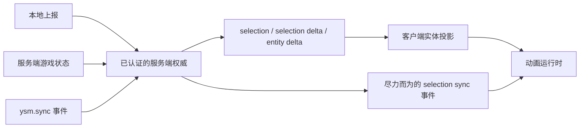

# 状态输入与同步

本页对应[动画输入交接](../overview.md#数据流与交接)，说明客户端动画求值所消费的输入分类、联网投影、Roaming、`ysm.sync` 与 Config form 的实现边界。

服务端作为联网玩家状态权威，不计算动画、controller 或骨骼姿态；客户端将服务端投影与本地 `Entity`、输入设备和 `RenderContext` 合并后完成求值。

## 输入分类

| 输入 | 典型内容 | 权威与用途 |
|---|---|---|
| `Entity` 观察 | tick、位置与位移、`Pose`、骑乘、生命状态、行走、身体与头部方向 | 客户端 `level` 实时事实，用于连续动作与姿态 |
| 服务端 PlayerState | 模型选择、gameplay 与 effects、额外动画、远端操作轴、Roaming | 经连接与内容校验的尽力而为联网投影 |
| `Minecraft` | 键鼠、相机、`level` 与 `LocalPlayer` 状态 | 本地动画与受限上报输入，不充当服务端权威 |
| `AnimationEvent` 与 `RenderContext` | `partialTick`、`level`、GUI、第一人称、pass 与视角差异 | 提供采样时刻、姿态语义与输出复用条件 |
| 模型资源 | animation、controller、用户函数、config form 与骨骼绑定 | 容器仅携源码与公开模型内容，加载期转为 Portable Program inventory 与已验证 module |
| 兼容适配 | 可选模组的动作、装备、载具或相机状态 | 直接接线尚未统一改造，现状见[联动与验证](../../../status/known-issues/animation.md#联动与验证) |

`LocalPlayer` 与 `RemotePlayer` 进入 controller 前统一归一为相同逻辑输入：历史类查询读取选定完成样本，远端玩法值读取目标投影，其余实时查询沿用既有线程与时序边界（见[实体与帧状态](entity-and-frame-state.md)）。

## 主体完成样本与玩家投影

- **`SubjectSample`**：保存位置与位移、采样跨度、速度、移动输入、身体/头部/视线方向、control、闭眼分类与 Melody 已完成结果。数值缺席记 `NaN`，分类缺席记 `null`，getter 零分配，结构本身不依赖可选模组类型。Producer 在 `beginEval` 与 `update` 窗口维护草稿。
- **读取与发布规则**：根环境（root）读当前 owner 本轮私有样本；箭头子环境（含自指向箭头）在入口捕获目标最近完成样本。仅 canonical world body 的成功主轮可发布完成样本，GUI、第一人称及独立 action/observation/config/transient 入口均不发布。清空与换模规则见[完成样本的发布与结束](../entity-lifecycle.md#完成样本的发布与结束)。
- **`PlayerQueryProjection`**：在既有网络接纳点按目标 `Player` 发布不可变快照，涵盖生命值/最大生命值、饥饿值、等级、移动轴、飞行状态、盾牌冷却与药水效果副本。投影缺项不回查源 tracker；网络接纳不触发动画求值或 body 样本发布。样本、投影与直接读取的实时事实之间无统一全局快照版本。

## 状态与事件

- Roaming 随完整选择及当前 intent 的数字增量累积；协议无逐消息 revision、ACK 或重放，丢包、重复与延迟允许导致漂移。`LocalPlayer` 忽略回显的选择、选择增量与 track 消息，仅消费实体增量；客户端找不到对应实体时直接丢弃。边界见[script-sync](../../../product-decisions/decisions/script-sync.md)与[当前协议](../../../standards/protocol-v1/README.md)。
- `ClientPlayerStateHandler` 收到完整选择后先建立远端 target 与操作身份，再保存选择投影。实体状态独立于模型选择与安装；远端 Roaming 与 `ysm.sync` 在匹配安装就绪前按当前选择有界暂存（Catalog 未发布不阻塞暂存），交接见[远端安装等待与消费](../../network/player-state.md#远端安装等待与消费)。

## Roaming

Roaming 是模型作用域内、跨帧与跨 controller 共享的必有值 F32 状态（脚本访问 `v.roaming.<name>`），各字段初值 `+0`（直接读取不触发 `??` 右侧）。加载期分别为 `main` 与 `arm` 建立连续局部编号并校验 target 声明并集；实体按 producer 或 consumer 角色持有独立生成状态对象。

### 写入与编码边界

- **本地写入**：不受 `UPDATE`、`OBSERVATION`、`ACTION` 门禁限制。持久程序走编译期定死的字段 setter，临时程序经结构授权与精确 generation 校验的原生 `float` 槽桥接后复用同一 setter。同步角色仅控制 dirty 标记、导出与接收。
- **内部与导出载荷**：引擎内部为等长 `short[]` 与 `float[]`（局部编号仅对源模块布局有效）。导出时将 `NaN`/±Infinity 归为 `+0`（不改运行时值），有限值保留原 bit 位；宿主修改已发布数组前需先复制。网络传输编号与命名持久化分别由各自宿主边界映射。

### 角色协作流程

| 角色 / 场景 | 初始化与写入 | 同步与失效边界 |
|---|---|---|
| 本地偏好恢复（`PlayerPreferenceSession`） | 按 UUID、业务会话、完整发布身份与原选择 scope 判定恢复资格，区分未知、明确空与合法快照。查询失败时以临时空基线运行，当前 scope 修改不落盘，切模后重查。 | 忽略回显的 selection / delta / track，原记录不变。详见[客户端偏好](../../model-management/storage/preferences.md)。 |
| `LocalPlayer` 安装初始化 | 从合法偏好快照或临时空基线初始化后发布精确安装资格；未恢复前或临时回退实例只用于表现。 | UUID、连接、角色或选择操作变化令旧恢复与安装失效；兼容换纹理保留原操作；实例替换沿同一偏好 owner 重装，不复活已关闭持久资格。 |
| `LocalPlayer` body（producer） | 每次合法赋值（含同值）在首次变脏时记入 dirty 列表；正常更新结束生成完整 body delta，worker 不直接访问会话、载具或 arm。 | 主线程取得源 `get` 后凭原操作与安装资格更新 runtime、尽力上报网络并在具持久资格时发起存储缓冲；目标端也完成对应 `get` 后按精确连接与安装应用投影（目标仍忙则仅留到本次 drain 结束，不跨调用重试）。Observation/action/control/transient 写入延至下次正常更新消费；逻辑成功后的 Extract 失败不撤回 delta。 |
| 远端玩家、投射物、载具（consumer） | 脚本写入仅推进本地 state，不置 dirty、不上报，runtime 替换时不保留。 | 网络入口先整批校验数字编号与有限值再按准备期映射更新，非法批次不产生部分写入；可信内部 apply 跳过重复预检。载具状态变更转发给乘客。 |
| 第一人称 arm 与网络上报 | 新 arm 在主线程取得 body 交接后，对双方字段交集做一次非消费 snapshot/full 初始化（交集按精确安装配对时的名称建立，后续仅做编号转换；full 将未携带本地字段归为 `+0`）。 | 网络上报先取 body `get`，再以精确安装资格执行非消费采样、编码与提交；连接切换或任一端换代丢弃旧结果。时机与失败见[玩家状态与控制](../../network/player-state.md)。 |

- **载具 `StringPool` 入口**：外部消息先整批校验再保留或应用；玩家内部投影直接提供有限数字导出与源布局，由载具转换到命名缓冲，避免重复线缆校验，安装资格与交接窗口仍由调用 owner 建立。
- **`/ysmclient roaming clear <selector>`**：清空本地值与待发 snapshot，以空初值提交新选择 scope，并确保落盘 clear 排在新写入之前；清除与重选分别反馈，失败不回滚已清空的 runtime。未验证范围见[动画已知问题](../../../status/known-issues/animation.md)。

### Roaming owner

| 层 | Owner |
|---|---|
| 服务端权威 | `ModelInfoCapability` 的当前选择值；不保存历史或 NBT |
| 客户端恢复与持久资格 | `PlayerPreferenceSession`，由 `ClientPlayerPreferences` 组合 UUID、本地选择和恢复请求 |
| 客户端安装与远端投影 | `PlayerAnimatableCapability` 的 `ClientRoamingSession` |
| 模型可见结构 | 每个实体 runtime 持有的生成 roaming state（本地玩家为 producer，其余为 consumer） |

- **职责切分**：producer 数字 snapshot 服务网络采样，正常更新 delta 服务本地投影；偏好层经源布局转为命名快照，隔离跨编译编号变化。
- **交接与封口**：主线程仅接纳原安装仍有效的变更；`endUse` 在封口前完成最终投影采用再撤销安装引用，已建立的合法偏好快照独立保留。
- **远端基线与清理**：远端完整选择建立当前字典与初值，缺少匹配选择的 delta 直接丢弃。最新网络投影不含 `ysm.sync` 本地副作用：存在待消费暂存事件的安装沿用暂存基线，其余安装使用最新投影。模型切换、远端重置与会话结束由各自 owner 清理实例或命名空间。

## `ysm.sync`

- **本地触发与上报**：当前本地执行借用退出后入队执行一次，不依赖服务端回传。联机 `LocalPlayer` 在原选择与安装仍匹配时尽力上报 `SelectionStateSync.sync_event`（0–16 个有限 F32 参数）。
- **服务端转发与远端暂存**：服务端仅校验连接、主体与当前正向 intent，不读模型 handler 也不校验共享语义摘要，转发给观察者与玩家自身（`LocalPlayer` 忽略回显）。`RemotePlayer` 在匹配安装就绪前按[远端安装前暂存与消费顺序](../../../standards/protocol-v1/README.md#远端安装前暂存与消费顺序)交错暂存 Roaming 与 `ysm.sync`；找不到对应实体或选择时丢弃。
- **顺序排空与失败**：匹配安装发布后，`EntityExpressionRuntime` 在合法脚本窗口内按序消费暂存队列：每条 sync 及其借用退出后触发的动作完全排空后，才写入下一段状态；期间暂停常规动画，新输入不插队，队列清空后恢复即时路径（不重建等待期帧历史）。
- **资格复核与终结**：事件交给执行入口前即出队，失败不重试，缺 handler 直接丢弃。每条事件执行前后均复核选择与安装资格；安装退休时剩余事件一并终结，后续重装从最新网络投影起步且不重放已消费 sync，新选择 B 的输入不会交给旧安装 A。产品边界见[script-sync](../../../product-decisions/decisions/script-sync.md)。

## Config form

- **类型化路由**：read、write 与 label action 均为模型内已编译程序。UI 读取当前实体 generation 的 read handler；触发操作前须确认当前同一 module 存在对应 bool、F32 或 label handler，随后仅发送表单语义路由与类型化载荷，不传输 Molang 源码。
- **服务端校验与本地执行**：服务端校验连接、目标控制权限、当前模型、共享语义摘要、表单类型及 label/index；接收端复核当前 module 后直接执行本地 handler。模型重绑生成新实体 generation 后旧 UI 操作自动失效，接收方 `ProgramId` 完全来自本地绑定。详见[Expression action 与本地求值](../../../standards/protocol-v1/README.md#expression-action-与本地求值)。
