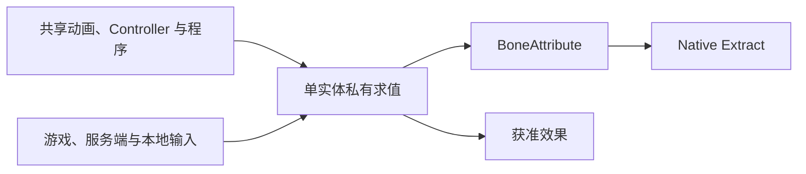

# 动画设计

上级契约：[系统边界](../README.md#系统边界)。

## 职责与边界

动画子系统运行在客户端，负责将模型资源、游戏观察值、服务端状态投影与本地输入求值为骨骼姿态及受控效果。服务端只决定联网状态，不计算逐骨骼动画。产品语义见[实体动画求值](../../product-decisions/requirements/req-evaluate-entity-animation.md)。

| 下级子系统 | 独立交接职责 |
|---|---|
| [实体模型使用](entity-lifecycle.md#seam-contract) | 指派、完整安装、执行权交接与使用结束 |
| [Controller、播放与声音触发](controllers-and-playback.md#seam-contract) | 动作选择、离散推进与声音触发 |
| [Molang 运行](molang-runtime.md#seam-contract) | 准备产物、实体求值轮、效果与短期程序接纳 |

[共同声明](molang-declarations.md)、[静态语言](molang-static-language.md)和[解释语义](molang-interpreter.md)分别约束 Java 扩展接入、AOT 编译与 GUI 动态表达式，它们本身不建立独立的运行作用域。

## Seam Contract

本页汇总动画求值的顶层组合契约。具体消费者的接纳、借用和结束责任由下表各下级契约分别细化，下级契约不会因为本页的组合关系而获得额外许可。

| 消费者问题 | 具体契约 |
|---|---|
| Ready 候选如何成为当前模型使用，何时结束？ | [模型使用与完整安装](entity-lifecycle.md#模型使用与完整安装) |
| worker 或 GUI 任务何时归还更新态？ | [执行权与任务交接](entity-lifecycle.md#执行权与任务交接) |
| 动作选择、缓存与时间线如何连续？ | [动作选择与播放](controllers-and-playback.md#动作选择与播放) |
| 声音触发成功后由谁接管？ | [声音触发与宿主播放](controllers-and-playback.md#声音触发与宿主播放) |
| 共享 module 何时可供实体绑定？ | [共享产物准备与准入](molang-runtime.md#共享产物准备与准入) |
| 顶层调用何时结束借用并提交效果？ | [Invocation 与效果](molang-runtime.md#invocation-与效果) |
| 跨实体只读输入何时发布、何时失效？ | [完成样本](entity-lifecycle.md#完成样本的发布与结束) |
| 独立编译、迟到结果与 access 由谁关闭？ | [短期执行](molang-runtime.md#短期执行) |

### 边界与权威

#### 数据流与交接

在一次实体求值中，服务端投影、本地输入与只读动画资源共同输入到实体的私有求值流程。`AnimationProcessor` 将求值结果写入 `BoneAttribute`，渲染侧同步借用这些属性并生成独立的帧状态；动画与渲染之间不共享最终矩阵或 GPU 状态。

服务端投影仅用于补充动画输入，不替代游戏自身权威。Roaming 是持久化的 float 状态，`ysm.sync` 是尽力而为的事件通道，两者都不是可靠事件队列。可选模组只提供输入事实，不拥有动画状态机、网络权威或资源生命周期。

在远端当前选择尚未完成本地安装前，客户端会有界地暂存交错到达的 Roaming 更新和 `ysm.sync` 事件；匹配安装发布后，再在合法脚本窗口内按序消费，期间常规动画不穿插执行。暂存的消费与清理归[玩家状态](../network/player-state.md#远端安装等待与消费)，脚本执行与借用仍归原动画 owner。

### 前置条件与输入

#### 共享资产与按需绑定

派生资产按单个动画独立访问，只有在首次请求某个动画时才读取并绑定它。

target Ready 依赖内存中完整且有效的候选资产。动画与 AOT 产物的可选磁盘持久化独立完成，不会阻挡内存候选发布。单动画的读取与绑定依然按需执行；GUI 也只准备当前实际消费的程序，用户函数体按实际调用读取。内置默认模型（intrinsic default）的[必需准备流程](../model-management/client-resources/default-model.md)是明确例外。

派生物的身份与完整性校验见[模型存储](../model-management/storage/overview.md)。

### 结果与保证

#### 时间推进与观察

动画区分主时间线推进与额外观察（observation）：只有主时间线会推进逻辑状态，同帧内的额外 draw 只做观察。骨骼按累计单调时间采样，远处实体可以降低更新频率，跳帧不等于暂停。离散指令必须沿着实际经过的时间区间保持因果顺序，不能只执行最终采样点，否则会破坏作品逻辑。

`AnimatableEntity` 独占两条时间基线：最近主采样 tick 和最近实际主更新时间。首次组件采样使用零跨度；新 holder 独立建立初始样本，tracker 则延续主体历史。Observation、限频跳过和姿态复用都不会移动这两条基线；恢复主更新时一次消费累计跨度。Tracker 与组件只执行 owner 已经确定的跨度，不另设时间门禁。

不同求值阶段的副作用权限严格受限：连续采样、controller 动画选择与 config read 均不获得 ACTION 权限；instruction、状态进入与退出、coded predicate 和显式动作入口则仍须满足宿主资格。共享函数继承实际调用入口的权限，函数自身声明的 effect 不会提升入口权限。普通动作一旦执行即刻交给领域 owner，后续失败不会撤销先前动作；多次观察也不会重复触发这些动作。

#### 输入、输出与替换

完整实体安装会同时发布资源绑定和私有动画状态。换模与兼容纹理替换的采用、失败及历史承接规则，由[实体生命周期](entity-lifecycle.md#模型使用与完整安装)定义；骨骼通道语义与同步借用见[骨骼输出](implementation/processor-and-bone-output.md)。

Coded、Bedrock 与 hybrid controller 共享同一套 processor 和骨骼输出边界。模型声明的状态转换、混合、覆盖与指令因果不会因 controller 来源不同而改变，具体播放规则见[Controller 与播放](controllers-and-playback.md)。

### 所有权与时序

#### 运行作用域与所有权

动画实例可由世界实体、页面预览或第一人称 renderer 持有。动画对应的主体（subject）不一定是它的直接上级；同一个 subject 即使对应多个动画 owner，彼此的可变状态也完全隔离。跨主体访问只能读取 canonical world body 最近一次完成的纯值样本，不会获取目标的执行权。Root 私有输入与 child 完成输入的选择规则由[Molang 运行](molang-runtime.md#当前主体与源执行)定义，实体使用与保留关系见[实体生命周期](entity-lifecycle.md#对象寿命与模型使用)。

模型的只读资源可以在实体间共享，但 controller、播放进度、表达式实例、component、Roaming 和骨骼输出都按实体 owner 严格隔离。多个输出槽可以分别保存 Extract 结果，但它们仍共用同一条播放时间线；如果需要独立播放，必须建立独立的动画 owner。

组件通过 `beginEval` 与 `endEval` 在每次完整求值期间借用 event：主更新在借用窗口内依次分发 `tick` 与 `update`，observation 只进入借用而不推进状态，直接复用姿态则不调用任何 hook。Holder 对已经成功 `beginEval` 的组件前缀按逆序调用 `endEval`，即便中途失败也不跳过剩余清理。`endEval` 只表示退出借用，不回滚已发生的领域动作。作者契约见[共同声明](molang-declarations.md#组件生命周期)。

同一实体的求值、换模与关闭严格串行，不同实体之间可以并行。在启动新任务、读取或覆盖更新态、换模以及释放前，调用方必须遵守[实体执行权交接](entity-lifecycle.md#执行权与任务交接)：普通异步任务须经过对应 `get`，GUI 任务须经过对应 `join`。

等待交接期间若遇到线程中断，调用方必须继续等待对应 `get` 完成，再恢复中断标志。普通结束在任务交接后变更生命周期；同步绘制回调则是局部例外，它可立即撤销消费资格，将物理清理延后到局部借用退出。独立接纳的音频不会随模型使用结束而回滚。

#### 实体使用的结束与复用

主线程在对应异步任务 `get` 或 GUI 任务 `join` 之后，才结束模型使用并释放私有状态与自身 lease（同步绘制借用的例外见生命周期正文）。`retire()` 会永久终结该 owner 并撤销指派；reset 或 reload 则保留指派，允许后续建立新的模型使用。完整规则和失败记忆见[实体生命周期](entity-lifecycle.md)。

#### 声音与宿主

Instruction 声音、controller 状态声音与 `ysm.play_sound` 共用实体或 controller 的声音作用域。只有获准的主时间线才会提交声音，额外观察不会重复发声。ID 控制与触发映射见[声音触发](controllers-and-playback.md#声音触发与宿主播放)。

声音作用域只负责自身的显式 stop 与 reset；音频被后端独立接纳后的读取、解码与输出寿命，由[音频子系统](../model-management/audio/overview.md)定义。模型 target 退休本身不会追溯撤销已经合法播放的音频。宿主音频线程读取采样时不执行解码、I/O 或阻塞等待；断粮或设备终止只结束本次播放，不补播。

### 失败与拒收

#### 生命周期与失败

普通单动画失败遵循[局部隔离契约](../../product-decisions/decisions/animation-isolation.md#bcanimation-failure-is-local)。

安装、组件与 Extract 阶段的失败分别由[实体模型使用契约](entity-lifecycle.md#失败记忆与恢复)隔离；Molang 求值期的失败由[求值轮契约](molang-runtime.md#求值失败)分类处理，不会把合法的 missing、取消或过期身份误判为严重模型故障。

### 证据与依赖

时间与隔离的产品契约见[时间语义](../../product-decisions/decisions/animation-sampling.md)与[重复观察隔离](../../product-decisions/decisions/animation-isolation.md)，当前调度落实见[实体与帧状态](implementation/entity-and-frame-state.md)。

Molang 的共享 module、实体实例、即时动作与失败隔离由[Molang 运行设计](molang-runtime.md)定义。扩展作者接口见[共同声明](molang-declarations.md)，模型语言规则分别见[AOT 静态规则](molang-static-language.md)与[GUI 动态规则](molang-interpreter.md)。

#### 当前差异

现有 query 仍直接读取部分实时（live）的 Minecraft 或可选模组对象，尚未形成统一的输入快照。输入分类、Roaming 投影与 config action 见[输入实现](implementation/state-inputs-and-sync.md)；线程安全、模组联动与实机验证缺口由[动画问题](../../status/known-issues/animation.md)跟踪。

## 设计取舍

- **保持按动画粒度的按需绑定**：不进一步拆分到逐帧、逐骨骼或任意 byte-range streaming，因为更细粒度会显著增加调度与局部校验成本，而日常访问模式并无对应收益。
- **先验证完整派生资产，再按需绑定单个动画**：这样既避免了局部提交点和复杂的恢复状态，也省去了未播放动画的准备工作。
- **按实体隔离运行实例**：避免同模型的多个实体互相污染，代价是每个 owner 都要维护一份私有状态。
- **按 tick 采样再逐帧插值仍是后续方向**：当前实现不采用该模式，不能将其当作现有行为。

## 实现与验证入口

- [实体与帧状态](implementation/entity-and-frame-state.md)：主线程任务交接、安装与清理责任。
- [Controller 与播放](controllers-and-playback.md)：动作来源、离散区间和声音作用域。
- [骨骼输出](implementation/processor-and-bone-output.md)：动画到 renderer 的通道与借用。
- [Molang 落实关系](implementation/molang-runtime.md)：编译身份、实例和效果提交。
- [状态输入与同步](implementation/state-inputs-and-sync.md)：网络投影与模型私有状态。
