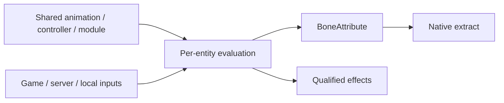

# 动画设计

本页展开[系统边界](../README.md#系统边界)中的客户端动画职责。

## 职责与边界

动画在客户端把模型资源、游戏观察值、服务端投影和本地输入求值为骨骼姿态及受控效果。服务端裁决联网状态，不计算逐骨骼动画。产品语义见[实体动画求值](../../product-decisions/requirements/req-evaluate-entity-animation.md)。

Coded、Bedrock 与 hybrid controller 使用同一 processor 和骨骼输出边界。模型提供的状态转换、混合、覆盖与指令因果不因 controller 来源改变。播放规则见[Controller 与播放](controllers-and-playback.md)。

## 运行作用域与所有权

动画实例由实体、页面预览或第一人称 renderer 持有。Subject 不一定是直接上级；同一 subject 的多个动画 owner 仍隔离可变状态。实体使用与保留关系见[实体生命周期](entity-lifecycle.md#对象寿命与模型使用)。

### 共享资产与按需绑定

模型只读资源可共享，controller、播放进度、表达式 instance、component、Roaming 与骨骼输出按 entity owner 隔离。输出槽可以分开保存 Extract 结果，但不因此获得独立播放时间线；需要独立播放时应使用独立动画 owner。

派生资产按动画独立访问，首次请求才取得并绑定该动画。不进一步拆成帧、骨骼或任意 byte-range streaming，因为这些粒度增加调度和局部验证成本，却没有对应日常访问收益。派生物身份与完整性见[模型存储](../model-management/storage/overview.md)。

整个派生资产先完成结构验证和原子发布，target 才能 Ready；单动画读取与绑定仍按需执行。提前发布局部动画会增加可见提交点与恢复状态，启动时全量绑定则放弃按需访问的收益。Intrinsic default 的[required 准备](../model-management/client-resources/default-model.md)是明确例外；普通单动画失败仍按[局部隔离契约](../../product-decisions/decisions/animation-isolation.md#bcanimation-failure-is-local)处理。

共享 module 与实体实例的选择、成本及失败门禁见[Molang 设计](molang-runtime.md)。

## 数据流与交接

服务端投影、本地输入与只读动画共同进入实体私有求值。Processor 将结果写入 `BoneAttribute`，renderer 同步借用并生成独立帧状态。两者不共享最终矩阵或 GPU 状态。

### 时间推进与观察

主时间线推进逻辑状态，额外 draw 只观察。骨骼按累计单调时间采样，远处实体可以降低更新频率；跳帧不等于暂停。离散指令应沿经过的区间保持因果，不能只执行最终采样点，否则作品逻辑会改变。

`AnimatableEntity` 独占最近主采样 tick 和最近实际主更新时间两条基线。首次组件采样使用零跨度；新 holder 单独建立初始样本，tracker 延续主体历史。Observation、限频和姿态复用不移动基线；恢复主更新时一次消费累计跨度。Tracker 与组件只执行 owner 已裁决的跨度，不另设时间门禁。

组件通过 `beginEval/endEval` 借用每次完整求值的 event；主更新在借用内依次分发 `tick/update`，observation 只进入借用，直接复用姿态不调用 hook。Holder 对成功 begin 的前缀逆序清理，失败也不跳过剩余 end。End 只表示退出，不扩大表达式效果事务，也不回滚已提交效果。作者契约见[共同声明](molang-declarations.md#组件生命周期)。

连续采样、controller animation 选择与 config read 不获得 ACTION；instruction、状态进入/退出、coded predicate 和显式动作仍应满足宿主资格。共享函数继承实际入口权限，声明 effect 不提升入口权限。Effect batch 只有整次逻辑事务成功才提交，多次观察不能重复提交。

同一实体的求值、换模和关闭串行。启动新任务、读取或覆盖更新态、换模及释放前，主线程应取得旧任务的对应 `get`；不同实体可并行。按 tick 采样再逐帧插值仍是后续方向，不能当作当前行为。契约见[时间语义](../../product-decisions/decisions/animation-sampling.md)与[重复观察隔离](../../product-decisions/decisions/animation-isolation.md)，当前调度见[实体与帧状态](implementation/entity-and-frame-state.md)。

等待中断后继续取得对应 `get`，再恢复中断标志。普通结束在交接后变更生命周期；同步绘制回调可立即撤资格，物理清理等局部借用结束。独立接纳的音频不随模型使用结束而回滚。

### 输入、输出与替换

服务端投影只补充动画输入，不替代游戏权威。Roaming 是持久 float 状态，`ysm.sync` 是尽力而为事件；两者都不是可靠事件队列。可选模组提供输入，不拥有动画状态机、网络权威或资源生命周期。

完整实体安装将资源和私有状态同时发布。换模与兼容纹理替换的采用、失败与历史承接规则由[实体生命周期](entity-lifecycle.md#完整安装与替换)定义。骨骼通道与同步借用见[骨骼输出](implementation/processor-and-bone-output.md)。

## 生命周期与失败

### 实体使用的结束与复用

主线程在对应任务 `get` 后结束模型使用并释放私有状态和自身 lease。同步绘制借用的例外见生命周期正文。`retire()` 永久终结 owner 并撤销指派；reset/reload 保留指派，允许建立新的使用。完整规则和失败记忆见[实体生命周期](entity-lifecycle.md)。

### 声音与宿主

Instruction、controller-state sound 和 `ysm.play_sound` 使用实体/controller 的声音作用域。只有获准的主时间线提交声音，额外观察不重复发声。ID 控制与触发映射见[声音触发](controllers-and-playback.md#声音触发与宿主播放)。

声音作用域负责自己的显式 stop/reset；独立接纳后的读取、解码与输出寿命由[音频子系统](../model-management/audio/overview.md)定义。模型 target 退休本身不追溯撤销合法播放。宿主读取不执行解码、I/O 或等待；断粮或设备终止只结束本次播放，不补播。

## 关键契约与设计取舍

Coded、Bedrock 和 hybrid 只改变动作来源，均满足同一时间与骨骼输出契约。按需绑定减少未使用动画的准备；完整派生资产先验证并发布，避免局部提交点。独立实例避免同模型实体互相污染，代价是每个 owner 保留私有状态。

Molang 的共享 module、实体 instance、效果事务与失败门禁由[Molang 运行设计](molang-runtime.md)定义。扩展作者使用[共同声明](molang-declarations.md)；模型语言使用[静态规则](molang-static-language.md)。

## 实现与验证入口

- [实体与帧状态](implementation/entity-and-frame-state.md)：主线程任务交接、安装与清理责任。
- [Controller 与播放](controllers-and-playback.md)：动作来源、离散区间和声音作用域。
- [骨骼输出](implementation/processor-and-bone-output.md)：动画到 renderer 的通道与借用。
- [Molang 落实关系](implementation/molang-runtime.md)：编译身份、实例和效果提交。
- [状态输入与同步](implementation/state-inputs-and-sync.md)：网络投影与模型私有状态。

### 当前差异

现有 query 仍读取部分 live Minecraft/optional-mod 对象，尚未形成统一输入快照。输入表、Roaming 投影与 config action 见[输入实现](implementation/state-inputs-and-sync.md)；线程安全、联动与实机验证缺口由[动画问题](../../status/known-issues/animation.md)维护。
