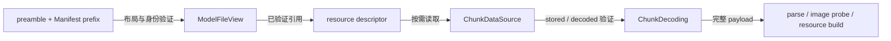

# 容器与分层验证

本页定位[分层验证与发布](../overview.md#分层验证与发布)中的证明边界。格式与字段唯一见 [Asset Container](../../../standards/asset-container.md)和 [Model Schema](../../../standards/model-schema/README.md)。

## 三层视图

`AssetContainerReader` 验证通用结构，不解释模型语义。`ModelFileIdentityReader` 从已验证 preamble 建立精确身份；`ModelFileView` 再核对 Manifest 身份与引用，构造目标视图。`AssetFileView` 将资源引用映射到 descriptor，I/O 交给 `ChunkDataSource`。

`ModelFileView` 保存唯一 immutable Manifest；其他 view 引用其中的 child，只建可重建索引。View 是验证、查询和资源打开边界，不是复制 mutable Proto 的隔离层。

## Metadata 与内容取得

`readMetadata()` 验证 prefix 布局、双重身份、引用闭包与精确末端，remote activation 无需先取得全部模型。Metadata 有效不能证明未读取 chunk 有效。

`ChunkDecoding` 区分 zstd 存储编码与直接/media payload。Logical-content hash 对解码后的逻辑内容验证；图像语义继续由上层 codec 解释。存储提交与[存储 owner](../../model-management/storage/overview.md)交接，不能以解压成功代替内容验证。

## 写出与所有权

`ModelFileWriter` 组织模型内容，`AssetContainerWriter` 写出通用容器。它们不提交 Catalog。View 只描述，`ChunkDataSource` 提供 bytes，`ModelContent`/backing 保活；借用 view 不释放 backing。

访问或 I/O 失败不等于内容损坏证据，不能据此删除 cache。整份 Schema profile 的验收与差异见[格式问题](../../../status/known-issues/format-and-schema.md)。
