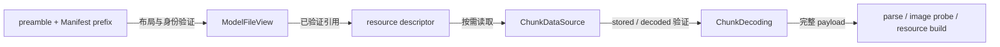

# 容器与分层验证

本页说明[分层验证与发布](../overview.md#分层验证与发布)在代码中的分层校验边界与组件分工。容器格式与字段定义以 [Asset Container](../../../standards/asset-container.md) 和 [Model Schema](../../../standards/model-schema/README.md) 为准。

## 三层视图

读取资产容器时，校验按容器结构、精确身份、模型视图与资源定位逐层展开：

- `AssetContainerReader`：校验 preamble 的通用结构与 ContainerId，不解释模型语义，也不要求尚未消费的 chunk 已经存在。
- `ModelFileIdentityReader`：基于已验证的 preamble 建立模型的精确身份。
- `ModelFileView`：按普通 chunk 规则校验 Manifest，并核对身份与内部引用闭包。
- `AssetFileView`：把资源引用映射为 descriptor，具体字节 I/O 交给 `ChunkDataSource`。

`ModelFileView` 持有唯一的不可变 Manifest；其他视图只引用其中的子节点，并按需构建可重建索引。视图是校验、查询和打开资源的边界，而不是复制可变 Proto 的数据隔离层。

## Metadata 与内容取得

`readMetadata()` 只校验前缀布局、双重身份、引用闭包与精确末端位置，因此远端激活无需先拉取整个模型文件；其余 chunk 的字节读取与内容校验推迟到实际消费时执行。

Direct、converted 与 remote 三类来源执行同一套校验边界：

- 扫描阶段如果读取 CID，会校验当次 preamble；仅查询 converted 索引时则不打开容器。
- Direct 准入只从已验证的 Manifest 检查是否声明了内嵌预览图，图片本身的完整性校验推迟到首次读取图片时执行。
- 普通 metadata 读取不检查整文件长度，也不解码未消费的图片；但新生产的容器和显式完整离线验证仍会检查完整文件。

缓存负责方在单次读取中先复核目录有效性，再直接打开目标文件，不额外探测目标路径属性；后续独立的读取必须重新确认目录资格。缓存读取遇到的文件缺失、访问拒绝、I/O 错误、越界或内容校验失败统一归类为 miss；取消、线程中断、已关闭、关闭失败、OOM 与程序错误则原样向上传播。已经建立的读取阶段一旦失败即直接结束，不会在当前阶段重新打开文件或拼接来自另一实例的字节。

`ChunkDecoding` 区分 zstd 压缩编码与直接存储或媒体 payload，并在解码完成后对逻辑内容做哈希校验；图像自身的格式语义继续交由上层 codec 解释。持久存储提交由[存储负责方](../../model-management/storage/overview.md)接手，不能把解压成功当作完整内容校验通过。

## 写出与所有权

写出链路分为两层：`ModelFileWriter` 负责组织模型内容，`AssetContainerWriter` 负责写出通用容器，两者都不直接向 Catalog 提交发布。在对象保活上，视图只负责描述和查询，`ChunkDataSource` 负责提供字节，`ModelContent` 与底层 backing 负责保活；调用方借用视图时不能释放 backing。

访问失败或 I/O 异常并不等同于内容损坏，因此不能据此删除缓存。整份 Schema profile 的验收范围与当前差异见[格式问题](../../../status/known-issues/format-and-schema.md)。
