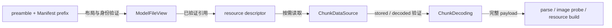

# 容器与分层验证

本页说明[分层验证与发布](../overview.md#分层验证与发布)在代码中的分层校验边界与组件分工。容器格式与字段定义以 [Asset Container](../../../standards/asset-container.md) 和 [Model Schema](../../../standards/model-schema/README.md) 为准。

## 三层视图

读取资产容器时，校验按容器结构、精确身份、模型视图与资源定位逐层展开：

- `AssetContainerReader`：校验 preamble 的通用结构与 `ContainerId`，按需读取后续 chunk。
- `ModelFileIdentityReader`：基于已验证的 preamble 建立模型精确身份。
- `ModelFileView`：按普通 chunk 规则校验 Manifest，并核对身份与内部引用闭包。
- `AssetFileView`：把资源引用映射为 descriptor，字节 I/O 交给 `ChunkDataSource`。

`ModelFileView` 持有唯一的不可变 Manifest；其余视图直接引用其子节点，并按需构建可重建索引，不复制可变 Proto。

## Metadata 与内容取得

`readMetadata()` 仅校验前缀布局、双重身份、引用闭包与精确末端位置，远端激活因此无需等待完整模型文件；其余 chunk 的字节读取与内容校验推迟到消费时执行。

Direct、converted 与 remote 来源共用这套校验边界：

- 扫描阶段读取 CID 时校验当次 preamble；仅查 converted 索引时不打开容器。
- Direct 准入仅凭已验证 Manifest 检查是否声明内嵌预览图，图片完整性校验推迟到首次读取图片时执行。
- 普通 metadata 读取只覆盖前缀范围；新生产容器与显式完整离线验证则校验整文件。

缓存读取遵循单次阶段边界：

- **目录复核**：每次读取先复核目录有效性，再直接打开目标文件；后续独立读取重新确认目录资格。
- **错误分类**：文件缺失、访问拒绝、I/O 错误、越界或内容校验失败归类为 miss；取消、线程中断、已关闭、关闭失败、OOM 与程序错误原样向上传播。
- **阶段隔离**：已建立的读取阶段失败即结束，不在同一阶段重开文件或拼接另一实例的字节。

`ChunkDecoding` 区分 zstd 压缩编码与直接存储或媒体 payload，解码后校验逻辑内容哈希；图像格式语义由上层 codec 解释，通过哈希校验后再由[存储负责方](../../model-management/storage/overview.md)提交。

## 写出与所有权

`ModelFileWriter` 组织模型内容，`AssetContainerWriter` 写出通用容器，发布到 Catalog 由上层负责。对象保活分工如下：

- 视图负责描述与查询，`ChunkDataSource` 提供字节，`ModelContent` 与底层 backing 负责保活。
- 调用方借用视图期间需保持 backing 存活。
- 访问失败或 I/O 异常与内容损坏分开处理，不据此删除缓存。

整份 Schema profile 的验收范围与当前差异见[格式问题](../../../status/known-issues/format-and-schema.md)。
