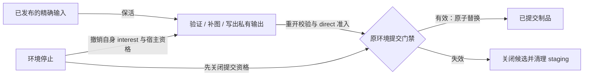

# 转换与导出

本页说明[冻结输入](../overview.md#冻结输入与单向转换)、[媒体转换](../overview.md#图像与声音转换)及[导出](../overview.md#导出批次与提交)的实现交接与关键路径。面向外部格式的公开语义由[模型兼容决策](../../../product-decisions/decisions/model-compatibility.md)和相关标准定义。

## Raw capture 与编译

Catalog 冷转换与独立 capture 入口共用解析编译逻辑，仅输入保活方式不同：

- **Catalog 直接解析**：Catalog 通过 `RawModelImporter.convert(VFS, staging)` 直接运行 parser。Resolver 先查来源相对路径索引；命中提示仅返回候选，实际读取 metadata 失败后才回退执行一次冷解析。Writer 借用同一短名 staging 文件，输入持有方保活 VFS 至同步解析结束。
- **独立 capture**：Builtin 与其他独立调用方使用 `ModelParser.capture()`。`CapturedSourceData` 保存已读字节与冻结目录观察，后续编译消费 `CapturedModel`；`RawModelImporter` 复核产出身份与诊断信息一致。

暖复用核对由 `SourceReuseObservation` 执行：

- `v1`、`v2` 读取文件头已存 MD5。
- ZIP 与 7z 读取根目录折叠前的成员名、大小与可选 CRC；目录访问错误、重复或冲突成员直接拒收，任一成员缺 CRC 或名称非合法 UTF-8 则转入冷解析。
- ZIP reader 先定位尾部目录，再由 minizip 解析成员；持有方保留独立目录流，首次 extract 才读原文件 local header 与 payload。搜索尾部目录时按 comment 长度跳过未对齐位置，每次最多回读 20 字节且不越过结束记录。

底层文件读取与缓冲区借用按来源隔离：

- **`NativeArchive.getFile()`**：返回复用借用缓冲区。Parser 在下一次 extract 前同步消费 JSON 与文本，延迟音频复制为独立副本，图片通过 `share` 取得自有字节；Capture 同样在下次 extract 前复制输入，避免旧视图进入异步任务（规则见[JNI 内存](../../native-runtime/implementation/jni-and-memory.md#buffer-传递)）。
- **Java raw `Directory.getFile`**：每次以受检单流读完并核验文件与目录观察后立即关闭，Parser 仅消费返回字节。Native archive 内部 I/O 归 archive 持有方，Java wrapper 在同步借用结束后释放。

## 图像处理的位置

图像压缩由 `RawImageCompressor.Policy` 按用途选择策略并交由 native `ImageEncoder` 编码，只在来源进入当前容器前执行：

- Raw 路径目前仅对 PNG 启用压缩，合法的已有 JPEG、WebP、AVIF 直接复用；编码成功即采用输出，不做体积回退比较。
- Raw 路径遇到可处理的 codec I/O 失败时保留原图；历史格式路径遇到编码或回环解码失败则终止该来源。
- 历史格式解码器读出图片字段后同样按用途准备表示，再由转换器接管已验证字节。

压缩效果与编码成本的评估缺口见[Q-04](../../../complexity-map/java-assets-and-presentation.md#q-04)。

## 音频内容转换

Raw 与历史格式共用同一套音频规范化出口：

- **未知与损坏区分**：无法识别的 raw 音频发 warning 并省略；历史消费者原无法解释的未知字节按兼容决策静默省略；已识别但损坏的音频直接使该来源失败。
- **候选策略**：Vorbis 转码为必选（required）候选，失败则终止转换；Opus 先保留原 packet、head 与 gain 的规范化候选，再生成可选（optional）转码候选，遇到明确候选失败时保留原候选，其余错误终止转换。
- **采用口径**：候选体积以同一 writer 写出的完整制品长度为准，转码结果严格更小时才采用，相等则保留原候选。

`ModelFileWriter` 只接收一次获选结果，未选中候选由生成方释放。导出当前容器时直接复制已验证声音，不重新编码。M1 阶段仅持 descriptor，M2 阶段按块校验全部声明声音至 EOF，单次播放仍按需读取目标声音。格式与 profile 见[音频标准](../../../standards/model-schema/assets-and-validation.md#common-stringssettings-与音频)。

## 历史输入的单向投影

`ModelOriginVersion` 决定来源语义解释：raw capture 记录最终版本，已转换缓存复用要求版本一致，导出只更新导出元信息。接收模型按保留的原始来源版本选择[除法语义](../../animation/molang-static-language.md#来源版本与除法)，字段定义见[模型标准](../../../standards/model-schema/README.md)。

来源发现按完整文件头唯一路由：

- `v1`、`v2` 进入 Java raw 适配路径；`v3` 进入 `LegacyModelImporter`。
- Native `conversion` 直接产出符合当前 Schema 的 `ImportResult`，可执行字段直接交付源 `Program`，Java 侧不再二次编译。
- Java 侧校验返回协议、身份、payload 角色与顺序以及图像与音频来源事实；历史音频原始字节走共用规范化出口。
- 写入 staging 后需通过重开验证才移交已转换存储；格式一经识别，遇格式或协议错误即失败，不回退尝试其他格式，临时结果与候选归本次导入清理。

### Legacy envelope 的输入契约

在[来源稳定由调用方负责](../../../product-decisions/decisions/model-compatibility.md#bclegacy-source-stability-is-caller-owned)前提下：

- Java 侧将已识别 `v3` 文件完整读入有界 direct buffer，边缘分类短读与访问错误，保活至同步 JNI 返回。
- Native 侧独立校验格式、checksum 与资源预算，借用输入缓冲流式解码，不持文件句柄、不建线程、不读写全局状态。
- JNI 结果描述符上限为 256 MiB（含记录头与名称），各 payload 通过独立缓冲区视图交付。
- 单一负责方保活全部 payload 视图：Java 校验失败立即关闭，通过后交付下游（释放规则见[opaque handle](../../native-runtime/implementation/jni-and-memory.md#opaque-handle)）。

## 发布与失败

`RawCompileResult` 仅为临时 staging 结果，发布由上游负责。Raw 与历史格式共用已转换工作区的同一 staging 对象校验身份、逻辑 payload、声音与存储完整性；失败时仅清理本次候选，不覆盖原文件或已有有效产物。存储提交与目录候选由 `ConvertedObjectStore` 和 `ModelSourceResolver` 承接，见[存储设计](../../model-management/storage/overview.md)。

## Preview 取得与显式 export

### 预览生成与资源复用

`ClientPreviewGenerator` 的单次操作生命周期如下：

- 从 probe 到宿主渲染、编码与写出，持续持有同一个工作名额，直接派发各阶段，不做像素字节额度预约（backing 回收与上传借用见[资源所有权](../../model-management/client-resources/implementation/resource-ownership.md#图片内容与-cpu-像素)）。
- 客户端 tick 中，在 render-target 负责方推进后观察自身 lease，确认目标 Ready 再交给宿主渲染；worker 与宿主完成后交回带所有权的结果。
- 取消时结束本次 lease，迟到候选交客户端资源负责方处理，操作自身归还像素、编码结果与导出输出。

不同预览路径的资源复用边界如下：

- **图片命中**：仅读取并校验图片本身，无需加载模型主体或等待 Ready。Manifest 声明的内嵌图读取失败判为操作失败；独立图片损坏视作 miss。
- **自动补图**：仅请求默认贴图的 GUI 主体，按消费需要独立读取 GUI 动画输入并解释绑定，不触及 FULL 字节码或实例；动画输入按自身身份与 FULL 共享。
- **入口隔离**：普通目录请求复用精确匹配的 Ready 或在途 Flight；显式导出仅借用精确匹配的 Ready，未命中则基于固定内容能力独立准备；管理补图使用本次管理 fetcher，不加入普通 Flight 授权上下文。导出与管理补图均不向 Catalog 回填，也不用默认占位图替代生成结果。

编码后验证与复用边界：

- 编码完成后立即关闭渲染像素，并对已编码字节执行一次完整解码验证。
- 显示用途保留解码所得 RGBA 像素；管理补图与导出验证通过后立即释放像素，只传递封闭编码内容。
- 存储接纳与提交阶段不再重复媒体解码；导出重开容器校验时，若预览图副本与刚验证内容一致则复用验证资格，保留源 thumbnail 则核对原 descriptor，内容有变更时执行首次完整验证。

`DirectContainerAdmission` 依据 resolver 提供的真实来源类型，检查 direct 成品是否声明内嵌预览图。Raw、builtin 与历史格式内部容器允许缺图；文件扩展名、缓存位置或独立图片不授予 direct 准入资格。

### 导出批次与提交门禁

- **入口与推进**：`ModelExportService` 核对原服务端实例、权限与集成服务器环境。`ServerModelService` 绑定具体 `Environment` 与客户端生成器，由原服务端 tick 串行推进当前批次；已有批次运行时重复命令直接返回 `BUSY`，关闭 GUI 不中断批次。
- **输入锁定**：单项导出从同一次已发布 snapshot 解析并捕获精确输入；批量导出先冻结完整地址与精确身份，执行每项前再核查当前 Catalog。`PreparedExport` 保活固定输入并在重开时复核身份，公开地址不作为宿主文件系统路径使用（选集语义见[导出决策](../../../product-decisions/decisions/export-preprocessing.md)）。

- **写出与提交门禁**：`ModelExporter` 保留模型语义、作者信息与有效作者预览图，仅缺图时补充独立图片或真实生成预览图，随后重算容器身份并重开验证。提交门禁（effect gate）内仅执行资格复核与原子移动（atomic move），不包裹大文件读取、编码或回调；原子移动一旦成功，后续反馈发送或临时清理失败不改判提交结果。
- **环境停止**：先关闭提交资格，收尾仅等待不依赖服务端 tick 或宿主回调的自有工作；未启动项不再执行，迟到结果自行关闭所持资源，已停止环境的工作不再写入新环境。已提交输出与共享缓存保留，不保存续跑状态。批量导出中单项失败照常汇总，最终反馈回到原服务端 executor。完整验证范围见[当前状态](../../../status/support-and-verification.md)。
