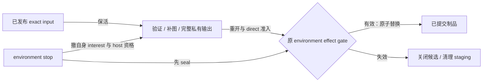

# 转换与导出

本页定位[冻结输入](../overview.md#冻结输入与单向转换)、[媒体转换](../overview.md#图像与声音转换)及[导出](../overview.md#导出批次与提交)的当前交接。公共语义由[模型兼容决策](../../../product-decisions/decisions/model-compatibility.md)和标准定义。

## Raw capture 与编译

`ModelParser.capture()` 通过同一 `RawModelAssembler` 解析路径发现实际输入。`CapturedSourceData` 保存 consumed bytes 和冻结后的目录观察；后续编译仅消费 `CapturedModel`。`RawModelImporter` 在接受结果前复核身份与 diagnostics 一致，避免 scan/compile 读取不同来源。

`NativeArchive.getFile()` 可借用复用缓存。Capture 在下次 extract 前取得独立 bytes，不能将旧 view 排入异步工作后继续读取 archive。底层借用见[JNI 内存](../../native-runtime/implementation/jni-and-memory.md#buffer-传递)。

Java raw `Directory.getFile` 每次以受检单流读取，核验读取前后的文件与目录观察后关闭。Parser 只消费返回的 bytes，不持文件 channel。Native archive 内部 I/O 仍归 archive owner；Java wrapper 结束自己的同步借用，不与 Java 文件读取共享句柄或 ABI。

## 图像处理的位置

`RawImageCompressor.Policy` 选择用途策略，native `ImageEncoder` 编码。Raw 当前只对 PNG 应用策略，合法已有 JPEG/WebP/AVIF 表示直接复用。成功策略输出不以大小比较回退；raw 可处理 codec I/O 失败保留原图，legacy 编码或 round-trip 失败终止该 source。

历史 decoder 在读出图片字段后按用途准备表示，projector 接管已验证 bytes。Raw 与 legacy 都只在来源转入当前容器前应用策略，不改写现有容器。效果与成本证据见[Q-04](../../../complexity-map/java-assets-and-presentation/open-questions.md#q-04)。

## 音频内容转换

Raw 与 legacy 共用当前音频规范化出口。未知 raw 音频产生 warning 并省略该声音；历史 consumer 始终无法解释的 unknown bytes 按兼容决策静默省略。已识别且受支持但损坏的内容使 source 失败，不能伪装 unknown。

Vorbis 的转码候选是 required，Opus 保有原 packet/head/gain 的规范化候选，按策略生成 optional 转码候选。Required 候选失败结束转换；optional 的明确候选失败可保留原候选，其他失败仍结束。比较使用同一 writer 的完整制品长度，只有转码候选更小时才采用，平局保留原候选。局部编码阈值不定义另一份媒体规范。

`ModelFileWriter` 一次接纳获选结果，未选候选由生成 owner 释放。Current export 复制已验证声音，不重编码。M1 可只持 descriptor；M2 按块验证全部声明声音到 EOF，单次播放仍只取得目标声音。格式与 profile 见[音频标准](../../../standards/model-schema/assets-and-validation.md#common-stringssettings-与音频)。

## 历史输入的单向投影

`ModelOriginVersion` 解释来源行为，raw capture 保存最终版本，converted cache 复用要求版本匹配。Export 更新导出信息，不改来源行为；具体字段由[模型标准](../../../standards/model-schema/README.md)定义。

来源发现按完整 header 唯一路由，v1/v2 进入 Java raw adapter，v3 进入 `LegacyModelImporter`。Native `conversion` 输出当前 schema 的 `ImportResult`；执行字段交付 source Program，不引入第二套 legacy Proto 或 Java 二次编译。

Java 校验返回协议、身份、payload 角色与顺序、图像和音频来源事实，再写当前 staging。Legacy 音频只交付原始 bytes 与来源事实，由 Java 独立核对并走共同规范化。Java 不把 native 结果自洽当作 current admission；重开验证成功后才交 converted storage。识别后的格式或协议错误不回退另一格式，临时结果与候选始终属于本次导入。

### Legacy envelope 的输入契约

在[来源稳定由调用方负责](../../../product-decisions/decisions/model-compatibility.md#bclegacy-source-stability-is-caller-owned)的前提下，Java 将已识别 v3 完整读入有界 direct buffer。短读与访问失败在输入边缘分类；buffer 保活到同步 JNI 返回。Native 独立验证格式、checksum 和预算，借用输入流式解码，不持有文件、不创建线程、不读写全局 importer 状态。

Native 导入结果由一个 owner 保活全部 payload view，Java 校验失败关闭该 owner，成功才交下游。详细采用边界见[opaque handle](../../native-runtime/implementation/jni-and-memory.md#opaque-handle)。转换成功不证明远端取得、Minecraft adoption 或设备播放通过。

## 发布与失败

`RawCompileResult` 是 staging 结果，不是 Catalog 发布。格式 writer 借用 converted workspace 的能力，不按路径标签重新建 cache 文件。Raw/legacy 均从同一 staging 对象验证身份、逻辑 payload、声音与存储完整性；失败清理本次候选，不覆盖来源或有效产物。`ConvertedObjectStore` 和 `ModelSourceResolver` 承接存储与目录 candidate，见[存储设计](../../model-management/storage/overview.md)。

## Preview 取得与显式 export

`ClientPreviewGenerator` 的 operation 从 probe 到 host、编码和写出持续占有同一工作名额与终态。各阶段直接派发，不建立像素字节预约或等待；backing 的退休与上传借用见[资源所有权](../../model-management/client-resources/implementation/resource-ownership.md#图片内容与-cpu-像素)。Worker、target future、host 只交回 owned fact；client tick 在 render-target owner 之后接纳并推进下一阶段。Worker 不等待 host，取消只撤自身 interest/pin，迟到 fact 由原 operation 归还。

图片 hit 只取得并验证图片，不要求 body/Ready/bake。自动生成只请求默认贴图 GUI body；detached 路径不再先构造 FULL cache-only target。GUI loader 只取得 GUI 闭包与对应派生物，不探测或借用 FULL。声明内嵌图失败仍失败；独立坏图可作 miss。普通需求的 cold miss 可复用 exact Ready/Flight；显式 export 只借 exact Ready，否则固定输入独立走同一 loader/bake/profile，不加入可能更换输入的普通 Flight。管理补图使用本次管理 fetcher，不借普通 Flight 的授权上下文，也不以默认占位图代替真实生成。

生成器编码后关闭渲染像素，再完整解码最终 encoded 结果。显示用途保留该次 RGBA；管理与 export 验证后立即释放，只传封闭内容。Store 接纳和提交不再媒体解码，staging 核对实际副本。Export 重开验证容器、模型身份和声音；预览副本与本次已验证内容相同则复用资格，保留源 thumbnail 时另核对原 descriptor。不同内容仍须首次完整验证。

`DirectContainerAdmission` 根据 resolver 的真实 source kind 检查 direct 成品内嵌 preview。Raw/builtin/legacy 内部容器可缺图；扩展名、cache 位置或独立图都不能伪造 direct 准入。该门禁不修改 Schema 对 unspecified 的合法解释。

`ModelExportService` 在命令和服务入口检查原 server、真实权限与 integrated 环境。`ServerModelService` 绑定具体 `Environment` 和 client generator；原 server tick 串行推进一个批次中的一个未终态项，重复命令 BUSY，不排队。GUI 关闭不结束批次。

单项从同一 published snapshot 解析并捕获 exact input；批次冻结完整地址与身份，每项再核查当前 catalog。`PreparedExport` 保活固定输入，后续重开复核身份，不按 path 静默替换来源，也不查未发布候选。公开地址不能直接当宿主路径，选择语义见[导出决策](../../../product-decisions/decisions/export-preprocessing.md)。

`ModelExporter` 保留模型语义、作者和有效作者图，缺图才加入适用独立图或真实生成图，重算容器身份并重开验证。Effect gate 只包含资格复核和 atomic move，不包大读取、编码或 callback。成功 move 后，反馈或 cleanup 失败不能改标提交失败。

Environment stop 只等待不依赖 tick/host 的自有收尾；余项不启动，迟到结果关闭自身资源，旧工作不能写新环境。已提交输出与共享 cache 保留，不保存续跑状态。单项失败仍归约本批结果，反馈回原 server executor。完整验证范围见[当前状态](../../../status/support-and-verification.md)。
