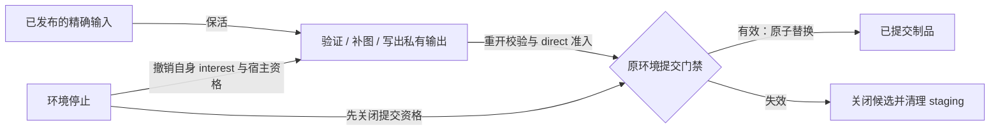

# 转换与导出

本页说明[冻结输入](../overview.md#冻结输入与单向转换)、[媒体转换](../overview.md#图像与声音转换)及[导出](../overview.md#导出批次与提交)的实现交接与关键路径。面向外部格式的公开语义由[模型兼容决策](../../../product-decisions/decisions/model-compatibility.md)和相关标准定义。

## Raw capture 与编译

Catalog 冷转换与独立 capture 入口复用同一套解析编译逻辑，但在输入保活方式上有所不同：

- **Catalog 直接解析**：Catalog 通过 `RawModelImporter.convert(VFS, staging)` 直接运行完整 parser。Resolver 会先查询来源相对路径索引；命中提示时只返回候选，不预开已转换容器，只有实际读取 metadata 失败后才回退执行一次冷解析。Writer 借用同一个短名 staging 文件，输入持有方负责保活 VFS，直到同步解析结束。
- **独立 capture**：Builtin 及其他独立调用方继续使用 `ModelParser.capture()`。`CapturedSourceData` 保存已读取的字节和冻结后的目录观察结果，后续编译只消费 `CapturedModel`；`RawModelImporter` 会复核 capture 产出的身份与诊断信息一致。

暖复用核对由 `SourceReuseObservation` 负责。对 `v1`、`v2`，它读取文件头已存的 MD5。对 ZIP 和 7z，它读取根目录折叠前的成员名称、大小与可选 CRC。目录访问错误、重复成员或冲突成员会导致拒收。任一成员缺少 CRC 或名称无法按 UTF-8 解码时，转入冷解析。

ZIP reader 先定位尾部目录，再由 minizip 解析成员。同一个持有方保留独立的目录流，直到首次 extract 才读取原文件的 local header 与 payload。搜索尾部目录时，reader 依据已读取的 comment 长度字段跳过无法对齐文件末尾的位置，每次最多向文件开头回读 20 字节，且不会越过结束记录。

底层文件读取和缓冲区借用按来源严格隔离：

- `NativeArchive.getFile()` 返回借用的复用缓冲区。Parser 在下一次 extract 前同步消费 JSON 与文本；延迟使用的音频复制出独立副本，图片通过 `share` 取得自有字节。Capture 同样在下一次 extract 前复制输入，防止旧缓冲区视图进入异步任务（底层借用规则见[JNI 内存](../../native-runtime/implementation/jni-and-memory.md#buffer-传递)）。
- Java 侧的 raw `Directory.getFile` 每次通过受检单流读取文件，在读取前后核验文件与目录观察结果后立即关闭流。Parser 只消费返回的字节，不持有文件 channel。Native archive 内部的 I/O 仍归 archive 持有方所有；Java wrapper 在同步借用结束后即释放，不与 Java 文件读取共享句柄或 ABI。

## 图像处理的位置

图像压缩由 `RawImageCompressor.Policy` 按用途选择策略，并交由 native `ImageEncoder` 编码。Raw 路径目前只对 PNG 应用该策略，合法的已有 JPEG、WebP 与 AVIF 表示直接复用。策略编码成功后直接采用输出，不做体积回退比较；raw 路径遇到可处理的 codec I/O 失败时保留原图，而历史格式路径遇到编码或回环解码（round-trip）失败会直接终止该来源。

历史格式解码器在读出图片字段后同样按用途准备表示，再由转换器接管已验证的字节。无论是 raw 还是历史格式，图像策略都只在来源进入当前容器前执行，不会改写已有容器。压缩效果与编码成本的评估缺口见[Q-04](../../../complexity-map/java-assets-and-presentation/open-questions.md#q-04)。

## 音频内容转换

Raw 与历史格式共用同一套音频规范化出口：

- 无法识别的 raw 音频会发出 warning 并省略该声音；历史消费者原本就无法解释的未知字节按兼容决策静默省略。
- 已识别且受支持但数据损坏的音频必须导致该来源失败，不能伪装成未知格式跳过。
- Vorbis 转码属于必选（required）候选；Opus 先保留原 packet、head 与 gain 的规范化候选，再按策略生成可选（optional）转码候选。必选候选失败会终止转换；可选候选遇到明确的候选失败时保留原候选，其他错误仍终止转换。候选体积以同一 writer 写出的完整制品长度为准，只有转码结果严格更小时才采用，体积相同时保留原候选。局部编码阈值不另立媒体规范。

`ModelFileWriter` 只接收一次获选结果，未选中的候选由生成它的负责方释放。当前容器执行导出时直接复制已验证的声音，不重新编码。M1 阶段可以只持有 descriptor，M2 阶段按块校验所有声明的声音直至 EOF，但单次播放仍只按需读取目标声音。音频格式与 profile 规范见[音频标准](../../../standards/model-schema/assets-and-validation.md#common-stringssettings-与音频)。

## 历史输入的单向投影

`ModelOriginVersion` 决定如何解释模型来源行为：raw capture 会记录最终版本，已转换缓存复用也要求版本一致。导出只更新导出元信息，不改变来源行为。接收模型依据保留的原始来源版本文本选择[除法语义](../../animation/molang-static-language.md#来源版本与除法)，不按新 producer 版本判断；具体字段由[模型标准](../../../standards/model-schema/README.md)定义。

来源发现按完整文件头唯一路由：`v1`、`v2` 进入 Java raw 适配路径，`v3` 进入 `LegacyModelImporter`。Native `conversion` 直接输出符合当前 Schema 的 `ImportResult`，可执行字段直接交付源 `Program`，不引入第二套历史 Proto，也不在 Java 侧二次编译。

Java 侧负责校验返回协议、身份、payload 角色与顺序，以及图像和音频的来源事实，再写入当前 staging。历史音频只交付原始字节与来源事实，由 Java 侧独立核对后走共用规范化出口。Java 不会仅凭 native 结果自洽就放行，必须通过重开验证后才移交已转换存储。来源格式一经识别，遇到格式或协议错误即失败，不回退去尝试其他格式；临时结果与候选始终归属于本次导入。

### Legacy envelope 的输入契约

在[来源稳定由调用方负责](../../../product-decisions/decisions/model-compatibility.md#bclegacy-source-stability-is-caller-owned)的前提下，Java 侧将已识别的 `v3` 文件完整读入有界 direct buffer。短读与访问错误在输入边缘完成分类，buffer 会保持存活直到同步 JNI 调用返回。Native 侧独立校验格式、checksum 和资源预算，直接借用输入缓冲流式解码，不持有文件句柄、不创建线程，也不读写全局 importer 状态。

JNI 结果描述符最多为 256 MiB，包含记录头和名称。各 payload 的字节通过独立的缓冲区视图交付。

Native 导入结果由单一负责方保活全部 payload 视图：Java 侧校验失败时立即关闭该负责方，校验通过后才交给下游使用。句柄所有权与释放细节见[opaque handle](../../native-runtime/implementation/jni-and-memory.md#opaque-handle)。

## 发布与失败

`RawCompileResult` 是临时 staging 结果，不代表已发布到 Catalog。格式 writer 借用已转换工作区的输出能力，不会按路径标签另行创建缓存文件。Raw 与历史格式都基于同一 staging 对象校验身份、逻辑 payload、声音与存储完整性；一旦失败只清理本次候选，不覆盖原文件或已有有效产物。后续的存储提交与目录候选管理由 `ConvertedObjectStore` 和 `ModelSourceResolver` 承接，见[存储设计](../../model-management/storage/overview.md)。

## Preview 取得与显式 export

### 预览生成与资源复用

`ClientPreviewGenerator` 的单次操作从 probe 起，一直到宿主渲染、编码和写出，持续持有同一个工作名额并负责其完成状态。各阶段直接派发，不做像素字节额度预约或等待；底层 backing 的回收与上传借用见[资源所有权](../../model-management/client-resources/implementation/resource-ownership.md#图片内容与-cpu-像素)。在客户端 tick 中，操作会在 render-target 负责方推进之后观察自己的 lease，确认目标 Ready 后再把 lease 交给宿主渲染；worker 与宿主完成后仍交回带所有权的结果。操作取消时只结束本次 lease，迟到的候选由客户端资源负责方处理，操作自身归还其像素、编码结果与导出输出。

不同预览路径对资源的依赖与复用规则各不相同：

- **图片命中**：只读取并校验图片本身，不要求加载模型主体、等待 Ready 或执行 bake。如果 Manifest 声明的内嵌图读取失败，本次操作仍判为失败；独立图片损坏则可视作 miss。
- **自动补图**：只请求默认贴图的 GUI 主体。客户端资源负责方按消费需要独立读取 GUI 动画输入并解释绑定，不探测或借用 FULL 字节码、inventory 或实例；动画输入仍按自身身份与 FULL 共享。
- **入口隔离**：普通目录请求可直接复用资源负责方中精确匹配的 Ready 或在途 Flight。显式导出只借用精确匹配的 Ready，未命中时由资源负责方基于固定内容能力独立准备。管理补图则使用本次管理 fetcher，不加入普通 Flight 的授权上下文。导出与管理补图都不会向 Catalog 回填，也不允许用默认占位图充当生成结果。

图片编码完成后，生成器立即关闭渲染像素，再对最终已编码的字节执行一次完整解码以验证可用性：显示用途会保留这次解码得到的 RGBA 像素，而管理补图和导出在验证通过后立即释放像素，只传递封闭的编码内容。存储接纳与提交阶段不再重复做媒体解码，staging 只核对实际副本。导出阶段重开容器校验结构、模型身份与声音时，若预览图副本与本次刚验证的内容完全一致，则直接复用验证资格；保留源 thumbnail 时则另行核对原 descriptor。凡是内容有变化，都必须执行首次完整验证。

`DirectContainerAdmission` 依据 resolver 提供的真实来源类型，检查 direct 成品是否声明了内嵌预览图。Raw、builtin 与历史格式的内部容器允许缺图，而文件扩展名、缓存位置或独立图片都不能伪造 direct 准入资格。这道门禁只约束实际来源接纳，不改变 Schema 对 `unspecified` 的合法定义。

### 导出批次与提交门禁

`ModelExportService` 在命令和服务入口先核对原服务端实例、真实权限以及集成服务器环境。`ServerModelService` 绑定具体的 `Environment` 与客户端生成器，并由原服务端 tick 串行推进单个批次中的当前未完成项；若已有批次运行，重复命令直接返回 `BUSY`，不入队等待。关闭 GUI 不会中断导出批次。

导出输入在启动时即锁定：单项导出从同一次已发布 snapshot 解析并捕获精确输入；批量导出先冻结完整地址与精确身份，执行每一项前再核查当前 Catalog。`PreparedExport` 负责保活固定输入，后续重开时复核身份，不会按路径静默替换为新来源，也不会搜索未发布的候选。公开地址不能直接当作宿主文件系统路径使用，具体选集语义见[导出决策](../../../product-decisions/decisions/export-preprocessing.md)。

`ModelExporter` 写出产物时保留模型语义、作者信息以及有效的作者预览图；仅当缺图时才补充适用的独立图片或真实生成的预览图，随后重算容器身份并执行重开验证。提交门禁（effect gate）内只包含资格复核与原子移动（atomic move），绝不包裹大文件读取、图片编码或回调逻辑。原子移动一旦成功，后续的反馈发送或临时文件清理失败都不能把这次提交改判为失败。

集成服务器环境停止时，先关闭提交资格，收尾阶段只等待不依赖服务端 tick 或宿主回调的自有工作：剩余未启动的项目不再执行，迟到结果自行关闭所持资源，旧环境的工作绝不能写入新环境。已经提交的输出和共享缓存全部保留，不保存续跑状态。批量导出中单项失败仍会汇总到本批结果，最终反馈回到原服务端 executor。完整验证范围见[当前状态](../../../status/support-and-verification.md)。
