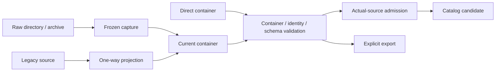

# 资产管线

上级契约：[系统边界](../README.md#系统边界)。

## 职责与边界

资产管线把用户来源转换、验证为当前容器与模型视图，并提供预览及导出操作。

## Seam Contract

按本次交接定位契约：

- 把来源变成可接纳容器或模型视图：[转换与准入](#来源转换与内容准入)。
- 取得图片或生成缺失 preview：[preview 操作](#预览取得与生成)。
- 从已发布内容执行显式 export：[export 批次](#导出批次与提交)。

### 共同规则

适用范围：本页的来源转换与内容准入、preview 操作、export 批次三项交接。各项共用以下格式 authority、工作作用域、独立终态及外部依赖。

Java 解释格式、组装语义、计算 canonical identity 并写出；native 提供 archive、hash、压缩、媒体和历史解码能力。管线不裁决授权，也不把解析成功直接发布为 Ready target。

#### 数据流与交接

图中边表示制品转换与验证交接，各出口仍需自己的发布门禁。

#### 运行作用域与所有权

解析、转换和验证没有独立全局运行实例，由调用方的有限工作作用域承载。输入 owner 保活来源；capture 保有本次冻结输入，writer 只借用存储 owner 提供的 channel。转换可以在 client 或 server 工作中执行，不因使用媒体 codec 而要求客户端 Minecraft。

#### 预览与导出

Preview operation 持有自己的容量、interest 和终态；export batch 属于具体 integrated server environment。Catalog、backing、GPU 和持久存储仍由接收方拥有，格式 writer 不取得发布权。

Preview 与 export 各有独立操作终态；取消不回滚已提交文件，也不终结其他消费者。原环境提交门禁及停止偏序见[导出批次与提交](#导出批次与提交)。

格式与内容保证消费 [Asset Container](../../standards/asset-container.md)、[Model Schema](../../standards/model-schema/README.md)及[兼容决策](model-compatibility.md)。存储提交依赖[存储契约](../model-management/storage/overview.md#seam-contract)，宿主采用依赖[客户端资源契约](../model-management/client-resources/overview.md#seam-contract)。当前一致性差异见[格式问题](../../status/known-issues/format-and-schema.md)，责任映射见[实现入口](#实现与验证入口)。

### 来源转换与内容准入

本项显式继承[共同规则](#共同规则)。

**边界与权威**

Java/native 分工及发布权见[共同规则](#共同规则)。本项交付当前容器与模型视图，媒体转换属于来源进入当前容器的阶段。

**前置条件与输入**

#### 冻结输入与单向转换

同一次 raw 转换的身份与写出消费同一份冻结输入。Capture 复制实际解析依赖的文件与目录观察，再适配回同一 parser 的 scan/compile 路径。身份计算后不再读取可变来源，也不维护第二套 parser；代价是 capture 需要保有本次输入闭包。

Raw 与 legacy v1/v2/v3 在输入边缘统一为当前容器。容器提供随机访问与前缀准入，统一运行制品避免复制三套存储和验证规则；统一格式不要求落盘，可以直接形成内存 backing。

历史适配只投影可确定解释的内容，不带回 legacy cache、session 或模型管理 owner。识别后的格式、投影或结果协议错误结束该 source，不能改走另一种格式。转换成功也不证明远端取得、host adoption 或设备播放通过。兼容承诺如何约束转换见[模型兼容](model-compatibility.md)。

Legacy 导入以[调用期间来源稳定](../../product-decisions/decisions/model-compatibility.md#bclegacy-source-stability-is-caller-owned)为前提。导入器不增加平台锁、重复扫描或变化检测；这些机制增加协调与 I/O 成本，却不改善稳定来源的迁移结果。实际发现的 I/O、格式和校验错误仍拒绝该 source。

**结果与保证**

#### 分层验证与发布

容器结构、精确身份、Schema 引用和实际 payload 分层验证。前一层只提供下一层输入：解压成功不证明 Schema 有效，metadata 可读不证明 model chunks 齐全，bake 成功不证明 Ready。

消费者应信任同一不可变表示已经建立且持续维持的结构、身份及引用保证，不应重新解析相同 metadata 来重建信任。该保证不覆盖尚未读取的 payload、后来打开的可变来源或来源准入。后续读取方仍负责取得对应 bytes，并完成本层内容验证；权限、Ready 和宿主可用性仍由各自 owner 裁决。

Writer 形成 bytes，storage owner 提交已验证制品，Catalog owner 发布内容。Raw/legacy staging 重开通过后才交给存储；失败清理本次候选，不覆盖来源或已有有效产物。公共字段仍以 [Asset Container](../../standards/asset-container.md)和 [Model Schema](../../standards/model-schema/README.md)为准。

Direct 成品应声明并完整解码内嵌 preview；raw、builtin 和 legacy 的内部转换容器可以缺图。这是实际来源准入，不改变 Schema 对 unspecified 的合法解释。来源 kind 来自 resolver 调用链，不能由扩展名、metadata、cache 位置或调用方标记伪造；独立图片也不能补足 direct 准入。

#### 图像与声音转换

Java 选择用途策略，native 执行媒体编码。图像策略按以下顺序裁决，产品依据见[图像决策](../../product-decisions/decisions/image-policy.md)。

| 输入与用途 | 选择 |
|---|---|
| 已有合法有损表示 | 复用，避免重复压缩 |
| 模型纹理且格式在 PNG/zst 之外 | 复用合法受支持表示 |
| 其余模型纹理 | 以输入像素为基准无损处理 |
| 其余非纹理图片，低于分辨率阈值或适用受限设备策略 | 无损处理 |
| 其余非纹理图片 | 允许有损处理 |

小图与体素纹理经 YUV 4:2:0 和有损编码会损失色彩、边缘及透明细节，因此选择无损。阈值和 codec 属于实现参数；受限设备降低编码成本，但保留 WebP/AVIF 解码。策略只在来源转入当前容器前执行，不改写已有容器；当前 PNG 路径及效果证据缺口见[转换实现](implementation/conversion-and-export.md#图像处理的位置)。

声音转换沿同一 raw/legacy 管线进入当前媒体表示。Required 与 optional 候选的失败、完整制品计价和不支持媒体边界应分别保持；算法见[音频转换](implementation/conversion-and-export.md#音频内容转换)，媒体语义见[标准](../../standards/model-schema/assets-and-validation.md#common-stringssettings-与音频)。Current export 复制已验证声音，不重新编码。

**所有权与时序**

View 负责描述与验证，内容来源提供 bytes，模型 backing 保活。不可变 Manifest 是模型视图的唯一事实；lookup 只建立可重建索引，不复制另一棵 metadata。实现层的 reader 与 decode seam 见[分层验证](implementation/container-and-validation.md)。

生产转换的临时输出由存储 owner 在复核目录后创建，格式层只借用 channel；其提交、清理与平台边界见[存储设计](../model-management/storage/overview.md#精确缓存与持久工作)。

**失败与拒收**

#### 生命周期与失败

每次转换在调用期持有输入与候选；验证完成后才向存储转移结果。拒绝或失败关闭本次候选与临时产物，已有有效内容不随候选失败撤销。Source read、格式/身份无效与基础设施失败保留各自分类，不用一次解析结果推断未读取资源有效。

**证据与依赖**

格式与兼容范围继承[共同规则](#共同规则)中的标准和状态。Reader/view/bytes/backing 的实现交接见[容器与分层验证](implementation/container-and-validation.md)，capture、媒体与 staging 见[转换实现](implementation/conversion-and-export.md)。

### 预览取得与生成

本项显式继承[共同规则](#共同规则)。

**边界与权威**

Preview operation 的容量、interest 与终态归属见[预览与导出](#预览与导出)；取得图片不替代 target Ready 或 export 完成。

**前置条件与输入**

图片命中不要求 model body 或 GPU；真实缺图生成消费同一 loader、bake 和 host 路径。

**结果与保证**

图片命中可直接返回 encoded bytes；缺图生成交付真实预览，不能拿占位图当生成结果。

**所有权与时序**

一个 preview operation 从 probe 起持续拥有容量和终态责任，跨 worker、target 与 host 只传 owned fact。Worker 不等待宿主。取消只撤自身 interest/pin，迟到资源由原 owner 关闭；其他消费者与已验证 cache 保留。

**失败与拒收**

取消、已提交内容与其他消费者的边界见[预览与导出](#预览与导出)；迟到资源按本项所有权字段交回原 owner。

**证据与依赖**

取得与生成依赖[客户端资源契约](../model-management/client-resources/overview.md#seam-contract)，具体阶段见[preview 取得与显式 export](implementation/conversion-and-export.md#preview-取得与显式-export)。内容差异沿[共同规则](#共同规则)中的格式状态保留。

### 导出批次与提交

本项显式继承[共同规则](#共同规则)。

**边界与权威**

Export batch 属于具体 integrated server environment，操作终态与发布权按[预览与导出](#预览与导出)和[共同规则](#共同规则)划分。

**前置条件与输入**

选集与权限由[导出决策](../../product-decisions/decisions/export-preprocessing.md)定义。环境与权限检查先于来源打开和输出创建。单项与批量均从已发布 catalog 捕获 exact input；批次先冻结路径与精确身份，再逐项核查当前 catalog。后续读取不按 path 静默换成新表示，也不搜索未发布候选。已发布的 raw／legacy 内部容器允许缺图，export 仍负责补齐图片。

**结果与保证**

Writer 复制已验证内容，保留作品语义与已有作者信息，补齐适用 preview 后重算容器身份并重开验证。在原 environment gate 仍有效时才原子替换；成功提交不因反馈或 cleanup 失败改为失败。停止先 seal 提交资格，只等待不依赖 tick/host 的自有阶段。

**所有权与时序**

环境以单批次、串行单项限制 retained input、target 和输出候选。GUI 关闭不影响批次；环境结束终止余项，不保存续跑状态。

**失败与拒收**

取消和已提交文件的后果见[预览与导出](#预览与导出)；候选清理与提交依赖[存储契约](../model-management/storage/overview.md#seam-contract)。提交成功后的反馈或 cleanup 失败仍按本项结果字段解释。

**证据与依赖**

选集与权限消费[导出决策](../../product-decisions/decisions/export-preprocessing.md)。批次、BUSY、容量及停止偏序见[预览与 export 实现](implementation/conversion-and-export.md#preview-取得与显式-export)，标准和支持限制继承[共同规则](#共同规则)。

## 设计取舍

Raw 与 legacy 归一到一种运行容器，减少存储与验证分支。Frozen capture 的代价是保留输入闭包；legacy 不增加变化检测的理由见[输入契约](#冻结输入与单向转换)。Export 串行逐项降低驻留量，代价是并行吞吐受限，以及环境结束后未完成部分需要重新发起。

## 实现与验证入口

[容器与分层验证](implementation/container-and-validation.md)定位 reader、view、bytes 与 backing 的责任。[转换与导出](implementation/conversion-and-export.md)定位 capture、staging、环境门禁与结果交接。公开语义见[模型兼容](model-compatibility.md)，支持和证据见[格式问题](../../status/known-issues/format-and-schema.md)。
