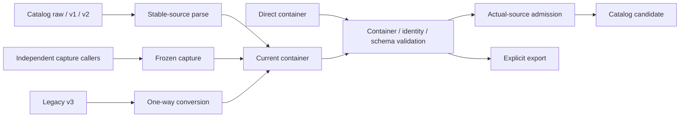

# 资产管线

上级契约：[系统边界](../README.md#系统边界)。

## 职责与边界

资产管线处于外部素材进入运行时的入口位置，负责把目录、压缩包、历史格式和现有容器统一转换为当前资产容器，并产出经过分层校验的模型视图。在此基础上，管线还提供预览图获取或补生成，以及面向已发布模型的显式导出操作。

## Seam Contract

按本次交接定位契约：

- 把来源变成可接纳容器或模型视图：[转换与准入](#来源转换与内容准入)。
- 取得图片或生成缺失预览：[preview 操作](#预览取得与生成)。
- 从已发布内容执行显式导出：[export 批次](#导出批次与提交)。

### 共同规则

适用范围：本页三项交接。

Java 侧负责格式解析、模型语义组装、规范身份计算与容器写出；native 侧提供压缩包读取、哈希、压缩、媒体编解码与历史格式解码。管线不做权限判断，也不直接将模型发布为 Ready。

#### 数据流与交接

#### 运行作用域与所有权

解析、转换与校验运行在调用方的有限工作作用域内，不常驻全局实例。输入持有方在转换期间保活来源；独立 capture 持有冻结后的输入数据；容器 writer 借用存储持有方提供的输出 channel。转换可在客户端或服务端工作线程执行，媒体编解码不依赖客户端 Minecraft 环境。

#### 预览与导出

预览操作独立管理自身容量名额、interest 与完成状态；导出批次归属于具体集成服务器环境。取消操作不回滚已提交文件，也不影响其他消费者。

规范以 [Asset Container](../../standards/asset-container.md)、[Model Schema](../../standards/model-schema/README.md) 与[兼容决策](model-compatibility.md)为准；依赖[存储契约](../model-management/storage/overview.md#seam-contract)和[客户端资源契约](../model-management/client-resources/overview.md#seam-contract)，一致性差异见[格式问题](../../status/known-issues/format-and-schema.md)。

### 来源转换与内容准入

**前置条件与输入**

#### 冻结输入与单向转换

外部来源进入运行时前先归一化为当前容器（支持随机访问和前缀校验，可落盘或构建内存 backing）。

Catalog 发现阶段优先尝试暖复用：按区域、scope、来源相对路径、转换 profile 与 Schema 查询已转换索引，命中后按来源类型轻量核对：
- `v1` / `v2`：比对文件头已存 MD5。
- ZIP / 7z：比对完整成员表名称、大小与可用 CRC（缺 CRC 时直接冷转换）。
- `v3`：沿用尾部提示。
- raw 目录：沿用原暖观察记录。

核对通过后若实际读取已转换容器 metadata 失败，则回退并仅执行一次冷转换。

冷转换时，Catalog 的 raw 目录、ZIP、7z 及 `v1`/`v2` 直接完整解析一次，同步产出身份、诊断信息与容器输出，不做预 capture 复制或试运行；调用方保活 VFS，并与用户共同保证转换期间来源稳定（[产品前提](../../product-decisions/decisions/model-compatibility.md#bclegacy-source-stability-is-caller-owned)，不加平台文件锁也不做目录快照）。Builtin 与独立 capture 调用方可先复制输入闭包再走同一 parser。

历史格式适配只做单向转换；来源格式一经识别，后续遇格式、转换或协议错误即终止该来源，不回退尝试其他格式（详见[模型兼容](model-compatibility.md)）。

**结果与保证**

#### 分层验证与发布

资产校验按容器结构、精确身份、Schema 引用和实际 payload 四层推进。下游消费者直接信任同一不可变表示已通过的结构、身份和引用校验，不重复解析相同 metadata；未读 payload 与新打开的可变来源由读取方按需校验。

raw 与历史格式写出的 staging 容器需通过重开验证后才移交存储；失败只清理本次候选，不覆盖原文件或已有有效产物。

实际来源接纳区分 direct 容器与内部转换容器：direct 容器 metadata 接纳要求 Manifest 声明内嵌预览图（实际 payload 在首次消费时校验）；raw、builtin 与历史格式生成的内部容器允许缺图。来源类型由 resolver 调用链确定，不凭文件扩展名、metadata 或缓存位置判断，独立图片也不能补足 direct 容器准入条件。

#### 图像与声音转换

媒体转换由 Java 决定策略、native 执行编解码，仅在来源转入当前容器前执行，不改写已有容器。图像策略按优先级匹配（产品依据见[图像决策](../../product-decisions/decisions/image-policy.md)）：

| 输入与用途 | 处理策略 |
|---|---|
| 已有合法有损表示 | 直接复用，避免二次有损压缩 |
| 模型纹理且格式不在 PNG 或 zst 范围内 | 复用已有合法受支持表示 |
| 其余模型纹理 | 以输入像素为基准做无损处理 |
| 其余非纹理图片，低于分辨率阈值或适用受限设备策略 | 无损处理 |
| 其余非纹理图片 | 允许有损处理 |

小尺寸图片与体素纹理走无损路径以避免 YUV 4:2:0 采样与有损压缩造成的偏色与 alpha 失真；受限设备降低编码成本但保留 WebP/AVIF 解码能力（证据缺口见[转换实现](implementation/conversion-and-export.md#图像处理的位置)）。声音转换沿同一管线进入当前表示，详见[音频转换](implementation/conversion-and-export.md#音频内容转换)与[标准](../../standards/model-schema/assets-and-validation.md#common-stringssettings-与音频)；当前容器导出时直接复制已验证声音数据，不重编码。

**所有权与时序**

不可变 Manifest 是模型视图唯一事实来源，查询索引仅基于 Manifest 构建可重建查找结构。生产转换的临时输出文件由存储负责方复核目录后创建，格式层借用输出 channel，提交与清理见[存储设计](../model-management/storage/overview.md#精确缓存与持久工作)。

**失败与拒收**

#### 生命周期与失败

每次转换仅在调用期持有输入与候选产物；被拒或失败时立即关闭并清理本次候选与临时文件，保留来源读取、格式/身份无效与基础设施故障的独立分类。实现交接见[容器与分层验证](implementation/container-and-validation.md)和[转换实现](implementation/conversion-and-export.md)。

### 预览取得与生成

**前置条件与输入**

命中已有图片时直接返回已编码字节，不加载模型主体或使用 GPU；仅缺图需要真实渲染生成时向客户端资源负责方申请目标使用权。普通目录展示、未发布导出项补图与管理入口补图共用本入口。

**结果与保证**

缺图生成产出真实渲染预览图，不用占位图充当生成结果。

**所有权与时序**

单个预览操作从 probe 起持有容量名额，在现有客户端推进窗口观察自身目标 lease，就绪后完成渲染、读像素、编码与写出（客户端资源负责方负责准备资源、宿主 Ready 接纳及未采用候选清理）。后台 worker 不阻塞等待宿主线程；取消后迟到的资源交回客户端资源负责方清理。执行阶段见[preview 取得与显式 export](implementation/conversion-and-export.md#preview-取得与显式-export)。

### 导出批次与提交

**前置条件与输入**

导出选集范围与权限见[导出决策](../../product-decisions/decisions/export-preprocessing.md)；环境有效性与权限检查在打开来源或创建输出文件前完成。

单项与批量导出均仅从已发布 Catalog 捕获精确输入：启动时冻结每个目标路径与精确身份，逐项执行前复核当前 Catalog，不按路径静默切新版也不搜索未发布候选。已发布 raw 或历史格式内部容器允许缺图，导出阶段为其补齐预览图。

**结果与保证**

Writer 复制已验证模型内容、按需补齐预览图，重算容器身份并重开验证；原环境提交门禁仍有效时才执行原子替换。文件替换成功后，后续反馈发送或清理失败不回滚也不改判已提交结果。环境停止时先关提交资格，收尾仅等待不依赖服务端 tick 或宿主回调的自有工作。

**所有权与时序**

单个集成服务器环境同时只运行一个导出批次并串行逐项处理，以限制常驻内存、渲染目标与临时输出。关闭 GUI 不中断正在运行的批次；集成服务器环境结束时终止剩余未执行项，不保存断点续跑状态。调度与停止收尾见[预览与 export 实现](implementation/conversion-and-export.md#preview-取得与显式-export)。

## 设计取舍

- **统一运行容器**：把 raw 与历史格式在入口处归一为同一种当前容器，省去多套存储与校验分支，降低下游维护成本。
- **Catalog 直接解析**：冷转换时省去 capture 复制闭包，降低内存与 I/O 开销，代价是转换期间的来源稳定性需由调用方保证；独立 capture 调用方仍自行承担冻结输入的成本（见[输入契约](#冻结输入与单向转换)）。
- **导出串行逐项**：每个环境一次只跑一个批次、串行处理单项，换取可控的内存与显存驻留量；代价是批量导出吞吐受限，且环境结束后未完成项需要手动重新发起。

## 实现与验证入口

- [容器与分层验证](implementation/container-and-validation.md)：定位 reader、view、字节来源与 backing 的代码职责。
- [转换与导出](implementation/conversion-and-export.md)：定位 capture、staging、环境提交门禁与结果交接。
- [模型兼容](model-compatibility.md)：查看面向外部格式的公开兼容语义。
- [格式问题](../../status/known-issues/format-and-schema.md)：查看当前支持状态与已知差距。
