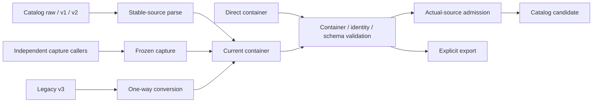

# 资产管线

上级契约：[系统边界](../README.md#系统边界)。

## 职责与边界

资产管线处于外部素材进入运行时的入口位置，负责把目录、压缩包、历史格式和现有容器统一转换为当前资产容器，并产出经过分层校验的模型视图。在此基础上，管线还提供预览图获取或补生成，以及面向已发布模型的显式导出操作。

## Seam Contract

按本次交接定位契约：

- 把来源变成可接纳容器或模型视图：[转换与准入](#来源转换与内容准入)。
- 取得图片或生成缺失预览：[preview 操作](#预览取得与生成)。
- 从已发布内容执行显式导出：[export 批次](#导出批次与提交)。

### 共同规则

适用范围：本页的来源转换与内容准入、预览取得与生成、导出批次与提交三项交接。三者共享以下职责分工、运行作用域、生命周期隔离与外部依赖。

管线内部按语言分层协作：Java 侧负责解析格式、组装模型语义、计算规范身份并写出容器；native 侧提供压缩包读取、哈希计算、数据压缩、媒体编解码和历史格式解码能力。管线本身不做权限判断，也不会在解析成功后直接把模型发布为 Ready 目标。

#### 数据流与交接

下图展示各类来源经转换和校验流向目录候选与导出的主路径；每个出口仍需经过各自的发布门禁。

#### 运行作用域与所有权

解析、转换与校验不常驻全局运行实例，而是运行在调用方的有限工作作用域内。输入持有方负责在转换期间保活来源；独立 capture 持有本次冻结后的输入数据；容器 writer 只借用存储持有方提供的输出 channel。转换可在客户端或服务端工作线程中执行，即使涉及媒体编解码也不依赖客户端 Minecraft 环境。

#### 预览与导出

预览操作独立管理自身的容量名额、订阅关注（interest）与完成状态；导出批次归属于具体的集成服务器环境。Catalog、底层 backing、GPU 资源和持久存储仍归各自接收方所有，格式 writer 不获得发布权。

预览与导出各自维护独立的操作生命周期：取消当前操作不会回滚已经提交的文件，也不会影响其他消费者。导出时的原环境提交门禁及停止收尾顺序见[导出批次与提交](#导出批次与提交)。

格式与内容规范以 [Asset Container](../../standards/asset-container.md)、[Model Schema](../../standards/model-schema/README.md) 及[兼容决策](model-compatibility.md)为准。持久存储提交依赖[存储契约](../model-management/storage/overview.md#seam-contract)，宿主资源采用依赖[客户端资源契约](../model-management/client-resources/overview.md#seam-contract)。当前一致性差异见[格式问题](../../status/known-issues/format-and-schema.md)，源码责任映射见[实现入口](#实现与验证入口)。

### 来源转换与内容准入

**边界与权威**

Java 与 native 的职责分工以及发布权归属遵循[共同规则](#共同规则)。本项负责交付当前容器与模型视图，图像和音频的媒体转换在外部来源转入当前容器的阶段完成。

**前置条件与输入**

#### 冻结输入与单向转换

外部来源进入运行时前，先统一归一化为当前容器。统一容器支持随机访问和前缀校验，避免为多种旧格式各自维护存储和校验分支；容器也不强制落盘，可直接构建内存 backing。

在 Catalog 发现阶段，管线会优先尝试暖复用，避免每次扫描都重复解析：先按区域、作用域（scope）、来源相对路径、转换配置（profile）和 Schema 查询已转换索引。命中候选后，再按来源类型做轻量核对：

- `v1` 与 `v2`：比对文件头部已存的 MD5。
- ZIP 与 7z：比对完整文件成员表的名称、大小与可用 CRC；缺少 CRC 时不走暖复用，直接进入冷转换。
- `v3`：沿用尾部提示。
- raw 目录：沿用原有的暖观察记录。

上述核对只表明可以尝试复用；如果实际读取已转换容器的 metadata 失败，则回退并只执行一次冷转换。

进入冷转换时，Catalog 的 raw 目录、ZIP、7z 以及 `v1`、`v2` 直接执行一次完整解析，由同一次 parser 同步产出身份、诊断信息与容器输出，不先做 capture 复制或试运行（dry-run）。调用方负责保活 VFS，并与用户共同保证转换期间来源稳定。Builtin 与独立 capture 调用方仍可先复制输入闭包，再通过同一套 parser 编译。

Catalog 对 raw 与历史格式的导入以[转换期间来源稳定](../../product-decisions/decisions/model-compatibility.md#bclegacy-source-stability-is-caller-owned)为前提：导入器不加平台文件锁，也不为目录建立输入快照；目录完整观察只用于扫描收尾和来源引用，不承诺 payload 快照一致。转换过程中实际遇到的 I/O、格式或校验错误仍会拒绝该来源。

历史格式适配只做单向转换，仅提取可确定解释的内容，不引入旧版缓存、会话或旧模型管理组件。一旦来源格式已识别，后续出现格式、转换或协议错误即终止该来源，不回退去尝试另一种格式。具体兼容范围与承诺见[模型兼容](model-compatibility.md)。

**结果与保证**

#### 分层验证与发布

资产校验按容器结构、精确身份、Schema 引用和实际 payload 四个层次推进。每层只负责自身边界并向下层提供输入：解压成功不代表 Schema 合法，metadata 可读不代表模型 chunk 齐全，bake 完成也不等于达到 Ready 状态。

下游消费者应直接信任同一不可变表示已经通过的结构、身份和引用校验，不要反复重解析相同的 metadata 来重建信任。尚未读取的 payload 和后续新打开的可变来源仍需由读取方按需取得字节并完成本层校验；权限、Ready 状态与宿主可用性由各自负责方判断。

写出与发布按职责分段交接：writer 生成容器字节，存储负责方提交已验证的制品，Catalog 负责方对外发布条目。raw 与历史格式写出的 staging 容器必须通过重开验证后才能交给存储；任何失败都只清理本次候选，不会覆盖原文件或已有的有效产物。公共字段定义仍以 [Asset Container](../../standards/asset-container.md) 和 [Model Schema](../../standards/model-schema/README.md) 为准。

实际来源接纳还区分 direct 容器与内部转换容器：direct 容器的 metadata 接纳要求 Manifest 声明内嵌预览图（实际图片 payload 在首次消费时校验），而 raw、builtin 与历史格式生成的内部容器允许缺图。这是针对实际来源的接纳门禁，不改变 Schema 本身对 `unspecified` 的合法解释。来源类型由 resolver 调用链确定，不能通过文件扩展名、metadata、缓存位置或调用方标记伪造，独立图片也不能用来补足 direct 容器的准入条件。显式导出仍会验证完整产物。

#### 图像与声音转换

媒体转换由 Java 侧按用途决定策略，native 侧执行实际编解码。图像策略按以下优先级匹配，产品依据见[图像决策](../../product-decisions/decisions/image-policy.md)：

| 输入与用途 | 处理策略 |
|---|---|
| 已有合法有损表示 | 直接复用，避免二次有损压缩 |
| 模型纹理且格式不在 PNG 或 zst 范围内 | 复用已有合法受支持表示 |
| 其余模型纹理 | 以输入像素为基准做无损处理 |
| 其余非纹理图片，低于分辨率阈值或适用受限设备策略 | 无损处理 |
| 其余非纹理图片 | 允许有损处理 |

小尺寸图片与体素纹理在 YUV 4:2:0 采样和有损压缩下容易出现色彩偏移、边缘模糊与透明通道失真，因此默认走无损路径。分辨率阈值与具体 codec 属于实现参数；受限设备会降低编码成本，但仍保留 WebP 与 AVIF 解码能力。该策略只在来源转入当前容器前执行，不改写已有容器；当前 PNG 路径与效果证据缺口见[转换实现](implementation/conversion-and-export.md#图像处理的位置)。

声音转换沿同一套 raw 与历史格式管线进入当前媒体表示。必选（required）与可选（optional）转码候选的失败语义、完整制品体积比较以及不支持媒体的边界须分别保持；具体算法见[音频转换](implementation/conversion-and-export.md#音频内容转换)，媒体规范见[标准](../../standards/model-schema/assets-and-validation.md#common-stringssettings-与音频)。当前容器执行导出时直接复制已验证的声音数据，不重新编码。

**所有权与时序**

模型视图只负责描述与验证，内容来源提供字节读取，模型 backing 负责数据保活。不可变 Manifest 是模型视图的唯一事实来源；查询索引只基于 Manifest 构建可重建的查找结构，不复制另一份 metadata。实现层的 reader 与解码交接见[分层验证](implementation/container-and-validation.md)。

生产转换所需的临时输出文件由存储负责方在复核目录后创建，格式层只借用输出 channel；临时文件的提交、清理与平台边界见[存储设计](../model-management/storage/overview.md#精确缓存与持久工作)。

**失败与拒收**

#### 生命周期与失败

每次转换只在本次调用期内持有输入与候选产物，通过重开验证后才把结果移交存储。转换被拒或失败时，立即关闭并清理本次候选与临时文件，不撤销已经存在的有效内容。来源读取失败、格式或身份无效以及基础设施故障各自保留独立错误分类。

**证据与依赖**

格式标准、兼容范围与已知差异遵循[共同规则](#共同规则)。reader、view、字节来源与 backing 的实现交接见[容器与分层验证](implementation/container-and-validation.md)；capture、媒体转换与 staging 细节见[转换实现](implementation/conversion-and-export.md)。

### 预览取得与生成

**边界与权威**

预览操作的容量名额、订阅关注与生命周期归属遵循[预览与导出](#预览与导出)及[共同规则](#共同规则)。成功取得预览图只表示图片可用，不代表模型目标达到 Ready 状态或导出已完成。

**前置条件与输入**

命中已有图片时，无需加载模型主体或使用 GPU；只有在缺失预览图、需要真实渲染生成时，才向客户端资源负责方申请目标使用权。普通目录展示、未发布导出项补图以及管理入口补图都共用这一契约。

**结果与保证**

图片命中时可直接返回已编码的图片字节；缺图生成必须产出真实的渲染预览图，不能用占位图充当生成结果。

**所有权与时序**

单个预览操作从 probe 阶段起持续持有自己的容量名额，并对操作结果负责。渲染生成路径会在现有的客户端推进窗口中观察自身持有的目标 lease，待目标就绪后再把使用权交给宿主渲染。职责分工如下：

- 客户端资源负责方：准备渲染资源、完成宿主 Ready 接纳，并清理未被采用的候选。
- 预览操作：使用已就绪目标完成渲染、读取像素、执行编码并写出结果。

后台 worker 绝不阻塞等待宿主线程。取消操作只结束本次预览使用，不影响其他消费者，也不会清除已经验证的缓存。

**失败与拒收**

操作取消不会回滚已提交的文件或影响其他消费者（见[预览与导出](#预览与导出)）；如果取消后仍有迟到的资源返回，按本项所有权规则交回客户端资源负责方清理。

**证据与依赖**

预览取得与生成依赖[客户端资源契约](../model-management/client-resources/overview.md#seam-contract)，各执行阶段见[preview 取得与显式 export](implementation/conversion-and-export.md#preview-取得与显式-export)；格式一致性限制遵循[共同规则](#共同规则)。

### 导出批次与提交

**边界与权威**

导出批次归属于具体的集成服务器环境，操作生命周期与发布权按[预览与导出](#预览与导出)和[共同规则](#共同规则)划分。

**前置条件与输入**

导出选集范围与权限要求由[导出决策](../../product-decisions/decisions/export-preprocessing.md)定义。环境有效性与权限检查必须在打开任何来源或创建输出文件之前完成。

无论是单项导出还是批量导出，都只从已发布的 Catalog 捕获精确输入：批次在启动时先冻结每个目标的路径与精确身份，执行每一项前再核查当前 Catalog。后续读取不会按路径静默切换为新版本表示，也不会搜索未发布的候选。已发布的 raw 或历史格式内部容器允许缺图，导出阶段负责为其补齐预览图。

**结果与保证**

Writer 复制已验证的模型内容，保留作品语义与已有作者信息，在需要时补齐适用预览图，随后重算容器身份并执行重开验证。只有原环境提交门禁仍然有效时，才执行原子替换；一旦文件替换成功，后续的反馈发送或清理失败不会把已提交结果改判为失败。环境停止时，先关闭提交资格，收尾阶段只等待不依赖服务端 tick 或宿主回调的自有工作。

**所有权与时序**

单个集成服务器环境同时只运行一个导出批次，并按顺序逐项处理，以限制常驻内存的输入、渲染目标和临时输出。关闭 GUI 不会中断正在运行的批次；集成服务器环境结束时会终止剩余未执行的项目，且不保存断点续跑状态。

**失败与拒收**

批次取消及已提交文件的保留边界见[预览与导出](#预览与导出)；临时候选清理与原子提交依赖[存储契约](../model-management/storage/overview.md#seam-contract)。提交成功后的反馈或清理异常按本项结果规则处理，不回滚或改判提交结果。

**证据与依赖**

选集与权限要求消费[导出决策](../../product-decisions/decisions/export-preprocessing.md)。批次调度、BUSY 拒绝、容量限制与停止收尾顺序见[预览与 export 实现](implementation/conversion-and-export.md#preview-取得与显式-export)，格式标准与支持限制遵循[共同规则](#共同规则)。

## 设计取舍

- **统一运行容器**：把 raw 与历史格式在入口处归一为同一种当前容器，省去多套存储与校验分支，降低下游维护成本。
- **Catalog 直接解析**：冷转换时省去 capture 复制闭包，降低内存与 I/O 开销，代价是转换期间的来源稳定性需由调用方保证；独立 capture 调用方仍自行承担冻结输入的成本（见[输入契约](#冻结输入与单向转换)）。
- **导出串行逐项**：每个环境一次只跑一个批次、串行处理单项，换取可控的内存与显存驻留量；代价是批量导出吞吐受限，且环境结束后未完成项需要手动重新发起。

## 实现与验证入口

- [容器与分层验证](implementation/container-and-validation.md)：定位 reader、view、字节来源与 backing 的代码职责。
- [转换与导出](implementation/conversion-and-export.md)：定位 capture、staging、环境提交门禁与结果交接。
- [模型兼容](model-compatibility.md)：查看面向外部格式的公开兼容语义。
- [格式问题](../../status/known-issues/format-and-schema.md)：查看当前支持状态与已知差距。
