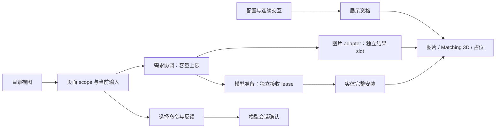

# 客户端展示设计

上级契约：[系统边界](../README.md#系统边界)。

## 职责与边界

客户端展示层消费目录数据，呈现模型卡片图片、实时 3D 预览和扫描进度，并向底层提交资源需求与用户选择。

在此边界内，metadata 可读、预览图可用与 3D 实体完成安装是三个独立状态。页面负责当前交互、展示资格、图片适配与子页导航；权威选择归模型会话，通用需求准备归[需求协调](../model-management/demand/overview.md)。产品依据见[创作与选择](../../product-decisions/requirements.md#reqcreate-and-select-models)及[模型授权](../../product-decisions/decisions/model-authorization.md)。

## Seam Contract

按本次交接定位契约：

- 显示卡片、图片、3D、进度或缺图反馈：[页面消费](#页面需求与展示消费)。
- 提交选择或进入纹理页面：[选择与导航](#选择与导航交接)。

### 共同规则

适用范围：本页的页面需求与展示消费、选择与导航交接两项契约。

#### 数据流与交接

#### 运行作用域与所有权

模型主界面及子页面绑定创建时的世界生命周期：无有效世界时拒绝打开，世界卸载后旧页面流程不可恢复。页面持有卡片状态、图片批次（batch）和私有预览实体；预览 `FakePlayer` 不迁移到新世界，新页面按需重建。

页面为每张卡片维持稳定端点登记，实体需求随展示资格建立/撤销。页码、成员、排序或内容变化时替换当前 scope；窗口 resize 或内容未变的重新初始化（init）保留原有 scope、实体与图片。页面退出时仅关闭自身 interest 与 lease，不影响缓存或其他消费者；通用展示实体缓存不拥有模型卡私有预览实体。

#### 生命周期与失败

卡片失去展示资格时，先撤销消费资格，再依次撤销指派、需求、私有执行态与动画引用（静态卡片可继续持有图片）。页面关闭或世界结束时立即停止新展示消费；当前帧有在途任务时，待全部任务交接完毕后再关闭借用的实例、lease 与图片输入。

依赖[需求协调](../model-management/demand/overview.md#seam-contract)、[实体执行](../animation/entity-lifecycle.md#seam-contract)与[模型会话](../model-management/sessions/overview.md#seam-contract)。

### 页面需求与展示消费

**前置条件与输入**

#### 页面需求与结果

页面资源准备与界面渲染按两个周期协作：客户端 tick 推进底层资源获取；模型列表在每次 render 时制定本帧计划，领取 Ready 资源并完成卡片绑定、图片 CPU 准备与动画求值，再消费结果绘制。

资源获取上限按触发条件区分：
- 自动展示卡片最多准备 GUI 离线资源。
- 交互触发的准备需同时满足连续交互资格与页面本地名额；需联网下载时另经联网准入。

**结果与保证**

卡片加载反馈同时观察图片状态与当前展示资格下的实时准备状态。预览图合法缺图不中断仍在进行的实时准备或宿主接纳；仅遇到真实失败、离线 miss 或展示资格退出时结束等待。卡片直接读取需求负责方状态，不另存副本。

#### 本地目录进度

HUD 与模型页右下角每次绘制各读取一次 `ClientModelService.catalogProgress()`。阶段与计数直接来自[Catalog 扫描进度](../model-management/catalog/overview.md#扫描进度投影)，两处共用阶段文案，模型页右下角保持右对齐深灰样式，无扫描活动时不绘制。

#### GUI 取景

目录卡片与自动生成预览图共用固定构图：截图固定 idle 姿态，实时卡片按清单播放 preview/hover/focus 动画。构图不按几何包围盒重新居中或缩放，合法根骨骼变换允许超出视区被裁剪，落实[作者姿态保护](../../product-decisions/decisions/selection-and-attribution.md#bcgui-framing-preserves-author-pose)。

纹理预览卡片采用保守几何取景：每张卡片记录当前安装下已观察姿态的几何包络，只扩不缩，仅换安装时清空（避免循环动画导致相机来回缩放，代价是大幅动作后画面可能偏小）。空几何或非法帧直接跳过绘制且不更新包络，取景计算不修改骨骼或作者属性。

**所有权与时序**

页面图片批次创建时绑定当前连接。`PageImages` 维护各 slot、获取需求与图片使用权（use）；资源侧 `ResidentImages` 关联驻留内容与宿主纹理注册。建立新使用权前复核成员、连接与展示资格，优先查询驻留内容；多个 slot 独立持有使用权，最后一个使用权结束时交回 `CustomTextureManager` 按原保留期限处理。信息页无提前加载例外；Eager 模式模型列表不建立也不消费预览图需求（跳过预览不算缺图或失败）。

模型列表帧计划固定本帧 GUI 输入，为新绑定与冷图片分配并发名额，已有绑定动画每帧推进。多张卡片共享同张图片时只由一张获准卡片准备，若同帧需绑定则合并在同一任务内执行。工作任务独占私有预览实体，renderer、宿主纹理注册与 GL 调用留在主线程。首张卡片直接在主线程执行并立即注册图片，其余任务全部交接完成后主线程统一注册其余图片并开始绘制（输入与执行许可见[实体生命周期](../animation/entity-lifecycle.md)）。

**失败与拒收**

图片批次完成与缓存提交非同一事务：单张失败不回滚同批次已提交图片。旧页面迟到结果由原图片 adapter 接纳、取消或释放，不借用新会话或复活已关闭页面。存储提交边界见[存储设计](../model-management/storage/overview.md)。

#### 缺图观察

远端预览图合法缺图记录归[模型会话](../model-management/sessions/overview.md)管理（同一会话对特定成员的观察），GUI 只读不自建副本也不主动清除。成员移除、模型表示变更、收到图片可读通知或会话退出时撤销旧记录；发请求前复核原 token。

停留在当前页面时不主动重拉图，待返回或重开页面时重判；本地已有适用图片或命中 Ready/cache-only 目标优先于旧缺图观察。图片可读通知不触发自动下载也不立即刷新停留页面。合法缺图与真实失败的区分见[缺图产品契约](../../product-decisions/decisions/selection-and-attribution.md#bcgui-preview-absence-is-session-observed)。

### 选择与导航交接

**边界与权威**

#### 选择与资源需求

目录只枚举普通条目，默认模型恰有一个 `builtin:default` 条目；intrinsic 槽位不生成目录卡片。GUI 3D 展示只呈现与当前请求和角色匹配的 Matching 安装，不用世界中的 Retained 模型冒充新选择，等待期间显示当前图片或占位。ACTIVE 会话下的选择由权威方决定，客户端不做乐观修改。

GUI 消费绑定对象维护的[请求关系](../animation/entity-lifecycle.md#指派请求与安装关系)：依赖不变时复用，选择、纹理、用途、绑定、安装或依赖内容任一变化时在下次消费切换。

**前置条件与输入**

进入纹理子页前先读取当前目标完整预览 Ready 并为接收页建立独立使用权；遇系统忙碌、门禁变化或资源失败直接拒绝导航，不保存待执行意图也不自动跳转。中央预览实体在内部页面重建期间保持存活，其余纹理候选卡进入页面后按常规规则获取资源。

**结果与保证**

仅左侧玩家名称消费真实玩家的选择等待状态；卡片名称始终标识模型内容本身。中央动画预览只接收与目标角色和纹理匹配的 FULL Ready，纹理候选卡沿 GUI 卡片准入获取资源。等待反馈超时后不回滚权威状态、不清领域失败记录、也不取消实体独立需求。

**所有权与时序**

选择命令发送、用途资源准备与实体独立需求各自独立推进（固定用途准备、连续交互起点与 lease 交接见[需求协调](../model-management/demand/overview.md)）。关闭页面不取消已发起的独立 FULL 选择准备。

## 设计取舍

- **展示资格与资源准入分离**：防止底层 Ready 回调把已经退出的卡片重新激活；代价是页面需显式维护卡片端点的展示资格与资源交接。
- **语义 scope 复用**：窗口 resize 或内容未变时复用现有 scope、实体与图片，避免不必要的重建开销；具体的换代条件由[作用域契约](#运行作用域与所有权)统一规定。

## 实现与验证入口

- [页面 runtime](implementation/page-runtime.md)：定位世界流程、图片发布、导航与取景的实现类。
- [实体生命周期](../animation/entity-lifecycle.md)：定义实体安装、借用与回收。
- [资产管线](../asset-pipeline/overview.md)：定义预览图生成与模型导出流程。
- [渲染状态](../../status/known-issues/rendering.md#gui-取景)与[模型状态](../../status/known-issues/model-management.md)：查看真实交互、缺图反馈、世界切换与取景的验证证据。
