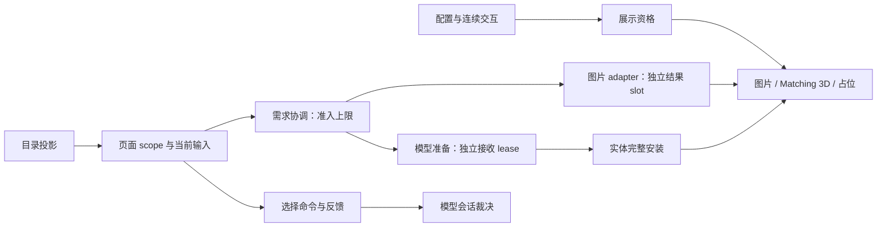

# 客户端展示设计

本页展开[系统边界](../README.md#系统边界)中的页面展示职责。页面消费模型目录，提交当前需求与用户选择；模型会话拥有 authority，资源 Ready 不授予权限或展示资格。

## 职责与边界

Metadata、图片与 3D 安装是不同完成状态。页面拥有当前交互、展示资格、图片 adapter 与导航；共同需求准备由[需求协调](../model-management/demand/overview.md)定义，资源与持久缓存由各自 owner 管理。

产品依据为[创作与选择](../../product-decisions/requirements/req-create-and-select-models.md)及[模型授权](../../product-decisions/decisions/model-authorization.md)。

## 运行作用域与所有权

模型界面和子页面共享创建时的世界生命周期。无世界时拒绝打开，世界卸载后旧流程不能恢复。页面持有卡片、图片 batch 与私有预览实体；FakePlayer 不迁移到新世界，新页面按需重建。

页面稳定登记卡片端点，实体需求随展示资格建立或退休。页面、成员、顺序或内容改变时替换 scope；resize 或相同内容 init 保留 scope、实体与图片。页面只关闭自己的 interest/lease，不清已验证 cache。通用展示实体 cache 不拥有模型卡私有预览。

## 数据流与交接

### 页面需求与结果

箭头表示输入或结果交付，不表示单一串行流程。Client tick 推进资源取得；模型列表在每次 render 建立帧计划，领取 Ready 并完成卡片绑定、图片 CPU 准备和动画，再消费准备结果。自动卡片最多准备 GUI 离线资源；交互准备同时需要连续交互资格与页面本地准入，联网另需联网准入。资源就绪、预览生成或图片失败都不授予展示资格。

Page batch 创建时绑定 exact connection。`PageImages` 保存 slot、取得需求与各自的图片 use；资源侧 `ResidentImages` 统一关联内容和宿主注册。新使用先复核成员、连接与展示访问资格，再在读取、下载和解码前查驻留内容。多个 slot 各持独立 use，最后一个 use 结束才交回 `CustomTextureManager` 的原保留期限。所有已建立的页面图片需求使用相同准入，信息页无提前加载例外。Eager 模型列表不建立或消费 preview 需求；跳过状态不当作缺图或失败。

Batch 完成与 cache 提交不是同一事务，一个 sibling 失败不回滚其他已提交图片。旧页面迟到结果由原 adapter 接纳、取消或释放，不借新 session 或复活页面。图片存储的提交边界见[存储设计](../model-management/storage/overview.md)。

帧计划固定 GUI 输入，为新绑定和冷图片授予公平名额；已有绑定的动画每帧继续执行。共享图片只由一张获准卡片准备；该卡本轮同时绑定时，两项工作属于同一任务。任务独占私有实体，renderer、宿主注册和 GL 留在主线程。首卡在主线程执行并立即注册图片；其余已接纳任务全部交接后才注册其他图片和绘制。此结构增加执行权交接成本，避免跨帧任务、重复求值和同池等待；输入与许可见[实体生命周期](../animation/entity-lifecycle.md)。

卡片的加载反馈同时观察图片与当前展示资格下的实时准备。图片合法空不结束仍在准备或等待 host 接纳的实时展示；真实失败、离线 miss 与展示资格退出仍能结束等待。卡片只读取需求 owner 的状态，不保存另一份完成事实。

### 选择与资源需求

GUI 3D 只表达当前请求的 Matching 安装；世界 Retained 不能冒充新选择，等待时显示当前图片或占位。ACTIVE 选择由 authority 裁决，不乐观修改模型或 Roaming。

选择发送、用途准备和实体独立需求分别推进。固定用途准备、连续起点与 lease 交接由[需求协调](../model-management/demand/overview.md)定义。页面关闭不取消独立的 FULL 选择准备；用途 Ready 也不证明接收实体安装完成。

只有左侧玩家名称消费真实玩家选择等待；卡片名称始终标识内容，图片与 GUI 加载独立。中央动画预览只接收匹配纹理的 FULL Ready，纹理候选沿 GUI 卡片准入取得资源。Accepted、Ready 或 Retained 不表示安装成功；反馈期限结束不回滚 authority、清领域失败或取消实体独立需求。

纹理入口只读取当前目标的完整预览 Ready，并先建立接收页独立使用。Busy、门禁变化或接收失败直接拒绝本次导航，不保存意图或后来自动进入。中央预览跨内部重建保留，其他纹理卡进入后沿原规则取得资源。此选择避免隐含重试，但缺少完整预览时需要再次点击。

### 本地目录进度

HUD 与模型页右下角各次绘制只读取一次 `ClientModelService.catalogProgress()`。阶段与计数来自[Catalog 扫描投影](../model-management/catalog/overview.md#扫描进度投影)，不使用 runtime pending、当前模型数或 session 活动。页面开关不控制扫描。两处共用阶段文案，右下角保持右对齐深灰；无活动时都不绘制进度。

## 生命周期与失败

展示资格退出先撤消费资格，再撤指派、需求、私有状态与动画引用；静态卡片仍可持图片。页面或世界结束立即封口消费；存在本帧任务时，全部交接后才关闭任务借用的实例、lease 和图片输入。页面只关闭自身资源，不影响其他消费者或已验证磁盘内容。

### 缺图观察

Remote preview 的合法缺图归[模型会话](../model-management/sessions/overview.md)，是 exact session 对精确成员的观察。GUI 只读，不保存镜像或清除事实。成员移除、换表示、图可读通知和 session 退出撤销旧观察；发送时原 token 仍需复核。

停留页不主动拉图，返回或重开时再判断；适用本地图或 Ready/cache-only target 优先于旧缺图观察。图可读通知不下载、不授予权限，也不立即刷新停留页。空结果与失败的区分见[缺图产品契约](../../product-decisions/decisions/selection-and-attribution.md#bcgui-preview-absence-is-session-observed)。

## 关键契约与设计取舍

### GUI 取景

目录卡与自动预览图共用固定构图。截图固定 idle；实时卡消费清单的 preview、hover/focus 动画。不按几何边界重居中或缩放，合法根变换可超出视区并被裁剪，遵循[作者姿态保护](../../product-decisions/decisions/selection-and-attribution.md#bcgui-framing-preserves-author-pose)。

纹理卡使用保守几何取景，各自保留当前安装已观察姿态的包络。包络只扩不缩，换安装清空；避免循环动画引起相机反复缩放，代价是大动作后模型可能持续较小。空几何或非法帧不绘制、不写包络，取景不改骨骼与作者属性。

展示资格与资源准入分离，避免 Ready 结果重新激活已退出的卡片；成本是端点资格和资源交接需要显式维护。语义 scope 复用减少 resize 重建，但内容身份变化仍应撤旧 scope。

## 实现与验证入口

[页面 runtime](implementation/page-runtime.md)定位世界流程、图片发布、导航与取景映射。[实体生命周期](../animation/entity-lifecycle.md)定义安装、借用和退休；生成预览与 export 进入[资产管线](../asset-pipeline/overview.md)。

真实交互、缺图反馈、世界切换与取景证据见[渲染状态](../../status/known-issues/rendering.md#gui-取景)和[模型状态](../../status/known-issues/model-management.md)。
