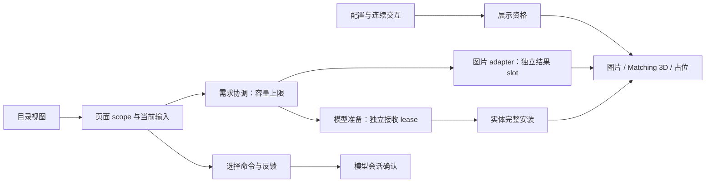

# 客户端展示设计

上级契约：[系统边界](../README.md#系统边界)。

## 职责与边界

客户端展示层落实[系统边界](../README.md#系统边界)中的页面交互与呈现职责：模型页面消费目录数据，展示卡片图片、实时 3D 预览和扫描进度，并向底层提交资源需求与用户选择。

在这个边界内，metadata 可读、预览图可用与 3D 实体完成安装分别代表三个独立的完成状态。页面只负责当前交互、展示资格判断、图片适配与子页导航；模型的权威选择由模型会话决定，通用需求准备由[需求协调](../model-management/demand/overview.md)负责，渲染资源与持久缓存则归各自负责方管理。资源进入 Ready 状态并不等同于获得使用权限或页面展示资格。

产品依据见[创作与选择](../../product-decisions/requirements/req-create-and-select-models.md)及[模型授权](../../product-decisions/decisions/model-authorization.md)。

## Seam Contract

按本次交接定位契约：

- 显示卡片、图片、3D、进度或缺图反馈：[页面消费](#页面需求与展示消费)。
- 提交选择或进入纹理页面：[选择与导航](#选择与导航交接)。

### 共同规则

适用范围：本页的页面需求与展示消费、选择与导航交接两项契约。两者共用以下职责分工、创建时世界绑定、作用域（scope）管理与停止消费规则。

页面只负责交互状态、展示资格与页面导航；模型会话决定权威选择，需求负责方维护资源准备状态。Metadata、图片、Ready 目标与实体安装分别提供各自的状态事实，页面不另行保存完成状态或权限的副本。

页面流程自打开起即绑定创建时的世界；资源用途、连续交互与联网资格按[页面需求](#页面需求与结果)建立。进入新子页时必须先取得接收页的独立资源使用权，一旦被拒即放弃本次操作，不保留待执行意图（见[选择与资源需求](#选择与资源需求)）。

#### 数据流与交接

下图梳理页面输入、资源准备与权威反馈之间的交接路径；前一阶段产出结果并不自动授予后一阶段的执行资格。

#### 运行作用域与所有权

模型主界面及其子页面共享创建时的世界生命周期：无有效世界时拒绝打开，世界卸载后旧页面流程不可恢复。页面自身持有卡片状态、图片批次（batch）和私有预览实体；预览用的 `FakePlayer` 不迁移到新世界，新页面按需重建。

页面为每张卡片维持稳定的端点登记，实体需求随展示资格的获得或退出建立和撤销。当页码、成员、排序或内容发生变化时，页面替换当前 scope；仅窗口尺寸变化（resize）或内容未变的重新初始化（init）会保留原有 scope、实体与图片。页面退出时只关闭自己持有的 interest 与 lease，不清理已验证的缓存；通用展示实体缓存也不拥有模型卡的私有预览实体。

#### 生命周期与失败

当卡片失去展示资格时，先撤销消费资格，再依次撤销指派、需求、私有执行态与动画引用；静态卡片仍可继续持有图片。页面关闭或世界结束时，立即停止新的展示消费；如果当前帧还有在途任务，须等全部任务交接完毕后再关闭任务借用的实例、lease 与图片输入。页面只清理自身资源，不影响其他消费者或磁盘上已验证的内容。

页面消费[需求协调](../model-management/demand/overview.md#seam-contract)、[实体执行](../animation/entity-lifecycle.md#seam-contract)及[模型会话](../model-management/sessions/overview.md#seam-contract)的契约保证。代码定位以及真实交互、世界切换与取景验证见[实现与验证入口](#实现与验证入口)。

### 页面需求与展示消费

**边界与权威**

页面展示资格与需求、资源和模型会话的职责边界遵循[共同规则](#共同规则)；预览图和实时 3D 安装分别独立交付结果。

**前置条件与输入**

#### 页面需求与结果

页面的资源准备与界面渲染按两个周期协作推进：客户端 tick 负责推进底层资源获取；模型列表在每次 render 时制定本帧计划，领取 Ready 资源并完成卡片绑定、图片 CPU 准备与动画求值，再消费结果进行绘制。

不同触发条件对应的资源获取上限不同：

- 自动展示的卡片最多只准备 GUI 离线资源。
- 交互触发的准备必须同时满足连续交互资格与页面本地名额；若需联网下载，还必须通过联网准入。
- 资源已就绪、预览图生成或图片读取失败本身，都不会自动授予卡片展示资格。

**结果与保证**

卡片的加载反馈同时观察图片状态以及当前展示资格下的实时准备状态。如果预览图返回合法缺图，并不会中断仍在进行的实时准备或宿主接纳；只有遇到真实失败、离线 miss 或展示资格退出时才结束等待。卡片直接读取需求负责方的状态，不另存一份完成事实。

#### 本地目录进度

HUD 与模型页右下角在每次绘制时各读取一次 `ClientModelService.catalogProgress()`。进度阶段与计数完全来自[Catalog 扫描进度](../model-management/catalog/overview.md#扫描进度投影)，不使用运行时 pending 数、当前模型数或会话活动状态，页面开关也不控制扫描进程。两处展示共用同一套阶段文案，模型页右下角文字保持右对齐深灰样式；无扫描活动时两处均不绘制进度。

#### GUI 取景

目录卡片与自动生成的预览图共用同一套固定构图：截图固定采用 idle 姿态，实时卡片则按清单约定播放 preview、hover 或 focus 动画。构图不根据几何包围盒重新居中或缩放，合法的根骨骼变换允许超出视区并被裁剪，以遵循[作者姿态保护](../../product-decisions/decisions/selection-and-attribution.md#bcgui-framing-preserves-author-pose)。

纹理预览卡片采用保守几何取景：每张卡片各自记录当前安装下已观察姿态的几何包络。包络只扩不缩，仅在更换安装时清空；这样可以避免循环动画导致相机来回缩放，代价是模型做完大幅动作后，后续画面可能一直显得偏小。遇到空几何或非法帧时直接跳过绘制且不更新包络，取景计算绝不修改骨骼或作者属性。

**所有权与时序**

页面图片批次在创建时绑定当前同一个连接。`PageImages` 维护各个 slot、获取需求与各自的图片使用权（use）；资源侧的 `ResidentImages` 统一关联驻留内容与宿主纹理注册。每次建立新使用权前，先复核成员、连接与展示访问资格，随后在读取、下载或解码前优先查询驻留内容。多个 slot 各自持有独立使用权，直到最后一个使用权结束时，才交回 `CustomTextureManager` 按原有保留期限处理。所有已建立的页面图片需求共用同一套准入规则，信息页没有提前加载的例外。Eager 模式下的模型列表不建立也不消费预览图需求，跳过预览的状态不当作缺图或失败。

模型列表的帧计划会固定本帧的 GUI 输入，并为新绑定与冷图片分配公平的并发名额，而已有绑定的动画每帧继续推进。多张卡片共享同一张图片时，只由其中一张获准卡片负责准备；如果该卡片本帧同时需要绑定，两项工作合并在同一个任务中执行。工作任务独占私有预览实体，而 renderer、宿主纹理注册和 GL 调用都保留在主线程。首张卡片直接在主线程执行并立即注册图片，其余已接纳的任务必须全部交接完成后，主线程才统一注册其余图片并开始绘制。这种编排增加了一定的执行权交接开销，但避免了跨帧任务、重复求值以及同池互相等待；输入与执行许可边界见[实体生命周期](../animation/entity-lifecycle.md)。

**失败与拒收**

图片批次完成与缓存提交不属于同一个事务：同批次中某张图片失败不会回滚其他已经提交的图片。旧页面如果有迟到结果返回，由原图片 adapter 负责接纳、取消或释放，绝不借用新会话或复活已关闭页面。图片持久存储的提交边界见[存储设计](../model-management/storage/overview.md)。

#### 缺图观察

远端预览图的合法缺图记录归[模型会话](../model-management/sessions/overview.md)管理，代表同一个会话对特定成员的观察结果。GUI 侧只读该观察，不另存副本，也不主动清除记录。当成员被移除、模型表示变更、收到图片可读通知或会话退出时，旧的缺图观察随之撤销；发送请求前仍需复核原 token。

停留在当前页面时不会主动重新拉图，而是等用户返回或重开页面时再重新判断；本地已有适用图片，或者命中 Ready 与 cache-only 目标时，优先于旧的缺图观察。图片可读通知既不会触发自动下载，也不授予额外权限，也不会立即刷新正在停留的页面。合法缺图与真实失败的区分见[缺图产品契约](../../product-decisions/decisions/selection-and-attribution.md#bcgui-preview-absence-is-session-observed)。

页面只消费各负责方给出的失败或合法缺图结果：图片缺失不中断仍获准的实时准备，页面退出时按[生命周期与失败](#生命周期与失败)归还资源。

**证据与依赖**

需求协调、实体执行与模型会话依赖遵循[共同规则](#共同规则)。图片发布、帧任务与取景代码映射见[页面 runtime](implementation/page-runtime.md)，实际验证状态见[实现与验证入口](#实现与验证入口)。

### 选择与导航交接

**边界与权威**

#### 选择与资源需求

目录只枚举普通条目，默认模型恰有一个 `builtin:default` 条目；intrinsic 槽位不生成目录卡片。GUI 的 3D 展示只呈现与当前请求和角色匹配的 Matching 安装，绝不用世界中的 Retained 模型冒充新选择；等待安装期间显示当前图片或占位。ACTIVE 会话下的选择由权威方决定，客户端不做乐观修改，也不擅自变更模型或 Roaming 状态。

GUI 消费绑定对象维护的[请求关系](../animation/entity-lifecycle.md#指派请求与安装关系)：当依赖不变时直接复用现有关系；一旦选择、纹理、用途、绑定、安装或依赖内容任一发生变化，下一次消费便切换为新关系。绘制 hook 不会延长旧 Matching 安装的有效期。

**前置条件与输入**

进入纹理子页前，先读取当前目标的完整预览 Ready，并为接收页建立独立的使用权。如果遇到系统忙碌、门禁状态变化或资源获取失败，直接拒绝本次导航，既不保存待执行意图，也不会在资源就绪后自动跳转。中央预览实体在内部页面重建期间保持存活，其余纹理候选卡则在进入页面后按常规规则获取资源。这种设计避免了隐式重试带来的意外跳转，代价是完整预览尚未就绪时用户需要再次点击。

**结果与保证**

页面上只有左侧玩家名称消费真实玩家的选择等待状态；卡片名称始终标识模型内容本身，图片加载与 GUI 加载各自独立。中央动画预览只接收与目标角色和纹理匹配的 FULL Ready，纹理候选卡则沿 GUI 卡片准入获取资源。命令被接受（Accepted）、资源 Ready 或持有 Retained 都不等于实体安装成功；等待反馈超时后，不会回滚权威状态、清除领域失败记录，也不会取消实体的独立需求。

**所有权与时序**

选择命令发送、用途资源准备与实体独立需求三者分别独立推进。固定用途准备、连续交互起点与 lease 交接由[需求协调](../model-management/demand/overview.md)定义。关闭页面不会取消已经发起的独立 FULL 选择准备，用途进入 Ready 也不代表接收实体已经完成安装。

**失败与拒收**

导航被拒与反馈超时后的边界遵循本项[选择与资源需求](#选择与资源需求)；页面关闭按[生命周期与失败](#生命周期与失败)清理自身资源，不影响独立的用途准备或权威状态。

**证据与依赖**

用途准备与 lease 交接依赖[需求协调](../model-management/demand/overview.md#seam-contract)，权威反馈依赖[模型会话](../model-management/sessions/overview.md#seam-contract)，世界与页面生命周期遵循[共同规则](#共同规则)。

## 设计取舍

- **展示资格与资源准入分离**：防止底层 Ready 回调把已经退出的卡片重新激活；代价是页面必须显式维护卡片端点的展示资格与资源交接。
- **语义 scope 复用**：窗口 resize 或内容未变时复用现有 scope、实体与图片，避免不必要的重建开销；具体的换代条件由[作用域契约](#运行作用域与所有权)统一规定。

## 实现与验证入口

- [页面 runtime](implementation/page-runtime.md)：定位世界流程、图片发布、导航与取景的实现类。
- [实体生命周期](../animation/entity-lifecycle.md)：定义实体安装、借用与回收。
- [资产管线](../asset-pipeline/overview.md)：定义预览图生成与模型导出流程。
- [渲染状态](../../status/known-issues/rendering.md#gui-取景)与[模型状态](../../status/known-issues/model-management.md)：查看真实交互、缺图反馈、世界切换与取景的验证证据。
