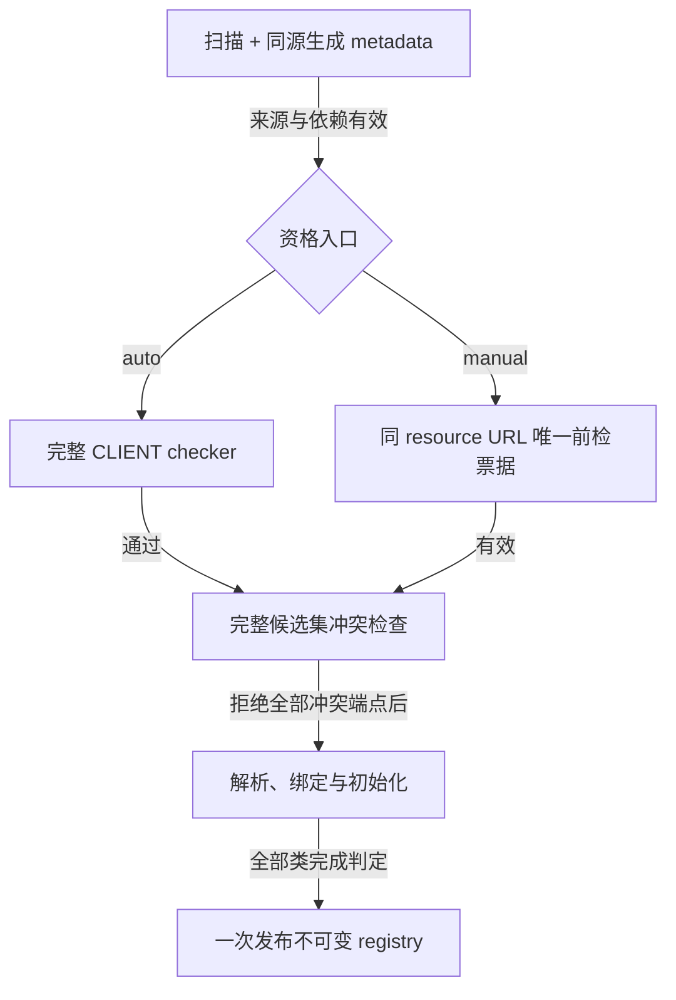

# 扩展装载

本页说明[扩展资格与冻结](../overview.md#扩展接纳与声明发布)在代码中的编译期生成、运行期发现与发布门禁。作者侧声明规范见[共同声明契约](../../animation/molang-declarations.md)。

## 扩展兼容检查与注册

可选事件 handler 装载分兼容检查与总线注册两步：

- `ExtensionCompatibilityProcessor` 编译期生成 checker，`ExtensionEventHandlerLoader` 在 `FMLLoadCompleteEvent` 收集 Forge 扫描候选类名，`ExtensionEventHandlerRegistration.prepare()` 在实例化前执行 checker。
- 类缺失、检查未通过、加载异常或注册失败按单个 handler 隔离；兼容检查 warning 不阻止注册。
- 注册失败时在原事件总线上对同一实例 `unregister` 回滚；若回滚也失败，将异常附加到原异常并在诊断中标注可能残留监听。

Builtin 与外部 API 的 Molang 声明共用 `UnifiedDeclarationProcessor`、`DeclarationSchema` 与带类型 helper 生成器；核心声明单次编译，由 bootstrap 处理器与发布 JAR 共同复用。

运行期装载由 `MolangExtensionLoader` 驱动：从实际来源文件读取 mod 集合、扫描类名与同源元数据，由 collector 在加载实现类前完成来源归属、全量依赖（all-of）与资格校验；归属确认前诊断仅标文件与类名。

- Auto 与 manual 入口均不直接接收实现 `Class`。
- 接纳器在合格候选集上一次性判定 symbol 与 namespace 冲突，拒绝冲突类且不重选赢家；随后在绑定阶段核验方法、helper、资源与 linkage。被拒类不留占位或 fallback，局部运行故障不影响已发布的全局资格。
- 普通模型视图与 builtin 专用视图派生自同一次可信接纳，builtin 身份由可信来源确定。组件实例按“声明类 + 实体安装（entity installation）”定位。
- Checker 覆盖声明与链接准入；Forge 扫描机制与模组初始化顺序归外部加载器边界。
