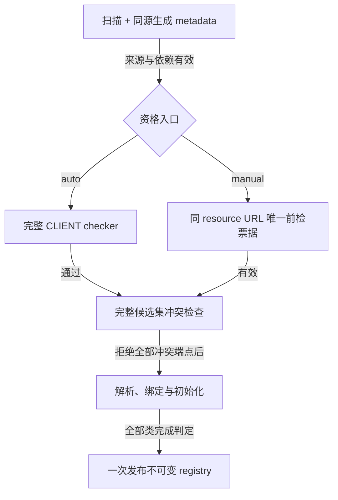

# 扩展装载

本页说明[扩展资格与冻结](../overview.md#扩展接纳与声明发布)在代码中的编译期生成、运行期发现与发布门禁。作者侧声明规范见[共同声明契约](../../animation/molang-declarations.md)。

## 扩展兼容检查与注册

可选事件 handler 的装载分为兼容检查与总线注册两步：`ExtensionCompatibilityProcessor` 在编译期生成 checker，`ExtensionEventHandlerLoader` 在 `FMLLoadCompleteEvent` 中从 Forge 扫描元数据收集候选类名，再由 `ExtensionEventHandlerRegistration.prepare()` 在实例化前执行 checker。类缺失、检查未通过、加载异常或注册失败均按单个 handler 隔离；兼容检查产出的 warning 不会阻止注册。

如果注册过程失败，loader 会在原事件总线上对同一实例调用 `unregister` 执行回滚。若回滚也失败，异常会附加到原注册异常上，并在诊断中保留可能存在残留监听的提示。

Builtin 与外部 API 的 Molang 声明复用同一套工具链，包括 `UnifiedDeclarationProcessor`、`DeclarationSchema` 以及带类型的 helper 代码生成。核心声明只编译一次，由 bootstrap 注解处理器和发布 JAR 共同复用，不维护第二套签名语义。

运行期装载由 `MolangExtensionLoader` 驱动：它从实际来源文件读取 mod 集合、扫描类名与同源生成的元数据，由 collector 在加载实现类之前完成来源归属、全量依赖（all-of）和资格校验。归属确认前的诊断只标注文件与类名，不推测 mod id。

Auto 与 manual 两条入口都不直接接收实现 `Class`。接纳器在合格候选集合上一次性完成 symbol 与 namespace 冲突判定，拒绝冲突类后不再重选赢家；随后在绑定阶段核验真实方法、helper、资源与 linkage。被拒绝的类不保留占位符或 fallback，运行期局部负责方的故障也不会反向撤销已发布的全局资格。

普通模型视图与 builtin 专用视图均派生自同一次可信接纳，builtin 来源身份不能通过公共声明自报。组件实例按“声明类 + 实体安装（entity installation）”定位，不按 namespace 分组。Checker 只负责声明与链接层面的准入检查，Forge 自身的扫描机制与模组初始化顺序仍属于外部加载器边界。
