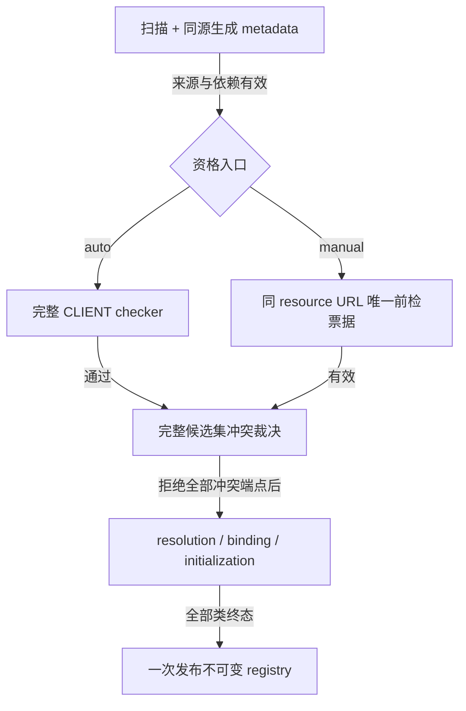

# 扩展装载

本页定位[扩展资格与冻结](../overview.md#扩展资格与冻结)的生成、发现和发布门禁。作者声明见[共同声明契约](../../animation/molang-declarations.md)。

## 扩展兼容检查与注册

`ExtensionCompatibilityProcessor` 生成 checker；`ExtensionEventHandlerLoader` 在 `FMLLoadCompleteEvent` 从 Forge scan metadata 取得候选名称。`ExtensionEventHandlerRegistration.prepare()` 在实例化前执行 checker。缺失、检查、加载或注册失败按 handler 隔离；兼容结果的 warning 不自动禁止注册。

Builtin/API 声明复用 `UnifiedDeclarationProcessor`、`DeclarationSchema` 与 typed helper 输出。核心 declaration 编译一次，bootstrap AP 和发布 JAR 复用该结果，不建立第二套签名语义。

`MolangExtensionLoader` 从实际来源文件取得 mod 集合、扫描类名及同源生成 facts。Collector 在解析实现类前验证归属、all-of 依赖和资格；归属确认前的诊断只标文件和类名，不推测 mod id。

Auto/manual 两入口均不提交实现 Class。接纳器从合格集合一次确定 symbol/namespace 冲突，拒绝后不重选赢家；绑定仍核验真实方法、helper、资源和 linkage。拒绝类没有 placeholder 或 fallback，运行期 owner 故障不回写资格。

普通与 builtin-only 视图来自同一可信接纳，builtin 来源身份不能由公共声明自报。组件实例按声明类与 entity installation 定位，不按 namespace 分组。Checker 只证明声明和链接准入，不证明第三方业务、并发或视觉正确；Forge 自身扫描和初始化顺序仍是外部 loader 边界。
