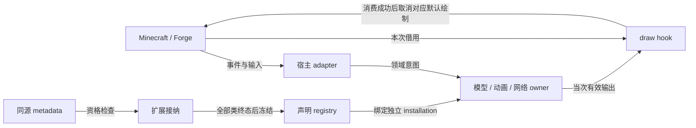

# 游戏与扩展接入

上级契约：[系统边界](../README.md#系统边界)。

## 职责与边界

接入层把 Minecraft/Forge 的实体、事件、组件和绘制上下文交给 YSM 领域 owner。接入不增加模型、动画或网络权威。本页的宿主前提限于 Minecraft 1.20.1 / Forge 47.4；其他版本、加载器或可选提供方需要独立建立依据。

## Seam Contract

按本次交接定位契约：

- 接纳扩展类并冻结声明：[扩展发布](#扩展接纳与声明发布)。
- 读取宿主输入或借用 draw 上下文：[输入与绘制](#宿主输入与绘制借用)。
- 交付连接、实体、reload 或停止事实：[换代与结束](#宿主换代重载与结束)。

### 共同规则

适用范围：本页的扩展接纳、宿主输入与绘制借用、宿主换代与结束三项交接。各项共同遵守以下接入权威、作用域和普通失败边界。

可选模组只提供适配输入或绘制交接。产品范围与降级义务见[模组联动](../../product-decisions/decisions/mod-integration.md)和[联动风险](../../product-decisions/decisions/integration-risk.md)。当前直接接线不代表已经建立统一输入层，未收敛范围见[动画问题](../../status/known-issues/animation.md)。

接入层没有统领模型、动画或网络的运行实例。Setup 与装载窗口建立绑定；entity capability 将宿主实体关联到领域 owner；draw hook 只借用本次绘制上下文。扩展全局声明资格与每个 installation 的组件实例分别存续，不以 namespace 合并实例寿命。

下图的边分别标注输入、借用和资格发布；handler 注册不授予任意线程访问能力。

#### 普通失败边界

普通模型、接入或可选模组错误由所属 owner 按[普通失败隔离](../../product-decisions/decisions/failure-isolation.md#bcordinary-failure-keeps-game-running)降级。接入错误不能升级为宿主 startup、正常连接或游戏进程失败，也不能先使宿主崩溃再据此免除收尾。[Required default](../../product-decisions/shared.md#condefault-failure-exception) 与 [fallback `VertexConsumer`](../../product-decisions/decisions/failure-isolation.md#bcrender-failure-does-not-corrupt-scene) 的例外不扩展到其他接入错误。接入层不另建覆盖全部回调的恢复状态或重试协议。

资源诊断只观察实际构造、读取、提交与回收，不触发加载或保活。开关与观察范围见[诊断实现](../../verification/resource-diagnostics.md)。Forge scan metadata 的产生和其他模组初始化顺序属于外部 loader，不由 YSM 接入层推定。

### 扩展接纳与声明发布

本项显式继承[共同规则](#共同规则)。

**边界与权威**

接纳器裁决类级资格，领域 owner 裁决 installation 的使用；两者依赖[共同规则](#共同规则)中的接入权威。

**前置条件与输入**

#### 扩展资格与冻结

公共声明的显式 `modId` 应属于实际来源文件的 mod 集合；省略时，来源文件应只有一个有效 mod。多 mod 文件应显式消歧。其他文件中安装了同名 mod 不能授权当前文件。Processor 只保存显式值，不从包、`@Mod` 或 ABI module id 推测归属。接纳结果单独保存验证后的 mod id。

冲突只统计成员覆盖后的真实导出。公共 namespace 允许同一验证后 mod id 的类合并；不同 mod 共享 namespace 时，接纳器拒绝全部冲突类。跨类同完整 symbol 也拒绝全部类，包括 builtin，且不合并为重载。无真实导出的默认 namespace 不占位。连锁冲突取原集合所有端点，不在拒绝后重选赢家。namespace 不合并组件实例或安装生命周期。

Auto 使用完整 checker；manual 使用同一资源的唯一前检票据。未提交、重复、双路或迟到均拒绝，资格入口不直接提交实现 Class。资格与实际解析分开，避免缺依赖或未获准的类提前初始化。

**结果与保证**

扩展接纳先核对扫描与同源元数据，再验证来源归属、all-of 依赖和 checker/manual 资格。接纳器对合格候选一次建立完整冲突集合，拒绝全部端点后才解析、绑定和初始化真实实现。全部类终态后一次发布 registry；拒绝类不保留 placeholder、签名或 fallback。

**所有权与时序**

真实 method/helper、可见性和 linkage 仍在绑定阶段核验。Checker 不替代[作者声明契约](../animation/molang-declarations.md)或实际 linkage，也不证明第三方业务、并发或视觉正确。Owner-local 构造、生命周期 hook 与 provider 失败只结束本地用途，不撤销全局已发布声明资格。同一次可信接纳派生普通与 intrinsic default 的 builtin-only 不可变声明视图，不再次接纳。来源资格使用内部 builtin 来源身份，不根据 namespace、类名或注解推断。Subject 资格在 installation 的同代 SubjectBinding 中缓存。

宿主线程、实体和安装的结束由各领域 owner 裁决。

**失败与拒收**

#### 失败隔离与声明寿命

可选 handler 的版本资格先于构造；构造或注册失败撤销半注册。Checker/linkage 失败在类或 handler 边界隔离，不能吞掉已进入 YSM 的绘制或 consumer 异常。类级资格细化见[扩展资格与冻结](#扩展资格与冻结)，具体 Forge 窗口、事件和版本范围见[接入实现](implementation/host-adapters.md#已有事件表面)。

可选 handler 的注册失败仍有[半注册回滚缺口](../../status/known-issues/integration.md#可选-handler-注册回滚)。

普通失败和 consumer 例外使用[普通失败边界](#普通失败边界)，不扩大类级隔离范围。

**证据与依赖**

声明存在不证明入口已接通，也不构成稳定公共 API 承诺。`RegisterRenderStateModifierEvent` 等现有缺口由[渲染问题](../../status/known-issues/rendering.md#扩展接线)记录；规划适配仍在[联动方向](../../future/mod-animation-integration.md)。

宿主窗口和版本范围见[已有事件表面](implementation/host-adapters.md#已有事件表面)。

### 宿主输入与绘制借用

本项显式继承[共同规则](#共同规则)。

**边界与权威**

宿主提供执行位置和当次借用，YSM 领域 owner 接纳输入与输出；权威分工见[共同规则](#共同规则)。

**前置条件与输入**

#### 宿主执行与输入权限

下表区分宿主提供的执行前提与 YSM 应建立的访问保证。事件总线、物理发行侧和逻辑侧都不能替代实际执行入口的权限。

| 宿主前提 | YSM 接入责任与信任范围 |
|---|---|
| 正常客户端 game/tick 与 render 共用 Render thread；集成服务器仍使用独立 Server thread | 只在对应 owner 窗口访问其状态。`Dist.CLIENT` 不能作为逻辑客户端判断，客户端发行包中的服务端状态仍归 server owner |
| `FMLCommonSetupEvent` 与 `FMLClientSetupEvent` 是 parallel-dispatch 事件 | 需要 game-thread 的 setup 经 `enqueueWork` 交接；client-only 注册只限定类和发行侧，不授予任意线程访问 `Minecraft` 或 GL 的能力 |
| Runtime event 在各自发布点调用；Forge custom-message 默认接收与解码可在 Netty，主线程 consumer 需显式交接 | 按实际入口选择 owner，不因共同使用 event bus 推断线程；排队只建立执行顺序，不保留原连接、实体或安装资格。网络接纳细化见[执行权限](../network/overview.md#接收准入与执行权限) |
| 暂停不结束 render；一帧与一次逻辑 tick 没有一一对应关系 | 动画时间与动作资格由[动画 owner](../animation/overview.md)裁决，不以 draw 次数驱动宿主玩法，也不把暂停视作所有 live 输入被冻结 |

动画 worker 对 YSM 私有状态的独占权限不覆盖 live `Entity`、`level`、`Minecraft` 或可选 provider。客户端在一帧内等待 worker 不暂停独立的集成服务器，也不建立 live 对象或可选 provider 的冻结保证；同步事件已返回同样不证明并发读取安全或同一时点快照。跨线程读取应由输入提供方建立相应保证。当前 live 输入与可选 API 的已知缺口见[线程与生命周期状态](../../status/known-issues/animation.md#context线程与生命周期)，不能据本页契约省略该边界的保护。

**结果与保证**

第三人称取消宿主与实际消费共享一次准备。发布后回调可更新选择或封口，原调用返回后应复核资格；候选装配中的同 owner 切模、reset、退休和递归求值则明确拒绝。执行入口不承诺嵌套绘制。

第一人称适配在本地门禁、资源与精确根成立后交给统一 owner。Hook 或求值改变实际 target 时拒绝旧交接；只有对应部分成功消费后才取消宿主默认绘制。Consumer 回放异常继续传播，finally 只清理借用和栈，不伪装为可重试的正常失败。

**所有权与时序**

#### 宿主适配与借用

Render hook 的取消只作用于当前提交窗口，不回滚动画、资源取得或其他 Minecraft 绘制。`PoseStack`、buffer 和渲染 view 只在本次 draw 借用，不能异步保存。借用不转移共享 batch 的提交裁决或宿主 GPU 对象的关闭权；YSM 只归还自身 pose、状态与资源借用。顶点成功生成也不等于宿主已消费或 GPU 已完成，消费边界归[渲染提交](../rendering/overview.md#顶点输出与宿主接管)，纹理 adoption 与物理关闭归[客户端资源](../model-management/client-resources/overview.md#引用撤销与物理关闭)。

**失败与拒收**

输入缺口按[宿主执行与输入权限](#宿主执行与输入权限)保留保护；普通失败按[普通失败边界](#普通失败边界)隔离。Consumer 回放异常及 finally 的责任见本项结果字段，不转成正常失败。

**证据与依赖**

消费保证依赖[渲染提交](../rendering/overview.md#顶点输出与宿主接管)与[实体执行权](../animation/entity-lifecycle.md#执行权与任务交接)。Live 输入和可选 provider 的证据限制见[线程与生命周期状态](../../status/known-issues/animation.md#context线程与生命周期)。

### 宿主换代重载与结束

本项显式继承[共同规则](#共同规则)。

**边界与权威**

接入只交付宿主换代、重载和结束事实；连接、实体、运行组合与资源 owner 各自裁决接纳和终态，作用域见[共同规则](#共同规则)。

**前置条件与输入**

#### 宿主换代与结束

连接事件把事件携带的 exact `Connection` 交给[连接 owner](../network/overview.md#连接撤销交接)，不以当前全局连接替代来源。旧退出事件、排队回调和异步结果不能操作 replacement connection。重生、换维度与客户端玩家替换还可能更换实体或 level；同一 UUID、entity id 或未断开的连接不延长旧实体 owner 的使用资格，结束规则归[实体生命周期](../animation/entity-lifecycle.md#对象寿命与模型使用)。

**结果与保证**

连接、实体及发布资格分别依赖[连接 owner](../network/overview.md#连接撤销交接)、[实体生命周期](../animation/entity-lifecycle.md#对象寿命与模型使用)、[目录交接](../model-management/catalog/overview.md#seam-contract)及[纹理接纳](../model-management/client-resources/overview.md#ready-与宿主交接)；宿主事件或 reload 成功不替代这些结果。

**所有权与时序**

宿主的 stop 请求、卸载事件与资源关闭不是同一个终态。服务端正常停止与异常退出的事件路径不同，不能假定 `ServerStoppingEvent` 覆盖全部关闭；客户端关闭请求也不证明 Render thread、集成服务器或 GPU 资源已经结束。接入只向原 owner 交付结束事实，实际封口、等待和资源归还遵守[运行关闭组合](../runtime/overview.md#结束与替换)。YSM 自有工作的收尾不能依赖后续宿主 tick、宿主回调或 Netty drain。

#### 宿主资源重载

Minecraft resource-pack reload 与 YSM Local Catalog 扫描是不同操作。宿主 listener 的标准两阶段 adapter 提供 background prepare、barrier 后的 game-executor apply；任意自定义 listener 不自动获得相同调度。宿主会先关闭并替换内部资源 manager，再执行 listener；外层 manager 对象仍在不延长旧 stream 或 pack handle 的有效期。Listener failure 不提供全局 rollback，也不证明其余已投递工作停止。

YSM 在此窗口使用宿主资源时，不跨 reload 沿用旧 manager 借出的 stream 或 pack handle；异步工作与失败应归入对应完成边界。游戏可见发布和 GPU 操作分别满足 owner 与 Render thread 要求。宿主 reload 成功不能代替 YSM 候选接纳，失败也不自动撤销已经提交的领域事实。Catalog 的逐项发布与扫描终态归[目录交接](../model-management/catalog/overview.md#seam-contract)，纹理候选归[Ready 与宿主交接](../model-management/client-resources/overview.md#ready-与宿主交接)。

**失败与拒收**

连接建立中的普通存储失败仍有[宿主传播待验证路径](../../status/known-issues/network.md#连接建立失败的宿主传播)，不能据上述职责声明省略该入口的隔离责任。

其他接入失败沿[普通失败边界](#普通失败边界)处理；reload 的局部提交与未停止工作见[宿主资源重载](#宿主资源重载)。

**证据与依赖**

Resource-pack reload 的未完成观察、真实玩家/capability 替换和可选模组组合缺口见[渲染状态](../../status/known-issues/rendering.md#重复消费与第一人称)。

## 设计取舍

编译期 checker 与运行期资格分开，代价是维护两处边界；类级接纳把缺依赖、冲突和初始化失败隔离到类。Builtin/API 共用声明和 helper 生成路径，避免两套签名语义。

## 实现与验证入口

[宿主适配](implementation/host-adapters.md#已有事件表面)定位实际绘制窗口，[扩展装载](implementation/extension-loading.md#扩展兼容检查与注册)定位生成器、loader 与发布门禁。
