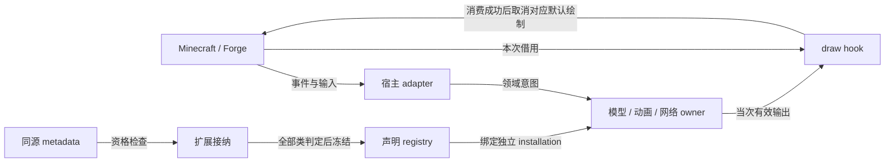

# 游戏与扩展接入

上级契约：[系统边界](../README.md#系统边界)。

## 职责与边界

接入层位于宿主游戏与 YSM 领域模块之间，负责把 Minecraft 与 Forge 的实体、事件、组件和绘制上下文转交给对应的领域负责方，并承担扩展声明的装载与发布。接入层本身不新增模型、动画或网络权威。本页记录的宿主行为前提仅适用于 Minecraft 1.20.1 与 Forge 47.4；若适配其他版本、加载器或可选模组提供方，需要重新核实依据。

## Seam Contract

按本次交接定位契约：

- 接纳扩展类并冻结声明：[扩展发布](#扩展接纳与声明发布)。
- 读取宿主输入或借用 draw 上下文：[输入与绘制](#宿主输入与绘制借用)。
- 交付连接、实体、reload 或停止事实：[换代与结束](#宿主换代重载与结束)。

### 共同规则

适用范围：本页的扩展接纳与声明发布、宿主输入与绘制借用、宿主换代重载与结束三项交接。三者共享以下职责分工、运行作用域与普通失败边界。

可选模组集成只负责提供适配输入或绘制交接，不改变领域主流程。产品支持范围与降级要求见[模组联动](../../product-decisions/decisions/mod-integration.md)和[联动风险](../../product-decisions/decisions/integration-risk.md)。当前的直接接线方式并不代表已经抽象出统一输入层，尚未统一的适配范围见[动画问题](../../status/known-issues/animation.md)。

接入层不常驻统领模型、动画或网络的全局运行实例：setup 与装载窗口负责建立绑定，`entity capability` 把宿主实体关联到领域负责方，draw hook 只借用当次绘制上下文。扩展的全局声明资格与每个实体的 installation 组件实例各自独立存续，不按 namespace 合并实例生命周期。

下图展示了宿主输入、绘制借用与扩展声明发布的交接关系；注册事件监听器并不赋予回调在任意线程访问领域状态的权限。

#### 普通失败边界

普通的模型、接入或可选模组错误由所属负责方按[普通失败隔离](../../product-decisions/decisions/failure-isolation.md#bcordinary-failure-keeps-game-running)降级处理。接入错误不能升级为宿主启动失败、正常连接中断或游戏进程崩溃，也不能任由宿主崩溃来规避收尾。[Required default](../../product-decisions/shared.md#condefault-failure-exception) 与 [fallback `VertexConsumer`](../../product-decisions/decisions/failure-isolation.md#bcrender-failure-does-not-corrupt-scene) 两项例外不扩展到其他接入错误。接入层也不另建覆盖全部回调的全局恢复状态或重试协议。

资源诊断只被动观察实际的对象构造、读取、提交与回收，不主动触发加载，也不延长对象保活时间；开关与观察范围见[诊断实现](../../verification/resource-diagnostics.md)。Forge 扫描 metadata 的生成方式以及其他模组的初始化顺序属于外部加载器行为，不由 YSM 接入层推定。

### 扩展接纳与声明发布

**边界与权威**

扩展接纳器决定类级声明资格，领域负责方决定单个 installation 的运行期使用；两者的接入职责遵循[共同规则](#共同规则)。

**前置条件与输入**

#### 扩展资格与冻结

扩展装载把“资格判定”和“实际类加载”拆成两个阶段，避免缺少依赖或未通过检查的类提前触发初始化。

来源归属校验遵循以下规则：

- 公共声明中显式填写的 `modId` 必须属于实际来源文件包含的 mod 集合；省略 `modId` 时，该来源文件必须恰好只有一个有效 mod，多 mod 文件必须显式消歧。
- 其他文件中安装了同名 mod 不能为当前文件背书。
- 注解处理器只原样保存显式声明值，不从包名、`@Mod` 注解或 ABI module id 推测归属；接纳器单独记录验证通过后的 mod id。

声明冲突校验在成员覆盖生效后、基于真实导出集合一次性判定：

- 公共 namespace 允许同一验证后 mod id 的多个类合并；若不同 mod 共享同一 namespace，接纳器拒绝所有冲突类。
- 跨类出现相同完整 symbol 时，拒绝全部涉及的类（包括 builtin），不合并为重载。
- 没有真实导出的默认 namespace 不占名额。
- 连锁冲突收集原集合中的所有端点一并拒绝，不在拒绝部分类之后重新挑选赢家。namespace 仅用于符号组织，不合并组件实例或安装生命周期。

资格入口分两条路径：auto 路径执行完整 checker，manual 路径校验绑定到同一资源的唯一前检票据。未提交、重复提交、双路同时提交或迟到提交一律拒绝；两条入口都不直接接收实现 `Class`。

**结果与保证**

扩展接纳先核对扫描结果与同源生成元数据，再依次验证来源归属、全量依赖（all-of）以及 checker 或 manual 资格。随后，接纳器基于全部合格候选一次性计算完整冲突集合，拒绝所有冲突端点后，才对剩余类执行解析、绑定和初始化。待全部类完成判定后，一次性冻结并发布不可变 registry；被拒绝的类不保留占位符、签名或 fallback。

**所有权与时序**

编译期 checker 只把关声明格式和基本依赖，真实方法、helper 查找、可见性与 linkage 仍在绑定阶段核验，因此 checker 不能替代[作者声明契约](../animation/molang-declarations.md)或实际链接检查。运行期单个负责方本地发生的构造、生命周期 hook 或 provider 失败，只结束该本地用途，不会撤销全局已经发布的声明资格。

同一次可信接纳会同时派生普通模型与 intrinsic 默认模型的不可变声明视图，不重复走接纳流程。Intrinsic 的函数来源与声明依赖过滤见[默认模型边界](../model-management/client-resources/default-model.md#边界与权威)，但声明层面的过滤不保证实现代码内部的传递依赖隔离。Builtin 来源资格依据内部 builtin 来源身份判定，不从 namespace、类名或注解推断。

Subject 资格由源冻结模块解释，并缓存在同代 `SubjectBinding` 中。声明作用域、`SUBJECT` 静态约束以及精确的 `Entity` 或 `List` 返回类型在冷准备阶段核验；成员 `ORIGIN` 保留原 receiver，子节点不借用目标组件。宿主线程、实体和安装的结束时机由各领域负责方自行管理。

**失败与拒收**

#### 失败隔离与声明寿命

可选事件 handler 的版本兼容检查先于对象构造执行：构造失败直接结束该 handler 的接入；注册失败则在原总线上撤销当前实例。如果撤销本身也失败，会保留原注册失败原因与撤销诊断信息，因为此时无法排除残留监听的可能。Checker 或 linkage 失败在类或 handler 边界隔离，绝不能吞掉已经进入 YSM 流程的绘制异常或 consumer 异常。类级资格规则见[扩展资格与冻结](#扩展资格与冻结)，具体的 Forge 窗口、事件与版本范围见[接入实现](implementation/host-adapters.md#已有事件表面)。

可选 handler 注册回滚的测试覆盖见[注册回滚验证](../../status/known-issues/integration.md#可选-handler-注册回滚)。普通失败与 consumer 异常继续按[普通失败边界](#普通失败边界)处理，不扩大类级隔离的范围。

**证据与依赖**

声明存在不代表对应宿主入口已经接通，也不构成稳定公共 API 承诺。`RegisterRenderStateModifierEvent` 等尚未接通的入口记录在[渲染问题](../../status/known-issues/rendering.md#扩展接线)，后续联动规划见[联动方向](../../future/mod-animation-integration.md)。具体宿主窗口与版本约束见[已有事件表面](implementation/host-adapters.md#已有事件表面)。

### 宿主输入与绘制借用

**边界与权威**

宿主提供事件执行入口与当次绘制上下文借用，YSM 各领域负责方按职责接纳输入并交付渲染输出；权威划分遵循[共同规则](#共同规则)。

**前置条件与输入**

#### 宿主执行与输入权限

事件总线、物理发行侧和逻辑侧都不能替代具体执行入口的线程与访问权限。下表区分宿主提供的执行前提与 YSM 必须守住的访问边界：

| 宿主前提 | YSM 接入责任与信任范围 |
|---|---|
| 正常客户端的 game、tick 与 render 共用 Render thread；集成服务器仍运行在独立的 Server thread | 只在对应负责方的执行窗口内访问其状态。不能用 `Dist.CLIENT` 推断逻辑客户端，客户端发行包中的服务端状态仍归 server owner 管理 |
| `FMLCommonSetupEvent` 与 `FMLClientSetupEvent` 属于并行派发事件 | 需要运行在游戏线程的初始化必须经 `enqueueWork` 交接；仅限客户端注册只限定类加载与发行侧，不赋予任意线程访问 `Minecraft` 或 GL 的权限 |
| 运行期事件在各自发布点同步调用；Forge 自定义网络消息默认可在 Netty 线程接收与解码，主线程消费者需显式交接 | 按实际入口选择对应负责方，不因共用 event bus 推断线程。入队只保证执行顺序，不保活原连接、实体或安装资格（网络接纳规则见[执行权限](../network/overview.md#接收准入与执行权限)） |
| 游戏暂停不中断 render；渲染帧与逻辑 tick 并非一一对应 | 动画时间推进与动作资格由[动画负责方](../animation/overview.md)决定，不以绘制次数驱动玩法逻辑，也不把暂停当作所有 live 输入已冻结 |

动画 worker 对 YSM 私有状态的独占权不覆盖宿主的 live `Entity`、`level`、`Minecraft` 对象或可选模组 provider。客户端在一帧内等待 worker 完成时，并不会暂停独立运行的集成服务器线程，因此也不对 live 对象或可选 provider 构成冻结保证；同步事件已经返回同样不能证明并发读取安全或同一时点快照一致。凡是跨线程读取，必须由输入提供方建立相应的并发保证。当前 live 输入与可选 API 的已知并发缺口见[线程与生命周期状态](../../status/known-issues/animation.md#context线程与生命周期)，不能借本页契约省略该边界的保护。

#### 共享事实读写窗口

客户端组合方通过严格的分阶段顺序保护共享事实：负责方写入 → 发布任务 → 等待全部读者交接完成 → 允许再次写入。普通实体的完整交接遵循[实体任务交接](../animation/entity-lifecycle.md#执行权与任务交接)，GUI 页面则等待本帧所有已接纳任务全部完成。单个实体提前完成 `get`，或在主线程接管原任务，都不会提前开放共享写窗口；同步调用只能消费当前串行窗口。

这一读写窗口保护四类共享事实：当前连接、模型会话状态、客户端当前 Catalog 视图以及键鼠输入。连接的建立、publication 与 activation 接纳、失败、断连与替换均在负责方窗口内写入；输入回调的写入发生在任务发布前，下一次输入轮询发生在全部任务交接后。后台资源线程可以完成独立工作并向负责方投递回调，但不能直接修改上述当前视图。

正常动画与 GUI 交接只等待任务完成，不轮询宿主队列；同步事件和绘制 hook 在仍有活跃读者时绝不提交上述共享写入。必需引导阶段（required bootstrap）的 `managedBlock` 发生在服务对外发布之前，不依赖正常帧窗口保证。如果未来引入队列轮询、新写入口或独立跨帧读者，必须先重新核验对应共享事实的读写窗口。

窗口 API 直接读取原负责方字段，不维护状态镜像：跨帧会话消费者走同步 getter，远端激活后台读取的本地索引继续通过 `volatile` 发布，而扫描候选、资源完成、取消与清理各自使用独立的交付同步。配置热重载、worker 写出的第一人称位置、调试目标、Cleaner、live 输入与可选 provider 都不在这套窗口的覆盖范围内，仍须自行保证并发安全。

**结果与保证**

第三人称替换宿主绘制与实际模型消费共用同一次准备。事件发布后的回调可能修改当前选择或关闭消费资格，因此原调用返回后必须复核资格；在候选装配期间，对同一负责方发起切模、reset、销毁或递归求值一律显式拒绝。执行入口不承诺支持嵌套绘制。

第一人称适配在本地门禁、资源与精确根姿态均成立后，才把绘制交给统一负责方。如果 hook 或求值改变了实际渲染目标，直接拒绝旧交接；只有对应部位成功完成消费后，才取消宿主默认绘制。Consumer 回放阶段抛出的异常必须原样传播，`finally` 只负责归还借用和恢复栈状态，不能把异常伪装成可重试的普通失败。

**所有权与时序**

#### 宿主适配与借用

Render hook 中的取消只影响当前这一次提交窗口，不会回滚动画状态、资源获取任务或其他 Minecraft 绘制。`PoseStack`、buffer 和渲染 view 都只在当次 draw 期间借用，不能保存到异步任务或跨帧保留。借用也不转移共享 batch 的提交决定权或宿主 GPU 对象的关闭权，YSM 只负责归还自身的 pose、状态与资源借用。顶点数据成功生成不代表宿主已经消费或 GPU 执行完毕：顶点消费边界归[渲染提交](../rendering/overview.md#顶点输出与宿主接管)，纹理采用与物理释放归[客户端资源](../model-management/client-resources/overview.md#引用撤销与物理关闭)。

**失败与拒收**

跨线程输入缺口按[宿主执行与输入权限](#宿主执行与输入权限)保留保护；普通接入失败按[普通失败边界](#普通失败边界)隔离。Consumer 回放异常的传播与 `finally` 清理按本项结果规则执行，不降级为普通失败。

**证据与依赖**

渲染消费保证依赖[渲染提交](../rendering/overview.md#顶点输出与宿主接管)与[实体执行权](../animation/entity-lifecycle.md#执行权与任务交接)。Live 输入与可选 provider 的实测限制见[线程与生命周期状态](../../status/known-issues/animation.md#context线程与生命周期)。

### 宿主换代重载与结束

**边界与权威**

接入层只负责把宿主的连接切换、实体换代、资源重载与停止事件转交给对应领域负责方；具体的接纳决策和结束状态归连接、实体、运行组合与资源负责方各自所有，作用域边界遵循[共同规则](#共同规则)。

**前置条件与输入**

#### 宿主换代与结束

处理连接事件时，必须把事件携带的精确 `Connection` 交给[连接负责方](../network/overview.md#连接撤销交接)，绝不能拿当前全局连接替代事件来源。旧连接的退出事件、排队回调或异步结果都不能操作替换后的新连接。玩家重生、切换维度以及客户端玩家对象替换还可能更换底层实体或 `level`：即使 UUID、entity id 相同或网络连接未断开，也不会延长旧实体负责方的使用资格，具体结束条件归[实体生命周期](../animation/entity-lifecycle.md#对象寿命与模型使用)。

**结果与保证**

连接撤销、实体回收、目录发布与纹理接纳分别遵循[连接负责方](../network/overview.md#连接撤销交接)、[实体生命周期](../animation/entity-lifecycle.md#对象寿命与模型使用)、[目录交接](../model-management/catalog/overview.md#seam-contract)和[纹理接纳](../model-management/client-resources/overview.md#ready-与宿主交接)的契约；宿主事件送达或 reload 返回成功并不替代这些领域结果。

**所有权与时序**

宿主的停止请求、世界卸载事件与底层资源关闭分属不同的阶段：服务端正常停服与异常退出的事件路径不同，不能假定 `ServerStoppingEvent` 会覆盖全部关闭场景；客户端收到关闭请求也不代表 Render thread、集成服务器或 GPU 资源已经停止。接入层只把结束事实交给原负责方，实际的停止接纳、收尾等待与资源归还遵循[运行关闭组合](../runtime/overview.md#结束与替换)。进程内领域结束时，自有工作的收尾不依赖后续宿主 tick、宿主回调或 Netty drain；[JVM 退出](../runtime/overview.md#jvm-进程退出)则直接放弃运行资源与未提交工作。

#### 宿主资源重载

Minecraft 的资源包重载（resource-pack reload）与 YSM 本地 Catalog 扫描是两件独立的事。宿主标准两阶段 listener 适配器会先在后台线程执行 prepare，过 barrier 后再在游戏线程执行 apply，而任意自定义 listener 不会自动获得这种两阶段调度。重载期间，宿主会先关闭并替换内部资源 manager，再回调各个 listener；外层 manager 引用仍然存在并不延长旧流或旧 pack 句柄的有效期。单个 listener 失败不会触发全局回滚，也不会保证其余已投递的重载任务停止。

因此，YSM 在重载窗口使用宿主资源时，绝不跨 reload 复用旧 manager 借出的流或 pack 句柄，异步工作与失败必须归入对应的完成边界；对游戏可见的发布和 GPU 操作须分别满足负责方与 Render thread 要求。宿主 reload 成功不能替代 YSM 候选接纳，reload 失败也不会自动撤销已经提交的领域事实。Catalog 的逐项发布与扫描状态归[目录交接](../model-management/catalog/overview.md#seam-contract)，纹理候选接纳归[Ready 与宿主交接](../model-management/client-resources/overview.md#ready-与宿主交接)。

**失败与拒收**

连接建立过程中的普通存储失败仍存在[宿主传播待验证路径](../../status/known-issues/network.md#连接建立失败的宿主传播)，不能因为本页划清了职责边界就省略该入口的失败隔离。其他接入失败按[普通失败边界](#普通失败边界)处理；资源重载中可能出现的局部提交与未停止工作按[宿主资源重载](#宿主资源重载)的边界应对。

**证据与依赖**

资源包重载中尚未完成验证的观察项、真实玩家与 capability 替换以及可选模组组合缺口见[渲染状态](../../status/known-issues/rendering.md#重复消费与第一人称)。

## 设计取舍

- **编译期 checker 与运行期资格分离**：把兼容检查和实际类加载解耦，代价是维护编译期与运行期两处边界，但可以在类加载之前拦截缺依赖、冲突与初始化失败，把故障隔离到单个类。
- **Builtin 与 API 声明共用生成路径**：两者复用同一套声明模式与 helper 生成逻辑，避免维护两套签名语义。

## 实现与验证入口

- [宿主适配](implementation/host-adapters.md#已有事件表面)：定位游戏侧接入点与实际绘制事件窗口。
- [扩展装载](implementation/extension-loading.md#扩展兼容检查与注册)：定位注解处理器、扩展 loader 与发布门禁。
