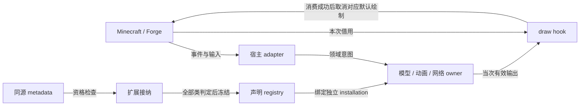

# 游戏与扩展接入

上级契约：[系统边界](../README.md#系统边界)。

## 职责与边界

接入层位于宿主游戏与 YSM 领域模块之间，负责把 Minecraft 与 Forge 的实体、事件、组件和绘制上下文转交给对应的领域负责方，并承担扩展声明的装载与发布。本页记录的宿主行为前提适用于 Minecraft 1.20.1 与 Forge 47.4；适配其他版本、加载器或可选模组提供方时需重新核实。

## Seam Contract

按本次交接定位契约：

- 接纳扩展类并冻结声明：[扩展发布](#扩展接纳与声明发布)。
- 读取宿主输入或借用 draw 上下文：[输入与绘制](#宿主输入与绘制借用)。
- 交付连接、实体、reload 或停止事实：[换代与结束](#宿主换代重载与结束)。

### 共同规则

适用范围：本页三项交接。

可选模组集成仅提供适配输入或绘制交接；产品支持范围与降级要求见[模组联动](../../product-decisions/decisions/mod-integration.md)和[联动风险](../../product-decisions/decisions/integration-risk.md)。当前直接接线方式尚未抽象出统一输入层，见[动画问题](../../status/known-issues/animation.md)。

接入层不常驻统领模型、动画或网络的全局运行实例：setup 与装载窗口建立绑定，`entity capability` 将宿主实体关联到领域负责方，draw hook 仅借用当次绘制上下文。扩展的全局声明资格与每个实体的 installation 组件实例各自独立存续，不按 namespace 合并实例生命周期。

#### 普通失败边界

普通模型、接入或可选模组错误按[普通失败隔离](../../product-decisions/decisions/failure-isolation.md#bcordinary-failure-keeps-game-running)降级，不升级为宿主启动失败、正常连接中断或游戏崩溃；[Required default](../../product-decisions/shared.md#condefault-failure-exception) 与 [fallback `VertexConsumer`](../../product-decisions/decisions/failure-isolation.md#bcrender-failure-does-not-corrupt-scene) 例外不外扩。

资源诊断只被动观察实际的对象构造、读取、提交与回收，不触发加载也不延长保活，见[诊断实现](../../verification/resource-diagnostics.md)。Forge 扫描 metadata 生成方式与其他模组初始化顺序属于外部加载器行为。

### 扩展接纳与声明发布

**前置条件与输入**

#### 扩展资格与冻结

扩展装载把“资格判定”与“实际类加载”拆成两个阶段，避免缺少依赖或未通过检查的类提前触发初始化。

来源归属校验：
- 公共声明中显式填写的 `modId` 须属于实际来源文件包含的 mod 集合；省略 `modId` 时，该来源文件须恰好只有一个有效 mod，多 mod 文件需显式消歧。
- 其他文件中安装的同名 mod 不为当前文件背书。
- 注解处理器原样保存显式声明值，不从包名、`@Mod` 注解或 ABI module id 推测归属；接纳器单独记录验证通过后的 mod id。

声明冲突校验在成员覆盖生效后、基于真实导出集合一次性判定：
- 公共 namespace 允许同一验证后 mod id 的多个类合并；不同 mod 共享同一 namespace 时拒绝所有冲突类。
- 跨类出现相同完整 symbol 时拒绝全部涉及类（包括 builtin），不合并为重载。
- 没有真实导出的默认 namespace 不占名额。
- 连锁冲突收集原集合中的所有端点一并拒绝，不在拒绝部分类后重新挑选赢家。

资格入口分两条路径：auto 路径执行完整 checker，manual 路径校验绑定到同一资源的唯一前检票据。未提交、重复提交、双路同时提交或迟到提交均拒绝；两条入口均不直接接收实现 `Class`。

**结果与保证**

扩展接纳依次核对扫描结果与同源生成元数据、来源归属、全量依赖（all-of）以及 checker 或 manual 资格；随后基于全部合格候选一次性计算冲突集合，拒绝全部冲突端点后才对剩余类执行解析、绑定与初始化，最终一次性冻结发布不可变 registry（被拒类不保留占位符或 fallback）。

**所有权与时序**

编译期 checker 只把关声明格式和基本依赖，真实方法、helper 查找、可见性与 linkage 仍在绑定阶段核验（见[作者声明契约](../animation/molang-declarations.md)）。运行期单个负责方本地的构造、hook 或 provider 失败只结束该本地用途，不撤销全局声明资格。

同一次可信接纳同时派生普通模型与 intrinsic 默认模型的不可变声明视图。Intrinsic 的函数过滤见[默认模型边界](../model-management/client-resources/default-model.md#边界与权威)（声明过滤不保证实现代码内部的传递依赖隔离）；Builtin 来源资格依据内部 builtin 来源身份判定。

Subject 资格由源冻结模块解释并缓存在同代 `SubjectBinding` 中：声明作用域、`SUBJECT` 静态约束及精确 `Entity`/`List` 返回类型在冷准备阶段核验；成员 `ORIGIN` 保留原 receiver，子节点不借用目标组件。

**失败与拒收**

#### 失败隔离与声明寿命

可选事件 handler 的版本兼容检查先于对象构造执行：构造失败直接结束该 handler 接入；注册失败则在原总线撤销当前实例（若撤销本身也失败，同时保留原注册失败原因与撤销诊断信息，因为无法排除残留监听）。Checker 或 linkage 失败在类或 handler 边界隔离，不吞掉已进入 YSM 流程的绘制异常或 consumer 异常。具体 Forge 窗口与版本范围见[接入实现](implementation/host-adapters.md#已有事件表面)，注册回滚测试覆盖见[注册回滚验证](../../status/known-issues/integration.md#可选-handler-注册回滚)。

**证据与依赖**

声明存在不代表对应宿主入口已接通，也不构成稳定公共 API 承诺。`RegisterRenderStateModifierEvent` 等尚未接通的入口记录在[渲染问题](../../status/known-issues/rendering.md#扩展接线)，后续规划见[联动方向](../../future/mod-animation-integration.md)。

### 宿主输入与绘制借用

**前置条件与输入**

#### 宿主执行与输入权限

事件总线、物理发行侧和逻辑侧都不直接等价于具体执行入口的线程与访问权限。以下为宿主行为事实与 YSM 当前的对应边界：

| 宿主事实 | YSM 接入边界与前提 |
|---|---|
| 客户端 game、tick 与 render 共用 Render thread；集成服务器运行在独立 Server thread | 按实际负责方窗口访问状态；不用 `Dist.CLIENT` 推断逻辑客户端，客户端包内的服务端状态归 server owner |
| `FMLCommonSetupEvent` 与 `FMLClientSetupEvent` 并行派发 | 需在游戏线程运行的初始化经 `enqueueWork` 交接；仅限客户端注册只限定类加载与发行侧，不提供游戏线程或 GL 权限 |
| 运行期事件在发布点同步调用；Forge 自定义网络消息默认在 Netty 线程接收解码 | 按实际入口选择负责方，主线程消费者显式交接；入队仅保证执行顺序，不保活原连接、实体或安装资格（见[执行权限](../network/overview.md#接收准入与执行权限)） |
| 游戏暂停不中断 render；渲染帧与逻辑 tick 非一一对应 | 动画推进与动作资格由[动画负责方](../animation/overview.md)决定，不以绘制次数驱动玩法逻辑，也不把暂停当作 live 输入已冻结 |

动画 worker 对 YSM 私有状态的独占权不覆盖宿主的 live `Entity`、`level`、`Minecraft` 对象或可选模组 provider。客户端在一帧内等待 worker 完成时并不会暂停独立运行的集成服务器线程，同步事件返回也不构成并发读安全或一致快照保证。当前 live 输入与可选 API 的已知并发缺口见[线程与生命周期状态](../../status/known-issues/animation.md#context线程与生命周期)。

#### 共享事实读写窗口

当前客户端组合方采用帧内分阶段窗口无锁保护四类共享事实（当前连接、模型会话状态、客户端当前 Catalog 视图、键鼠输入）：负责方写入 → 发布任务 → 等待全部普通任务（见[实体任务交接](../animation/entity-lifecycle.md#执行权与任务交接)）和 GUI 读者交接完成 → 允许再次写入。

该窗口机制目前依赖以下前提（若未来引入队列轮询、新写入口或跨帧读者，需同步重新设计这四类事实的并发保护）：
- 连接建立/发布/激活/断连/替换以及输入回调写入都在负责方窗口内完成，后台资源线程仅向负责方投递回调而不直接写当前视图。
- 单实体提前完成 `get` 或主线程接管排队任务不会提前开放共享写窗口；正常动画与 GUI 交接只等待任务完成而不轮询宿主队列；同步事件和绘制 hook 在仍有活跃读者时不提交上述共享写入。
- Required bootstrap 的 `managedBlock` 发生在服务对外发布之前，不依赖正常帧窗口。

窗口 API 直接读原负责方字段，不维护状态镜像：跨帧会话消费走同步 getter，远端激活后台读取的本地索引走 `volatile` 发布，扫描候选、资源完成、取消与清理各自使用独立同步。配置热重载、worker 写出的第一人称位置、调试目标、Cleaner、live 输入与可选 provider 不在该窗口保护范围内，仍各自维护并发安全。

**结果与保证**

第三人称替换宿主绘制与实际模型消费共用同一次准备。事件发布后的回调可能修改当前选择或关闭消费资格，返回后需复核资格；候选装配期间对同一负责方发起的切模、reset、销毁或递归求值均直接拒绝。当前执行入口不支持嵌套绘制。

第一人称适配在本地门禁、资源与精确根姿态均成立后交给统一负责方；hook 或求值改变实际渲染目标时拒绝旧交接，仅在对应部位成功消费后取消宿主默认绘制。Consumer 回放阶段抛出的异常原样传播，`finally` 只归还借用与恢复栈状态。

**所有权与时序**

#### 宿主适配与借用

Render hook 中的取消只影响当次提交窗口，不回滚动画状态或资源任务。`PoseStack`、buffer 和渲染 view 仅在当次 draw 期间借用，不能保存到异步任务或跨帧保留，也不转移共享 batch 的提交权或宿主 GPU 对象关闭权。顶点消费边界见[渲染提交](../rendering/overview.md#顶点输出与宿主接管)，纹理采用与物理释放见[客户端资源](../model-management/client-resources/overview.md#引用撤销与物理关闭)。

**证据与依赖**

依赖[渲染提交](../rendering/overview.md#顶点输出与宿主接管)与[实体执行权](../animation/entity-lifecycle.md#执行权与任务交接)；live 输入与可选 provider 实测限制见[线程与生命周期状态](../../status/known-issues/animation.md#context线程与生命周期)。

### 宿主换代重载与结束

**前置条件与输入**

#### 宿主换代与结束

连接事件需传递事件携带的精确 `Connection` 给[连接负责方](../network/overview.md#连接撤销交接)，不能以当前全局连接替代，避免旧连接退出事件或排队回调误操作替换后的新连接。玩家重生、切换维度及客户端玩家对象替换会更换底层实体或 `level`：即使 UUID、entity id 相同或连接未断，旧实体负责方的使用资格也不延续（见[实体生命周期](../animation/entity-lifecycle.md#对象寿命与模型使用)）。

**所有权与时序**

宿主停止请求、世界卸载事件与底层资源关闭分属不同阶段：服务端正常停服与异常退出路径不同，`ServerStoppingEvent` 不覆盖全部关闭场景；客户端收到关闭请求不代表 Render thread、集成服务器或 GPU 资源已停止。接入层只转交结束事实，收尾等待与资源归还见[运行关闭组合](../runtime/overview.md#结束与替换)。进程内领域结束时，自有工作收尾不依赖后续宿主 tick、回调或 Netty drain；[JVM 退出](../runtime/overview.md#jvm-进程退出)直接放弃运行资源与未提交工作。

#### 宿主资源重载

Minecraft 资源包重载（resource-pack reload）与 YSM 本地 Catalog 扫描相互独立。宿主标准两阶段 listener 适配器先在后台线程 prepare、过 barrier 后在游戏线程 apply；自定义 listener 无此两阶段调度。重载期间宿主会先关闭并替换内部资源 manager 再回调 listener，外层 manager 引用存活不延长旧流或旧 pack 句柄的有效期；单个 listener 失败不触发全局回滚，也不保证其余重载任务停止。

因此，重载窗口内不跨 reload 复用旧 manager 借出的流或 pack 句柄，游戏可见发布与 GPU 操作各自满足负责方与 Render thread 要求。目录发布见[目录交接](../model-management/catalog/overview.md#seam-contract)，纹理候选接纳见[Ready 与宿主交接](../model-management/client-resources/overview.md#ready-与宿主交接)。

**失败与拒收**

连接建立过程中的普通存储失败仍存在[宿主传播待验证路径](../../status/known-issues/network.md#连接建立失败的宿主传播)，该入口需保留失败隔离。

**证据与依赖**

资源包重载中尚未验证的观察项、真实玩家与 capability 替换及可选模组组合缺口见[渲染状态](../../status/known-issues/rendering.md#重复消费与第一人称)。

## 设计取舍

- **编译期 checker 与运行期资格分离**：把兼容检查和实际类加载解耦，代价是维护编译期与运行期两处边界，但可以在类加载之前拦截缺依赖、冲突与初始化失败，把故障隔离到单个类。
- **Builtin 与 API 声明共用生成路径**：两者复用同一套声明模式与 helper 生成逻辑，避免维护两套签名语义。

## 实现与验证入口

- [宿主适配](implementation/host-adapters.md#已有事件表面)：定位游戏侧接入点与实际绘制事件窗口。
- [扩展装载](implementation/extension-loading.md#扩展兼容检查与注册)：定位注解处理器、扩展 loader 与发布门禁。
