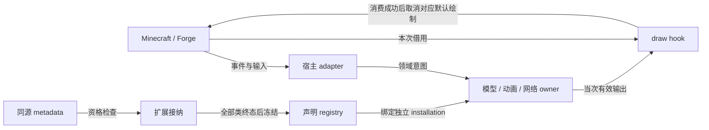

# 游戏与扩展接入

## 职责与边界

接入层把 Minecraft/Forge 的实体、事件、组件和绘制上下文交给 YSM 领域 owner。接入不增加模型、动画或网络权威。Common setup、client-only、实体并行求值与 render-thread hook 的线程和权限分别判断，不能从共同使用 event bus 推导。

本页细化[系统架构](../README.md#系统边界)的宿主输入和外部扩展边界。

## 运行作用域与所有权

接入层没有统领模型、动画或网络的运行实例。Setup 与装载窗口建立绑定；entity capability 将宿主实体关联到领域 owner；draw hook 只借用本次绘制上下文。扩展全局声明资格与每个 installation 的组件实例分别存续，不以 namespace 合并实例寿命。

## 数据流与交接

下图的边分别标注输入、借用和资格发布；handler 注册不授予任意线程访问能力。

### 宿主适配与借用

可选模组只提供适配输入或绘制交接。产品范围与降级义务见[模组联动](../../product-decisions/decisions/mod-integration.md)和[联动风险](../../product-decisions/decisions/integration-risk.md)。当前直接接线不代表已经建立统一输入层，未收敛范围见[动画问题](../../status/known-issues/animation.md)。

Render hook 的取消只作用于当前提交窗口，不回滚动画、资源取得或其他 Minecraft 绘制。`PoseStack`、buffer 和渲染 view 只在本次 draw 借用，不能异步保存。

第三人称取消宿主与实际消费共享一次准备。发布后回调可更新选择或封口，原调用返回后应复核资格；候选装配中的同 owner 切模、reset、退休和递归求值则明确拒绝。执行入口不承诺嵌套绘制。

第一人称适配在本地门禁、资源与精确根成立后交给统一 owner。Hook 或求值改变实际 target 时拒绝旧交接；只有对应部分成功消费后才取消宿主默认绘制。Consumer 回放异常继续传播，finally 只清理借用和栈，不伪装为可重试的正常失败。

适配器对可选 API linkage 的隔离不能吞掉 YSM 绘制或 consumer 异常。版本资格应先于 handler 构造，构造或注册失败撤销半注册。具体 Forge 窗口、事件和版本范围见[接入实现](implementation/host-adapters.md#已有事件表面)。

## 生命周期与失败

可选 handler 的版本资格先于构造；构造或注册失败撤销半注册。Checker/linkage 失败在类或 handler 边界隔离，不能吞掉已进入 YSM 的绘制或 consumer 异常。正常 draw 结束归还借用；hook 取消只影响对应提交窗口。

全局声明 registry 在所有候选类终态后一次冻结。随后 owner-local 构造、hook 或 provider 失败只结束本地用途，不回滚已发布资格。宿主线程、实体和安装的结束由各领域 owner 裁决。

## 关键契约与设计取舍

### 扩展资格与冻结

扩展接纳先核对扫描与同源元数据，再验证来源归属、all-of 依赖和 checker/manual 资格。接纳器对合格候选一次建立完整冲突集合，拒绝全部端点后才解析、绑定和初始化真实实现。全部类终态后一次发布 registry；拒绝类不保留 placeholder、签名或 fallback。

公共声明的显式 `modId` 应属于实际来源文件的 mod 集合；省略时，来源文件应只有一个有效 mod。多 mod 文件应显式消歧。其他文件中安装了同名 mod 不能授权当前文件。Processor 只保存显式值，不从包、`@Mod` 或 ABI module id 推测归属。接纳结果单独保存验证后的 mod id。

冲突只统计成员覆盖后的真实导出。公共 namespace 允许同一验证后 mod id 的类合并；不同 mod 共享 namespace 时，接纳器拒绝全部冲突类。跨类同完整 symbol 也拒绝全部类，包括 builtin，且不合并为重载。无真实导出的默认 namespace 不占位。连锁冲突取原集合所有端点，不在拒绝后重选赢家。namespace 不合并组件实例或安装生命周期。

Auto 使用完整 checker；manual 使用同一资源的唯一前检票据。未提交、重复、双路或迟到均拒绝，资格入口不直接提交实现 Class。资格与实际解析分开，避免缺依赖或未获准的类提前初始化。

真实 method/helper、可见性和 linkage 仍在绑定阶段核验。Checker 不替代[作者声明契约](../animation/molang-declarations.md)或实际 linkage，也不证明第三方业务、并发或视觉正确。Owner-local 构造、生命周期 hook 与 provider 失败不撤销全局已发布声明资格。同一次可信接纳派生普通与 intrinsic default 的 builtin-only 不可变声明视图，不再次接纳。来源资格使用内部 builtin 来源身份，不根据 namespace、类名或注解推断。Subject 资格在 installation 的同代 SubjectBinding 中缓存。

这个选择要求维护编译期 checker 与运行期资格边界，但把缺依赖、冲突和初始化失败隔离到类。Builtin/API 共用声明和 helper 生成路径，避免两套签名语义。具体 loader、阶段和注册流程见[扩展实现](implementation/extension-loading.md#扩展兼容检查与注册)。

## 实现与验证入口

声明存在不证明入口已接通，也不构成稳定公共 API 承诺。`RegisterRenderStateModifierEvent` 等现有缺口由[渲染问题](../../status/known-issues/rendering.md#扩展接线)记录；规划适配仍在[联动方向](../../future/mod-animation-integration.md)。

资源诊断只观察实际构造、读取、提交与回收，不触发加载或保活。开关与观察范围见[诊断实现](../../verification/resource-diagnostics.md)。Forge scan metadata 的产生和其他模组初始化顺序属于外部 loader，不由 YSM 接入层推定。

[宿主适配](implementation/host-adapters.md#已有事件表面)定位实际绘制窗口，[扩展装载](implementation/extension-loading.md#扩展兼容检查与注册)定位生成器、loader 与发布门禁。
