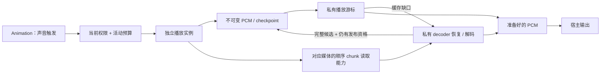

# 模型音频

上级契约：[模型管理](../overview.md#seam-contract)。

## 职责与边界

本级负责模型声音的独立播放管理、顺序 chunk 读取与共享 PCM 保留：动画触发后复核权限与活动预算，建立独立播放与专属顺序 chunk 读取能力，优先消费共享不可变 PCM/checkpoint，缺口按需建私有解码器继续解码并交付宿主输出。

## Seam Contract

- 新播放如何校验资格并按顺序读取音频 chunk：[播放接纳与顺序读取](#播放接纳与顺序读取)。
- 播放被接纳后，谁负责输出、取消与最终收尾：[后端接管与播放终态](#后端接管与播放终态)。
- 共享 PCM 何时可以发布，活动预算何时归还：[PCM 保留与工作集](#pcm-保留与工作集)。

### 共同规则

适用范围：“播放接纳与顺序读取”“后端接管与播放终态”和“PCM 保留与工作集”。

细化[模型管理的发布与使用](../overview.md#发布与使用的独立终点)；相邻职责：触发时机与声音 scope 归[动画声音边界](../../animation/overview.md#声音与宿主)，解码能力归 native，最终输出归宿主。触发它的动画状态结束后，已开始播放不自动停止。公开 API 不暴露底层缓存、会话、Minecraft 音频通道或 native handle。

必需默认模型另遵循[全部声音驻留](../client-resources/default-model.md#驻留与缓存)，Native token 规则见[JNI 与内存](../../native-runtime/implementation/jni-and-memory.md)，当前缺口见[模型管理问题](../../../status/known-issues/model-management.md)。

#### 数据流与交接

#### 运行作用域与所有权

客户端运行时创建前冻结全进程唯一音频后端。单次播放独占播放游标、按需创建的解码器、宿主 handle 与结束状态；共享缓存只存不可变 PCM 与 checkpoint，不存播放位置或活动解码器。

### 播放接纳与顺序读取

**前置条件与输入**

#### 接纳与读取

每次发起播放前复核当前内容访问权限（命中内存缓存同样检查）。普通模型资源准备阶段不预取声音尾块，也不预热 PCM。

**结果与保证**

读取能力绑定到精确模型表示与媒体项，只能顺序读 chunk，限制并发未完成读取数与持有 token 数，不跨媒体复用；接纳后读取不再依赖原准备输入或 fetcher 存活。

**所有权与时序**

远端缺失 chunk 在模型表示、chunk 与连接 fetcher 均一致时多消费者共享同一传输 flight；最后一份 interest 退出时撤销命中资格并请求取消传输。

已验证 chunk 接纳与读取能力封口串行处理：
- 封口前未接纳的结果由交付方关闭；已接纳结果允许封口后完成通知。
- 通知回调在门禁锁外执行，避免消费者借用字节期间占住封口门禁。
- 通知成功时 token 关闭权移交消费者（消费者保活至字节借用结束再关）；通知未成功由交付方关闭。
- 关闭读取能力拒绝新请求与重启并取消待完成 interest，已交付 token 所有权不变。

共享准备保留 Common 中全部声音的已验证首块：同模型不同纹理复用首块读取与前缀校验（各 target 独立持有同一 `SharedBuffer`）；共享准备身份由容器、非纹理状态、存储区域、声音描述、chunk 表与用途共同决定（GUI 与 FULL 隔离），最后一份 pin 释放时结束保留。

**失败与拒收**

替换后的新连接不加入旧 fetcher 的传输 flight；迟到旧结果只清理自身 payload。

### 后端接管与播放终态

**前置条件与输入**

#### 后端能力契约

音频后端在服务启动前注册一次即冻结，运行期不可更换。

**结果与保证**

后端接纳播放同步返回 `Accepted` 或 `Rejected`，不在同步返回前反向回调播放结束。

**所有权与时序**

外部后端接纳播放后全权接管受限 chunk 读取、解码、输出、控制与唯一结束通知。

运行时主动取消外部后端播放按固定顺序执行：**先封止新读取/重启/结果接纳 → 再通知后端取消 → 最后取消未交付 interest 并关闭读取能力**（把取消通知放在读取收尾前，避免读取收尾同步触发的失败回调卡在等待尚未发出的取消信号上）。后端在取消调用返回前阻止新音频输出，无需同步等在途请求结束，已交付 chunk 在最后借用结束后关闭。

后端接纳拒绝或抛异常时先停自身工作并关已收 chunk，调用方随后关读取能力（不自动回退默认后端）；后端取消抛异常时运行时仍完成本地清理并记录错误。

#### 播放终态

断连停止所有活动播放但保留音频缓存；运行时关闭同时停止活动播放并清空缓存保留（实体或 target 退休不替代这两个事件）。

停止、强制替换、播放失败、宿主终止或运行时关闭均先对本次播放封口（撤销后续读 chunk、补 PCM、checkpoint 恢复、宿主提交、循环与缓存发布资格），再关宿主 handle，后台 worker 结束借用后关解码器与 chunk interest（取消方不并发关仍在借用的解码器）。

外部后端仅在已接纳请求、工作、字节借用与自有资源全部收尾后触发 `terminal()`；运行时逻辑结束先行归还活动槽位不阻塞等通知，取消后迟到通知按原播放身份忽略。

**失败与拒收**

宿主同步关闭允许重入结束流程，未采用宿主 handle 立即关闭。宿主音频线程只读已准备 PCM，不解码也不等 I/O；断粮直接结束本次播放，不补静音也不重播。单次播放失败不影响其他播放或已发布共享 PCM。

### PCM 保留与工作集

**前置条件与输入**

#### PCM 保留与发布

单 chunk 音频保留完整 PCM，多 chunk 音频保留首块 PCM + 不可变 checkpoint。完整候选须正常到 EOF 且总帧数符声明；首块候选须消费完首块输入、排空解码输出并成功捕获 checkpoint（前缀 PCM 帧数与 checkpoint 已输出帧数一致）。满足精确身份、预算充足与仍有发布资格时原子发布。

默认后端输出固定为 48 kHz、signed 16-bit、little-endian、mono PCM，源音频声道数仍进入精确缓存键，不混用源媒体身份。

**结果与保证**

命中 Complete 直接读缓存不建解码器；命中 Prefix 仅在消费遇缺口时从 checkpoint 恢复私有解码器（刚好读完不主动探测尾部，单次部分输出不代表 EOF）。循环播放重建新一轮私有读取与解码状态，封口后不再开启新循环。

**所有权与时序**

#### 容量与物理结束

长期保留缓存与活动工作集分别计价：
- 活动工作集覆盖已准备 PCM、生成中候选及播放持有的 PCM/checkpoint（热命中缓存也从接纳起计入活动预算）。
- 候选发布进共享缓存直接转移底层内存，不复制整份 PCM。
- 播放结束同步归还活动预算（后台 worker 仍在借用的待借用结束释放）；槽位上限不等同进程物理内存峰值上限。
- 编码 chunk 的 `SharedBuffer` 关闭只归还读取窗口与领域引用，共享底层内存随最后强引用消失经 Cleaner 回收。
- 共享缓存与活动账本可能指向同一块底层内存，不能直接相加作为总占用；外部后端内存不由默认 PCM 账本计量。

缓存发布复核 lookup receipt 与播放门禁（向宿主提交与播放封口共用同一门禁），失效 receipt 或已存在条目不被迟到候选覆盖。

**失败与拒收**

首块前缀有效不证明尾块有效，尾块失败不撤销已有效前缀缓存。候选超保留预算时放弃入缓存但当前播放照常；内存分配、checkpoint 捕获或恢复失败直接结束本次播放，不从头解码恢复也不重试。缓存淘汰只撤缓存引用，进行中播放继续持有。

## 设计取舍

把私有解码器与共享不可变前缀拆开，让并发播放可以安全复用解码结果而无需共享游标。代价是需要维护 checkpoint 恢复逻辑、分段读取控制以及独立的活动工作集计价。

## 实现与验证入口

`ClientAudioRuntime` 登记每个具体播放并持有宿主 handle，`PlaybackAudioStream` 维护私有游标、就绪 PCM 与按需创建的私有解码器。`SoundSource` 保存对应媒体信息与首块资格，在播放时构造 `VerifiedChunkAccess`，不在共享条目中保存 fetcher 或会话回调。

`AudioRetentionCache` 保存 `Complete` 与 `Prefix` 两种缓存条目，默认保留预算为 64 MiB。`AudioRuntimeCapacity` 计量活动工作集，默认的编码（encoded）与解码（decoded）活动预算各为 32 MiB，分别限制当前活动编码 chunk 与已解码数据的占用。

Minecraft 适配器通过 `isPlaybackStopped()` 显式转调宿主的 `isStopped()`，避免自定义接口与 Minecraft 原生方法在重映射后产生名称冲突。
