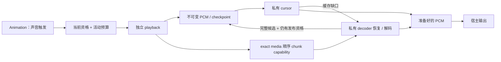

# 模型音频

上级契约：[模型管理](../overview.md#seam-contract)。

## 职责与边界

本级提供独立 playback、顺序 chunk 读取与共享 PCM 保留。

## Seam Contract

- 新播放取得什么读取资格：[播放接纳与顺序读取](#播放接纳与顺序读取)。
- 接纳后谁负责输出、取消和唯一终态：[后端接管与播放终态](#后端接管与播放终态)。
- 共享 PCM 何时可发布，预算何时归还：[PCM 保留与工作集](#pcm-保留与工作集)。

### 共同规则

适用范围：“播放接纳与顺序读取”“后端接管与播放终态”和“PCM 保留与工作集”。三项契约继承本节的职责、API 能力范围、私有与共享状态划分及依赖。

本子系统细化[模型管理的发布与使用](../overview.md#发布与使用的独立终点)，拥有已接纳 playback、顺序 chunk 读取和共享 PCM 保留。动画拥有触发与声音 scope，native 提供 decoder 能力，宿主负责音频输出。触发状态结束不自动终结已接纳播放。

API 不公开 cache、session、Minecraft channel 或 native handle，避免默认与扩展后端竞争同一次播放。触发和声音 scope 的消费者规则见[动画声音边界](../../animation/overview.md#声音与宿主)。

#### 数据流与交接

#### 运行作用域与所有权

Client runtime 创建前冻结进程唯一音频后端。每次 playback 拥有私有 cursor、按需创建的 decoder、宿主 handle 与终态。共享 entry 只保存不可变 PCM/checkpoint，不保存播放位置或活动 decoder。

触发依赖[动画声音边界](../../animation/overview.md#声音与宿主)，Intrinsic default 依赖[全部声音驻留](../client-resources/default-model.md#驻留与缓存)，Native token 依赖[JNI 与内存](../../native-runtime/implementation/jni-and-memory.md)。当前缺口见[模型管理问题](../../../status/known-issues/model-management.md)。

### 播放接纳与顺序读取

**边界与权威**

本契约继承[共同规则](#共同规则)的职责、能力范围及私有与共享状态划分。

**前置条件与输入**

#### 接纳与读取

每次播放即使命中内存保留，也重新检查当前内容访问资格。

普通准备不预取尾块、不预热 PCM。

**结果与保证**

读取 capability 绑定 exact representation/media，只顺序取得 chunk；同一能力限制未完成读取与持有 token，不授予其他媒体或新连接资格。

播放接纳时复核当前权限并取得独立读取 capability，不依赖准备输入或 fetcher 继续存活。

**所有权与时序**

同 exact representation、chunk 与 connection fetcher 的 remote miss 可共享 accepted transfer。

消费者只持自己的 result interest，最后 interest 撤命中并请求取消；transfer owner 独占 bytes、cache 提交和终态。

共享准备保留 Common 全部声音的已验证首块。同一准备寿命内，纹理消费者复用首块读取与媒体前缀验证；每个 target 独立持有同一 `SharedBuffer`，不复制首块。准备身份由已验证 container、非纹理状态和存储区域决定，包含声音描述、chunk 表及用途，GUI/FULL 保持隔离。不同媒体约束分别验证，即使共用同一首块。

最后 pin 结束共享准备保留；target 退休只释放自身引用。

**失败与拒收**

Replacement connection 不能加入旧 fetcher flight，迟到旧结果只处置自身 payload。

**证据与依赖**

Intrinsic default 另遵守[全部声音驻留](../client-resources/default-model.md#驻留与缓存)。

本契约继承[共同规则](#共同规则)的触发与验证依赖。

### 后端接管与播放终态

**边界与权威**

本契约继承[共同规则](#共同规则)的职责、API 能力范围及私有播放状态。

**前置条件与输入**

#### 后端能力契约

后端只在服务启动前注册一次并冻结。

**结果与保证**

播放接纳同步返回 Accepted/Rejected，不在返回前反向完成终态。

**所有权与时序**

外部后端接纳后完整接管受限 chunk 读取、解码、输出、控制与唯一终态；取消返回前应 seal 新输出，失败不回退默认后端。

#### 播放终态

Disconnect 停止活动播放，保留音频 cache；runtime close 同时终结活动播放与缓存保留。实体 target 退休不能代替这两个结束事件。

作者 stop/force replacement、播放失败、宿主终止和 runtime close 先 seal 本次播放。Seal 撤销 chunk/refill、checkpoint 恢复、宿主提交、loop 和缓存发布资格。Runtime 终结宿主 handle，worker 结束借用后关闭 decoder 与 chunk interest；取消方不得并发关闭仍被借用的 decoder。

**失败与拒收**

宿主同步关闭可重入终态，未采用 handle 随即关闭。宿主只读已准备 PCM，不解码、不等待 I/O；断粮结束本次播放，不补静音或重播。其他 playback 与已发布 PCM 不被追溯销毁。

**证据与依赖**

本契约继承[共同规则](#共同规则)的声音 scope、native 与验证依赖。

### PCM 保留与工作集

**边界与权威**

本契约继承[共同规则](#共同规则)的职责及私有与共享状态划分。

**前置条件与输入**

#### PCM 保留与发布

单 chunk 音频保留完整 PCM；多个 chunk 音频只保留首块 PCM 与不可变 checkpoint。完整候选应正常 EOF 并符合声明帧数；首块候选应完整消费输入、排空输出并成功捕获 checkpoint。候选满足 exact identity、预算及发布资格后，作为完整值原子发布。

默认后端向宿主交付 48 kHz、signed 16-bit、little-endian、mono PCM；源声道数仍参与 exact key。前缀 PCM 帧数应与 checkpoint 的已输出帧数一致，不能用相同输出格式替代原媒体身份。

**结果与保证**

Complete 播放不创建 decoder；Prefix 仅在消费请求出现缓存缺口时恢复私有 decoder。缓存恰好耗尽不主动探测尾部，部分输出不代表 EOF。Loop 重新建立本轮私有读取/解码状态，不改共享 cursor；seal 后不得开始下一轮。

**所有权与时序**

#### 容量与物理结束

Retention 与活动工作集分别计价。活动账本覆盖 ready PCM、候选及播放持有的 PCM/checkpoint；热命中也从接纳时计价。候选发布转移 backing，不要求复制完整 PCM。

终态同步归还相应活动预算，不依赖 Cleaner；worker 持有的资源与容量仍等借用结束才释放。活动槽可先归还，因此槽位上限不是物理峰值保证。编码 chunk 的多个消费者可保留同一 `SharedBuffer`；关闭 chunk 只归还读取窗口与领域引用。共享 backing 最后引用消失后由 Cleaner 回收，逻辑归还不承诺进程内存立刻下降。

音频与 target、传输各自终结，不能用实体 retire 或 cache 淘汰替代 playback seal。

缓存和活动账本可覆盖同一 backing，不能相加为互不重叠的内存；外部后端内存不由默认 PCM 账本完整计量。

发布复核 lookup receipt 和 playback gate，失效 receipt 或已有 entry 不被迟到候选覆盖。宿主提交与 seal 共用资格门禁。Native token 规则见[JNI 与内存](../../native-runtime/implementation/jni-and-memory.md)，当前缺口见[模型管理问题](../../../status/known-issues/model-management.md)。

**失败与拒收**

前缀不证明尾部有效，后续尾部失败不撤销独立有效前缀。候选超预算只放弃缓存，播放继续；分配、捕获或恢复实际失败则结束本次播放，不从头解码恢复或创建重试队列。淘汰只撤缓存引用，活动播放仍保留 entry。

**证据与依赖**

Native token 与验证限制继承[共同规则](#共同规则)；本契约的发布另受[播放终态](#播放终态)的 seal 资格约束。

## 设计取舍

私有 decoder 与共享不可变前缀分开，使多个播放复用解码结果而不共享游标。代价是 checkpoint 恢复、分段读取及独立活动计价。

## 实现与验证入口

`ClientAudioRuntime` 登记 exact playback 并拥有宿主 handle；`PlaybackAudioStream` 拥有 cursor、ready PCM 与私有 decoder。`SoundSource` 保存 exact media 与首块资格，播放时建立 `VerifiedChunkAccess`，不在共享 entry 保存 fetcher 或 session callback。

`AudioRetentionCache` 保存 `Complete`/`Prefix`，默认保留预算为 64 MiB。`AudioRuntimeCapacity` 计活动工作集，默认 encoded 与 decoded 活动预算各为 32 MiB，分别限制当前 encoded chunk 与 decoded 工作集。

Minecraft 适配器用 `isPlaybackStopped()` 显式转调宿主的 `isStopped()`，避免自定义接口与 Minecraft 方法共用重映射名称。
