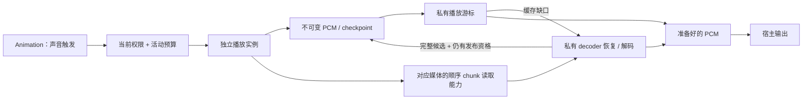

# 模型音频

上级契约：[模型管理](../overview.md#seam-contract)。

## 职责与边界

本级负责模型声音的独立播放管理、顺序 chunk 读取以及共享 PCM 保留。整体主流程是：动画触发声音后，本级先复核当前权限和活动预算，再建立一次独立播放并分配专属的顺序 chunk 读取能力；播放时优先消费共享缓存中的不可变 PCM 或 checkpoint，遇到缺口才按需创建私有解码器继续解码，最后把准备好的 PCM 送给宿主输出。

## Seam Contract

- 新播放如何校验资格并按顺序读取音频 chunk：[播放接纳与顺序读取](#播放接纳与顺序读取)。
- 播放被接纳后，谁负责输出、取消与最终收尾：[后端接管与播放终态](#后端接管与播放终态)。
- 共享 PCM 何时可以发布，活动预算何时归还：[PCM 保留与工作集](#pcm-保留与工作集)。

### 共同规则

适用范围：“播放接纳与顺序读取”“后端接管与播放终态”和“PCM 保留与工作集”。三项契约继承本节的职责、API 能力范围、私有与共享状态划分及依赖。

本子系统细化[模型管理的发布与使用](../overview.md#发布与使用的独立终点)，管理已接纳的音频播放、顺序 chunk 读取与共享 PCM 保留。相邻职责保持独立：动画负责触发时机与声音 scope（见[动画声音边界](../../animation/overview.md#声音与宿主)），native 层提供解码器能力，宿主负责最终音频输出。触发它的动画状态结束后，已经开始的播放不会随之自动停止。

公开 API 不暴露底层缓存、会话、Minecraft 音频通道或 native handle，防止默认后端与扩展后端争夺同一次播放的控制权。

#### 数据流与交接

#### 运行作用域与所有权

客户端运行时创建前会冻结全进程唯一的音频后端。单次播放独占自己的播放游标、按需创建的解码器、宿主 handle 以及结束状态；共享缓存条目只保存不可变的 PCM 数据和 checkpoint，不保存播放位置或活动解码器。

触发入口依赖[动画声音边界](../../animation/overview.md#声音与宿主)，必需默认模型（Intrinsic default）另遵循[全部声音驻留](../client-resources/default-model.md#驻留与缓存)，Native token 规则见[JNI 与内存](../../native-runtime/implementation/jni-and-memory.md)，当前已知缺口见[模型管理问题](../../../status/known-issues/model-management.md)。

### 播放接纳与顺序读取

**边界与权威**

本契约继承[共同规则](#共同规则)的职责、能力范围以及私有与共享状态划分。

**前置条件与输入**

#### 接纳与读取

每次发起播放前，即使数据已经命中内存保留缓存，也必须重新检查当前内容的访问权限。普通模型的资源准备阶段不预取声音尾块，也不预热 PCM。

**结果与保证**

每个读取能力绑定到精确对应的模型表示与媒体项，只能按顺序读取 chunk，并限制并发未完成读取数与持有中的 token 数，不能跨媒体复用，也不能借此获得新连接的访问资格。

播放被接纳时，先复核当前权限，再获得一份独立的读取能力；之后读取不再依赖原先的准备输入或 fetcher 继续存活。

**所有权与时序**

对于远端缺失的 chunk，只要模型表示、chunk 以及所用的连接 fetcher 完全一致，多个消费者可以共享同一笔已接纳的传输。消费者只持有自己的结果 interest；当最后一个 interest 退出时，系统撤销该传输的命中资格并请求取消传输。传输 owner 独占字节数据、缓存提交和传输结束状态。

已验证 chunk 的接纳与读取能力封口按同一顺序串行处理，避免竞态：

- 封口前尚未接纳的结果，由交付方负责关闭；已经接纳的结果允许在封口后完成通知。
- 通知回调在门禁锁外执行，避免消费者借用字节期间占住封口门禁。
- 通知成功时，token 的关闭责任移交给消费者；通知未成功时，仍由交付方关闭 token。消费者必须保持 token 存活直到所有字节借用结束，再关闭 token。
- 关闭读取能力会立即拒绝新请求和重启，并取消所有待完成的 interest；主动取消请求返回的 future 也会撤销对应的待完成 interest。已经交付给消费者的 token 所有权不变。

在模型准备阶段，共享准备会保留 Common 中全部声音的已验证首块：

- 在同一次共享准备的存活期内，同一模型下不同纹理的消费者复用首块读取与媒体前缀校验；每个 target 独立持有同一份 `SharedBuffer`，不复制首块数据。
- 共享准备的身份由已验证容器、非纹理状态和存储区域共同决定，覆盖声音描述、chunk 表及用途，且 GUI 与 FULL 彼此隔离。即使共用同一首块，不同媒体约束仍需分别验证。
- 最后一个 pin 释放时才结束共享准备的保留；单个 target 退休只撤销它自己的引用。

**失败与拒收**

替换后的新连接不能加入旧 fetcher 的传输 flight；迟到的旧结果只清理自身的 payload，不影响新连接。

**证据与依赖**

必需默认模型另需遵守[全部声音驻留](../client-resources/default-model.md#驻留与缓存)。本契约其余触发与验证依赖继承[共同规则](#共同规则)。

### 后端接管与播放终态

**边界与权威**

本契约继承[共同规则](#共同规则)的职责、API 能力范围与私有播放状态划分。

**前置条件与输入**

#### 后端能力契约

音频后端只能在服务启动前注册一次，随后冻结，运行期不可更换。

**结果与保证**

后端接纳播放时同步返回接受（Accepted）或拒绝（Rejected），不能在同步返回之前反向回调播放结束。

**所有权与时序**

外部后端一旦接纳播放，就全权接管受限的 chunk 读取、解码、输出、控制以及唯一的结束通知。

当运行时主动取消外部后端的播放时，必须按固定顺序执行：先封止新的读取、重启与结果接纳，再通知后端取消，最后取消尚未交付的 interest 并关闭读取能力。之所以把取消通知放在读取收尾之前，是因为读取收尾可能同步触发失败回调，如果颠倒顺序，回调可能会卡在等待尚未发出的取消信号上。

后端在取消调用返回前必须阻止新的音频输出，但不需要同步等待在途请求或后台工作结束；已交付的 chunk 仍由后端在最后一次借用结束后自行关闭。

如果后端在接纳阶段拒绝或抛出异常，必须先停止自己已启动的工作并关闭已接收的 chunk，调用方随后关闭读取能力；外部后端失败不会自动回退到默认后端。如果后端在取消时抛出异常，运行时仍会完成本地清理并记录错误，但无法保证第三方音频输出已真正停止。

#### 播放终态

断连（disconnect）会停止所有活动播放，但保留音频缓存；运行时关闭（runtime close）则同时停止活动播放并清空缓存保留。实体或 target 退休不能替代这两个结束事件。

无论是作者指令触发的停止或强制替换、播放失败、宿主终止，还是运行时关闭，都会先对本次播放执行封口（seal）。封口后会立即撤销继续读取 chunk、补充 PCM、从 checkpoint 恢复、向宿主提交、循环播放（loop）以及发布共享缓存的资格。随后运行时关闭宿主 handle，后台 worker 在结束手头借用后再关闭解码器和 chunk interest；取消方不得并发关闭仍在被 worker 借用的解码器。

对于外部后端，`terminal()` 回调只有在已接纳请求及其结果责任、后端工作、字节借用和自有资源全部收尾后才能触发。不过运行时的逻辑结束会先行归还活动槽位，不会阻塞等待该通知；取消之后迟到的结束通知按原播放身份忽略，已交付 chunk 的物理寿命仍由后端独立收尾。

**失败与拒收**

宿主同步关闭时允许重入结束流程，未被采用的宿主 handle 会立即关闭。宿主音频线程只读取已经准备好的 PCM，既不解码也不等待 I/O；一旦 PCM 断粮就直接结束本次播放，不补静音也不重播。单次播放失败不会追溯销毁其他正在进行的播放或已经发布的共享 PCM。

**证据与依赖**

本契约继承[共同规则](#共同规则)的声音 scope、native 与验证依赖。

### PCM 保留与工作集

**边界与权威**

本契约继承[共同规则](#共同规则)的职责以及私有与共享状态划分。

**前置条件与输入**

#### PCM 保留与发布

音频按 chunk 数量决定共享保留形式：单 chunk 音频保留完整 PCM；多 chunk 音频只保留首块 PCM 与一份不可变 checkpoint。成为合法缓存候选必须满足严格条件：完整候选必须正常到达 EOF 且总帧数符合声明；首块候选必须完整消费首块输入、排空解码器输出并成功捕获 checkpoint。候选只有同时满足精确身份匹配、预算充足和仍有发布资格，才会作为完整值原子发布。

默认后端向宿主输出的格式固定为 48 kHz、signed 16-bit、little-endian、mono PCM，但源音频的声道数仍然参与精确缓存键的计算，不能因为输出格式一致就混用源媒体身份。前缀 PCM 的帧数也必须与 checkpoint 记录的已输出帧数保持一致。

**结果与保证**

命中完整 PCM（Complete）的播放直接读取缓存，不创建解码器；命中首块前缀（Prefix）的播放，只在消费请求遇到缓存缺口时才从 checkpoint 恢复私有解码器。缓存恰好读完时不会主动探测尾部，单次调用返回部分输出也不代表到达 EOF。循环播放（loop）会重新建立新一轮的私有读取与解码状态，不修改共享状态；一旦播放被封口，就不得开启下一轮循环。

**所有权与时序**

#### 容量与物理结束

长期保留缓存（retention）与活动工作集分别独立计价：

- 活动工作集账本覆盖已准备好的 PCM、正在生成的候选以及播放持有的 PCM 和 checkpoint；即使热命中缓存，也会从播放接纳起计入活动预算。
- 候选发布进共享缓存时直接转移底层内存（backing），不需要复制整份 PCM。
- 播放结束时同步归还对应的活动预算，不依赖 Cleaner；但后台 worker 仍在借用的资源与容量，要等到借用结束才释放。
- 因为活动槽位可能先于物理回收归还，所以槽位上限不等于进程内存的物理峰值上限。
- 多个消费者可以同时持有同一份编码 chunk 的 `SharedBuffer`；关闭 chunk 只归还读取窗口和领域引用，共享底层内存由最后一份强引用消失后的 Cleaner 回收，逻辑归还不代表进程内存立刻回落。
- 共享缓存和活动账本可能同时指向同一块底层内存，不能简单把两者的计数相加当作互不重叠的内存占用；外部后端使用的内存也不由默认 PCM 账本完整计量。

音频播放与 target、网络传输各自独立结束，不能用实体退休或缓存淘汰来代替播放封口。

缓存发布时会复核 lookup receipt 和播放门禁，失效的 receipt 或已存在的条目不会被迟到的候选覆盖；向宿主提交输出与播放封口共用同一门禁。Native token 规则见[JNI 与内存](../../native-runtime/implementation/jni-and-memory.md)，当前已知缺口见[模型管理问题](../../../status/known-issues/model-management.md)。

**失败与拒收**

首块前缀有效并不证明后续尾块一定有效，后续尾块读取或解码失败也不会撤销已经独立有效的前缀缓存。候选超出保留预算时只是放弃写入缓存，当前播放照常继续；但如果发生内存分配、checkpoint 捕获或恢复失败，则直接结束本次播放，不尝试从头解码恢复，也不建立重试队列。缓存淘汰只撤销缓存自身的引用，正在进行的播放仍继续持有该条目。

**证据与依赖**

Native token 与验证限制继承[共同规则](#共同规则)；本契约的缓存发布另受[播放终态](#播放终态)的封口资格约束。

## 设计取舍

把私有解码器与共享不可变前缀拆开，让并发播放可以安全复用解码结果而无需共享游标。代价是需要维护 checkpoint 恢复逻辑、分段读取控制以及独立的活动工作集计价。

## 实现与验证入口

`ClientAudioRuntime` 登记每个具体播放并持有宿主 handle，`PlaybackAudioStream` 维护私有游标、就绪 PCM 与按需创建的私有解码器。`SoundSource` 保存对应媒体信息与首块资格，在播放时构造 `VerifiedChunkAccess`，不在共享条目中保存 fetcher 或会话回调。

`AudioRetentionCache` 保存 `Complete` 与 `Prefix` 两种缓存条目，默认保留预算为 64 MiB。`AudioRuntimeCapacity` 计量活动工作集，默认的编码（encoded）与解码（decoded）活动预算各为 32 MiB，分别限制当前活动编码 chunk 与已解码数据的占用。

Minecraft 适配器通过 `isPlaybackStopped()` 显式转调宿主的 `isStopped()`，避免自定义接口与 Minecraft 原生方法在重映射后产生名称冲突。
