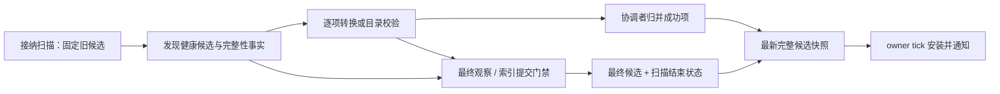

# 本地模型目录

上级契约：[模型管理](../overview.md#seam-contract)。

## 职责与边界

本级负责发现本地与内置模型来源、逐项完成转换或校验，并向进程发布唯一的当前本地目录。后台扫描先把通过校验的健康模型逐项归并进最新候选快照，再交给主线程按 tick 安装并通知订阅者，让健康模型尽快可用而不必等待整轮扫描结束。

## Seam Contract

### 边界与权威

细化[模型管理的身份与来源](../overview.md#身份与来源)，拥有本地候选发现、来源证明与唯一的当前内容目录。

### 前置条件与输入

`CatalogLocation` 由公开根和相对入口组成完整逻辑位置（见[公开目录地址](../../../standards/protocol-v1/README.md#公开目录地址)）。全局与实例 `models` 目录同时参与发现，保留原始文件后缀；逻辑位置决定区域与层级归属，文件系统解析出的真实目标只提供本轮读取事实。授权归类（Auth）由服务端配置决定，不从路径类别推导。

#### 逻辑位置与接纳

遇到符号链接或别名遵循[逻辑位置契约](../../../product-decisions/decisions/authoring-input-and-reload.md#bccatalog-links-preserve-logical-location)：每轮从原始逻辑入口重新解析，不维护跨轮持久目标表；同层兄弟别名均参与候选，目录环、断链和损坏分支不阻塞同级健康条目。

不同来源在目录校验阶段的深度不同：
- **真实 `direct` 容器**：读 preamble 校验文件结构与 CID；读 Manifest 校验该 chunk、模型身份与内嵌 preview 声明；图片 payload 延后到实际读图校验。同 CID 且同校验 profile 时可复用不可变 metadata 证明，新打开的可变 preamble 仍重检。扫描不预检未消费 chunk。
- **raw、builtin 与 legacy 内部转换容器**：允许合法缺图；独立 preview cache 不补足 `direct` 容器校验缺口。

路径与 Pack 归属：
- 位置按宿主真实名称段校验，不把名称段内反斜杠改写为分隔符；非法位置在入索引前拒绝，对外报错只给最长合法逻辑祖先，不泄露物理根路径。
- Pack 用完整目录地址，不跨根合并 manifest 或回退 cover；损坏 Pack 保留旧展示结果。
- 旧候选快照仅作复用提示，需满足表示、来源、位置与展示内容等价且不绕过本轮校验。
- 来源目录按启动时冻结布局创建缺席的实例 `models` 目录，不读取旧 `custom`/`auth` 目录也不搬迁用户原件。

### 结果与保证

#### 数据流与交接

#### 逐项发布与替换

Required intrinsic 保存在独立槽位，不进入普通内容、路径、去重或 collection 表；普通扫描照常接纳 `builtin:default`，但普通条目与目录替换不影响 required 槽。

普通来源以本轮首个通过校验并被协调者接纳的候选占用对应 `ModelId`：旧目录与损坏候选不占位，后到同 ID 候选报冲突；根类别、路径与排序不赋予优先级（Builtin 保留身份不保留相对文件名，不同身份模型可在同相对位置并存），因此本地重复身份模型的胜出位置可能随并发完成顺序变化。

后台结果逐项归并进最新完整候选槽位，主线程安装时直接跳中间版本；订阅者回调的 `previous` 始终为此前实际已安装目录，单个订阅者失败不回滚安装也不阻断其他订阅者。

扫描收尾的最终观察与索引提交按实际 CACHE 根分组执行：同组内初始目录清点不完整、最终一致性校验或索引提交失败时，该组不确认任何“缺失删除”（保留旧项与本轮成功项），其他成功 CACHE 根组不受影响；健康模型在组提交失败时仍对外发布。

#### 扫描进度投影

`ActiveScan` 通过不可变 `CatalogScanProgress` 快照发布本次扫描身份、阶段、已消费输入数与固定输入总数（产品语义见[目录发布](../../../product-decisions/decisions/catalog-publication.md#bccatalog-defines-current-content)）。阶段流转：
1. 接纳后进入 `DISCOVERING`（分母未知）；
2. 发现结束按 sources + packs 输入项总数固定分母，协调者每消费一个结果推进计数；
3. 输入为空或末项消费完进入 `FINALIZING`（含最终校验、索引提交与主线程交接）；
4. 后台 worker 退出时不立即清空进度，待 owner 接纳最终状态后再清空（显式关闭时先转 `FINALIZING`，停生产者并结束原请求后清空）。

进度仅用于展示，UI 每次绘制读取一次完整快照避免阶段与计数错位。

### 所有权与时序

#### 运行作用域与所有权

客户端当前 Catalog 视图由 client owner 单线写入：动画读走[共享事实读写窗口](../../integration/overview.md#共享事实读写窗口)，异步资源诊断只用已持有的固定条目，远端激活后台线程通过跨线程发布能力读本地索引，后台扫描候选与进度走扫描通道。

本地 Catalog 归进程所有：扫描协调者独占本轮可变构建状态，主线程只在 tick 安装不可变快照。Catalog 强持有当前目录内容，替换时只撤销自身引用，已有 `lease` 与运行资源继续保活旧内容；本轮新建未被接纳的独占结果由扫描关闭。

扫描结束附带最终候选快照交接；后台退出不阻塞等主线程，主线程接纳最终状态后完成本次扫描请求并开放下次 reload。显式关闭顺序：封止发布资格 → 锁外取消并等生产者停止 → 清理独占结果、撤销共享引用、结束未完成请求（不等待 tick，不在 monitor 锁内等线程）。Converted 缓存消费登记见[共享存储与清理](../storage/overview.md#共享存储与清理)；[JVM 退出](../../runtime/overview.md#jvm-进程退出)时不走该关闭链。

### 失败与拒收

启动与进入世界触发规则见[运行模型](../../runtime/overview.md)；目录忙时直接拒绝新重载请求，不排队。前置阶段失败保留旧完整目录。

若来源 worker 抛出 OOM，该异常通过 outcome 交协调者导致**整轮扫描失败**（不当作单个坏条目处理，以免误触发缺失删除）：已发布健康项与旧有效内容均保留，进度转 `FINALIZING` 待 owner 接纳失败后隐藏，下一轮需独立触发。

### 证据与依赖

依赖[运行模型](../../runtime/overview.md)与[共享存储与清理](../storage/overview.md#共享存储与清理)；验证边界见[模型管理验证](../../../verification/model-management.md)。

## 设计取舍

逐项归并发布让健康模型不必等待最慢来源，代价是扫描期间需构造并驻留多份完整候选快照；同时，主线程订阅者回调与服务端逐玩家通知仍有各自独立的开销。

## 实现与验证入口

`ReloadableModelCatalog` 持有唯一的当前目录；`ActiveScan` 内的协调者负责归并校验结果，并通过完整候选槽位交接给主线程 tick。`CatalogIndexSnapshot` 记录候选身份与来源证明，`CatalogSnapshot` 则只包含已验证内容。`ResolvedContent` 一旦被接纳进构建图就撤销独占关闭权，共享的 metadata 前缀靠 GC owner 保活，不对外分发关闭权。

`ModelSourceDiscovery` 与 `ModelSourceResolver` 分别负责来源发现和接纳校验。
