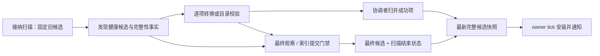

# 本地模型目录

上级契约：[模型管理](../overview.md#seam-contract)。

## 职责与边界

本级负责发现本地与内置模型来源、逐项完成转换或校验，并向进程发布唯一的当前本地目录。主流程上，后台扫描会先把通过校验的健康模型逐项归并进最新候选快照，再交给主线程按 tick 安装并通知订阅者，让健康模型尽快可用而不必等待整轮扫描全部结束。

## Seam Contract

### 边界与权威

本子系统细化[模型管理的身份与来源](../overview.md#身份与来源)，拥有本地候选发现、来源证明与唯一的当前内容目录。会话权限、远端激活、运行 target 以及持久化清理分别由相邻子系统负责。

### 前置条件与输入

`CatalogLocation` 由公开根和相对入口组成完整逻辑位置（语法见[公开目录地址](../../../standards/protocol-v1/README.md#公开目录地址)）。全局与实例的 `models` 目录会同时参与发现，入口保留原始文件后缀。逻辑位置决定区域与层级归属，文件系统解析出的真实目标只提供本轮读取事实。授权归类（Auth）由服务端配置决定，不从来源路径类别推导。

#### 逻辑位置与接纳

扫描遇到符号链接或别名时遵循[逻辑位置契约](../../../product-decisions/decisions/authoring-input-and-reload.md#bccatalog-links-preserve-logical-location)：每轮复核都从原始逻辑入口重新解析，不维护跨轮的持久目标表。同一目录层的兄弟别名都能参与候选；目录环、断链和损坏分支不会阻塞同级健康条目。

不同类型的模型来源在目录校验阶段的检查深度不同：

- **真实 `direct` 容器**：读取 preamble 时校验文件结构与 CID；读取 Manifest 时校验该 chunk、模型身份及内嵌 preview 声明；图片 payload 延后到实际读图时再校验。同 CID 且同校验 profile 时可复用不可变的 metadata 证明，但新打开的可变 preamble 仍须重新校验。扫描不预检未消费的 chunk，完整离线校验由独立入口保留。
- **raw、builtin 与 legacy 内部转换容器**：允许合法缺图。独立的 preview cache 不能补足 `direct` 容器的校验缺口，也不会改变 Schema 对 `unspecified` 的解释。

路径与 Pack 归属受以下规则约束：

- 位置按宿主真实名称段校验，不把名称段内的反斜杠改写为路径分隔符。非法位置在插入索引前就被拒绝；对外报错只给出最长合法逻辑祖先，既不泄露物理根路径，也不伪造合法位置。
- Pack 使用完整目录地址，不跨根合并 manifest 或回退 cover；遇到损坏的 Pack 时保留其旧展示结果。
- 旧候选快照只能作为复用提示。仅身份相同不足以直接复用绑定了布局的视图，实际表示、来源、位置与展示内容必须满足各自的等价条件；复用也不能绕过本轮来源与内容校验，且不建立全局 interning 或历史表。
- 来源目录的创建遵循启动时冻结的目录布局：客户端和服务端都会创建正常缺席的实例 `models` 目录。扫描既不读取旧的 `custom` 或 `auth` 目录，也不搬迁用户原件。

### 结果与保证

#### 数据流与交接

#### 逐项发布与替换

必需的内置默认模型（Required intrinsic）保存在独立槽位中，不进入普通内容、路径、去重或 collection 映射表。普通扫描会照常接纳 `builtin:default`，但同源的普通条目不能覆盖 required 槽，普通目录替换也不会撤销 required。

对于普通来源，本轮中第一个通过校验并被协调者接纳的候选占用对应的 `ModelId`：

- 旧的当前目录不会预占身份，损坏的候选也不会占位，后到的同 ID 候选会按冲突报告。
- 根类别、路径与排序不带来优先级。Builtin 保留模型身份但不保留相对文件名，不同身份的模型可以在同一相对位置并存。这意味着如果本地存在重复身份的模型，最终哪一个位置胜出可能随并发完成顺序变化。

后台 worker 的处理结果会逐项交给协调者归并，最新完整候选槽位只保留最新一份快照。由于后续快照包含此前已接纳的所有成功项，主线程 owner 在安装时可以直接跳过中间版本。触发订阅者回调时，传入的 `previous` 始终是此前实际已安装的目录；某个订阅者通知失败既不会回滚本次安装，也不会阻止通知其他订阅者。

扫描收尾时的最终观察与索引提交按实际 CACHE 根分组执行：

- 同一组内如果初始目录清点不完整、最终一致性校验失败或索引提交失败，该组就不确认任何“缺失删除”，其旧项与本轮成功项都会保留。
- 其他成功的 CACHE 根组不受影响，照常确认缺失并独立获得启动维护资格。
- 健康模型在组提交失败时仍可对外发布。扫描收尾只删除过期的来源关系，不重新插入保留中的实例，且只在各组完整成功后才确认该组的真实缺失。按根独立确认省去了跨根事务，代价是逐根分别维护完成资格。

#### 扫描进度投影

`ActiveScan` 通过同一个不可变的 `CatalogScanProgress` 快照对外发布本次扫描的身份、当前阶段、已消费输入数以及固定输入总数。Catalog 的 getter 只返回当前活跃扫描的一次快照观察，客户端适配器原样转发，不从当前目录、运行时或会话状态反推。该进度复用现有的扫描序号，不引入额外的当前映射表、持久化代次或完成权威（产品语义见[目录发布](../../../product-decisions/decisions/catalog-publication.md#bccatalog-defines-current-content)）。

扫描进度的阶段流转如下：

1. 扫描被接纳后进入 `DISCOVERING` 阶段，此时分母未知。
2. 发现阶段结束后，按 sources 与 packs 的输入项总数固定分母；此后协调者每消费一个最终处理结果就推进一次计数。
3. 输入为空或最后一项消费完成后进入 `FINALIZING` 阶段，覆盖最终校验、索引提交和主线程交接。
4. 后台 worker 退出时不会立刻清空进度，必须等 owner 接纳最终状态后才清空活跃扫描。如果显式关闭目录，进度会先转入 `FINALIZING`，等生产者停止并结束原请求后再清空；处于忙状态的接纳门禁也在关闭封口时退出。

进度快照只用于展示，不参与候选构造、健康项发布或取消判断。UI 每次绘制应只读取一次完整快照，避免阶段和计数跨轮错位。这种设计的代价是每消费一项结果都会分配一个短期快照对象，且关闭期间仍需短时保留扫描身份。

### 所有权与时序

#### 运行作用域与所有权

客户端当前的 Catalog 对外视图由 client owner 单线写入。动画读取走[共享事实读写窗口](../../integration/overview.md#共享事实读写窗口)；异步资源诊断只使用工作本身已持有的固定条目，不回头查询当前目录视图。远端激活的后台线程需要独立读取本地索引，因此本地状态保留了跨线程发布能力。后台扫描候选与进度沿上述扫描通道交接，不借用动画读写窗口。

本地 Catalog 归进程所有。扫描协调者独占本轮可变构建状态，主线程 owner 只在 tick 中安装完整不可变的候选快照。所有目录索引和 Pack 展示结果都从同一张获选表生成，不维护第二张当前目录表。

Catalog 强持有当前目录的内容对象。目录替换时，Catalog 只撤销自己对旧内容的引用，已有 `lease` 和已完成的运行资源会继续保活旧内容。本轮扫描新建但未被接纳的独占结果由扫描自身负责关闭，而共享的旧内容只能撤销引用。

扫描结束时会附带最终候选快照一起交接。后台线程退出时不阻塞等待主线程消费；主线程 owner 接纳最终状态后，才正式完成本次扫描请求并开放下一次 reload。如果主线程暂停 tick，请求可能暂时处于未完成状态，但后台扫描线程已经停止。

显式关闭 Catalog 按固定顺序执行：先封止发布资格，再在锁外取消并等待生产者停止；生产者退出后，Catalog 清理独占结果、撤销共享引用并结束未完成请求。整个关闭流程既不等待 tick，也不在持有 monitor 锁期间等待线程。Converted 缓存的消费登记归受控资源域，在全部使用者停止后统一释放（见[共享存储与清理](../storage/overview.md#共享存储与清理)）；[JVM 退出](../../runtime/overview.md#jvm-进程退出)时不执行这条关闭链。

### 失败与拒收

启动触发与进入世界刷新规则见[运行模型](../../runtime/overview.md)。消费者登记、扫描执行和最终状态接纳属于同一次已接纳工作；目录忙时直接拒绝新的重载请求，不做排队。前置阶段失败会保留旧的完整目录，后续可通过显式触发重试。

如果某个来源 worker 抛出 OOM，该异常会通过 outcome 交给扫描协调者，导致整轮扫描失败——绝不能把它当成单个坏条目处理，以免误触发缺失删除。此时已发布的健康项和旧有效内容都会保留；进度先进入 `FINALIZING`，待 owner 接纳失败结果后隐藏，下一轮仍需独立触发。

### 证据与依赖

本级依赖[运行模型](../../runtime/overview.md)提供的启动触发与主线程交接，Converted 缓存的消费登记依赖[共享存储与清理](../storage/overview.md#共享存储与清理)。验证与证据边界见[模型管理验证](../../../verification/model-management.md)。

## 设计取舍

逐项归并发布让健康的模型不必等待最慢的来源，但代价是需要构造多份完整快照并在扫描期间同时驻留多个候选。此外，主线程订阅者回调与服务端逐玩家通知仍有各自独立的开销，不能因为后台完成了归并就认为通知成本恒定。

## 实现与验证入口

`ReloadableModelCatalog` 持有唯一的当前目录；`ActiveScan` 内的协调者负责归并校验结果，并通过完整候选槽位交接给主线程 tick。`CatalogIndexSnapshot` 记录候选身份与来源证明，`CatalogSnapshot` 则只包含已验证内容。`ResolvedContent` 一旦被接纳进构建图就撤销独占关闭权，共享的 metadata 前缀靠 GC owner 保活，不对外分发关闭权。

`ModelSourceDiscovery` 与 `ModelSourceResolver` 分别负责来源发现和接纳校验。
