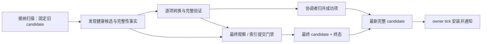

# 本地模型目录

## 职责与边界

本子系统细化[模型管理的身份与来源](../overview.md#身份与来源)，拥有本地候选发现、来源证明与唯一 current-content 目录。会话权限、远端激活、运行 target 和持久清理分别归相邻子系统。

`CatalogLocation` 使用公开根和相对入口形成完整位置，语法见[公开目录地址](../../../standards/protocol-v1/README.md#公开目录地址)。全局与实例 custom/auth 同时参与发现，入口保留文件后缀。逻辑位置拥有来源类别，解析目标只提供本轮读取事实。

## 运行作用域与所有权

进程拥有 Local Catalog。扫描协调者独占本轮可变构建状态，owner tick 只安装完整不可变 candidate。所有目录索引与 pack 投影从同一获选表生成，不增加第二张 current map。

Catalog 强持有当前内容。替换只撤引用；旧 lease 与已完成资源继续保活旧内容。新建且未接纳的独占结果由本次扫描关闭，共享旧内容只能撤引用。

## 数据流与交接

### 逐项发布与替换

启动触发与进入世界刷新见[运行模型](../../runtime/overview.md)。消费者登记、扫描和终态接纳属于同一 accepted work；忙时拒绝新请求，不排队重载。前置失败保留旧完整目录，后续显式触发可重试。

普通来源由本轮首个完整验证且被协调者接纳的候选占用 `ModelId`。旧 current 不预占资格；坏候选不占位，晚到重复项报告冲突。根类别、路径与排序不产生优先级。Builtin 保留身份，不保留相对名字；不同身份的同相对位置可并存。代价是重复身份的获选位置可随完成顺序变化。

Worker outcome 逐项消费；完整 candidate 只保留最新一份。后续 candidate 包含此前已接纳成功项，owner 可跳过中间版本。Observer 的 previous 始终为实际安装目录；通知失败不回滚安装或阻止其他 observer。

初始 inventory 不完整、最终一致性失败或索引提交失败时，整轮不确认缺失删除。健康项仍可发布，旧项与本次成功项继续保留。整轮门禁减少分区协调，代价是健康根的删除也延后。索引提交保留仍获选旧转换项的重新打开位置；完整成功扫描才确认真实缺失。

### 扫描进度投影

`ActiveScan` 以同一不可变 `CatalogScanProgress` 发布扫描 identity、阶段、已消费输入数和固定输入总数。Catalog getter 只返回当前 active 的一次观察；客户端 adapter 原样转发，不从 current、runtime 或 session 重算。投影复用现有 scan sequence，不增加 current map、持久 generation 或完成权威。产品语义见[目录发布](../../../product-decisions/decisions/catalog-publication.md#bccatalog-defines-current-content)。

接纳后为 DISCOVERING，分母未知。发现完成后以 sources 与 packs 的输入项数固定分母；协调者每消费一个最终 outcome 推进一次。空输入或最后一项完成后进入 FINALIZING，覆盖最终验证、索引和 owner 交接。Worker 退出不清投影；owner 接纳终态才清 active。关闭先令投影进入 FINALIZING，生产者停止并终结原请求后清空；`busy()` 仍在关闭封口时退出接纳状态。

此投影不参与 candidate 构造、健康项发布或取消裁决。每次绘制只读取一次完整快照，避免阶段和计数跨轮。代价为每项 outcome 发布一个短期对象，以及关闭期间对扫描 identity 的保留。

### 逻辑位置与接纳

来源链接政策见[逻辑位置契约](../../../product-decisions/decisions/authoring-input-and-reload.md#bccatalog-links-preserve-logical-location)。每轮复核从原逻辑入口重新解析，不建立持久目标表。兄弟别名均可参与候选；环、断链和坏分支不阻止健康兄弟。

真实 direct container 应声明并完整解码有效内嵌 preview。Raw、builtin 和 legacy 的内部转换容器可合法缺图；独立 preview cache 不能补足 direct 准入，也不改变 Schema 对 unspecified 的解释。

位置按宿主真实名称段验证，不把段内反斜杠改成分隔符。非法位置在索引插入前拒绝；公开错误使用最长合法逻辑祖先，不泄露物理根或伪造合法位置。Pack 使用完整目录地址，不跨根合并 manifest 或回退 cover；坏 pack 保留旧投影。

## 生命周期与失败

终态附带最终 candidate。后台退出不等待主线程消费；owner 接纳终态后才完成请求并开放下一次 reload。没有 tick 时，请求可仍未完成，但后台已经停止。

来源 worker 的 OOM 经 outcome 交给扫描协调者，整轮失败；不能把它变成坏单项后确认缺失删除。已发布健康项与旧有效内容保留。进度先进入 FINALIZING，owner 接纳失败终态后隐藏；下一轮仍需独立触发。

关闭先 seal 发布资格，再在锁外取消并等待生产者。生产者停止后，Catalog 处置独占结果、撤共享引用并终结未完成请求；关闭不等待 tick，也不持 monitor 等待线程。Converted 登记由进程在全部使用者停止后释放，见[共享存储与清理](../storage/overview.md#共享存储与清理)。

## 关键契约与设计取舍

目录可用性不等待最慢项；完整 snapshot 构造和多份候选驻留是代价。主线程 observer 与逐玩家通知仍有独立成本，不能从后台构建推导通知成本恒定。

旧 candidate 只提供复用提示。身份相同不足以复用绑定布局的视图；实际表示、来源、位置和展示投影应满足各自等价条件。复用不绕过本轮来源与内容验证，不建立全局 interning 或历史表。

## 实现与验证入口

`ReloadableModelCatalog` 持有唯一 current；`ActiveScan` 的协调者归并验证 outcome，经完整 candidate 槽位交接给 tick。`CatalogIndexSnapshot` 记录候选身份与来源证明，`CatalogSnapshot` 只含已验证内容。`ResolvedContent` 接纳进构建图后撤销独占 close 权；共享 prefix 使用独立 ownership token。

`ModelSourceDiscovery` 与 `ModelSourceResolver` 负责来源发现和接纳。来源创建遵循启动冻结布局；客户端进程不自动创建实例 auth，缺席视为空来源，已有目录仍参与扫描。验证与证据边界见[模型管理验证](../../../verification/model-management.md)。
