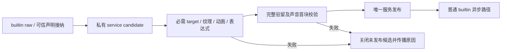

# Intrinsic default 的启动与驻留

上级契约：[客户端资源](overview.md#seam-contract)。

## 职责与边界

本级细化[客户端资源的必需默认模型契约](overview.md#seam-contract)，负责 intrinsic default 的启动期构建、唯一发布与全量内存驻留。它是整个客户端模型服务的兜底底座：必须在对外发布服务之前在私有候选内完成所有 target、纹理、FULL 动画、表达式和声音的准备与校验，发布后不再依赖磁盘或网络。

## Seam Contract

### 边界与权威

专用服务端（Dedicated server）只负责在本侧将内置默认模型加载为只读内存内容。

本进程全局只发布一个必需的 intrinsic 槽位，逻辑地址为 `default`。同一份 jar 内置源还会以完整的规范 `ModelId` 另行发布为普通的 `builtin:default`，走普通宿主与普通生命周期。仅靠来源、路径或内容哈希相同，不能让普通模型取得 intrinsic 资格；获取 intrinsic default 必须经本地 resolver 解析，并持有对应角色的 `lease`。

为了避免外部模组异常拖垮兜底模型，intrinsic default 的 Molang 函数声明会做专门过滤：只保留可信的 YSM 内置来源、且适用声明元数据未标记外部模组依赖的函数；带外部依赖的内置联动函数以及全部第三方函数（即使未声明额外依赖）一律排除。这份过滤后的声明集合来自同一次可信接纳结果，AOT 编译、制品身份、解释环境、binding 以及 transient 全部共用同一套过滤规则，实体安装阶段也不得重新暴露被排除的函数。显式选择的 default、失败回退、GUI 预览以及 main 与 arm 共享该身份，但真实的根实体类型仍参与运行期 binding。

需要注意的是，上述隔离只约束 Molang 函数声明本身，不追踪保留函数内部的传递依赖：核心函数里的辅助方法、组件查询和静态调用仍可能间接调用到外部模组，组件生命周期及其他能力的隔离也不在本契约保证范围内。间接联动的隔离留待独立任务处理，不能把声明过滤误解为完整的外部故障隔离。

### 前置条件与输入

内置默认模型源码本身允许引用外部模组能力。Intrinsic default 对被排除声明的引用会按所选执行路径的 missing 或 UNSET 语义绑定，不会仅因存在这些引用就阻止服务启动；它允许缺少外部联动效果，但基础动画与兜底可用性必须在启动期通过校验。这一规则不放宽容器结构、类型、链接或完整 target 的校验门槛。

普通模型借用 default 动画源时，仍然使用自己的普通声明视图和动画集，既不借用 default 的 AOT `ProgramRef` 或解释绑定，也不会因此获得 intrinsic default 身份。

[客户端偏好](../storage/preferences.md)按发布角色严格区分 intrinsic 与普通默认模型：本地尚无选择记录时采用普通的 `builtin:default`，显式选择的 intrinsic 则独立保存。运行期触发临时回退既不会改写持久化选择，也不会把原目标的 roaming 写入资格授给回退安装。

### 结果与保证

#### 私有构造与唯一发布

启动加载内置默认模型时，先校验真实源 `ModelId` 与内置清单。随后客户端在尚未公开的私有服务候选（service candidate）内部，完成每个可请求 target 和纹理的 FULL 动画、表达式、Common 数据及内存驻留验证；全部通过后，再对外发布唯一可达的服务。Intrinsic default 不进入模型列表 GUI，也不单独构建 GUI 动画集；显式选择 intrinsic 时的预览请求统一复用这份驻留的 FULL 资源。普通的 `builtin:default` 则按普通模型照常准备 GUI 资源。

普通本地目录扫描和[启动预热](../../runtime/overview.md#启动模型一次性预热)都在服务发布之后才启动，不能回滚必需默认模型的发布。启动预热针对的是普通角色的 FULL 资源，intrinsic 驻留与同源内容不能替代普通身份的准备；但如果本地持久选择本身就是显式 intrinsic，则预热直接沿 required 驻留路径结束。

#### 声明与首次使用

必需默认模型在启动准备阶段即完成 FULL 模式的 AOT 验证、全部动画、controller 与 Common 绑定，并将未绑定的默认源常驻内存。服务发布后，实体首次绑定它时只需要建立私有实例和组件，不会再触发读源、共享编译、加载、绑定动画或烘焙（bake）。

#### 驻留与缓存

内置原始资产（builtin raw）直接构建为内存容器。Default 的全部声音常驻内存，每个必需 target 在服务发布前都会完成 Common 声音首块的校验与保留；此后播放 default 声音完全不依赖磁盘、网络或音频 LRU 缓存。

启动期构建允许读写派生缓存，命中缓存后仍须完成加载、绑定与内存驻留。一旦构建完成，后续加载与绑定只依赖内存驻留内容；启动阶段允许写缓存并不意味着运行期重新引入读盘依赖。

### 所有权与时序

Required owner 显式持有独立槽位与角色限定的 `lease`。普通目录 reload、网络连接替换、缓存淘汰或者最后一个普通消费者退出，都不能撤销这份 `lease`。普通模型与 intrinsic 的私有 holder 不能跨角色复用，但同一角色下切换纹理时，仍可沿既有状态兼容规则共享私有 holder。

最终采用阶段直接转移唯一候选的所有权，不经过通用资源的发布回调。

### 失败与拒收

必需默认模型准备过程中的任何一步，或者 intrinsic 私有安装发生失败，都会直接向上传播原始异常原因，不会递归回退去尝试普通默认模型。构造失败时会立即关闭未发布的私有候选，既不对外暴露半成品服务，也不做超时恢复。

### 证据与依赖

本级遵循[启动硬依赖](../../../product-decisions/decisions/model-fallback.md#bcdefault-startup-is-required)与[物化后的磁盘独立](../../../product-decisions/decisions/model-fallback.md#bcdefault-has-no-disk-dependency)两项产品决策。服务关闭编排依赖[运行模型](../../runtime/overview.md#结束与替换)，当前验证范围见[模型管理验证](../../../verification/model-management.md)。

## 设计取舍

通过私有候选、显式 required `lease` 和唯一发布点，把必需默认模型的全部准备和常驻工作前置到服务可达之前，换取运行期兜底的绝对可靠。代价是启动阶段必须同步完成这些准备与常驻开销。

## 实现与验证入口

`Collector.collectBuiltins()` 保留可信内置来源，在声明冻结时按所属 schema 的外部依赖标记筛选 intrinsic 声明集合。`ExpressionHost.builtinOnly()` 基于该集合同步建立 registry、ABI 与 binding，transient 沿 module 继承同一个 host。`CatalogSnapshot.intrinsicDefault` 独立于普通目录映射表；`PublishedModelId`、`ResourceRequest` 与 `RenderTargetKey.StateKey` 均保留发布角色。`ManagedContainer.openResidentDefault` 负责建立内存驻留表示；`ClientModelRenderTargetManager` 采用私有候选并持有 required `lease`，构造失败路径负责关闭未发布候选。

函数声明过滤的验证范围与间接联动限制见[动画已知问题](../../../status/known-issues/animation.md)。必需默认模型的准备工作运行在[客户端本地玩家队列](../../runtime/overview.md#客户端资源调度)上。
