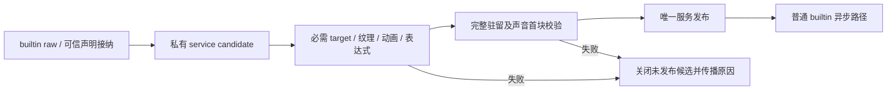

# Intrinsic default 的启动与驻留

上级契约：[客户端资源](overview.md#seam-contract)。

## 职责与边界

本级细化[客户端资源的必需默认模型契约](overview.md#seam-contract)，负责 intrinsic default 的启动期构建、唯一发布与全量内存驻留。服务对外发布前在私有候选内完成所有 target、纹理、FULL 动画、表达式与声音的准备与校验，发布后不依赖磁盘或网络。

## Seam Contract

### 边界与权威

专用服务端仅在本侧将内置默认模型加载为只读内存内容。

本进程全局只发布一个必需 intrinsic 槽位（逻辑地址 `default`）；同一份 jar 内置源另以规范 `ModelId` 发布为普通 `builtin:default`。获取 intrinsic default 经本地 resolver 解析并持有对应角色 `lease`，不凭哈希相同跨角色复用。

为避免外部模组异常拖垮兜底模型，intrinsic default 过滤 Molang 函数声明：只保留可信 YSM 内置来源且声明元数据未标记外部模组依赖的函数，排除带外部依赖的内置联动函数及全部第三方函数。AOT 编译、制品身份、解释环境、binding 与 transient 共用该过滤集合，实体安装阶段不重新暴露被排除函数；显式选择 default、失败回退、GUI 预览与 main/arm 共享该身份（真实根实体类型仍参与运行期 binding）。

**注意限制**：上述过滤只约束 Molang 函数声明本身，不追踪保留函数内部的传递依赖（核心辅助方法、组件查询与静态调用仍可能间接调用外部模组），不构成完整的外部故障隔离。

### 前置条件与输入

内置默认模型源码允许引用外部模组能力：intrinsic default 对被排除声明的引用按所选执行路径的 missing/UNSET 语义绑定，不因存在这些引用阻止启动（但不放宽容器结构、类型、链接或完整 target 校验）。普通模型借用 default 动画源仍用自己的普通声明视图与动画集。

[客户端偏好](../storage/preferences.md)按发布角色区分 intrinsic 与普通默认模型：本地无选择记录时用普通 `builtin:default`，显式选择 intrinsic 独立保存；运行期临时回退不改写持久化选择，也不把原目标 roaming 写资格授给回退安装。

### 结果与保证

#### 私有构造与唯一发布

启动加载先校验真实源 `ModelId` 与内置清单，再在私有服务候选内完成全部可请求 target/纹理的 FULL 动画、表达式、Common 数据与内存驻留验证，全部通过后对外发布唯一服务。Intrinsic default 不进模型列表 GUI 也不单独构建 GUI 动画集，显式选择时的预览统一复用驻留 FULL 资源（普通 `builtin:default` 照常准备 GUI 资源）。

普通本地目录扫描与[启动预热](../../runtime/overview.md#启动模型一次性预热)在服务发布后启动，不回滚必需默认模型发布。预热针对普通角色 FULL 资源，若本地持久选择就是显式 intrinsic 则预热沿 required 驻留路径直接结束。

#### 声明与首次使用

必需默认模型在启动期完成 FULL AOT 验证、全部动画、controller 与 Common 绑定，未绑定默认源常驻内存；服务发布后实体首次绑定只需建立私有实例与组件，不再触发读源、编译、加载或烘焙。

#### 驻留与缓存

Builtin raw 直接构建为内存容器；default 全部声音常驻内存，服务发布前完成每个必需 target 的 Common 声音首块校验与保留，运行期播放不依赖磁盘、网络或音频 LRU。启动期构建允许读写派生缓存，构建完成后运行期只依赖内存驻留内容。

### 所有权与时序

Required owner 显式持有独立槽位与角色限定 `lease`，不受普通目录 reload、连接替换、缓存淘汰或普通消费者退出影响；普通模型与 intrinsic 的私有 holder 不跨角色复用，同角色切纹理按既有兼容规则共享私有 holder。最终采用直接转移唯一候选所有权，不经通用资源发布回调。

### 失败与拒收

必需默认模型准备任一步失败或 intrinsic 私有安装失败均直接向上传播原异常，不递归回退普通默认模型；构造失败立即关闭未发布私有候选，不对外暴露半成品服务。

### 证据与依赖

落实[启动硬依赖](../../../product-decisions/decisions/model-fallback.md#bcdefault-startup-is-required)与[物化后的磁盘独立](../../../product-decisions/decisions/model-fallback.md#bcdefault-has-no-disk-dependency)；服务关闭编排见[运行模型](../../runtime/overview.md#结束与替换)，验证范围见[模型管理验证](../../../verification/model-management.md)。

## 设计取舍

通过私有候选、显式 required `lease` 和唯一发布点，把必需默认模型的全部准备和常驻工作前置到服务可达之前，换取运行期兜底可靠；代价是启动阶段需同步完成这部分准备与常驻开销。

## 实现与验证入口

`Collector.collectBuiltins()` 保留可信内置来源，在声明冻结时按所属 schema 的外部依赖标记筛选 intrinsic 声明集合。`ExpressionHost.builtinOnly()` 基于该集合同步建立 registry、ABI 与 binding，transient 沿 module 继承同一个 host。`CatalogSnapshot.intrinsicDefault` 独立于普通目录映射表；`PublishedModelId`、`ResourceRequest` 与 `RenderTargetKey.StateKey` 均保留发布角色。`ManagedContainer.openResidentDefault` 负责建立内存驻留表示；`ClientModelRenderTargetManager` 采用私有候选并持有 required `lease`，构造失败路径负责关闭未发布候选。

函数声明过滤的验证范围与间接联动限制见[动画已知问题](../../../status/known-issues/animation.md)。必需默认模型的准备工作运行在[客户端本地玩家队列](../../runtime/overview.md#客户端资源调度)上。
